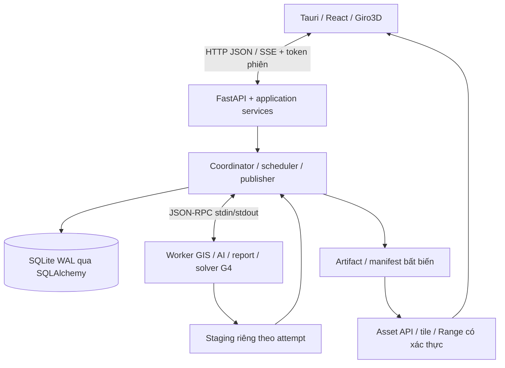

# Kiến trúc triển khai

Cơ sở: [kiến trúc hệ thống 1.1 theo đề xuất v1.4](../kien_truc_he_thong.md), [module và repository](../plans/04_kien_truc_thuc_thi_va_module.md). Đây là cấu trúc đích; contracts metadata SPEC-001 và API/UI foundation SPEC-003 đã triển khai/kiểm; chưa có runtime GIS/AI/solver hay desktop native đã nghiệm thu. Phân bố file và thứ tự ở [hướng dẫn dev](guides/development-guide.md); hiện trạng có bằng chứng ở [roadmap](roadmap.md).

Phạm vi đã xác nhận tại [G0-D01–D07](evidence/g0/decision-record.md): HLS 30 m + lớp phủ/NDVI/EVI/NDMI/MNDWI/thống kê/PDF trước; các nghiệp vụ rừng/mất rừng, đất ngập nước/ngập lụt và profile 10/5/1 m sau. AOI được vẽ/lấy footprint ảnh import/import Shapefile theo [AOI policy](domain/aoi-policy.md); bản đồ đầu có [bảy lớp](domain/landcover-taxonomy.md), gồm wetland/mangrove, `-1` ignore và profile nghiệp vụ T=3 cần kiểm riêng. Nguồn mở/miễn phí trước, ảnh thương mại khi có quyền/ngân sách. Mỗi sensor/product/GSD cần profile dữ liệu/model kiểm riêng, không gán mọi nguồn vào checkpoint HLS. Mục tiêu 20 GB RAM/8 GB VRAM chưa là support matrix; AOI kiểm định cụ thể và nhiều đầu vào G0 còn thiếu.

## Bộ sơ đồ chi tiết

[Bộ sơ đồ Windows desktop](platforms/windows/desktop-architecture-diagrams.md) ngày 09/11/2026 trình bày ngữ cảnh, module/tiến trình, execution owner, pipeline Prithvi, sequence publish, state machine, truy nguyên và vòng đời model. Đây là bản vẽ lại thiết kế đích, không thay quyết định ADR hoặc xác nhận runtime đã nghiệm thu.

Bổ sung ngày 10/11/2026: mục tiêu Ubuntu 22.04 LTS và Ubuntu 24.04 LTS đã được yêu cầu. [ADR-012](adr/ADR-012-ubuntu-desktop.md) và [kiến trúc Ubuntu](platforms/ubuntu/ubuntu-desktop-architecture.md) đề xuất WebKitGTK, supervisor trong user service/cgroup, owner theo UID và adapter FD/native I/O; [guide](platforms/ubuntu/ubuntu-development-and-packaging.md) cùng [ma trận UB-01–20](platforms/ubuntu/ubuntu-validation-matrix.md) xác định cách kiểm. Các primitive Windows bên dưới tiếp tục thuộc profile Windows; chưa có runtime Linux hoặc bằng chứng tương thích hai LTS. Phần nghiệp vụ/contracts/coordinator/fencing giữ semantics chung.

[SPEC-010](specs/010-ubuntu-foundation.md) cụ thể hóa profile native/interface và fixture cho nhánh Linux: composition root chọn adapter, namespace thống nhất qua session, Unix socket shell và pipe/FD cha–con, ledger epoch bền vững, worker kết thúc trước finalize/copy private. Không đưa dependencies OS vào contracts hoặc module policy; các thay đổi code/schema được mô tả là deliverable tương lai, chưa triển khai.

## Tiến trình

Shell cấp cổng/token qua Tauri IPC; profile Windows quản lý nhóm tiến trình bằng Job Object, profile Ubuntu đề xuất supervisor/user service theo ADR-012. Worker chỉ gửi event/checkpoint/candidate; coordinator và dịch vụ ứng dụng kiểm soát đường ghi DB. Training/hiệu chuẩn ở môi trường riêng; pack đã duyệt mới đưa vào runtime.

## Hướng phụ thuộc được phép

Mọi module được dùng `contracts`. Bảng liệt kê các import khác; thư viện ngoài nằm trong adapter tương ứng.

| Module | Import nội bộ khác |
| --- | --- |
| `contracts`, `storage`, `products` | Không có module nghiệp vụ khác |
| `catalog`, `geoprocessing`, `models` | `products`, `storage` |
| `compute` | `models` |
| `analytics` | `geoprocessing`, `models`, `compute` |
| `review` | `storage` |
| `reports`, `viewer` | `geoprocessing`, `storage` |
| `jobs` | `compute`, `storage`; không import workflows, nhận handler được đăng ký |
| `workflows` | `jobs`, `catalog`, `analytics`, `geoprocessing`, `review`, `reports`, `storage` |
| `domains` | `workflows`, `analytics`, `reports` |
| `api` | `workflows`, `jobs`, `catalog`, `review`, `viewer`, `storage` |

`bootstrap` ghép adapter/registry, không được import ngược từ module. `products` có thể nằm trong `catalog.products`; chỉ mở đúng subpackage. Entry point `workers` là composition/dispatch, không cho module nền import ngược. Khi package thật được tạo, thêm import-linter hoặc kiểm tra tương đương theo đúng bảng; chưa tạo mọi folder rỗng.

## Luồng dữ liệu

1. Catalog/import chuẩn hóa AssetRef; backend quản lý CRS/TransformSpec và GridSpec.
2. Cố định InputSnapshot, ModelSpec hoặc PhysicalModelSpec cùng parameter/forcing; dựng JobSpec, cấp attempt/token và lease.
3. Worker resolve ID theo quyền coordinator cấp, đọc theo cửa sổ và ghi staging. JSON chỉ mang tham chiếu/điều khiển.
4. Coordinator kiểm output, coverage/hash, attempt còn hiệu lực và trạng thái cancel; chuyển output hoàn chỉnh cùng volume tới vị trí bất biến.
5. Transaction DB kiểm lại token/trạng thái và ràng buộc publish duy nhất. API chỉ phục vụ artifact có bản ghi công bố hợp lệ. Reconcile file mồ côi/metadata thiếu file sau crash.
6. Revision giữ dự đoán gốc, edit artifact và representation; metrics/PDF dùng đúng revision/snapshot.

Filesystem và DB không có transaction chung. Idempotency chống lặp request khác fencing attempt cũ; không cam kết exactly-once. Model vật lý có trạng thái liên kết chỉ resume checkpoint native đã kiểm chứng, không chia thành tile độc lập tùy ý.

## Repository, UI và bảo mật

SQLite WAL local, một writer/project; SQLAlchemy session không đi qua IPC. Alembic migration chạy sau khóa writer + backup, trước nhận job; upgrade/restore phải kiểm trên dữ liệu cũ. PostgreSQL chỉ thêm khi triển khai server G4.

UI giữ project state ngoài engine; request không chạy GDAL/model nặng. COG phân tích/hiển thị dùng chung khi tương thích; backend tạo display asset/tile khi cần. Range/loader/web worker đều xác thực bằng header, không token URL. Host/Origin/token có policy rõ theo Tauri/WebView2; loopback không là sandbox chống mã độc cùng tài khoản.

Core CPU chính thức; NVIDIA pack tùy chọn. Bộ cài/codec/WASM/font/PROJ grid phải chạy trên máy sạch/offline. Tham khảo [ADR](adr/README.md), [IPC](ipc-protocol.md), [domain rules](domain-rules.md) trước thay đổi ranh giới.

## Trách nhiệm lưu trữ và phục hồi

| Nhóm dữ liệu | Chủ sở hữu ghi | Quy tắc |
| --- | --- | --- |
| Metadata project/job/attempt, review, publication | Coordinator/application services qua repository | Một writer local/project; transaction kiểm tham chiếu, state và token |
| Input đã quản lý, snapshot, model/parameter spec | Importer và dịch vụ lập snapshot qua storage | Khóa danh tính/version/hash trước chạy; không sửa nội dung snapshot đã dùng |
| Intermediate/checkpoint/candidate | Worker trong staging được cấp cho attempt | Chưa phục vụ như kết quả; không nhận đường ghi ngoài workspace được phép |
| Run/artifact/metrics/report đã công bố | Publisher; service review/report tạo bản ghi mới | Bất biến; API chỉ resolve publication hợp lệ, không duyệt file trực tiếp từ staging |
| Availability/pin/lease/cache index | Coordinator/storage | Thay đổi riêng với nội dung snapshot; reconcile trước GC sau crash |

Khóa writer cũng áp dụng khi hai cửa sổ app cùng mở một project; instance thứ hai phải dùng chế độ đọc hoặc báo project đang được dùng, không tự tạo writer thứ hai. Project ghi ở ổ local; dữ liệu mạng được nhập/tham chiếu theo policy, không đặt SQLite WAL đang hoạt động trên share rồi coi như được hỗ trợ.

Backup dùng cơ chế SQLite nhất quán cùng inventory/hash của artifact cần giữ. Restore kiểm schema, reference, bytes và trạng thái tái lập; không mở lại job cũ như đang chạy. SPEC-004 đã có source repository/bảng/index/migration/backup/restore, nhưng tests DB còn skip do thiếu SQLAlchemy/Alembic; [báo cáo](evidence/backend-pre-g0-2026-11-08/task-6-report.md) không phải bằng chứng DB runtime đạt.

## Phạm vi scheduler và đường đọc dữ liệu worker

[ADR-011](adr/ADR-011-local-execution-owner.md) đề xuất một execution owner cho mỗi tài khoản Windows trên máy, xuyên session của cùng tài khoản: một project được ghi/thực thi và một job nặng tại một thời điểm. Instance khác xem read-only hoặc báo bận, không tự tạo worker/model resident. Khóa này khác writer lock/project, attempt fencing và dependency pin/lease; chỉ cấp lại sau khi process cũ được xác nhận dừng. Chưa hỗ trợ điều phối nhiều tài khoản hoặc ứng dụng ngoài GeoAI; primitive/ACL/recovery phải được SPEC-003/004 kiểm G1.

[Worker resolver](worker-resolver.md) mô tả bootstrap handle tin cậy, registry context riêng worker và allowlist đọc theo project/attempt. Start truyền context ID/hash; worker không đọc SQLite hoặc nhận credential/provider URL. GrantRegistry và native I/O đã được kiểm bằng fixture Windows; bootstrap/worker và publisher đang tích hợp theo [tiến độ](evidence/backend-pre-g0-2026-11-08/progress.md). Catalog materialize remote input trước start; external local file đã đăng ký có thể đọc read-only, output chỉ trong staging được cấp. [SPEC-009](specs/009-importer-worker-resolver.md) và [security acceptance](importer-resolver-security.md) vẫn cần đầy đủ bằng chứng acceptance.

Training tiếp tục ở môi trường ngoài desktop. [SPEC-008](specs/008-training-evaluation-model-pack.md) sản xuất dataset/split/recipe/checkpoint/evaluation/model pack; SPEC-006 tiêu thụ pack đạt điều kiện rồi kiểm tích hợp business. Không coi training spec hoặc readiness field là bằng chứng G2.
