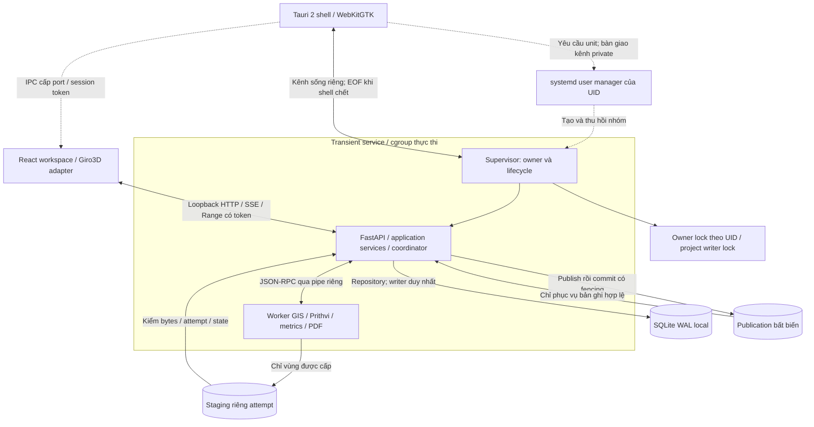
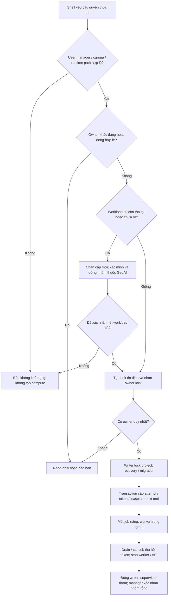

# Kiến trúc Ubuntu desktop GeoAI

**Ngày:** 10/11/2026. **Phạm vi:** Ubuntu 22.04 LTS và Ubuntu 24.04 LTS, desktop xử lý cục bộ. **Trạng thái:** thiết kế đề xuất theo [ADR-012](../../adr/ADR-012-ubuntu-desktop.md); chưa có runtime/bộ cài Linux đã kiểm chứng.

Đọc cùng [architecture](../../architecture.md), [sơ đồ Windows](../windows/desktop-architecture-diagrams.md), [IPC](../../ipc-protocol.md), [worker resolver](../../worker-resolver.md). Các sơ đồ dưới là thiết kế đích. Không đổi G0–G4, cấu trúc record `0.1.0` hay các quyết định nghiệp vụ đã xác nhận.

Đầu vào gen code foundation được cụ thể hóa trong [SPEC-010](../../specs/010-ubuntu-foundation.md), [native profile](ubuntu-native-profile.md) và [interface adapter](ubuntu-adapter-interfaces.md). Các profile này quyết định chi tiết namespace/FD/epoch/publish cho foundation; runtime vẫn chưa triển khai.

## 1. Phạm vi dùng chung và adapter

| Thành phần | Windows hiện được thiết kế | Ubuntu đề xuất | Điều phải kiểm riêng |
| --- | --- | --- | --- |
| Webview | WebView2 | WebKitGTK 4.1 qua Tauri 2 | Origin/header/CSP, Range/SSE, đồ họa và offline |
| Nhóm tiến trình | Windows Job Object | Supervisor trong user service/cgroup | Cây process được quản lý từ lúc tạo, crash/kill/cleanup |
| Execution owner | Namespace/ACL theo tài khoản Windows | Namespace theo UID, user manager và `flock` | Xuyên login session và bản cài; không cấp lại khi còn workload |
| Quyền file | Handle, volume/file ID, reparse policy | Directory FD, `openat2`, `fstat`, symlink/hardlink policy | Đổi ancestor/file, FD kế thừa, bytes ổn định |
| Lưu trữ | SQLite WAL + filesystem local | Giữ mô hình; kiểm filesystem Linux | Lock, rename/fsync, crash, backup/restore |
| Phân phối | NSIS/WebView2/runtime pack | `.deb` + WebKitGTK hệ thống + runtime pack riêng | ABI, package dependency, font/data/WASM và máy sạch |

API/application services, coordinator, nghiệp vụ, IPC và repository giữ semantics chung. Tách adapter bằng composition root `bootstrap`; không rải điều kiện OS vào thuật toán GIS/AI. Tên adapter hoặc thư mục tương lai trong tài liệu không chứng minh package đã tồn tại.



Một job nặng tại một thời điểm theo owner: sơ đồ liệt kê loại worker, không cho phép tất cả chạy đồng thời. Training nằm ngoài runtime theo SPEC-008. Ubuntu vẫn phải dùng Prithvi-EO-2.0 + decoder nghiệp vụ; HLS/band/QA, bảy lớp `0–6`, ignore `-1` và ba frame thật T=3 tuân [Prithvi profile](../../prithvi-profile.md), không tự đổi model khi chuyển OS.

## 2. Owner, khởi động và thu hồi

Đề xuất một unit có tên ổn định trong user manager của UID, không có suffix project/phiên bản. Supervisor là main process, giữ owner FD và tạo API/worker bên trong cgroup; không spawn compute bên ngoài rồi chuyển nhóm sau. Khóa nằm trong runtime directory local do OS/user manager xác nhận, thư mục app quyền `0700`, file `0600`; không dùng `/tmp` chung hoặc tin path từ project. Các login session cùng UID phải resolve cùng manager/namespace, kể cả khi môi trường `XDG_*` khác nhau. Nếu không chứng minh được cùng namespace thì không cấp execution.

`flock` là khóa theo open file description. Giữ FD đến hết lifecycle, không unlink/recreate inode khóa đang dùng, không để worker vô tình kế thừa owner FD. Metadata PID/boot ID/start time/epoch chỉ phục vụ đối chiếu; nội dung file hoặc PID đơn lẻ không cấp quyền. Profile v1 dùng unit `geoai-execution.service` và runtime root `/run/user/<uid>/geoai-execution-v1`, thống nhất qua session/bản cài; ledger epoch bền vững và project writer theo native profile, không theo XDG override từng session.



Khi hai shell tranh startup, user manager và khóa phải bảo đảm chỉ một unit/owner thắng. Owner khác đang hoạt động hợp lệ thì báo bận/read-only, không stop unit của owner đó để giành quyền. Chỉ recovery nhóm cũ khi đã xác minh owner mất hiệu lực; trạng thái chưa rõ thì chặn, không tự kill. Instance còn lại không attach như writer, không import/migration/GC/tile/report ngầm. Read-only không mở project qua chế độ SQLite có thể tạo/ghi WAL hoặc SHM; cần đường đọc đã kiểm và chỉ xem publication hợp lệ. Nếu chưa có đường đó thì báo bận.

Supervisor theo dõi kênh sống riêng của shell. Kênh này phải có FD allowlist/close-on-exec đúng; worker không giữ bản sao làm trì hoãn EOF. Đóng app bình thường yêu cầu drain/cancel trước stop. Shell bị kill dẫn tới EOF; supervisor dọn rồi thoát. API là child do supervisor theo dõi: API chết thì supervisor ngừng cấp việc, dừng worker và kết thúc unit; supervisor chết thì manager thu hồi nhóm. Thu hồi token/reconcile được thực hiện trước cấp mới. `KillMode=control-group` hỗ trợ dọn nhóm; không tự tạo checkpoint và không thay kiểm nhóm thực sự đã hết tiến trình. Unit dùng main-process lifecycle; không mặc định dùng tùy chọn systemd mới hơn baseline chỉ vì tài liệu upstream hiện tại có. Unit start thành công chưa là API ready; vẫn phải nhận handshake và health/capabilities thực.

Nếu process kẹt I/O không dừng, manager không truy vấn được, hoặc nhóm cũ chưa xác định thì giữ trạng thái recovery/bận. Không force-kill PID bất kỳ từ file metadata, không lấy timeout/heartbeat làm bằng chứng process đã chết. `pidfd` khi khả dụng và PID + start time/boot ID là công cụ đối chiếu danh tính cần kiểm ở adapter. Không khởi động daemon nền, bật lingering hoặc xin root như fallback.

## 3. Bootstrap, context và native I/O

Launcher thiết lập pipe/FD tin cậy cho bootstrap và JSON-RPC, chỉ truyền FD đã liệt kê. Theo profile v1, shell–supervisor dùng Unix stream socket private với kiểm peer/creator process/invocation và challenge một lần; SessionDescriptor đi trên socket, FD bootstrap chỉ kế thừa từ cha thực sự của API/worker. Socket shell không nhận FD ancillary hoặc token/bootstrap qua argv/URL/environment. D-Bus ứng dụng chỉ tạo/quan sát; cưỡng bức dừng dùng supervisor pidfd đã pin, không StopUnit theo tên vì có race thay invocation. Chưa có implementation trong source hiện tại.

| Thao tác | Quy tắc Linux đề xuất |
| --- | --- |
| Managed input/context/model | Giữ root directory FD tin cậy; mở tên tương đối bằng `openat2` với `RESOLVE_BENEATH`, `RESOLVE_NO_SYMLINKS` và policy không qua mount ngoài vùng được cấp; chỉ chấp nhận regular file đã đăng ký |
| External registered input | Mở đúng file người dùng cấp, kiểm registration/identity/hash và closure sidecar; thay đổi nguồn thì từ chối phiên bản cũ hoặc tạo managed copy đã kiểm trước grant. Không cấp cả thư mục cha |
| Identity | Adapter đối chiếu `st_dev`/`st_ino` trên FD và hash; encoding `linux-dev:<decimal>`/`linux-ino:<decimal>` trong hai chuỗi FileIdentity hiện có theo interface profile. Cần fixture round-trip/identity reuse; không thêm field schema |
| Staging | Directory riêng project/attempt, tạo file mới với `O_EXCL`, không follow link; từ chối symlink, hardlink bất hợp lệ, FIFO/socket/device và path escape; worker khác không được cấp descriptor |
| Driver native | GDAL/model chỉ thấy dependency được cấp; driver không thể dùng FD an toàn thì materialize vùng riêng với inventory đủ trước mở. Không bật VRT/code động hoặc mạng ngầm để vượt resolver |
| Capability thiếu | `openat2`/flag/FS bị chặn hoặc không bảo đảm containment thì từ chối thao tác; không fallback chỉ bằng `realpath` + so prefix |

Giữ external input hợp lệ theo IMP-07/08; managed copy là lựa chọn để cố định bytes, không là quyền thay nguồn hoặc đổi snapshot. Runtime phải chống thay bytes sau grant và sau candidate, bao gồm writer FD còn mở; `chmod`/đổi tên không thu hồi FD ghi đã tồn tại. Hash đúng không chứng minh ownership. Resolver/cgroup không là sandbox chống mọi code cùng UID.

Các quy tắc tên archive để trao đổi Windows/Linux giữ policy portable: không tự nới tên ADS/reserved/case/Unicode chỉ vì ext4 cho phép. Input gốc không bị rename; inventory lưu ánh xạ khi policy cho phép chuẩn hóa. Với filesystem network/FUSE/overlay hoặc mount không được kiểm, không đặt project writer/staging/publication hoạt động rồi suy an toàn như ext4.

## 4. Publish, durability và phục hồi

```mermaid
sequenceDiagram
    participant W as Worker
    participant C as Coordinator / publisher
    participant F as Local filesystem
    participant D as SQLite repository
    W->>F: Ghi candidate trong staging; flush và đóng
    W->>C: Candidate ID và event hoàn tất
    C->>D: Kiểm active attempt / token / cancel
    C->>F: Mở bằng FD; kiểm scope, identity, bytes và profile
    C->>F: Hoàn thiện bản publish do publisher sở hữu; fsync
    C->>F: Rename cùng filesystem, không overwrite; fsync directory liên quan
    C->>D: Transaction recheck token / state; commit publication duy nhất
    D-->>C: Commit hoặc từ chối
    C-->>W: Kết thúc context; giữ pin theo policy
    Note over C,D: Crash hoặc commit từ chối: reconcile file mồ côi trước GC
```

Publisher phải chứng minh không còn writer có thể thay bản công bố. Foundation v1 đợi workload dừng rồi copy có kiểm bytes vào file do publisher tạo, fsync, `renameat2(RENAME_NOREPLACE)` và fsync directory, sau đó transaction fencing. Copy là bước cố định bytes trong cùng filesystem, không là fallback cho `EXDEV`; thiếu primitive thì fail rõ. `fsync` file không tự bảo đảm entry directory bền vững; kiểm cả directory nguồn/đích bị đổi và các điểm crash theo ma trận.

Filesystem và DB không có transaction chung. Crash sau rename trước commit để lại bytes chưa công bố; API không được phục vụ. Crash sau commit trước event phải truy vấn lại publication, không publish lần hai. Cancel/retry cạnh tranh vẫn do transaction fencing xử lý, không dựa vào owner lock hoặc idempotency. Power-loss durability phải ghi cấu hình FS/mount và loại thử, không suy từ process kill.

## 5. Dữ liệu người dùng và triển khai

| Nhóm | Vị trí đề xuất | Quy tắc |
| --- | --- | --- |
| Cấu hình | `$XDG_CONFIG_HOME/geoai`, mặc định `~/.config/geoai` | Không dùng làm namespace owner khác theo project |
| Pack/data ứng dụng | `$XDG_DATA_HOME/geoai`, mặc định `~/.local/share/geoai` | Inventory/version/hash, pin và license |
| State/log | `$XDG_STATE_HOME/geoai`, mặc định `~/.local/state/geoai` | Log lọc secret/path; metadata owner chỉ để chẩn đoán |
| Cache có thể tạo lại | `$XDG_CACHE_HOME/geoai`, mặc định `~/.cache/geoai` | Không chứa bản duy nhất của input đã pin/checkpoint cần giữ |
| Pipe/socket/context tạm | Runtime directory của UID được OS xác nhận, nhánh `geoai` | Local, private; không backup/export context/token |
| Project | Thư mục local người dùng chọn đã kiểm | DB, staged publish và artifact theo storage policy; không ghi vào thư mục cài |

XDG variable phải là absolute path, quyền sở hữu/quyền truy cập phù hợp; path hợp lệ theo XDG chưa chứng minh FS phù hợp WAL. Windows/Linux không dùng chung project đang mở. Bundle chuyển máy phải resolve ID/root registration mới; không tái sử dụng context, PID, owner epoch hoặc đường dẫn tuyệt đối của máy nguồn.

Ngoại lệ namespace execution v1: runtime root và durable ledger dùng vị trí canonical theo UID/home OS như native profile, để XDG override ở hai session không tách thành hai owner/counter. Không dùng cache làm nơi duy nhất lưu epoch.

Thứ tự công việc và acceptance ở [ma trận Ubuntu](ubuntu-validation-matrix.md); build/máy sạch/offline ở [hướng dẫn đóng gói](ubuntu-development-and-packaging.md). Tất cả test runtime Ubuntu hiện **chưa chạy**.
