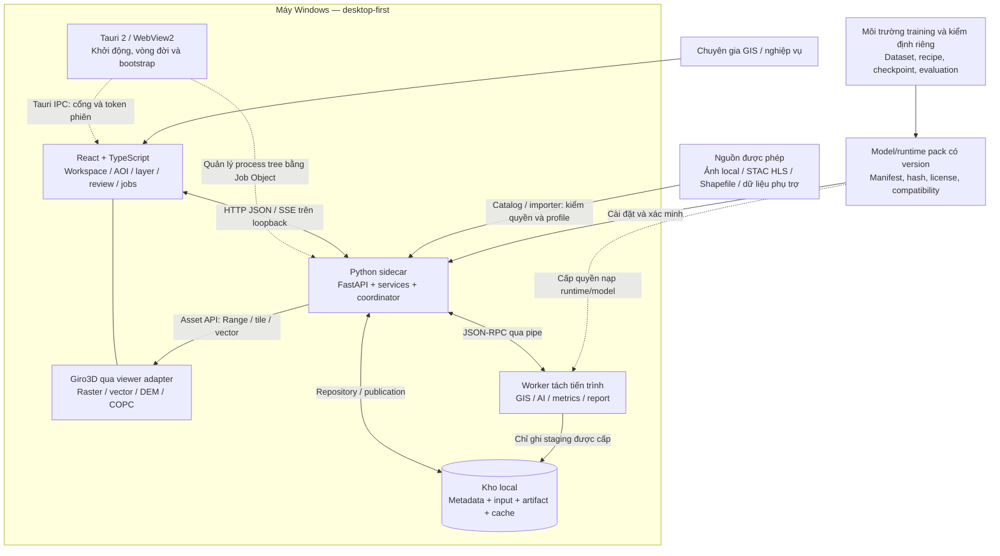
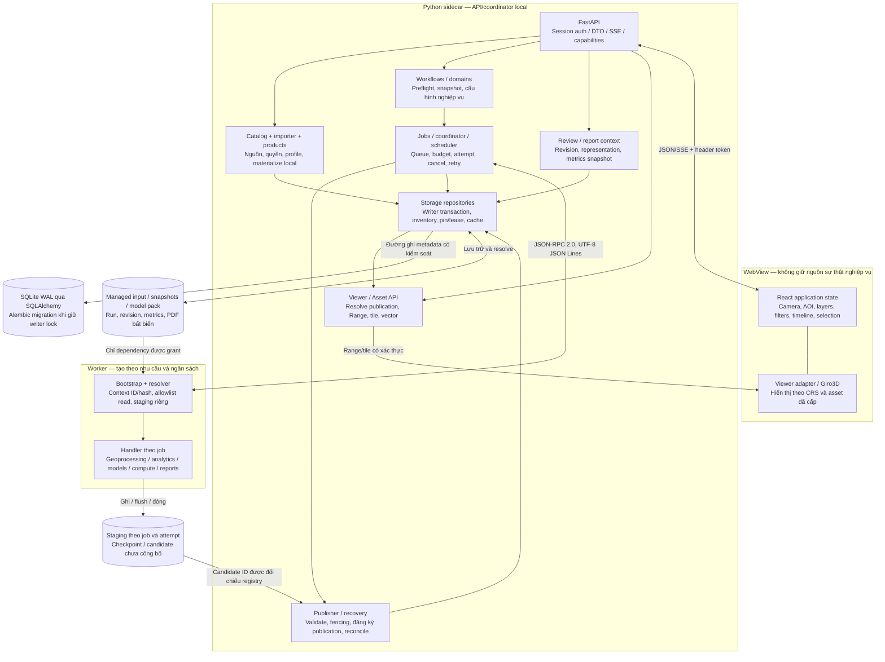
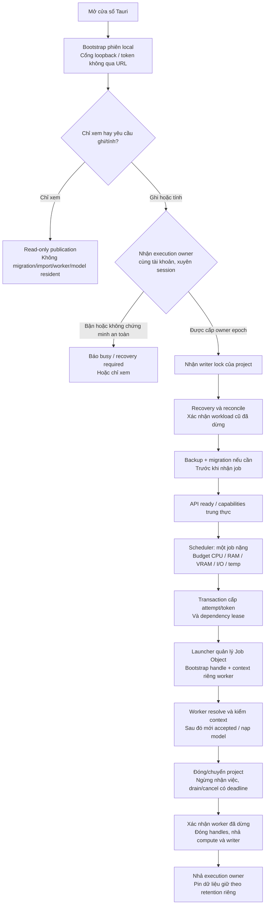
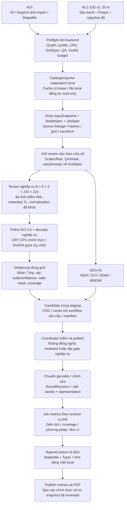
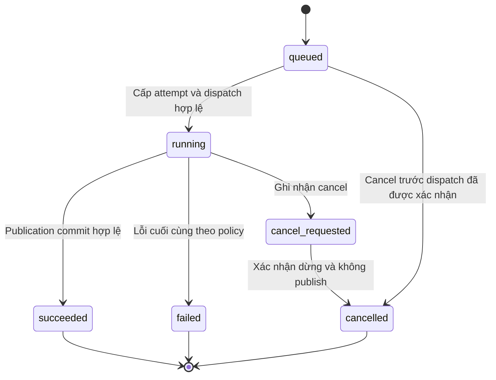
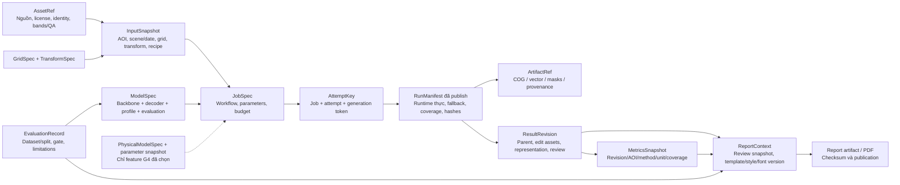
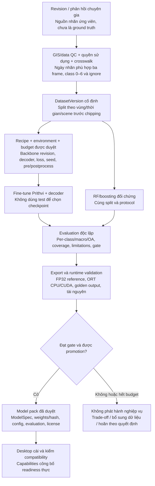

# Kiến trúc Windows desktop GeoAI — bộ sơ đồ chi tiết

**Ngày:** 09/11/2026 · **Phạm vi:** vẽ lại thiết kế desktop hiện tại; không thay quyết định kiến trúc, không triển khai runtime.

**Bổ sung Ubuntu 10/11/2026:** xem [kiến trúc và sơ đồ Ubuntu 22.04/24.04 LTS](../ubuntu/ubuntu-desktop-architecture.md), [môi trường/đóng gói](../ubuntu/ubuntu-development-and-packaging.md) và [ma trận nghiệm thu](../ubuntu/ubuntu-validation-matrix.md). File này giữ profile Windows; các primitive WebView2/Job Object không áp dụng trực tiếp cho Ubuntu. Adapter Linux ở trạng thái đề xuất theo [ADR-012](../../adr/ADR-012-ubuntu-desktop.md), chưa được triển khai/kiểm chứng.

**Cơ sở:** [kiến trúc triển khai](../../architecture.md), [kiến trúc hệ thống v1.1](../../../kien_truc_he_thong.md), [đề xuất v1.4](../../../solution/de_xuat_kien_truc_he_thong_geoai_tong_hop.md) và [chỉ mục ADR](../../adr/README.md). [Hướng dẫn GeoAI đính kèm](../../../solution/H%C6%B0%E1%BB%9Bng%20d%E1%BA%ABn%20x%C3%A2y%20d%E1%BB%B1ng%20%E1%BB%A9ng%20d%E1%BB%A5ng%20GeoAI%20cho%20vi%E1%BB%85n%20th%C3%A1m.md) cung cấp bối cảnh năm tầng; các lựa chọn web/server trong hướng dẫn không thay thiết kế desktop đã xác nhận.

> Đây là **kiến trúc đích**, không phải sơ đồ các thành phần đã nghiệm thu. Contracts dự thảo và API/UI foundation đã có bằng chứng; các phần backend thuần đang được hoàn thiện độc lập theo [tracker](../../task-tracker.md). Native lifecycle, GIS, AI, viewer, PDF, database/migration và installer chưa được nghiệm thu end-to-end. G0 chưa đạt; sơ đồ không đóng G0–G4. Các ADR kỹ thuật có điều kiện vẫn giữ trạng thái hiện tại.

## 1. Bản đồ đọc và nguyên tắc

| Cần hiểu | Sơ đồ |
| --- | --- |
| Hệ thống nằm ở đâu, kết nối với gì | 2 — ngữ cảnh và triển khai |
| Ai giao tiếp với ai, ai được ghi | 3 — tiến trình và module |
| Khởi động, nhiều cửa sổ/project, quyền chạy | 4 — lifecycle và execution owner |
| Dữ liệu đi từ ảnh đến báo cáo ra sao | 5 — pipeline nghiệp vụ |
| Khi nào kết quả thật sự được công bố | 6 — sequence và state machine |
| Truy nguyên, lưu trữ và tái lập | 7 — dữ liệu và kho local |
| Nhãn/huấn luyện quay lại desktop thế nào | 8 — vòng đời model |
| Thành phần nào thuộc gate nào | 9 — phạm vi và bằng chứng |

Các mũi tên biểu diễn giao tiếp/luồng dữ liệu, **không mặc định là hướng import Python**. Các ô trong backend là module của modular monolith, không phải microservice. Mũi tên nét đứt thể hiện cấp phát, lifecycle hoặc bàn giao ngoài runtime. Số lượng loại worker trên sơ đồ không phải số worker được chạy đồng thời.

Các bất biến:

1. API/UI không trực tiếp chạy GDAL, inference hoặc solver nặng.
2. Coordinator/application services là đường ghi metadata có kiểm soát; worker chỉ đọc theo grant, ghi staging và gửi event/candidate.
3. Một execution owner/tài khoản Windows trên máy, qua các session cùng tài khoản; một project ghi/thực thi và một job nặng tại một thời điểm là **đề xuất cần kiểm G1** theo [ADR-011](../../adr/ADR-011-local-execution-owner.md).
4. Execution owner, writer lock/project, attempt fencing và pin/lease là bốn cơ chế khác nhau.
5. UI chỉ đọc artifact có publication hợp lệ; không phục vụ trực tiếp staging hoặc mọi file có trong thư mục runs.
6. Training ở môi trường riêng; Prithvi-EO-2.0 + decoder nghiệp vụ bắt buộc từ bản đầu. RF/boosting chỉ là đối chứng.

## 2. Ngữ cảnh và ranh giới triển khai



**Không bắt buộc trong desktop bản đầu:** Redis/RabbitMQ, PostgreSQL/PostGIS, MinIO, Kubernetes, OIDC server hoặc GPU thường trực. STAC là giao diện tìm nguồn/metadata; không đồng nghĩa phải vận hành pgSTAC local. Mở rộng server ở G4 cần adapter và gate riêng.

## 3. Ranh giới tiến trình và trách nhiệm module



| Ranh giới | Quy tắc |
| --- | --- |
| UI → API | DTO có kiểu; không gửi script, registry path hoặc đường dẫn tùy ý như quyền thực thi. Host/Origin/token theo policy local. |
| API → worker | `capabilities` trước `start`; `start` mang attempt, IDs/hash context, job/snapshot và resource budget, không mang tensor hoặc credential. |
| Worker → coordinator | `heartbeat`, `progress`, `artifact_candidate`, `completed`, `error`; mọi event gắn đủ job/attempt/generation token. |
| Worker → filesystem | Read-only đúng dependency closure; chỉ staging hiện hành được ghi. Không SQLite session, không ghi input/model/publication root. |
| Asset API → viewer | Header auth trên cả Range, loader và web worker; không token URL. Không đủ phép CRS ở frontend thì backend tạo display asset/tile đã kiểm. |

Framing, version, error và giới hạn byte theo [IPC protocol](../../ipc-protocol.md). Kiểu trao đổi lấy từ [Pydantic contracts](../../../../backend/geoai/contracts); [schema sinh](../../../../schemas/contracts-v0.1.0.json) và client không sửa tay. Hướng import module giữ nguyên bảng trong [architecture](../../architecture.md).

## 4. Khởi động, nhiều instance và quyền thực thi



Sơ đồ là đường cấp quyền đích, không quy định thêm primitive native. Chi tiết ACL/SID, namespace khóa, handle inheritance và recovery còn phải kiểm ở [SPEC-003](../../specs/003-desktop-shell.md), [SPEC-004](../../specs/004-jobs-and-publish.md), [SPEC-009](../../specs/009-importer-worker-resolver.md).

- Một job nặng có thể dùng nhiều thread trong budget; không đồng nghĩa một thread CPU.
- Download/import/giải nén, preprocess, inference, metrics/PDF và tile dẫn xuất nặng đều chịu owner/scheduler; read-only không lách bằng tác vụ nền.
- Mất heartbeat hoặc owner lock abandoned không chứng minh worker đã chết. Thu hồi token, xác minh/dừng nhóm cũ trước cấp compute mới.
- Khóa không quản lý ứng dụng ngoài GeoAI hoặc tài khoản Windows khác; phải probe tài nguyên khả dụng và báo lỗi rõ.

## 5. Pipeline nghiệp vụ bản đầu



**Các điều kiện không được bỏ qua:**

- HLS S30: Blue/Green/Red/Narrow NIR/SWIR1/SWIR2 tương ứng B02/B03/B04/B8A/B11/B12; Fmask không là kênh phổ thứ bảy.
- T=1 chỉ cho spike kỹ thuật. T=3 nghiệp vụ phải có ba quan sát thật cùng grid và metadata phù hợp, không lặp ảnh cho đủ shape; không resize cả AOI về 224.
- Bảy class IDs 0–6; `-1` là ignore, lớp 0 là nước hợp lệ. Invalid không biến thành lớp nền và không được tính vào diện tích lớp quan sát.
- Normalization, mask/fill, padding/overlap/blend và precision phải khớp pack đã kiểm; không tự đặt hằng số từ fixture hoặc display stretch.
- Grid phân tích tách khỏi CRS hiển thị; không dùng pixel Web Mercator làm diện tích chưa hiệu chỉnh. VN-2000 cần operation/grid/tolerance và điểm kiểm, không fallback ballpark âm thầm.
- Confidence model không tự là xác suất hiệu chuẩn hoặc khoảng tin cậy diện tích. Chỉ số phổ không tự là LAI/độ ẩm/sinh khối định lượng đã kiểm định.
- Workflow có thể gồm nhiều job tuần tự; mỗi job metrics/report cũng đi qua attempt, staging và publish, không bỏ scheduler để render trong request.

Chi tiết theo [Prithvi profile](../../prithvi-profile.md), [domain rules](../../domain-rules.md), [taxonomy](../../domain/landcover-taxonomy.md), [AOI policy](../../domain/aoi-policy.md) và [SPEC-006](../../specs/006-landcover-workflow.md).

## 6. Điều phối, fencing và công bố

### 6.1. Sequence một job thành công

```mermaid
sequenceDiagram
    actor U as Chuyên gia
    participant UI as Desktop UI
    participant A as API và services
    participant C as Coordinator
    participant D as SQLite repositories
    participant W as Worker và resolver
    participant F as Local filesystem
    U->>UI: Chọn cấu hình và chạy
    UI->>A: Request với idempotency key
    A->>A: Kiểm quyền, profile, grid, model và budget
    A->>C: JobSpec và snapshot đã cố định
    C->>D: Lưu job; cấp attempt/token và lease
    C->>F: Ghi context private bất biến, lấy hash bytes
    C->>W: capabilities(protocol/schema version)
    W-->>C: Capability thực của runtime
    C->>W: start(attempt, job/snapshot IDs, context ID/hash, budget)
    W->>F: Resolve registry từ bootstrap; kiểm grant và hashes
    W-->>C: accepted sau validation
    loop Mỗi cửa sổ/phase theo budget
        W->>F: Đọc dependency; ghi staging/checkpoint
        W-->>C: Heartbeat/progress gắn attempt
        C-->>A: Trạng thái/tiến độ
        A-->>UI: SSE có xác thực
    end
    W->>F: Flush, đóng output; hoàn chỉnh candidate manifest
    W-->>C: artifact_candidate / completed(candidate ID)
    C->>C: Kiểm attempt hiện hành và cancel
    C->>F: Resolve candidate; kiểm hash/size/grid/coverage
    C->>F: Rename cùng volume sang vị trí bất biến
    C->>D: Transaction kiểm lại token/state/uniqueness và publication
    alt Commit thành công
        C-->>A: succeeded và publication ID
        A-->>UI: Kết quả đã công bố
        UI->>A: Đọc asset theo publication ID
        A->>D: Kiểm publication hợp lệ
        A->>F: Resolve đúng bytes được công bố
        A-->>UI: Range/tile/vector có xác thực
    else Commit thất bại hoặc token bị thu hồi
        C->>C: Không phục vụ file vừa chuyển; reconcile orphan
        C-->>A: Trạng thái theo lỗi/cancel hiện hành
    end
```

`completed` của worker chưa là `succeeded`. Rename và SQLite không có transaction chung; crash giữa hai bước phải reconcile. Attempt cũ không được publish dù output có cùng hash. Không hứa exactly-once; idempotency không thay fencing.

### 6.2. Trạng thái job và tình huống lỗi



Retry có giới hạn là vòng đời **attempt trong job**, không là mũi tên tự động từ job terminal `failed` sang `running`. Worker không tự retry. Phase `resolve/validate/preprocess/infer/postprocess/measure/publish` khác trạng thái job.

| Sự kiện | Xử lý đích |
| --- | --- |
| Retry lỗi tạm thời | Thu hồi token cũ; xác nhận giải phóng compute; cấp attempt/token/context mới; giữ snapshot đầu vào đã khóa. |
| Cancel khi inference đang chạy | Reader cancel/heartbeat vẫn hoạt động; dừng ở điểm an toàn; ack chưa chứng minh đã dừng; timeout dùng lifecycle có giới hạn. |
| Cancel sau publication commit thành công | Giữ succeeded và publication; không đổi thành cancelled hồi tố. |
| Worker cũ gửi candidate sau retry | Từ chối bằng đủ AttemptKey; không dùng idempotency key để chấp nhận. |
| Crash sau rename, trước DB commit | File orphan chưa phục vụ; recovery đối chiếu manifest và publication trước giữ/xóa. |
| DB có publication nhưng thiếu/hỏng bytes | Đánh dấu không khả dụng và báo lỗi; không phục vụ bytes khác như kết quả gốc. |
| Resume checkpoint | Chỉ khi input/model/config/runtime và capability phù hợp; solver có trạng thái chỉ resume checkpoint native đã kiểm. |

## 7. Truy nguyên và trách nhiệm lưu trữ

### 7.1. Đồ thị nguồn gốc — không phải ERD vật lý



Một job có thể có nhiều attempt; một run có nhiều artifact; review tạo revision mới thay vì sửa đè dự đoán. Metrics và PDF luôn chỉ rõ revision/representation. Edit vector không tự sửa raster; phản hồi không tự thành ground truth.

### 7.2. Kho local và vòng đời bytes

| Vùng logic | Nội dung | Quyền ghi / vòng đời |
| --- | --- | --- |
| Metadata SQLite WAL | Project/job/attempt, audit, chỉ mục revision/publication, availability | Coordinator/application services qua repository; một writer/project. Vị trí DB vật lý theo thiết kế storage, không suy từ bảng này. |
| Managed inputs và external registrations | Ảnh/band/QA và dependency được đăng ký | Importer; thay nội dung tạo version mới. External mutable input cần bảo đảm identity/content ổn định hoặc materialize bản managed. |
| Snapshots và manifests | Input/model/parameter/run/revision/report context | Dịch vụ tương ứng tạo bản bất biến theo ID/hash; không lấy latest lúc chạy lại. |
| Staging riêng job/attempt | Intermediate, checkpoint, candidate | Worker đúng attempt; chưa công bố; không được ghi root khác. |
| Publication store | Run artifacts, edit assets, metrics, PDF | Publisher sau validation; chỉ phục vụ record hợp lệ. Staging và đích rename tương ứng cùng volume. |
| Runtime/model packs | Runtime khóa version, trọng số, profile, licenses | Cài đặt/xác minh có kiểm soát; worker chỉ đọc dependency đã grant. |
| Cache và availability inventory | Dữ liệu tái tạo được, download cache, pin/lease | Quota/retention/GC có reconcile; không coi artifact chính thức là cache. |
| Logs/diagnostics | Structured event, lỗi đã redact, log rotation | Không credential, signed URL, dữ liệu khách hàng hoặc nội dung context private. |

- Project hoạt động, SQLite, staging và cache ở ổ local; không SQLite WAL trên share/SMB hoặc thư mục đồng bộ. Nguồn mạng được materialize local trước grant worker bản đầu.
- Snapshot cố định danh tính không bảo đảm đủ bytes. UI phải phân biệt **offline đủ dependency**, **cần lấy lại nguồn**, **thiếu nguồn/phiên bản**.
- Compute lease thuộc owner khác dependency lease/pin cho tái lập hoặc checkpoint. GC chỉ sau reconcile và kiểm dependency inventory.
- Backup SQLite nhất quán cùng inventory/artifact cần giữ; không copy riêng DB đang mở rồi bỏ WAL. Restore kiểm migration, hashes/references và không phục hồi job cũ như vẫn running.

Quyền path/driver/VRT/archive, bootstrap và candidate isolation theo [worker resolver](../../worker-resolver.md) và [security acceptance](../../importer-resolver-security.md). Loopback không là sandbox chống mã độc cùng tài khoản.

## 8. Vòng đời dataset và model — ngoài desktop runtime



Training/benchmark có môi trường và cấu hình máy riêng theo [SPEC-008](../../specs/008-training-evaluation-model-pack.md); không đóng gói optimizer/notebook vào desktop. CPU là runtime chính thức, NVIDIA tùy chọn; mục tiêu desktop ít nhất 20 GB RAM/8 GB VRAM chưa là support matrix đã benchmark. ONNX là hướng ưu tiên, PyTorch fallback chỉ khi có hồ sơ tương thích/benchmark và policy rõ, không fallback âm thầm.

G1 có thể kiểm backbone thật + decoder đúng kiến trúc nhưng ngẫu nhiên; không được lấy kết quả đó để công bố model nghiệp vụ. G2 cần checkpoint đã huấn luyện, test độc lập và chạy lại từng precision/runtime định phân phối. Phản hồi chỉ được nhập training sau QC/version/split; không làm rò test vào train.

## 9. Phạm vi phát hành và bản đồ bằng chứng

| Phần | Vai trò trong kiến trúc | Điều kiện trước khi coi là chạy được |
| --- | --- | --- |
| SPEC-001 | Contracts/schema/client dự thảo | Có evidence validation metadata; không suy ra enforcement native/I/O. |
| SPEC-003 + ADR-011 | Tauri launcher, session, execution owner, Job Object | Kiểm process thật, shutdown/crash, nhiều instance/cross-session trên Windows. |
| SPEC-009 | Importer/context/resolver | Policy fixture và native bootstrap/path/identity/candidate isolation theo acceptance. |
| SPEC-004 | Queue/attempt/fencing/publish/recovery | Test race/cancel/crash, DB/file reconcile, migration/restore và owner integration. |
| SPEC-002 / G0 | AOI/nhãn/profile/quyền/gate/hardware/budget | Người có thẩm quyền khóa đầu vào và protocol; G0 hiện chưa đạt. |
| SPEC-005 + SPEC-007 / G1 | Model kỹ thuật, GIS/CRS/viewer/PDF/bundle | Fixture thật, export/runtime, điểm chuẩn và máy/installer kiểm được. |
| SPEC-008 + SPEC-006 / G2 | Model nghiệp vụ và workflow tới PDF | Dataset/test độc lập, pack/evaluation và end-to-end gate tuyệt đối. |
| G3 | Offline/installer/upgrade/support matrix | Máy sạch, dependency/font/PROJ grid, backup/restore và vận hành thực. |
| G4 | Provider/profile 10/5/1 m, Domain Pack PHY, server | Chọn từng feature, dữ liệu/hiệu chuẩn/license/budget/gate riêng; không bật tất cả từ đầu. |

NDVI/EVI/NDMI/MNDWI, lớp phủ HLS 30 m, thống kê và PDF là lát cắt đầu. Rừng/mất rừng, ngập lụt và profile độ phân giải khác theo đợt sau; lớp wetland/mangrove vẫn nằm trong bộ bảy lớp đầu. Không đưa SAR/DEM/RGB lặp kênh vào checkpoint HLS để thay profile. Solver vật lý G4 không bị ép thành inference ONNX hoặc tile độc lập.

Trạng thái triển khai và bằng chứng thay đổi theo [roadmap](../../roadmap.md), [tracker](../../task-tracker.md) và [spec index](../../specs/README.md); bảng này ánh xạ trách nhiệm, không thay hồ sơ nghiệm thu.

## 10. Kiểm tài liệu và giới hạn bàn giao

Đợt vẽ lại thuộc phần bổ sung tài liệu [SPEC-000](../../specs/000-documentation-baseline.md). Phạm vi kiểm là UTF-8, liên kết file cục bộ, cặp code fence, số lượng/loại sơ đồ và đối chiếu các bất biến với tài liệu nguồn. Kết quả thực ghi ở spec/tracker sau khi chạy kiểm. Kiểm cấu trúc không chứng minh Mermaid đã render hoặc bất kỳ runtime/G0–G4 nào đạt. Không thay schema, mã nguồn, dependency hoặc quyết định ADR trong đợt này.
