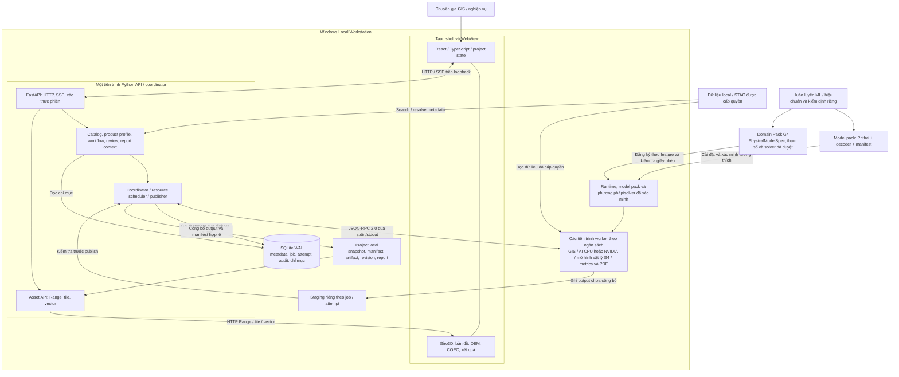
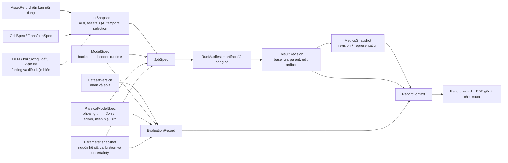
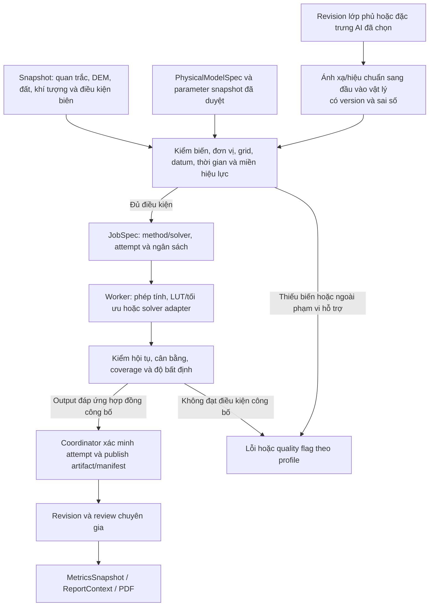
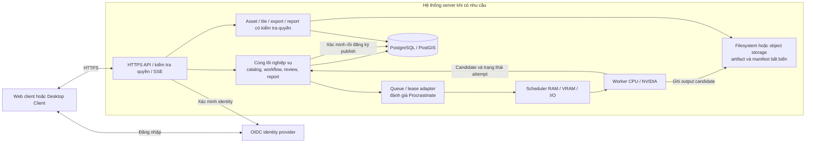

# Kiến trúc hệ thống GeoAI

**Phiên bản kiến trúc:** 1.1 · **Cơ sở đồng bộ:** đề xuất tổng hợp v1.4 · **Ngày:** 08/11/2026 · **Trạng thái:** thiết kế đề xuất, chưa triển khai, hiệu chuẩn thực địa hoặc benchmark.

Tài liệu này tổ chức các quyết định trong [bộ tài liệu chuyên biệt](plans/README.md) thành kiến trúc hệ thống: thành phần, ranh giới tiến trình, giao tiếp, dữ liệu, luồng xử lý và triển khai. Nguồn nội dung chuẩn là [bản tổng hợp v1.4](solution/de_xuat_kien_truc_he_thong_geoai_tong_hop.md). Các sơ đồ và cấu trúc thư mục dưới đây mô tả thiết kế đích. Phương trình, đơn vị, nguồn và giới hạn từng phương pháp nằm tại [hồ sơ mô hình](plans/07_model_prithvi_nhan_va_kiem_dinh.md#muc-8-6); tài liệu này xác định cách các phương pháp tham gia hệ thống.

## 1. Phạm vi và lựa chọn kiến trúc

**Mở rộng Ubuntu, 10/11/2026:** người dùng yêu cầu Ubuntu 22.04 LTS và Ubuntu 24.04 LTS bên cạnh Windows. [ADR-012](docs/adr/ADR-012-ubuntu-desktop.md) và [kiến trúc Ubuntu](docs/platforms/ubuntu/ubuntu-desktop-architecture.md) đề xuất adapter WebKitGTK, supervisor/user service/cgroup, owner theo UID và FD/native I/O, giữ nghiệp vụ/contracts/coordinator/fencing dùng chung. [Guide đóng gói](docs/platforms/ubuntu/ubuntu-development-and-packaging.md) và [ma trận hai LTS](docs/platforms/ubuntu/ubuntu-validation-matrix.md) bổ sung cách kiểm. Đây là addendum thiết kế chưa Accepted/chưa triển khai; các mục Windows/Job Object/WebView2 bên dưới giữ profile Windows, server vẫn là mở rộng G4.

[SPEC-010 Ubuntu foundation](docs/specs/010-ubuntu-foundation.md) kèm native profile/interface là đầu vào gen code nhánh Linux: các mốc baseline, lifecycle/FD và I/O/SQLite fixture đều chưa triển khai. Bổ sung chỉ cụ thể hóa adapter và kiểm chứng, không thay yêu cầu Prithvi, data contracts hiện hành hoặc gate; private ledger mới chỉ được dùng sau task Pydantic/fixture/exporter tương ứng.

GeoAI là ứng dụng cho chuyên gia GIS và nghiệp vụ, thực hiện chuỗi **dữ liệu địa lý và quan trắc → phân tích GIS/AI hoặc mô hình toán–vật lý → kiểm tra/chỉnh sửa → thống kê → báo cáo truy nguyên được**.

Kiến trúc chọn **modular monolith Python với worker tách tiến trình**, ưu tiên Windows desktop và xử lý cục bộ. Modular monolith nghĩa là các module nghiệp vụ được tổ chức trong cùng lõi ứng dụng; worker tách ra để cô lập tính toán nặng, quản lý tài nguyên và phục hồi lỗi.

| Khía cạnh | Lựa chọn thiết kế | Điều kiện hoặc giới hạn |
| --- | --- | --- |
| Giao diện | Tauri 2 + React + TypeScript + Giro3D | Workspace lấy bản đồ làm trung tâm; state nằm ở ứng dụng |
| Backend | FastAPI + Pydantic; một API/coordinator local | Request không trực tiếp chạy suy luận hoặc xử lý GIS nặng |
| Thực thi | Worker GIS/AI CPU, NVIDIA và báo cáo theo nhu cầu | Scheduler giới hạn CPU thread, RAM, VRAM, I/O và đĩa tạm |
| Metadata local | SQLite WAL, repository SQLAlchemy và migration Alembic | Một coordinator ghi; một writer cho mỗi project đang mở; migration/restore phải có fixture |
| Dữ liệu lớn | Filesystem local, đọc theo cửa sổ/Range | Project hoạt động, database, staging và cache nằm trên ổ local |
| AI bắt buộc | Prithvi-EO-2.0 + decoder nghiệp vụ từ bản đầu | RF/boosting là baseline đối chứng; không thay thế yêu cầu Prithvi |
| Runtime AI | Ưu tiên ONNX Runtime CPU/CUDA | PyTorch là đường tham chiếu và ngoại lệ phân phối có bằng chứng |
| Toán–vật lý | GEO-01 cho chỉ số phổ, diện tích và coverage; các PHY theo Domain Pack | NumPy/SciPy hoặc adapter solver đã kiểm chứng; feature PHY chọn từng bước ở G4 |
| Báo cáo | Matplotlib + Typst CLI, font tiếng Việt local | Render từ snapshot của revision được chỉ định |
| Mở rộng server | Giữ lõi nghiệp vụ; thay adapter lưu trữ, queue và identity | PostgreSQL/PostGIS, filesystem hoặc object storage, HTTPS/OIDC |

So với chạy mọi thứ trong tiến trình UI/API, phương án này cho phép dừng và phục hồi tính toán mà vẫn giữ giao diện phản hồi. So với microservices ngay từ đầu, nó giảm số dịch vụ phải cài và vận hành trên máy người dùng. Microservices/Kubernetes chưa thuộc phạm vi phát hành đầu.

Lát cắt nghiệp vụ khởi đầu đã được người dùng xác nhận là **lớp phủ HLS S30 v2, 30 m → Prithvi + decoder → thống kê theo vùng → PDF tiếng Việt**, kèm NDVI/EVI/NDMI/MNDWI. Đã cung cấp [bảy lớp IDs 0–6 và -1 ignore](docs/domain/landcover-taxonomy.md), profile nghiệp vụ T=3; [AOI](docs/domain/aoi-policy.md) có thể vẽ, lấy footprint ảnh import hoặc import Shapefile. Còn AOI kiểm định/thời gian cụ thể, QC/crosswalk/nhãn độc lập và gate phải chốt tại G0. Đợt sau bổ sung giám sát rừng/mất rừng, đất ngập nước/ngập lụt và profile 10/5/1 m; lớp wetland/mangrove vẫn có trong bản đồ bảy lớp đợt đầu. Chỉ tiêu đất/cây trồng định lượng chuyên sâu bổ sung sau. Nguồn mở/miễn phí trước; ảnh thương mại khi có quyền và ngân sách. HLS chỉ ở 30 m, các mức cao hơn cần nguồn/profile/model kiểm riêng. Mục tiêu máy ít nhất 20 GB RAM/8 GB VRAM chưa là cấu hình đã kiểm chứng. [Decision record G0](docs/evidence/g0/decision-record.md) lưu quyết định từng phần và đầu vào còn thiếu; G0 chưa đạt. DEM/COPC được đọc và hiển thị để kiểm chứng viewer; AI LiDAR, huấn luyện sâu trong desktop, AMD AI và nhiều ngành đồng thời được hoãn.

Bản đầu dùng GEO-01 cùng Prithvi và RF/boosting. Danh mục PHY gồm PROSAIL, FAO-56, SEBAL, SCS-CN, HAND, nước nông 2D, RUSLE và allometry sinh khối/carbon; mỗi feature bổ sung ở G4 cần dữ liệu, hiệu chuẩn, kiểm định và ngân sách riêng. Số lượng phương pháp trong danh mục không đồng nghĩa tất cả phải nằm trong bộ cài đầu.

## 2. Sơ đồ tổng thể và ranh giới thực thi



Các ô trong tiến trình backend là module logic, không phải dịch vụ độc lập. Có thể tạo worker theo loại tác vụ, nhưng số worker đồng thời phụ thuộc ngân sách; không khởi động toàn bộ loại worker chỉ vì chúng xuất hiện trên sơ đồ. Training xuất model package sang ứng dụng và không nằm trong đường chạy desktop.

Tauri quản lý khởi động/dừng sidecar và vòng đời cửa sổ. API nhận yêu cầu, dịch vụ nghiệp vụ kiểm tra hợp đồng, coordinator sở hữu chuyển trạng thái thực thi và công bố kết quả. Worker không trực tiếp sửa database hoặc quyết định job đã thành công.

Feature vật lý dùng cùng đường job, staging, publish, revision và báo cáo. Adapter solver được phép chạy executable con đã đăng ký trong nhóm tiến trình được quản lý; cấp input manifest và ngân sách, không chạy script hay lệnh tùy ý từ gói dự án. Thuật toán tính từng ô và solver có trạng thái liên kết không gian/thời gian khai báo capability khác nhau về hủy và resume.

## 3. Kiến trúc module và quy tắc phụ thuộc

| Module | Trách nhiệm | Hợp đồng vào/ra và giới hạn |
| --- | --- | --- |
| `contracts` | Schema, version, DTO, mã lỗi và quy tắc tương thích | Không import nghiệp vụ, UI hoặc runtime AI; là cơ sở sinh OpenAPI/client TypeScript |
| `api` | HTTP, SSE, xác thực, chuyển DTO sang lời gọi ứng dụng | Không chứa pipeline GIS/AI; trả ID job cho tác vụ nền |
| `catalog` / `products` | Adapter provider, search/resolve, capability, profile cảm biến | Trả `AssetRef` chuẩn hóa; phân biệt search, quyền đọc, download và order |
| `geoprocessing` | QA, grid, chuyển CRS, đọc cửa sổ, mask, raster/vector | Dùng `GridSpec` và `TransformSpec`; không phụ thuộc viewer |
| `models` | Kiểm tra model package và tính tương thích dữ liệu | Quản lý `ModelSpec`, backbone/decoder version, preprocessing và evaluation; `PhysicalModelSpec` thuộc contracts, phương pháp/solver vật lý đăng ký tại analytics/domains |
| `compute` | Chọn thiết bị/runtime và cấp ngân sách thực thi | Adapter AI CPU/CUDA và ngân sách tác vụ vật lý; không mặc định solver có thể xuất ONNX hoặc chạy GPU |
| `workflows` / `jobs` | Ghép bước đã đăng ký, hàng đợi, attempt, checkpoint, cancel/retry | Nhận `JobSpec`; coordinator điều phối, fence attempt cũ và quản lý tài nguyên |
| `analytics` / `domains` | Thuật toán GIS/ML/toán–vật lý, feature ngành, chỉ tiêu và quality gate | Analytics chứa phép tính/solver adapter; Domain Pack chọn phương pháp, hệ số và calibration/evaluation; không sao chép I/O, scheduler hoặc runtime |
| `review` | Revision, sửa thuộc tính, nhập chỉnh sửa hình học, trạng thái duyệt | Dự đoán gốc bất biến; revision mới liên kết parent/base run |
| `reports` | Metrics snapshot, `ReportContext`, bản đồ và PDF | Chỉ dùng revision/representation được chỉ định; render trong worker |
| `storage` | Metadata, asset resolution, manifest, publish, pin, backup | Filesystem/SQLite ở local; adapter riêng khi lên server |
| `viewer` | Phục vụ và hiển thị layer, picking, style, kiểm tra kết quả | Asset ID và revision rõ ràng; không dùng LOD làm dữ liệu đo chính thức |

Quy tắc phụ thuộc:

1. UI chỉ gọi API/asset serving; không mở trực tiếp database, runtime model hoặc đường dẫn bất kỳ trong worker.
2. `api` gọi dịch vụ ứng dụng; workflow phối hợp geoprocessing, compute, analytics và reports qua hợp đồng có kiểu.
3. Các thư viện xử lý không gọi ngược UI/API. Quy tắc ngành không phụ thuộc tên provider hoặc backend CPU/CUDA cụ thể.
4. Mọi thay đổi metadata đi qua đường ghi do coordinator kiểm soát. Worker chỉ gửi event, checkpoint và artifact candidate.
5. Registry tĩnh xác định feature, workflow và pre/postprocessor được phép; chỉ thêm interface khi có triển khai thay thế thực tế.

### 3.1. Hướng import nội bộ

Mọi module được dùng `contracts`; bảng sau liệt kê các phụ thuộc được phép ngoài hợp đồng chung, đồng bộ [đặc tả module](plans/04_kien_truc_thuc_thi_va_module.md#muc-5-1).

| Module | Phụ thuộc nội bộ được phép |
| --- | --- |
| `contracts`, `storage`, `products` | Không có module nghiệp vụ khác |
| `catalog`, `geoprocessing`, `models` | `products`, `storage` |
| `compute` | `models` |
| `analytics` | `geoprocessing`, `models`, `compute` |
| `review` | `storage` |
| `reports`, `viewer` | `geoprocessing`, `storage` |
| `jobs` | `compute`, `storage`; nhận handler đã đăng ký qua hợp đồng, không import `workflows` |
| `workflows` | `jobs`, `catalog`, `analytics`, `geoprocessing`, `review`, `reports`, `storage` |
| `domains` | `workflows`, `analytics`, `reports` |
| `api` | `workflows`, `jobs`, `catalog`, `review`, `viewer`, `storage` |

`bootstrap` ghép adapter và đăng ký domain/handler, được tham chiếu các module; module không import ngược bootstrap. `products` có thể là `catalog.products`, khi đó chỉ mở đúng subpackage này cho module nền. CI kiểm tra import cấm/phụ thuộc vòng theo package thực; không dựng module rỗng để đủ bảng. Các thư viện/solver ngoài được gọi qua adapter của module phụ trách, không dùng làm cầu nối để gọi ngược tầng trên.

### 3.2. Repository và migration

SQLAlchemy quản lý truy vấn/session/transaction bên trong `storage`; module nghiệp vụ nhận DTO và không truyền ORM object qua IPC. Alembic version của database độc lập với `schema_version` của API/manifest. Migration chỉ chạy khi có khóa writer độc quyền và backup SQLite hợp lệ, trước khi nhận job ghi dữ liệu.

Script migration sinh tự động phải được review; kiểm tra SQLite table rebuild/batch, constraint/index, dữ liệu cũ, dung lượng tạm và restore khi gián đoạn. Không coi rollback app là tự đảo được migration dữ liệu. CI bản desktop tập trung SQLite contract, upgrade và restore; thêm cùng bộ repository contract trên PostgreSQL khi thực hiện adapter server G4. GPU runner hàng đêm và CI hai database ngay G0 là lựa chọn theo nhu cầu/ngân sách.

## 4. Giao tiếp giữa các thành phần

| Ranh giới | Giao thức / dữ liệu | Quy tắc |
| --- | --- | --- |
| UI ↔ API | HTTP JSON theo OpenAPI | Request nhẹ; lỗi có mã, nguyên nhân, khả năng khắc phục; không nhúng raster/tensor |
| API → UI | SSE: job, phase, progress, lỗi | Reconnect được; UI đọc lại trạng thái từ API khi mất sự kiện |
| Viewer ↔ asset API | HTTP Range/206, tile, vector, ETag | Asset ID đã đăng ký, kiểm tra quyền; không truyền toàn bộ ảnh lớn qua Tauri IPC |
| Coordinator ↔ worker local | JSON-RPC 2.0, UTF-8, một JSON mỗi dòng qua stdin/stdout | Handshake version/capability; giới hạn đề xuất 1 MiB/thông điệp |
| Worker ↔ dữ liệu | Tham chiếu asset/manifest, window/grid, storage được cấp quyền | Đọc theo cửa sổ; ghi staging của attempt; dữ liệu lớn không đi qua JSON |
| Coordinator ↔ metadata | SQLite transaction ở local | Kiểm tra attempt/token và quyền công bố trong transaction |
| Backend ↔ nguồn ngoài | Adapter provider theo capability | URL truy cập resolve lúc dùng; credential/signed URL không lưu vào snapshot |

Worker hỗ trợ `capabilities`, `start`, `cancel`, `shutdown`; event gồm heartbeat, phase/progress, lỗi có cấu trúc và artifact candidate. Thông điệp gắn attempt mang `job_id`, `attempt_id`, generation token. `start` xác nhận nhận việc; hoàn tất được thông báo sau.

`stdout` chỉ dành cho protocol. Log chuyển sang `stderr` hoặc file; coordinator đọc liên tục cả hai pipe và giới hạn buffer. Bộ nhận cancel/heartbeat phải hoạt động trong khi inference đang chạy. Timeout request không tự chứng minh worker đã dừng. Memmap/shared memory chỉ thêm nếu phép đo cho thấy có lợi và có owner/lease/cleanup rõ ràng.

Bootstrap worker trước khi import thư viện native: flush buffer, giữ bản sao stdout gốc làm writer protocol nhị phân rồi chuyển fd 1 sang stderr bằng cơ chế tương đương `os.dup(1)`/`os.dup2(2, 1)`. Chỉ một writer tuần tự hóa UTF-8 + byte LF và flush, có khóa khi nhiều thread gửi event. Trên Windows phải xét thêm CRT descriptor và Win32 standard handle/`SetStdHandle`; handle đã cache có thể không theo chuyển hướng. `PYTHONUTF8=1` không thay chế độ binary hoặc bảo vệ native stdout. Launcher cấp đủ pipe và dùng `CREATE_NO_WINDOW` cho worker console; G1 thử log Python/CRT/Win32 cả lúc import và chạy trên sidecar đóng gói. Protocol nhiễm log phải báo lỗi, không tự bỏ dòng để đoán trạng thái.

## 5. Mô hình dữ liệu và nguồn sự thật

### 5.1. Chuỗi truy nguyên



Sơ đồ biểu diễn quan hệ truy nguyên, không phải ERD vật lý. `Project` là phạm vi tổ chức; một job có thể có nhiều attempt và nhiều artifact. `MetricsSnapshot` phải chỉ rõ revision, representation, AOI và phương pháp tính; schema chi tiết sẽ được chốt cùng các hợp đồng ở G0/G1.

Workflow AI tham chiếu `ModelSpec`; workflow vật lý tham chiếu `PhysicalModelSpec`, không tạo backbone/decoder giả cho phương trình. Workflow lai giữ cả hai. Parameter snapshot có hash, nguồn hệ số và dataset/split calibration; forcing/biên thuộc `InputSnapshot`, còn giá trị tham số, solver version/hash và evaluation liên quan được cố định khi lập job. Thay bất kỳ thành phần ảnh hưởng kết quả tạo run mới.

| Thành phần cho mô hình vật lý | Nội dung và điều kiện |
| --- | --- |
| `PhysicalModelSpec` | ID/version, loại vật lý/bán thực nghiệm, nguồn phương trình, implementation/solver hash, biến/đơn vị, miền hiệu lực, grid/time step/datum, điều kiện đầu/biên khi áp dụng, calibration/evaluation và uncertainty policy |
| Input/parameter snapshot | Nguồn quan trắc, thời điểm/kỳ tích lũy, hệ số/range, đơn vị, nguồn và cách fit, forcing/biên và dữ liệu kiểm định có version/hash; không thiếu biến bắt buộc rồi tự điền 0 |
| `RunManifest` | Spec và input/parameter/forcing/biên/solver hash, runtime thực, coverage, kiểm hội tụ/cân bằng, quality flags, artifact và uncertainty refs |
| `ReportContext` | Revision/representation, đại lượng, kỳ tính, phương pháp/đơn vị, tham số, solver, evaluation và giới hạn; giữ nguyên cơ chế snapshot như báo cáo AI |

| Dữ liệu | Nguồn sự thật | Ai được thay đổi |
| --- | --- | --- |
| Project registry, job, attempt, audit, chỉ mục revision | SQLite local | Coordinator và dịch vụ ứng dụng qua đường ghi được kiểm soát |
| Input đã import | File tham chiếu có kiểm tra hoặc bản copy được quản lý | Nội dung thay đổi tạo asset version mới |
| Input snapshot, run manifest, artifact đã công bố | Project filesystem local | Bất biến; chỉ công bố phiên bản mới |
| Chỉnh sửa và trạng thái review | Revision/edit manifest cùng chỉ mục và audit | Dịch vụ review qua coordinator; sửa nội dung tạo revision mới |
| ReportContext, report record và PDF gốc | Snapshot/artifact trong project, database lưu chỉ mục | Tạo báo cáo mới khi đổi revision/context |
| Cache, engine cache, checkpoint | Kho local với quota, owner và pin/lease | Dọn theo retention; không xem kết quả chính thức là cache |

Mọi hợp đồng lưu lâu dài có `schema_version`, ID ổn định và timestamp UTC. ID provider có namespace. App, schema, feature, model, decoder và template có version riêng. Thay đổi schema không tương thích phải có migration, backup và kiểm tra restore.

Snapshot cố định danh tính input nhưng không bảo đảm byte nguồn vẫn còn. Trạng thái tái lập phải phân biệt **đủ để chạy offline**, **cần lấy lại nguồn**, **thiếu nguồn/phiên bản**. Run giữ offline pin đủ input, model/decoder hoặc PhysicalModelSpec/parameter/forcing/biên, runtime/solver và cấu hình theo dependency inventory. Snapshot lịch sử chỉ giữ tham chiếu không tự ghim toàn bộ scene mãi mãi; tình trạng giữ byte/khả dụng được quản lý riêng với snapshot bất biến.

### 5.2. Bố trí lưu trữ đề xuất

```text
<app-data-local>/
  metadata.sqlite             # registry, jobs, attempts, audit và chỉ mục
  runtime-packs/              # môi trường inference có version
  model-packs/                # backbone + decoder + ModelSpec + license
  cache/                      # cache tái tạo được, có quota và pin/lease
  logs/                       # log rotation và chẩn đoán local

<project-root-local>/
  project.json                # ID và phiên bản manifest project
  inputs/                     # dữ liệu được copy theo lựa chọn import
  snapshots/                  # InputSnapshot và parameter/calibration snapshot bất biến
  staging/<job-id>/<attempt-id>/
  runs/<run-id>/               # RunManifest và artifact đã công bố
  revisions/<revision-id>/     # manifest và edit artifact
  reports/<report-id>/         # ReportContext, metrics, PDF và checksum
```

Tên thư mục là đề xuất tổ chức, chưa phải schema đường dẫn đã phát hành. Staging và vị trí công bố tương ứng phải cùng volume để dùng rename local. Project hoạt động không đặt trên SMB/thư mục đồng bộ; ổ mạng chỉ là nguồn đọc hoặc nơi lưu bản export. Mở cùng project để sửa từ instance thứ hai bị chặn bằng khóa hệ điều hành.

Metadata backup dùng cơ chế backup SQLite phù hợp; không copy riêng `.db` đang mở và bỏ qua WAL. Export ghi rõ dữ liệu nào được kèm hoặc còn tham chiếu ngoài. Khôi phục chỉ mục artifact từ manifest không thay thế bản backup đầy đủ lịch sử job/audit.

## 6. Luồng nghiệp vụ từ dữ liệu đến báo cáo

### 6.1. Feature Prithvi bản đầu

```mermaid
sequenceDiagram
    actor User as Chuyên gia
    participant UI as Desktop UI
    participant API as API / dịch vụ ứng dụng
    participant JC as Coordinator
    participant W as Worker
    participant FS as Staging / Project store
    participant DB as Metadata SQLite
    User->>UI: Chọn project, AOI, dữ liệu và feature
    UI->>API: Yêu cầu kiểm tra và cấu hình phân tích
    API->>API: Kiểm tra quyền, profile, CRS, model và ngân sách
    API-->>UI: Cấu hình chạy, coverage và vấn đề cần sửa
    UI->>API: Gửi yêu cầu chạy với idempotency key
    API->>JC: JobSpec + InputSnapshot đã cố định
    JC->>DB: Lưu job, cấp attempt/token và lease
    JC->>W: start(manifest, resource budget, attempt/token)
    W-->>JC: Xác nhận nhận việc
    loop Đọc và xử lý từng cửa sổ
        W->>W: QA, chuẩn hóa, Prithvi + decoder, hậu xử lý
        W->>FS: Ghi staging/checkpoint
        W-->>JC: Heartbeat, phase, progress
        JC-->>UI: SSE qua API
    end
    W-->>JC: Artifact candidate + checksum/coverage
    JC->>FS: Kiểm tra và chuyển output sang vị trí bất biến
    JC->>DB: Transaction kiểm tra token/cancel và đăng ký publish
    JC-->>UI: Trạng thái succeeded qua API
    User->>UI: Kiểm tra, sửa thuộc tính hoặc nhập GeoPackage, duyệt
    UI->>API: Tạo revision / cập nhật trạng thái review có audit
    API->>JC: Lưu revision và chỉ mục
    UI->>API: Yêu cầu báo cáo cho revision cụ thể
    API->>JC: Job metrics / ReportContext / PDF
    JC->>W: Render từ snapshot; không phụ thuộc viewer
    W->>FS: Ghi bản đồ, bảng, PDF vào staging
    W-->>JC: Artifact candidate của báo cáo
    JC->>JC: Kiểm tra và publish theo cùng cơ chế
    JC-->>UI: Report ID và asset truy cập qua API
```

Sơ đồ thể hiện đường thành công. Mỗi lần publish đều phải kiểm tra attempt còn hiệu lực trước khi di chuyển và kiểm tra lại trong transaction đăng ký. Nếu transaction không thành công, file đã di chuyển vẫn chưa được API công bố; startup reconcile xử lý file mồ côi. Filesystem và SQLite không tạo thành một transaction chung.

Trước chạy, UI hiển thị nguồn/ngày ảnh, vùng quan sát hợp lệ, model/bộ lớp, nơi xử lý, backend và dung lượng ước tính nếu có. Đổi panel giữ camera, AOI, layer, selection, filter, timeline và job. ETA chỉ hiển thị khi có cơ sở đo.

`succeeded` là hoàn tất kỹ thuật. Review chỉ có `unreviewed/reviewed`, kèm người, thời gian, phạm vi và nhận xét. Chỉnh sửa sau duyệt tạo revision chưa duyệt; báo cáo chính thức yêu cầu revision đã duyệt. Raster dự đoán và vector đã sửa là các representation khác nhau: metrics/report phải chọn rõ representation có thẩm quyền.

### 6.2. Feature toán–vật lý và workflow lai ở G4



Đường AI → ánh xạ chỉ có khi phương pháp cần kết quả AI, ví dụ lớp phủ thành một đầu vào cho bảng CN hoặc C; các yếu tố đất, quản lý và điều kiện ẩm vẫn phải có nguồn riêng. Không yêu cầu mọi job vật lý đều chạy Prithvi. Tích hợp feature vật lý bổ sung ở G4 không thay yêu cầu feature Prithvi của bản đầu.

Hiệu chuẩn tham số diễn ra trong môi trường kiểm định riêng, có split calibration/validation/test và xuất parameter snapshot được duyệt. Trong app, người dùng chọn model/profile và điều kiện đầu vào được phép; chỉnh tham số tạo job/run mới. Kết quả chạy đúng số học vẫn phải có validation thực địa trước khi model/feature được phát hành; review không thay quality gate.

Báo cáo vật lý phân biệt ET0/ETc/ET thực, Q theo mm/thể tích/lưu lượng, HAND/kịch bản độ sâu/độ sâu mô phỏng, mất đất sườn dốc/bùn cát cửa ra và sinh khối/carbon tồn trữ/biến động carbon. Đại lượng, phương trình, kỳ tính, nguồn tham số, solver và uncertainty thay cho các trường backbone/decoder không áp dụng. Kịch bản mang nhãn và giả định rõ; vùng thiếu dữ liệu/ngoài miền không được đổi thành 0.

## 7. Pipeline địa lý, học máy và mô hình toán–vật lý

### 7.1. Chuẩn hóa dữ liệu

**Provider Adapter → Product Profile → AssetRef/GridSpec → QA và tiền xử lý → model input.**

- Backend quản lý CRS registry và `TransformSpec`: WKT2/PROJJSON, trục/đơn vị, operation, grid datum/hash, area of use, tolerance và phiên bản PROJ/database.
- Giữ AOI gốc và tạo geometry WGS84 cho tìm kiếm; xử lý footprint đầy đủ theo phạm vi hỗ trợ. Không suy coverage từ giao bbox.
- VN-2000 xác định theo dữ liệu thực, múi/kinh tuyến trục và phép chuyển đã xác nhận. Thiếu grid hoặc chỉ còn phép chuyển gần đúng không đạt yêu cầu thì báo lỗi.
- Frontend chỉ dùng cấu hình chuyển đổi đã qua fixture tương đương. Nếu loader không thực hiện cùng operation, backend phục vụ asset/tile ở CRS hiển thị phù hợp.
- Dữ liệu phân tích giữ grid và độ chính xác riêng với dữ liệu render. QA, NoData, mây, ngoài AOI và không phát hiện được phân biệt.
- Diện tích dùng ellipsoid hoặc CRS phù hợp; height có đơn vị/datum đứng. Mosaic ghi từng scene/ngày, phương pháp và mask; không gán ngày giả cho composite.

G0 thử một đường truy cập HLS S30 v2 từ tìm kiếm đến đọc sáu band và QA, gồm xác thực/hết hạn/làm mới; catalog công khai không tự chứng minh quyền đọc asset. Khảo sát 2–3 năm theo tháng/mùa trên AOI thật, khóa provider/profile/Fmask và kiểm đủ band hợp lệ. Đo riêng coverage từng ngày, ngày tốt nhất/số ngày đạt yêu cầu, số quan sát theo pixel và coverage hợp/composite; trung bình tháng không chứng minh có ảnh T=1 đủ phủ. Dùng kết quả để chọn mùa/AOI/feature và chiến lược ảnh, không cam kết trước là luôn có ảnh sạch.

HLS theo tile MGRS/UTM, AOI có thể cắt ranh 48N/49N ở 108°E. Giữ CRS nguồn từng tile và warp về một GridSpec đích trước mosaic; fixture G1 kiểm đường nối, QA, NoData và diện tích không đếm trùng. Với forcing khí tượng/thủy văn, lưu cả đơn vị, datum, thời điểm/múi giờ, bước thời gian và kỳ tích lũy để tránh ghép mưa giờ với tổng ngày hoặc trộn cao độ mực nước khác datum.

Phân biệt COG phân tích và COG hiển thị theo mục đích, dùng chung file khi tương thích. COG phân tích giữ giá trị/dtype/band/grid/NoData và nén lossless; codec/predictor/overviews của COG hiển thị phải đọc được bằng decoder viewer đã khóa. Nhãn dùng resampling/overview giữ lớp. Nếu cần bản hiển thị dẫn xuất hoặc backend tile (có thể qua rio-tiler đã kiểm chứng), lưu source asset/version và recipe/style; display stretch không thay dữ liệu đo/suy luận, không nhân đôi toàn bộ raster mặc định.

### 7.2. Model và runtime

| Hạng mục | Thiết kế khởi đầu |
| --- | --- |
| Backbone / decoder | Prithvi-EO-2.0-300M-TL + UPerNet; fine-tune bên ngoài desktop |
| Ứng viên thay backbone | 100M-TL, tiny-TL khoảng 5M để sàng lọc CPU; 300M không TL để so sánh metadata policy; chỉ thay sau kiểm định checkpoint nghiệp vụ |
| Upstream revision tham chiếu | `63adbd39c271da4c42f447e69b1a7c91a338cdc9`, kế thừa hồ sơ nguồn trong plans |
| Profile đầu | HLS S30 v2, surface reflectance 30 m |
| Thứ tự band | Blue, Green, Red, Narrow NIR, SWIR1, SWIR2; S30: `B02, B03, B04, B8A, B11, B12` |
| HLS L30 khi mở rộng | `B02, B03, B04, B05, B06, B07`; chỉ thêm sau kiểm tra mapping và QA |
| Tensor | Profile đầu `B × 6 × 1 × 224 × 224`, patch 16 × 16; kênh/thời gian/không gian cố định khi export, batch 1 khởi đầu; batch động chỉ sau kiểm chứng |
| Thời gian | Đề xuất downstream T=1 phải được fine-tune/kiểm định; config nền dùng 4 frame |
| Metadata TL | Acquisition date và tâm cửa sổ WGS84 đã xác thực; thiếu thì chặn hoặc dùng profile đã huấn luyện/kiểm định riêng; non-TL vẫn giữ ngày/scene/CRS để truy nguyên |
| Normalization | Scale/offset và mean/std cùng đơn vị; thông số thực dùng được lưu trong ModelSpec |
| Đầu ra | Nhãn, QA/coverage, xác suất nếu cần; vector và thống kê là sản phẩm dẫn xuất |
| Kiểm chứng runtime | PyTorch tham chiếu toàn bộ encoder + decoder + metadata theo profile; G1 sàng lọc kỹ thuật, G2 xác nhận lại checkpoint nghiệp vụ trước phân phối ONNX/precision |

Xử lý theo cửa sổ có overlap/padding và quy tắc ghép đã kiểm tra, không resize toàn AOI về một patch. Không lặp ảnh để giả nhiều thời điểm; không thay sáu band quang học bằng SAR/DEM/RGB lặp kênh. Display stretch không tham gia normalization phân tích.

DatasetVersion tách train/validation/test theo không gian/thời gian trước chipping. Evaluation lưu metrics theo lớp và phạm vi áp dụng. Decoder có trọng số nghiệp vụ là bắt buộc; backbone MAE hoặc demo reconstruction chưa hoàn thành feature phân tích.

CPU là cấu hình sử dụng chính thức. G0 phải chốt workload, model, thời gian job tối đa, RAM và đĩa tạm; G1 đo cold/warm và từng giai đoạn. Nếu không đạt, đánh giá tối ưu, giới hạn workload hoặc biến thể khác thuộc Prithvi-EO-2.0 đã kiểm định. INT8, FP16, TensorRT/compile chỉ bật khi có lợi đầu cuối và giữ quality gate. NVIDIA dùng compute pack riêng; không tự fallback CPU khi người dùng yêu cầu GPU bắt buộc hoặc chuyển dữ liệu lên cloud.

Nhãn bắt đầu chuẩn bị từ G0 và chạy song song spike G1. G1 dùng backbone thật và decoder đúng kiến trúc có thể ngẫu nhiên với seed/hash cố định để kiểm shape, export/load, sai khác runtime và thời gian/RAM sơ bộ. Fixture này có namespace/version riêng, chưa chứng minh chất lượng nghiệp vụ hoặc mức suy giảm do INT8 của model cuối. G2 phải có checkpoint encoder + decoder đã huấn luyện và test độc lập, chạy lại export/tolerance/benchmark cho mọi precision định phân phối; golden output nghiệp vụ được duyệt riêng.

INT8 bắt đầu bằng dynamic quantization các toán tử tuyến tính/MatMul được runtime hỗ trợ trong transformer nếu profiling chỉ ra nút thắt CPU. Dynamic không cần calibration offline nhưng có overhead; static cho Conv/decoder chỉ thử sau với tập calibration đại diện tách test. Cả hai vẫn phải đánh giá chất lượng theo lớp/vùng và tổng thời gian job. RF/boosting là đối chứng trên cùng test split; chưa khóa một thuật toán boosting/thư viện cụ thể.

G0 chốt ngưỡng tuyệt đối theo lớp/vùng, coverage, ngân sách CPU, số vòng thử tối đa, trần thời gian/chi phí và người quyết định. Prithvi đạt các gate thì có thể nghiệm thu dù RF tốt hơn trên một số chỉ tiêu, công bố so sánh trung thực. Hết ngân sách chưa đạt thì hoãn, thu hẹp rồi kiểm định lại hoặc phê duyệt thay đổi yêu cầu; không tự hạ gate hồi tố, thay bằng RF rồi coi đã nghiệm thu Prithvi, hoặc dùng nhãn “thử nghiệm” để vượt gate nghiệp vụ.

### 7.3. Danh mục và vai trò của mô hình toán–vật lý

| ID / phương pháp | Đầu vào và đầu ra chính | Phạm vi kiến trúc và giới hạn |
| --- | --- | --- |
| GEO-01 — chỉ số phổ, diện tích/coverage | Reflectance sáu band HLS đã QA, nhãn/grid/AOI; NDVI, NDMI, MNDWI khi chọn cho baseline, diện tích từng lớp và vùng thiếu quan sát | Bản đầu G0–G2; không suy chỉ số thành đại lượng LAI/độ sâu/độ ẩm tuyệt đối nếu chưa kiểm định |
| PHY-01 — PROSAIL: PROSPECT-D + 4SAIL | Phổ/SRF, hình học chiếu/nhìn, tán và đất; forward reflectance hoặc nghịch đảo LAI/chlorophyll bằng LUT/tối ưu | G4 thực vật; sáu band không nhận dạng được mọi tham số, cần prior/ràng buộc và số đo thực địa |
| PHY-02 — FAO-56 Penman–Monteith | Bức xạ/khí tượng, gió 2 m, nhiệt độ/ẩm/áp suất; ET0 và ETc với Kc có nguồn | G4 nước cây trồng; ETc chuẩn chưa là ET thực khi stress; ảnh HLS không thay khí tượng thiếu |
| PHY-03 — cân bằng năng lượng SEBAL | LST/nhiệt, bức xạ, khí tượng, albedo/emissivity/độ nhám; ET thực từ LE | G4 có dữ liệu nhiệt và kiểm định; HLS S30 sáu band không có kênh nhiệt; resampling LST không tạo độ phân giải đo mới |
| PHY-04 — SCS-CN | Mưa sự kiện, CN theo đất/sử dụng đất/ẩm và hệ số tổn thất đã hiệu chuẩn; Q mm và thể tích dòng chảy | G4 lưu vực; chưa có hydrograph, đỉnh lưu lượng hoặc độ sâu ngập nếu chưa thêm routing/solver |
| PHY-05 — HAND | DEM đã xử lý thủy văn, routing và mạng thoát nước; cao độ so với ô nhận dòng, kịch bản nhạy cảm ngập khi có mực nước phù hợp | G4 sàng lọc; không dùng sông gần nhất Euclid hoặc một mực nước chung toàn tỉnh; chưa mô phỏng vận tốc/thời gian |
| PHY-06 — nước nông 2D | Terrain/bathymetry, lưới, điều kiện đầu/biên, nhám/công trình; độ sâu, vận tốc, diễn biến ngập | G4 theo dự án; adapter solver đã kiểm chứng, có kiểm khối lượng, hội tụ, wetting–drying và độ nhạy lưới/bước thời gian |
| PHY-07 — RUSLE | R, K, LS, C, P có nguồn/đơn vị tương thích; mất đất trung bình dài hạn tấn/ha/năm | G4 đất/lưu vực; mô tả xói mòn tấm/rãnh nhỏ, chưa là xói bờ, trượt lở hoặc sediment yield cửa ra |
| PHY-08 — allometry Chave 2014 và carbon | D cm, H m, khối lượng riêng gỗ g/cm³, diện tích ô mẫu, hệ số carbon; AGB và carbon trên mặt đất | G4 rừng đúng miền hiệu lực; HLS không đo trực tiếp D/H/gỗ từng cây, cần kiểm kê và hồi quy diện rộng kiểm định riêng |

PROSAIL, cân bằng năng lượng và nước nông mô tả quá trình vật lý; SCS-CN, RUSLE và allometry là bán thực nghiệm; HAND là mô tả địa hình. `PhysicalModelSpec` ghi đúng loại và giới hạn, không gọi mọi phép tính là mô hình vật lý đầy đủ. Không tự viết solver thủy lực tổng quát trong bản đầu; Domain Pack chỉ đưa adapter/implementation vào khi có dữ liệu, giấy phép và nghiệm thu.

Các quan hệ định hướng, đơn vị và trường hợp biên được đặc tả tại [mục 8.7 của hồ sơ model](plans/07_model_prithvi_nhan_va_kiem_dinh.md#muc-8-7):

- GEO-01: `A_k = sum(a_i × v_i × I(label_i = k))`; diện tích ô giao AOI tính trên ellipsoid/CRS phù hợp, mask hợp lệ và coverage ghi riêng. `NDVI = (NIR - Red)/(NIR + Red)` với reflectance đúng scale, mẫu số gần 0 thành invalid.
- FAO-56: ET0 theo phương trình Penman–Monteith profile ngày, ETc = Kc × ET0; dùng đúng °C/K, MJ/m²/ngày, kPa và gió m/s ở 2 m.
- SEBAL: `Rn - G = H + LE`; tích phân LE theo thời gian rồi chia nhiệt hóa hơi cho lượng nước. Không ngoại suy một ảnh tức thời thành ET ngày nếu thiếu giả định đã kiểm định.
- SCS-CN: `S = 25400/CN - 254`, `Ia = lambda × S`; `Q = 0` khi `P <= Ia`, còn lại `Q = (P - Ia)^2/(P - Ia + S)`, toàn bộ độ sâu bằng mm. Lambda=0,2 là giá trị khởi đầu truyền thống cần hiệu chuẩn cùng CN.
- HAND: `z_i - z_d(i)`, với d(i) theo đường thoát nước; kịch bản độ sâu cần cùng đáy/datum và kết nối thủy lực. Solver 2D giải khối lượng/động lượng với sơ đồ số, nhám và điều kiện đầu/biên được khóa trong spec.
- RUSLE: `A = R × K × LS × C × P`, báo tấn/ha/năm trong hệ đơn vị tương thích. Chave: `AGB_tree_kg = 0.0673 × (rho_wood × D² × H)^0.976`; tổng về Mg/ha theo diện tích ô, carbon dùng hệ số có nguồn. Tồn trữ carbon chưa là lượng hấp thụ/phát thải hay tín chỉ đã xác minh.

### 7.4. Hiệu chuẩn, độ bất định và tích hợp AI–vật lý

`analytics` chứa phép tính/adapter; `geoprocessing` chuẩn hóa grid/đơn vị/thời gian; `domains` chọn phương pháp, parameter snapshot và quality gate; `jobs/compute` quản lý vòng đời và tài nguyên. NumPy/SciPy phục vụ đại số, LUT/tối ưu và lấy mẫu khi cần; solver chuyên ngành có runtime/dependency riêng theo feature. Không ép phương trình/solver vào ONNX hoặc giả định mọi tác vụ đều chia được thành cửa sổ độc lập.

Tham số đo, tham số từ tài liệu và tham số fit được phân biệt. Lưu nguồn, range/phân phối, tương quan, seed/số mẫu Monte Carlo hoặc phương pháp lan truyền sai số; với gần tuyến tính có thể dùng `Var(y) ≈ J × Sigma × J^T`. Sai số quan trắc, tham số và cấu trúc model cần được xem xét; dải min–max kịch bản chưa là khoảng tin cậy. Thiếu biến bắt buộc hoặc sai đơn vị thì chặn; ngoài miền hiệu lực xử lý theo profile và quality flag, không clip kết quả vô lý rồi xóa dấu vết.

Workflow lai lưu cả ModelSpec và PhysicalModelSpec: lớp phủ AI có thể hỗ trợ bảng CN/C/P nhưng phải có hệ số địa phương và truyền sai số; allometry ô mẫu có thể tạo nhãn AGB cho hồi quy bản đồ. Dữ liệu mô phỏng PROSAIL dùng huấn luyện phải công bố simulation-to-real gap và kiểm định bằng quan trắc thật. Đầu ra model vật lý chưa kiểm định không tự là ground truth; PINN/physics-informed loss là nghiên cứu mở rộng.

Calibration/validation/test tách theo vùng, mùa, sự kiện hoặc ô mẫu trước chọn tham số. Feature vật lý chỉ phát hành khi qua [ma trận kiểm chứng riêng](plans/07_model_prithvi_nhan_va_kiem_dinh.md#muc-8-9): ví dụ chuẩn công thức/đơn vị, checks miền/cân bằng/hội tụ, validation thực địa đúng đại lượng, uncertainty và workload CPU/offline. Công thức tính đúng không tự chứng minh chất lượng địa phương.

## 8. Job, phục hồi và tính nhất quán

Trạng thái chính: `queued → running → succeeded / failed`. Hủy qua `cancel_requested → cancelled` khi đã xác nhận dừng; retry tạo attempt mới trong cùng job. Phase `resolve/validate/preprocess/infer/postprocess/measure/publish` tách khỏi trạng thái. Job đã publish thành công không chuyển thành cancelled vì yêu cầu đến muộn.

| Tình huống | Xử lý kiến trúc |
| --- | --- |
| Client gửi lại yêu cầu | Idempotency key chống tạo job trùng; khác với content cache key |
| Worker timeout/crash | Thu hồi generation token, reconcile staging/lease; retry lỗi tạm thời có giới hạn |
| Worker cũ trả kết quả sau retry | Từ chối publish nếu attempt/token không còn hiệu lực |
| Cancel khi đang tính | Bộ nhận lệnh hoạt động độc lập; dừng ở điểm an toàn, timeout có thể kết thúc nhóm tiến trình |
| Crash giữa di chuyển file và commit DB | Chưa phục vụ file chưa đăng ký; startup reconcile file mồ côi hoặc metadata thiếu file |
| Resume checkpoint | Chỉ tiếp tục nếu input/model/config hash và chunk inventory còn hợp lệ |
| Solver có trạng thái liên kết | Khóa PhysicalModelSpec/parameter/forcing/biên/solver hash; resume checkpoint native đã kiểm chứng. Không chia solver liên kết không gian/thời gian thành các tile suy luận độc lập; nếu không hỗ trợ resume thì báo rõ và chạy lại |
| Sai band, CRS, thiếu quyền hoặc model không tương thích | Lỗi có cấu trúc và hướng xử lý; không retry vô hạn |
| Hết VRAM | Giảm batch và retry giới hạn; không tự đổi cửa sổ trái ModelSpec |
| Thiếu đĩa/quota | Dừng nhận thêm công việc phù hợp; không tự xóa artifact hoặc gỡ pin nguồn được bảo vệ |
| Mất kết nối nguồn/URL hết hạn | Resolve lại theo asset identity và kiểm tra phiên bản; không thay input snapshot âm thầm |
| Đóng ứng dụng khi có job | Cho quay lại hoặc dừng có kiểm soát rồi thoát; không ngầm chạy nền |

Scheduler phân biệt số job với thread GDAL/BLAS/PyTorch. Bản đầu dùng một worker chính trên mỗi GPU, dành tài nguyên cho viewer và hệ điều hành. GC phối hợp việc cấp lease; chỉ LRU dữ liệu đủ điều kiện xóa. Chỉ tiến độ có đơn vị công việc xác định mới hiển thị phần trăm.

Bổ sung sau review theo [ADR-011](docs/adr/ADR-011-local-execution-owner.md), còn là đề xuất có điều kiện G1: một execution owner cho mỗi tài khoản Windows trên máy, xuyên session của cùng tài khoản; một project được ghi/thực thi và một job nặng tại một thời điểm. Instance khác chỉ đọc/báo bận, không tự nạp model/worker. Khóa owner khác writer lock/project và token attempt; worker chưa được xác nhận dừng thì chưa cấp compute mới dù heartbeat/token đã hết hiệu lực. Chưa điều phối nhiều tài khoản hoặc ứng dụng ngoài GeoAI.

[Worker resolver](docs/worker-resolver.md) quy định bootstrap bằng handle tin cậy và access context theo project/worker/attempt; start mang context ID/hash. Catalog materialize remote input trước start; worker chỉ đọc dependency đã đăng ký/cấp quyền, không đọc DB/credential/provider URL. External local file được đăng ký vẫn có thể nằm ngoài project; staging/output phải trong vùng ghi của attempt. SPEC-001/009 phải hiện thực schema/fixture/tests trước dùng runtime.

Windows shell quản lý nhóm sidecar/worker bằng Job Object, cân nhắc `JOB_OBJECT_LIMIT_KILL_ON_JOB_CLOSE`. Launcher xác nhận tiến trình con thuộc nhóm, kiểm soát handle inheritance và breakaway; G1 thử shell crash/native worker treo. Job Object thu hồi tiến trình, không tự flush hoặc tạo checkpoint: thoát bình thường vẫn gửi dừng, chờ xác nhận có giới hạn rồi mới force-kill. Lần khởi động tiếp theo reconcile trạng thái và chỉ resume checkpoint đã xác minh.

Pin/lease bền vững giữ input, intermediate/checkpoint và model/runtime/solver đang dùng; crash phải reconcile trước GC. Run chọn giữ offline pin đủ dependency closure; cache nguồn của snapshot lịch sử có thể được dọn khi không còn chủ sở hữu bảo vệ. File ngoài project có thể bị chủ sở hữu đổi/xóa; cần materialize phần đủ tái lập và xác minh hash nếu yêu cầu offline. Quota không tự gỡ pin để nhận job mới; artifact/revision/report chính thức không thuộc LRU cache.

## 9. Triển khai và phân phối

### 9.1. Windows desktop

| Gói | Thành phần |
| --- | --- |
| Core | Tauri/WebView UI, API/coordinator, GIS/CPU, SQLite, report engine và viewer assets |
| Compute pack | Runtime NVIDIA đã kiểm chứng; PyTorch inference CPU/CUDA khi cần theo hồ sơ ngoại lệ |
| Model pack | Prithvi + decoder nghiệp vụ, ModelSpec, hash/revision, định dạng/provenance chuyển đổi, config, evaluation và license/notice |
| Thành phần feature vật lý G4 | PhysicalModelSpec, phương pháp/solver adapter, parameter/calibration snapshot, runtime và license/notice theo từng feature; không kèm solver chưa được chọn vào core |
| Data pack | Dữ liệu mẫu, bản đồ nền và fixture được phép phân phối |

Stack hỗ trợ gồm GDAL/PROJ, Rasterio, Shapely, Pyogrio; PDAL cho pipeline điểm đã chọn; pystac-client và Xarray/odc-stac khi cần; SQLAlchemy/Alembic cho repository/migration, NumPy/SciPy cho phép tính được chọn. Dependency khóa theo OS/architecture bằng Pixi và lockfile; không quản lý cùng package bằng hai nguồn cạnh tranh. Phương án sidecar PyInstaller onedir hoặc environment có thể di chuyển cần được kiểm chứng tại G1; công cụ quản lý gói không tự bảo đảm đủ DLL, PROJ grid, codec hoặc tài nguyên tải động.

NSIS EXE Standard là profile đầu. Standard có thể tải model pack ở bước thiết lập với trạng thái và xác minh rõ ràng; bản phát hành vẫn phải có đủ pack/workflow Prithvi. Offline kèm runtime/model/decoder, WebView2 theo chính sách, font, decoder/WASM và tài nguyên cần thiết; kiểm tra trên máy sạch ngắt mạng. MSI/WiX bổ sung theo nhu cầu triển khai tập trung.

Luồng phát hành: **khóa dependency → build UI → đóng gói sidecar/pack → stage tài nguyên → build/ký installer → kiểm tra Windows sạch → phát hành**. Authenticode và chữ ký updater là hai cơ chế riêng. Update kiểm tra tương thích, xử lý job, backup và migration; rollback chỉ khi schema cho phép, nếu không dùng restore. Gỡ ứng dụng mặc định giữ project/kết quả. Máy người dùng không cần cài toolchain phát triển.

Checkpoint upstream `.pt` được tải theo revision/hash tin cậy và chuyển đổi trên môi trường build cô lập, không có credential sản xuất. Dùng PyTorch đã vá với `weights_only=True` tường minh; nạp lỗi không tự chuyển sang pickle không hạn chế hoặc allowlist class lạ. Phân phối ONNX cho ONNX Runtime hoặc safetensors cho PyTorch, cùng code kiến trúc/preprocess đã khóa; kiểm output tương đương trước phát hành. Ngoại lệ giữ `.pt` có lý do, runtime đã vá và cùng chính sách hạn chế nạp.

Manifest ký ghi hash nguồn/đích, công cụ/chế độ chuyển đổi, evaluation và compatibility. Kiểm manifest tin cậy/hash trước kích hoạt; hash đơn thuần không xác nhận nguồn an toàn. `weights_only=True`, ONNX hoặc safetensors không thay việc kiểm code/runtime, giới hạn dung lượng/tài nguyên và nguồn tin cậy. Với solver vật lý, khóa executable/implementation, tham số, giấy phép và capability; không phân phối môi trường training hoặc script tùy ý kèm gói dự án.

### 9.2. Hướng lên server



Server thay SQLite bằng PostgreSQL/PostGIS, local filesystem adapter bằng filesystem/object storage, phiên local bằng OIDC và quyền project/asset. Core và coordinator phía server vẫn kiểm soát quyền publish; worker ghi object candidate không đồng nghĩa object đó được công bố. Không mô phỏng rename filesystem trên S3.

Queue không thay scheduler GPU. Stdin/stdout là giao thức local, không dùng làm transport qua nhiều máy. Claim/lease, migration, quyền và runtime Linux được kiểm tra riêng; dùng cùng fixture để xác minh tương đương nghiệp vụ trong tolerance. Desktop Client kết nối server không kèm worker local. Server không phải điều kiện phải hoàn tất trước phát hành desktop.

## 10. Bảo mật, vận hành và quan sát

- API desktop bind `127.0.0.1`, kiểm `Host` đúng địa chỉ/cổng và token phiên đủ mạnh; nếu hỗ trợ IPv6 phải có bind/allowlist tương ứng, không tin `X-Forwarded-Host` do client gửi. Shell trao cổng/token qua IPC Tauri có giới hạn quyền, không qua URL; cổng ngẫu nhiên không thay xác thực.
- Kiểm `Origin` theo allowlist Tauri/WebView2 bản phát hành, tách cấu hình phát triển và từ chối origin lạ. Loader/native client thiếu Origin chỉ được đi đường đã định rõ, vẫn cần token/Host. CORS wildcard không là biện pháp bảo vệ; loopback/token không được mô tả là chống mọi mã độc cùng tài khoản OS.
- Asset API resolve ID đã đăng ký, không nhận path/URL tùy ý. Gắn token header qua fetch hook/adapter của viewer đã khóa, kiểm cả web worker/decoder, tile, Range và đường SSE. Nếu loader không hỗ trợ thì dùng adapter/proxy local được kiểm chứng; không bỏ xác thực hoặc đưa token vào query string, log, project hay cache key công khai. Tauri giới hạn lệnh và sidecar.
- Credential lưu trong kho hệ điều hành. Snapshot, log và report không chứa secret/signed URL. Archive/model pack kiểm tra đường dẫn, kích thước, nội dung và nguồn tin cậy; worker riêng không phải sandbox bảo mật đầy đủ.
- Importer/resolver theo [SPEC-009](docs/specs/009-importer-worker-resolver.md) và [ma trận security](docs/importer-resolver-security.md): kiểm archive traversal/ADS/reparse/giới hạn thực, VRT/dependency, network/redirect/DNS/provider policy và candidate khác project/attempt. Canonical path phối hợp handle/file identity để chống đổi đích sau kiểm; không cấm mọi input ngoài project đã được cấp quyền.
- Server kiểm tra quyền trên API, job, tile, Range asset, export và report. Quyền AOI chỉ phát hành khi crop/tile/download thực sự giới hạn dữ liệu, không chỉ lọc danh sách.
- Remote compute phải hiển thị nơi chạy, dữ liệu gửi và chi phí khi có; search không tự mua ảnh. Không tự upload ảnh, nhãn, crash dump hoặc gói chẩn đoán.
- Log có UTC, level/event/error code, correlation ID, project/job/attempt/phase; ghi model/runtime, PhysicalModelSpec/solver hoặc TransformSpec khi liên quan. Rotation và quota tránh log chiếm hết đĩa; lọc cả header chứa token.
- Gói chẩn đoán do người dùng xuất gồm version, capability, health, lỗi và log đã lọc; mặc định bỏ dữ liệu địa lý nhạy cảm và đường dẫn cá nhân, cho xem trước khi chia sẻ.

Viewer khóa phiên bản và giới hạn nơi gọi API engine qua adapter thao tác thực dùng; project state giữ camera/layer/AOI/selection/timeline ngoài engine. Codec/predictor COG, overview nhãn, COPC/laz-perf WASM và font/shader được kiểm chứng offline trước nâng phiên bản; không dựa vào CDN/cache máy build. Không thêm engine thứ hai chỉ để dự phòng. Backend dựng bản đồ báo cáo chính thức; picking/LOD hiển thị không thay phép đo nguồn.

CI desktop chạy schema, hướng import, SQLite contract/migration/restore, CRS/QA, job/IPC và fixture suy luận nhỏ khi có thay đổi liên quan. Benchmark lớn theo lịch hoặc trước release; compute pack/model mới kiểm bằng GPU runner hoặc máy NVIDIA chuyên dụng. G1/G3 có ca sai Host/Origin/token, token phiên cũ, request từ loader/web worker và log native. Các kết quả kiểm tra ở đây là điều kiện thiết kế cần thực hiện, chưa phải kết quả chạy của GeoAI.

## 11. Cấu trúc mã nguồn đích

Đây là gợi ý ánh xạ module sang mã nguồn khi triển khai; chưa tạo scaffold. Có thể gộp package ban đầu nếu vẫn giữ ranh giới trách nhiệm.

```text
<repository>/
  apps/desktop/                  # React/TypeScript và src-tauri
  backend/geoai/
    bootstrap.py                 # ghép adapter và đăng ký domain/handler
    contracts/                   # schema Pydantic và lỗi
    api/                         # routes, SSE, session, asset serving
    catalog/                     # provider adapters và product profiles
    geoprocessing/               # QA, CRS, grid, raster/vector
    models/                      # ModelSpec, package validation
    compute/                     # AI runtime adapters và ngân sách thực thi
    workflows/                   # các workflow đã đăng ký
    jobs/                        # coordinator, scheduler, attempts, IPC
    analytics/                   # GIS/ML/toán–vật lý, solver adapters và uncertainty
    domains/                     # feature/Domain Pack có version
    review/                      # revision, feedback, review state
    reports/                     # context, bản đồ, Typst export
    storage/                     # SQLAlchemy repositories, SQLite/filesystem
    viewer/                      # layer/asset serving phía backend
    workers/                     # entrypoint và dispatch tác vụ
  packages/api-client/           # TypeScript sinh từ OpenAPI
  migrations/                    # Alembic, schema upgrade và fixture restore
  resources/                     # font, template, decoder/WASM, CRS/grid
  packaging/                     # installer, pack manifest, release tooling
  tests/                         # contract, integration, recovery, fixture
  benchmarks/                    # workload và hồ sơ CPU/GPU/viewer
```

Model weights, dữ liệu khách hàng và runtime cài đặt nằm trong pack/kho dữ liệu được quản lý, không mặc định đưa vào repository mã nguồn. Không bắt buộc tạo folder riêng cho mọi trách nhiệm logic trước khi có nhu cầu.

`catalog.products` có thể chứa product profile ban đầu. PhysicalModelSpec nằm trong contracts; implementation/solver adapter vật lý và cấu hình domain được thêm dưới package đang phụ trách khi feature G4 được triển khai. Đây là ánh xạ thiết kế, không tuyên bố các thư mục hoặc dependency đó đã được tạo.

## 12. Cổng kiểm chứng và các đầu vào còn mở

| Cổng | Điều phải chứng minh trước khi đi tiếp |
| --- | --- |
| G0 — Chốt một nghiệp vụ | AOI/feature/class schema, bắt đầu nhãn/split; thử truy cập HLS và khảo sát coverage 2–3 năm; CRS mục tiêu; GEO-01/tập chỉ số; quality gate tuyệt đối, coverage và ngân sách CPU/RAM/đĩa, số vòng/trần chi phí/thời gian và điểm dừng |
| G1 — Kiểm chứng nền tảng | Spike backbone thật + decoder đúng kiến trúc có thể ngẫu nhiên; shape/export/runtime/INT8 và RAM/thời gian sơ bộ; fixture kỹ thuật riêng; CRS/ranh UTM, native stdout/JSON-RPC, Job Object, repository/migration, bảo mật/viewer/PDF và Windows bundle; nhãn tiếp tục song song |
| G2 — Hoàn chỉnh nghiệp vụ | Checkpoint nghiệp vụ và test độc lập; Import/STAC → snapshot → inference → review → GEO-01/metrics → PDF; chạy lại export/precision/benchmark, golden output nghiệp vụ; đạt ngưỡng tuyệt đối/coverage/ngân sách, công bố RF đối chứng và kiểm phục hồi/hủy job |
| G3 — Phát hành local | Máy sạch/offline, pack tương thích, backup/restore, upgrade, retention/pin, log/chẩn đoán và support matrix |
| G4 — Mở rộng chọn lọc | Chọn từng PHY/provider/domain hoặc server theo nhu cầu; PhysicalModelSpec, dữ liệu/parameter/forcing/biên, solver, calibration/test và uncertainty; mỗi feature có miền hiệu lực, quality gate, runtime/offline, giấy phép và ngân sách riêng |

Các bộ kiểm tra bắt buộc gồm: hợp đồng/schema; hướng import; SQLite/migration/restore; CRS/VN-2000 với điểm khống chế độc lập và mosaic cắt 108°E; band/scale/QA và tensor chuẩn; CPU/ONNX/CUDA/PyTorch với tolerance; crash/cancel/retry/IPC/native stdout/Job Object; Host/Origin/token qua loader; tính đúng revision/representation/report; tải và giải phóng viewer; offline/installer; backup/GC/lease; quyền server khi triển khai.

Golden output nghiệp vụ có input hash, ModelSpec, tensor/logits hoặc probability tham chiếu, nhãn, grid/coverage và metrics; tách khỏi fixture kỹ thuật decoder ngẫu nhiên G1. Benchmark ghi cấu hình máy/driver, version, cold/warm, tổng thời gian, peak RAM/VRAM, I/O, đĩa tạm và ảnh hưởng UI. Không yêu cầu bit-identical giữa mọi backend; không tự cập nhật golden output để làm kiểm tra đạt.

Feature vật lý bổ sung các phép kiểm độc lập về đơn vị/ví dụ chuẩn, provenance tham số, datum đứng và kỳ tích lũy, miền hiệu lực, calibration/test và uncertainty. PROSAIL kiểm forward/inverse/nhận dạng; ET kiểm đại lượng và nguồn nhiệt/khí tượng; SCS-CN kiểm thể tích; HAND kiểm routing; solver 2D kiểm lake-at-rest, khối lượng, độ sâu không âm và lưới/bước thời gian; RUSLE/AGB kiểm phương trình và validation phù hợp. Không dùng kiểm tra số học hoặc review để thay validation thực địa, không giả định solver nào cũng cancel/resume theo mảnh.

Các cấu hình **ứng viên để thảo luận**, chưa là support matrix: CPU 8 nhân/RAM 16 GB/SSD không GPU rời; máy trạm RAM 32 GB/NVIDIA khoảng 8 GB VRAM; AOI HLS khoảng 5.000–15.000 km², T=1. G0 phải chốt model CPU/GPU/OS/driver thực, RAM/VRAM khả dụng và thời gian job tối đa; G1 đo, G2 xác nhận checkpoint cuối. Đề xuất viewer p95 ≤ 33 ms trên scene/viewport/thao tác cố định có AI đồng thời; đo số đỉnh/layer/style, không suy throughput từ số nhân CPU, VRAM hoặc tổng polygon. Cấu hình nhẹ hơn/nặng hơn được hỗ trợ chỉ khi có bằng chứng riêng.

Các quyết định chưa chốt tiếp tục giữ trạng thái mở: nghiệp vụ đợt sau, QC/quy tắc biên của bộ bảy lớp và nhãn/split; biến thể Prithvi và decoder; runtime/precision; ngưỡng chất lượng/tolerance; phần cứng/workload/dung lượng; CRS/VN-2000; retention/phân phối; feature vật lý cùng dữ liệu/solver/hiệu chuẩn; thời điểm cần server. [Sổ ADR](plans/16_quyet_dinh_can_chot_va_danh_doi.md#muc-17-1) phân biệt yêu cầu đã xác nhận với lựa chọn kỹ thuật còn chờ bằng chứng. Hồ sơ được chấp thuận thay đổi thì có ADR mới liên kết/thay thế, giữ quyết định và bằng chứng cũ; không ghi các mặc định chưa đo là đã nghiệm thu.

## 13. Liên kết đặc tả chi tiết

| Phần kiến trúc | Tài liệu làm căn cứ |
| --- | --- |
| Sản phẩm và phạm vi | [01 — Định hướng](plans/01_dinh_huong_san_pham.md), [03 — Phạm vi bản đầu](plans/03_pham_vi_ban_dau_va_luong_su_dung.md) |
| Căn cứ lựa chọn | [02 — Tham chiếu thị trường](plans/02_co_so_de_xuat_va_tham_chieu_thi_truong.md), [17 — Nguồn và lịch sử](plans/17_nguon_tham_khao_va_lich_su.md) |
| Thành phần và hợp đồng | [04 — Module](plans/04_kien_truc_thuc_thi_va_module.md), [05 — Hợp đồng dữ liệu](plans/05_hop_dong_du_lieu_va_versioning.md) |
| GIS, AI và toán–vật lý | [06 — Dữ liệu/địa lý](plans/06_du_lieu_da_nguon_va_chuan_hoa_dia_ly.md), [07 — Model, phương trình và kiểm định](plans/07_model_prithvi_nhan_va_kiem_dinh.md) |
| Feature vật lý, đơn vị và hiệu chuẩn | [Danh mục](plans/07_model_prithvi_nhan_va_kiem_dinh.md#muc-8-6), [phương trình](plans/07_model_prithvi_nhan_va_kiem_dinh.md#muc-8-7), [tích hợp/uncertainty](plans/07_model_prithvi_nhan_va_kiem_dinh.md#muc-8-8), [cổng kiểm chứng](plans/07_model_prithvi_nhan_va_kiem_dinh.md#muc-8-9) |
| Thực thi và lưu trữ | [08 — Job/phục hồi](plans/08_job_tai_nguyen_va_phuc_hoi.md), [09 — Artifact/project](plans/09_luu_tru_artifact_va_project.md) |
| Hướng dẫn AI/dev và hiện trạng | [Bộ docs](docs/README.md), [roadmap](docs/roadmap.md), [bàn giao dev](docs/guides/development-guide.md), [specs](docs/specs/README.md) |
| Hồ sơ quyết định | [ADR-001–011 tại Artchitect/docs/adr](docs/adr/README.md); vị trí chính thức theo yêu cầu người dùng, giữ trạng thái đề xuất/có điều kiện |
| Đầu ra còn thiếu sau review | [SPEC-008 Training/model pack](docs/specs/008-training-evaluation-model-pack.md), [SPEC-009 Importer/resolver](docs/specs/009-importer-worker-resolver.md), [worker access context](docs/worker-resolver.md) |
| Trải nghiệm và đầu ra | [10 — Viewer](plans/10_viewer_gis_3d_va_kiem_tra_ket_qua.md), [11 — Revision/báo cáo](plans/11_revision_domain_pack_va_bao_cao.md) |
| Runtime và phân phối | [12 — CPU/NVIDIA](plans/12_runtime_cpu_nvidia_va_hieu_nang.md), [13 — Bộ cài Windows](plans/13_stack_va_bo_cai_windows.md) |
| Bảo mật và server | [14 — Bảo mật/vận hành](plans/14_bao_mat_server_va_van_hanh.md) |
| Nghiệm thu và quyết định | [15 — Lộ trình/cổng nghiệm thu](plans/15_lo_trinh_va_cong_nghiem_thu.md), [16 — Quyết định/đánh đổi](plans/16_quyet_dinh_can_chot_va_danh_doi.md) |

Khi thay đổi thiết kế, cập nhật [bản tổng hợp chuẩn](solution/de_xuat_kien_truc_he_thong_geoai_tong_hop.md) trước, đồng bộ phần kiến trúc liên quan và toàn bộ đặc tả chuyên biệt chịu ảnh hưởng trong cùng lần cập nhật; ghi rõ quyết định, căn cứ và phép kiểm chứng bị ảnh hưởng. Phiên bản tài liệu kiến trúc được theo dõi riêng, luôn ghi phiên bản bản tổng hợp làm cơ sở. Nguồn và mức độ đối chiếu ở [danh mục tài liệu](plans/17_nguon_tham_khao_va_lich_su.md); việc đồng bộ tài liệu không tạo bằng chứng đã chạy model/solver hoặc kiểm định thực địa.

## 14. Lịch sử tài liệu kiến trúc

| Phiên bản | Ngày | Cơ sở và nội dung |
| --- | --- | --- |
| 1.0 | 08/11/2026 | Tổ chức kiến trúc theo bản tổng hợp v1.1: desktop, Prithvi, worker, snapshot/revision, lưu trữ và hướng server |
| 1.1 | 08/11/2026 | Đồng bộ bản tổng hợp v1.4 và bộ plans: quy tắc dừng/G1–G2, hướng import và SQLAlchemy/Alembic, COG/coverage/UTM, model toán–vật lý và PhysicalModelSpec, solver/uncertainty/provenance, an toàn pack, IPC/Job Object và Host/Origin/token; bổ sung sơ đồ/luồng vật lý và cổng kiểm chứng. Chỉ cập nhật thiết kế, chưa triển khai/benchmark |

**Bổ sung đặc tả sau review, 08/11/2026:** giữ baseline kiến trúc 1.1/đề xuất v1.4, thêm SPEC-008 sản xuất model pack cho SPEC-006, SPEC-009/worker resolver/security acceptance và ADR-011 execution owner liên project/instance. Chưa hiện thực hoặc nghiệm thu lựa chọn này.

**Bổ sung Ubuntu, 10/11/2026:** giữ baseline 1.1, bổ sung ADR-012 và bộ tài liệu Ubuntu 22.04/24.04 LTS; trạng thái kỹ thuật đề xuất, không thay bằng chứng Windows, schema hoặc G0–G4. Bằng chứng phạm vi tài liệu theo SPEC-000.

**Bổ sung SPEC-010, 10/11/2026:** đặc tả foundation cùng native profile/interface cụ thể hóa namespace, creator/FD/lifecycle, journal và Linux publish; suite 010-T01–09 là yêu cầu kiểm khi triển khai. Hồ sơ review/kiểm tài liệu tại [báo cáo SPEC-010](docs/evidence/spec010-2026-11-10/review.md); không nâng trạng thái ADR, code hoặc gate từ việc hoàn thiện spec.
