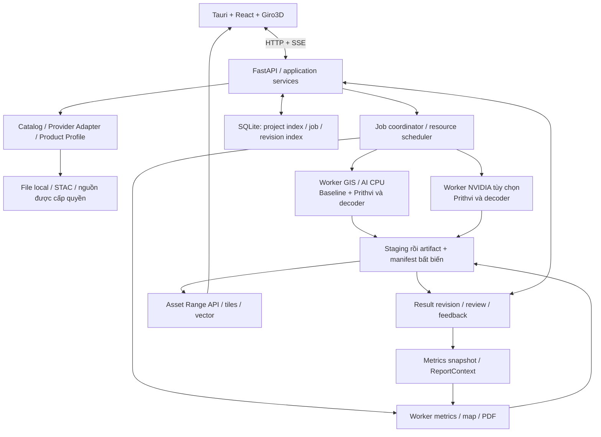

# Kiến trúc thực thi và ranh giới module

> Đồng bộ từ [bản tổng hợp v1.4](../solution/de_xuat_kien_truc_he_thong_geoai_tong_hop.md), ngày 08/11/2026. Đây là đề xuất thiết kế; chưa triển khai hoặc benchmark. Số mục được giữ theo tài liệu gốc.

[Mục lục bộ tài liệu](README.md) · [Danh mục nguồn](17_nguon_tham_khao_va_lich_su.md)

**Phạm vi:** Sơ đồ kiến trúc, API/coordinator/worker và trách nhiệm các module.

## 5. Kiến trúc thực thi và ranh giới module

Các ô là trách nhiệm logic. Bản đầu gồm shell, một API/coordinator và worker theo tài nguyên; không phải mỗi ô là một dịch vụ. Training dùng môi trường phát triển riêng, xuất model package sang ứng dụng.

| Module | Trách nhiệm | Giới hạn |
| --- | --- | --- |
| `contracts` | Schema và quy tắc tương thích | Không import module nghiệp vụ |
| `api` | Request, DTO, lỗi, SSE, quyền truy cập | Không chạy model hoặc GDAL nặng trong request |
| `catalog` | Provider adapter, tìm kiếm, resolve, quyền truy cập | Không chứa thuật toán ngành |
| `products` | Hồ sơ sản phẩm cảm biến và chuẩn hóa metadata | Có thể là package con của catalog ban đầu |
| `geoprocessing` | QA, reprojection, cửa sổ, mask, vector, chuẩn hóa dữ liệu | Không phụ thuộc UI |
| `models` / `compute` | Model package, inference adapter, capability, thiết bị và tài nguyên | Tách hợp đồng model khỏi cơ chế CPU/CUDA |
| `workflows` / `jobs` | Ghép bước, checkpoint, hàng đợi, attempt, cancellation | Chỉ workflow đã đăng ký; chưa cần trình thiết kế DAG tổng quát |
| `analytics` / `domains` | Thuật toán dùng lại; feature ngành, chỉ tiêu và quality gate | Domain không sao chép I/O hay runtime |
| `review` | Revision, quyết định duyệt, annotation/feedback | Không sửa artifact dự đoán gốc |
| `reports` | Metrics snapshot, bản đồ/biểu đồ, template, export | Chỉ nhận revision được chỉ định |
| `viewer` / `storage` | Layer/asset serving; metadata, artifact, cache | State nghiệp vụ không nằm trong object của renderer |

Không bắt buộc tạo một thư mục cho mỗi tên ngay lập tức. Dùng registry tĩnh và schema có kiểu; chỉ thêm interface khi có triển khai thay thế thực tế. Sinh client TypeScript từ OpenAPI; một nguồn định nghĩa schema.

### 5.1. Hướng phụ thuộc và kiểm tra ranh giới

Bảng dưới là hướng import nội bộ đề xuất khi tách module; mọi module được dùng `contracts`. Thư viện bên ngoài thuộc adapter có trách nhiệm tương ứng, không làm cầu nối để gọi ngược module cấp trên. Các tên đang ghép trong bảng trách nhiệm có thể cùng package lúc đầu; kiểm tra ranh giới theo package thực có, không tạo module rỗng chỉ để đủ sơ đồ.

| Module | Phụ thuộc nội bộ được phép ngoài `contracts` |
| --- | --- |
| `contracts` | Không có |
| `storage`, `products` | Không có; adapter file/database nằm trong `storage` |
| `catalog` | `products`, `storage` |
| `geoprocessing` | `products`, `storage` |
| `models` | `products`, `storage`; quản lý ModelSpec/pack, không điều khiển scheduler |
| `compute` | `models`; runtime adapter nhận model/input đã xác thực, không gọi workflow |
| `analytics` | `geoprocessing`, `models`, `compute` |
| `review` | `storage` |
| `reports` | `geoprocessing`, `storage`; nhận ReportContext đã chốt, không tự chọn revision |
| `viewer` | `geoprocessing`, `storage` |
| `jobs` | `compute`, `storage`; gọi handler đã đăng ký qua hợp đồng, không import `workflows` |
| `workflows` | `jobs`, `catalog`, `analytics`, `geoprocessing`, `review`, `reports`, `storage` |
| `domains` | `workflows`, `analytics`, `reports`; khai báo feature theo registry |
| `api` | `workflows`, `jobs`, `catalog`, `review`, `viewer`, `storage` |

`bootstrap` là điểm ghép adapter, đăng ký domain/handler và khởi tạo ứng dụng; được tham chiếu các module trên, nhưng các module không import ngược `bootstrap`. `products` có thể nằm trong `catalog.products`; khi kiểm tra import phải cho phép đúng subpackage này, không mở quyền import toàn bộ `catalog` cho module nền.

CI kiểm tra import cấm và phụ thuộc vòng, có thể dùng import-linter hoặc công cụ tương đương. Bổ sung kiểm tra khi package thật được tạo; nếu cần đổi hướng phụ thuộc thì sửa bảng và giải thích trong review. Quy tắc import không chứng minh I/O hay tính toán nặng đã chạy ngoài request: G1/G2 vẫn phải kiểm tra API/UI phản hồi khi worker đang xử lý.

### 5.2. Repository metadata và migration

Đề xuất **SQLAlchemy** cho repository metadata và **Alembic** cho migration [T13], [T14]. SQLite WAL và một coordinator ghi vẫn là cấu hình local. Module nghiệp vụ nhận DTO/hợp đồng; session/transaction và SQL nằm trong adapter repository, không truyền ORM object qua IPC hoặc lưu vào snapshot. Core hay ORM được chọn theo truy vấn thực, không bắt buộc một `BaseRepository` chung cho mọi bảng.

Migration chỉ chạy sau khi có khóa writer độc quyền và backup hợp lệ theo [mục 10.3](09_luu_tru_artifact_va_project.md#muc-10-3), trước khi nhận job ghi dữ liệu. Review migration sinh tự động; với SQLite, kiểm tra cả batch/table rebuild, constraint/index, dữ liệu cũ và dung lượng tạm. Ghi nhận thành công chỉ sau kiểm tra schema/data; lỗi hoặc gián đoạn phải có đường restore đã thử, không mặc định rollback app sẽ đảo được migration dữ liệu. Version Alembic của database khác `schema_version` của manifest/API.

CI bản đầu tập trung SQLite, repository contract, upgrade từ phiên bản được hỗ trợ và restore. Khi bắt đầu adapter PostgreSQL ở G4, dùng cùng bộ repository contract và bổ sung kiểm tra khác biệt transaction/claim/migration trước nghiệm thu server. CI hai database từ G0 hoặc runner GPU hàng đêm là lựa chọn theo nhu cầu/ngân sách, không phải điều kiện mặc định của desktop.

---

**Tài liệu liên quan:**

- [Hợp đồng dữ liệu và versioning](05_hop_dong_du_lieu_va_versioning.md)
- [Job, tài nguyên và phục hồi](08_job_tai_nguyen_va_phuc_hoi.md)
- [Lưu trữ, artifact và project di động](09_luu_tru_artifact_va_project.md)
- [Bảo mật, hướng lên server và vận hành](14_bao_mat_server_va_van_hanh.md)

[T13]: https://docs.sqlalchemy.org/en/20/intro.html
[T14]: https://alembic.sqlalchemy.org/en/latest/batch.html
