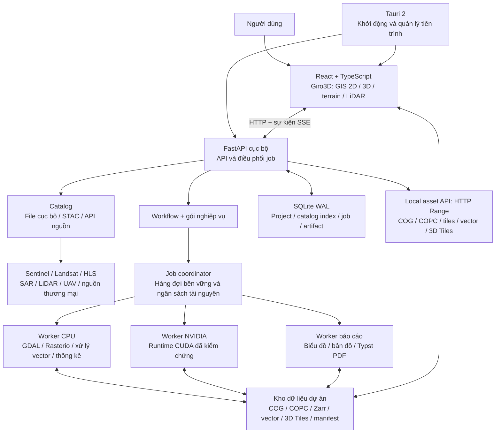

# Đề xuất kiến trúc hệ thống GeoAI

Ngày lập/cập nhật: **08/11/2026**. Phiên bản tài liệu: **1.2**. Trạng thái: **đề xuất kiến trúc để xem xét; chưa triển khai hoặc benchmark sản phẩm**.

Cơ sở: [Cẩm nang kiến trúc](cam_nang_kien_truc_ung_dung_geoai_vien_tham.md), đặc biệt mục 2, 3, 6, 7; [Hướng dẫn xây dựng ứng dụng](<Hướng dẫn xây dựng ứng dụng GeoAI cho viễn thám.md>), đặc biệt mục 3, 4, 11, 12, 13. Các thông tin ảnh hưởng đến lựa chọn GPU được đối chiếu thêm với tài liệu chính thức ở cuối bản đề xuất.

Giả định đã được người dùng xác nhận: **ưu tiên Windows desktop và worker xử lý cục bộ; giữ khả năng đưa cùng backend lên Linux/server**. Số người dùng đồng thời, dữ liệu mẫu, model nghiệp vụ và cấu hình GPU mục tiêu chưa được xác định; các chỉ tiêu hiệu năng cần chốt bằng benchmark ở giai đoạn đầu. Điều chỉnh đã được yêu cầu hợp nhất: **ưu tiên Giro3D cho GIS 2D/3D, terrain và LiDAR; AI tập trung CPU/NVIDIA, hoãn tăng tốc AI AMD**.

## 1. Quyết định kiến trúc

Đề xuất **modular monolith cho lõi ứng dụng, kết hợp các worker chạy ở tiến trình riêng**. Backend dùng chung một codebase Python, chia module theo trách nhiệm. Giao diện desktop dùng **Tauri 2 + React + TypeScript**, bản đồ và 3D dùng **Giro3D**. Tác vụ nặng chạy trong worker CPU/GPU; UI và API duy trì khả năng tương tác trong khi xử lý.

Năm tầng dữ liệu trong hai tài liệu được giữ lại: **thu nhận → chuẩn hóa → mô hình → suy luận/hậu xử lý → phục vụ**. Ba phần được bổ sung rõ hơn là **điều phối tài nguyên**, **báo cáo theo tính năng/ngành** và **pipeline dữ liệu 3D**.

| Phương án | Điểm mạnh | Chi phí và giới hạn | Đánh giá |
| --- | --- | --- | --- |
| **Tauri + lõi Python chia module + worker** | Tận dụng thư viện GIS/AI hiện có; UI web dùng lại được; chọn runtime GPU theo máy | Cần đóng gói thư viện native và kiểm chứng WebView2 | **Khuyến nghị** cho yêu cầu hiện tại |
| Native C++/Qt với engine đồ họa native | Kiểm soát sâu rendering và tích hợp hệ điều hành | Khối lượng C++ và cầu nối ML lớn; dùng lại UI web khó hơn | Phù hợp nếu sau này có yêu cầu đồ họa mà renderer WebView không đáp ứng |
| Web với các dịch vụ phân tán ngay từ đầu | Thuận lợi khi nhiều người dùng dùng chung cụm GPU | Tăng vận hành, mạng và đồng bộ trạng thái; xử lý nằm ở server | Dành cho giai đoạn có nhu cầu triển khai tập trung |

“Công nghệ mới nhất” được hiểu là **bản ổn định còn được duy trì, tương thích và đã đo trên workload của GeoAI**. Mô hình nhiều tham số hơn hay framework mới hơn chỉ được đưa thành mặc định khi cải thiện chất lượng hoặc tốc độ thực tế.

## 2. Sơ đồ thực thi



Đây là các khối logic; không phải mỗi ô là một dịch vụ phải cài đặt. Phiên bản desktop có shell, API/coordinator và số worker giới hạn theo tài nguyên. Tile API có thể gắn vào FastAPI. Worker AI chỉ khởi động khi cần; giữ model trong bộ nhớ khi có chuỗi công việc cùng loại.

Rust chỉ phục vụ shell Tauri, vòng đời tiến trình và tích hợp hệ điều hành. Nghiệp vụ GIS/AI nằm trong Python. TypeScript quản lý tương tác và hiển thị. Các phép tính nặng chạy qua thư viện native hoặc GPU kernel của framework.

## 3. Ranh giới module và cấu trúc code

| Module | Trách nhiệm và giao diện chính | Phụ thuộc cho phép |
| --- | --- | --- |
| `api` | Kiểm tra request, trả DTO, tiến độ và lỗi | Dịch vụ ứng dụng; không trực tiếp chạy model |
| `catalog` | Tìm nguồn, mô tả asset, xác thực khả năng truy cập; `search`, `resolve`, `import` | Adapter nguồn, storage |
| `geoprocessing` | Đọc cửa sổ, mask, đồng lưới, SAR, vector và chuyển đổi dữ liệu | GDAL/Rasterio, thư viện chuyên ngành |
| `analytics` | Các phép phân tích dùng lại: chỉ số, phân loại, phân đoạn, phát hiện, biến động, hồi quy | Geoprocessing và compute qua hợp đồng |
| `workflows` | Ghép bước xử lý, kiểm tra đầu vào, checkpoint và quản lý lần chạy | Các module xử lý; không phụ thuộc frontend |
| `compute` | Phát hiện thiết bị, chọn runtime, cấp phát ngân sách; `capabilities`, `execute` | Adapter runtime và trình quản lý worker |
| `domains` | Định nghĩa tính năng từng ngành: tham số, workflow, chỉ tiêu, mẫu báo cáo | Hợp đồng workflow, analytics, reports |
| `reports` | Biến snapshot kết quả thành bản đồ, bảng, biểu đồ và tài liệu | Artifact đã hoàn tất, chỉ tiêu và template |
| `viewer` | Mô tả lớp Giro3D, asset/tile API, chuẩn hóa COG/COPC và 3D Tiles khi cần | Artifact và geoprocessing |
| `storage` | Project, job, metadata, artifact, cache; adapter local/server | SQLite/filesystem hoặc PostgreSQL/object storage |

Các module trao đổi qua kiểu dữ liệu rõ ràng: `AssetRef`, `GridSpec`, `ModelSpec`, `JobSpec`, `RunManifest`, `ReportContext`. `contracts` không import các module nghiệp vụ; `bootstrap` ghép adapter và đăng ký feature để tránh dependency vòng. Chỉ thêm interface ở chỗ thực sự có nhiều cách triển khai, như nguồn ảnh, runtime tính toán và lưu trữ.

```text
geoai/
├── apps/
│   └── desktop/
│       ├── src/
│       │   ├── features/       # workspace, data, analysis, reports, compute
│       │   ├── viewer/         # tích hợp Giro3D; quản lý camera và lớp
│       │   └── api/            # client TypeScript sinh từ OpenAPI
│       └── src-tauri/          # shell mỏng; quản lý sidecar
├── backend/
│   ├── src/geoai/
│   │   ├── api/
│   │   ├── contracts/
│   │   ├── catalog/            # providers nằm cùng module catalog
│   │   ├── geoprocessing/
│   │   ├── analytics/
│   │   ├── workflows/
│   │   ├── compute/            # adapter runtime và vòng đời worker
│   │   ├── domains/            # từng ngành: feature spec, metrics, template
│   │   ├── reports/
│   │   ├── viewer/
│   │   ├── storage/
│   │   └── bootstrap.py       # ghép cấu hình và dependency
│   └── tests/                 # kiểm chứng hợp đồng và tính đúng địa lý
├── models/                    # manifest; trọng số tải riêng theo nhu cầu
├── packaging/                 # cấu hình build, runtime pack và lockfile
└── docs/
```

Đây là cấu trúc đích; chỉ tạo module có chức năng thực tế trong từng giai đoạn. Mỗi tính năng nghiệp vụ gọi lại các thuật toán dùng chung. Một tính năng “diện tích lúa theo vụ” và “diện tích rừng” có thể dùng cùng thao tác thống kê vùng, nhưng có định nghĩa lớp, kiểm định và báo cáo khác nhau.

Quy tắc giữ code gọn: một nơi định nghĩa schema; sinh client UI từ OpenAPI; không tạo `BaseService`/`BaseRepository` cho mọi lớp; không gom nghiệp vụ vào `utils`; không đưa code notebook vào runtime sản phẩm. Với plugin ban đầu, dùng registry tĩnh và cấu hình đã kiểm tra kiểu, tránh nạp mã tùy ý.

## 4. Stack mặc định và phần mở rộng

| Hạng mục | Lựa chọn ban đầu | Chỉ bổ sung khi có nhu cầu |
| --- | --- | --- |
| Desktop/UI | Tauri 2, React, TypeScript, Vite, Giro3D (Three.js và nguồn OpenLayers) | Web client dùng lại phần React |
| API/hợp đồng | FastAPI, Pydantic, OpenAPI, SSE | OIDC và phân quyền cho server |
| GIS raster/vector | GDAL/PROJ, Rasterio, Shapely, Pyogrio | GeoPandas cho thao tác cần bảng không gian |
| Khối dữ liệu nhiều chiều | Xarray, `odc-stac` | Dask khi dữ liệu vượt RAM hoặc cần chuỗi thời gian lớn |
| Catalog | `pystac-client`, STAC JSON và chỉ mục local | `earthaccess`, `asf_search`, API thương mại theo adapter |
| ML và AI | Scikit-learn cho baseline; PyTorch cho model cần học sâu | TorchGeo/TerraTorch trong môi trường huấn luyện |
| Suy luận | CPU và một đường CUDA chính theo model: ONNX Runtime hoặc PyTorch | TensorRT/INT8 sau benchmark; runtime AI AMD hoãn |
| Tile raster | `rio-tiler`/TiTiler gắn vào API | Cache tile và dịch vụ tile độc lập khi tải tăng |
| Metadata/job | SQLite WAL, một coordinator ghi trạng thái | PostgreSQL/PostGIS khi lên server |
| Artifact | Filesystem; COG, COPC cho LiDAR, GeoPackage/GeoParquet, STAC JSON | S3-compatible, Zarr, PMTiles, 3D Tiles theo sản phẩm |
| Báo cáo | `ReportContext` JSON, Matplotlib, Typst CLI cho PDF | XlsxWriter cho bảng XLSX; DOCX khi có mẫu bắt buộc |
| Đóng gói | Tauri bundler: NSIS EXE; profile Standard/Offline; pnpm và Pixi lockfile theo nền tảng | MSI/WiX cho triển khai tập trung; container Linux cho API và worker server |

Không bắt buộc PostgreSQL, Redis, Kubernetes, Ray, MLflow hoặc một dịch vụ vector database trong bản desktop đầu tiên. Khi cần tìm tương đồng bằng embeddings ở server, có thể dùng pgvector trên PostgreSQL đã có. Huấn luyện có môi trường riêng; máy người dùng chỉ cài runtime suy luận và model cần dùng.

## 5. Hỗ trợ dữ liệu và nhiều nguồn vệ tinh

### 5.1. Định dạng

| Nhóm | Định dạng cần hỗ trợ qua adapter | Dạng phục vụ nội bộ và giới hạn |
| --- | --- | --- |
| Raster quang học/DEM | GeoTIFF/COG, JP2, PNG/JPEG có georeference | COG cho raster cần đọc theo vùng; ảnh thiếu CRS phải bổ sung thông tin trước phân tích địa lý |
| Khối nhiều chiều/siêu phổ | NetCDF, HDF4/HDF5, Zarr, ENVI | Xarray/Zarr khi phù hợp; chọn đúng subdataset, trục thời gian, bước sóng và đơn vị |
| Sản phẩm vệ tinh | Sentinel SAFE, Landsat và metadata cảm biến | Giữ nguyên bản gốc và level xử lý; tạo asset phân tích có nguồn gốc rõ ràng |
| SAR | GRD, RTC, SLC và sản phẩm chuyên biệt | RTC/amplitude có thể thành raster phân tích; SLC cần giữ pha, thông tin quỹ đạo và pipeline riêng |
| Vector | GeoPackage, GeoJSON, Shapefile, FlatGeobuf, GeoParquet, KML/KMZ | GeoPackage cho trao đổi/chỉnh sửa; GeoParquet cho bảng lớn; chuyển CRS và kiểm tra hình học |
| Đám mây điểm | LAS/LAZ, COPC, E57 theo driver | PDAL cho xử lý; ưu tiên COPC cho Giro3D, 3D Tiles khi cần. GEDI/ICESat-2 cần adapter sản phẩm riêng, không mặc định là LiDAR phủ kín |
| Mô hình 3D | glTF/GLB, 3D Tiles; OBJ/IFC qua bộ chuyển tùy chọn | GLB cho mô hình nhỏ; 3D Tiles cho dữ liệu phân cấp lớn |

Khả năng đọc và ghi được công bố theo **driver thực sự có trong gói cài đặt**. Kiểm tra driver lúc khởi động; không hứa hỗ trợ toàn bộ định dạng GDAL chỉ vì đã cài Rasterio. Một số định dạng hoặc codec có dependency riêng.

Không chuyển mọi dữ liệu sang COG: giữ Zarr cho cube khi có lợi, LAS/COPC cho điểm, vector cho hình học và dữ liệu phức SAR cho InSAR. Tệp gốc được tham chiếu hoặc nhập vào dự án; không âm thầm nhân đôi toàn bộ dữ liệu.

### 5.2. Adapter nguồn

Nhóm nguồn mở đầu tiên: **Sentinel-2, Landsat/HLS, Sentinel-1 RTC và DEM**, truy cập qua STAC của Earth Search, Planetary Computer hoặc Copernicus theo collection đang có. Mở rộng NASA Earthdata/ASF cho SAR, GEDI và các sản phẩm khác; Planet/Maxar/Airbus theo quyền truy cập. Nguồn trong nước và vệ tinh mới được thêm bằng adapter cùng hợp đồng.

Mỗi adapter khai báo khả năng: `search`, `preview`, `window_read`, `download`, `remote_compute`. Không giả định mọi nguồn đều cung cấp COG hoặc URL tải trực tiếp. Catalog local dùng chỉ mục bbox/R-tree để lọc nhanh, rồi kiểm tra giao footprint khi cần. Earth Engine/openEO thuộc nhóm xử lý từ xa, kết quả được nhập lại như artifact; không dùng GPU cục bộ để thực thi tác vụ đang chạy trên hạ tầng của nhà cung cấp.

WMS/WMTS và tile ảnh dùng để hiển thị; chỉ dùng cho phân tích khi có dữ liệu và ngữ nghĩa phù hợp. Phân trang, giới hạn kết quả, quota và thời hạn URL được xử lý trong adapter. Job ghi danh sách scene/asset đã chọn thành snapshot; không tìm lại danh sách ảnh khi chạy lại báo cáo.

### 5.3. Hợp đồng dữ liệu địa lý

`AssetRef` ghi ID nguồn/scene, cảm biến, thời gian thu nhận, processing level, CRS, footprint, kênh, bước sóng/phân cực, đơn vị, scale/offset, NoData và checksum khi có. URL ký tạm thời được giải quyết lúc đọc; credential không nằm trong manifest kết quả.

`GridSpec` ghi **CRS + affine transform + width/height + pixel size + extent + mask hợp lệ**. AOI tìm kiếm được chuẩn hóa về WGS84; lưới xử lý chọn theo bài toán và model. Không gán cùng một UTM hoặc kích thước pixel cho mọi dự án.

Đồng đăng ký trước so sánh biến động; kiểm tra trục tọa độ, scale/offset, thứ tự kênh và mask trước suy luận. Raster nhãn dùng phép resample giữ nhãn; nội suy ảnh liên tục theo yêu cầu cảm biến/model. Chuẩn hóa theo model card và pipeline huấn luyện, không áp dụng percentile clipping cho mọi thuật toán. Diện tích tính trong CRS phù hợp hoặc trên ellipsoid; không tính trực tiếp từ độ kinh/vĩ hay pixel Web Mercator.

Mosaic nhiều ngày phải ghi **mọi scene/ngày thành phần**, phép tổng hợp và mask phủ dữ liệu; nếu sản phẩm cần truy ngày theo pixel thì xuất thêm lớp ngày hoặc scene nguồn. Nâng kích thước lưới không tạo thêm thông tin đo đạc. Ảnh tái tạo/siêu phân giải có loại sản phẩm riêng, để phân biệt với dữ liệu quan sát.

## 6. Kiến trúc tính toán CPU và NVIDIA

### 6.1. Phân biệt ba loại tăng tốc

**Hiển thị 3D**, **tiền/hậu xử lý GIS**, **AI training/inference** có khả năng tăng tốc khác nhau. Giro3D dùng Three.js và GPU đồ họa qua WebView2/WebGL2; PyTorch/ONNX sử dụng runtime tính toán. GDAL đọc file và nhiều phép biến đổi vẫn chạy CPU. Không có một tùy chọn GPU làm mọi bước nhanh lên như nhau.

Phạm vi phát hành đầu tiên gồm **CPU và tăng tốc AI trên NVIDIA**. Máy AMD/Intel vẫn có thể dùng GPU để render GIS/3D khi driver tương thích; AI chạy CPU. Hoãn runtime AI AMD, không loại bỏ hỗ trợ đồ họa AMD hoặc khả năng mở dự án trên máy AMD.

Windows có thể chọn GPU render khác GPU worker. Trang tài nguyên hiển thị thiết bị thực tế khi truy vấn được, VRAM, runtime, trạng thái hỗ trợ và backend của từng job; backend AI chọn GPU theo device ID. Trường hợp WebView chạy bằng GPU tích hợp cần xử lý cấu hình đồ họa Windows; lựa chọn của worker không tự chuyển GPU cho WebView.

### 6.2. Ma trận backend

| Môi trường | Suy luận | Phạm vi và điều kiện |
| --- | --- | --- |
| Windows CPU, kể cả máy AMD/Intel | ONNX Runtime CPU; NumPy/Scikit-learn; PyTorch CPU khi model cần | Core hoạt động độc lập; công bố model và giới hạn tài nguyên đã kiểm chứng |
| Windows + NVIDIA | ONNX Runtime CUDA cho model xuất ONNX hợp lệ; PyTorch CUDA cho model cần runtime native | Chọn một đường chính theo model đại diện, driver, compute capability và benchmark; compute pack tùy chọn |
| Linux/server CPU hoặc NVIDIA | Dùng lại hợp đồng model và các backend CPU/CUDA được chọn | Kiểm chứng trong giai đoạn server; khóa môi trường riêng theo OS |
| AI trên AMD | Chưa phân phối runtime chuyên biệt trong phạm vi đầu tiên | Dùng CPU; chỉ bổ sung backend khi có nhu cầu và benchmark riêng |

Không đưa tất cả runtime vào bộ cài. TensorRT, INT8 và `torch.compile` là tối ưu tiếp theo khi đo được lợi ích đầu cuối và đạt ngưỡng chất lượng; model có custom op giữ đường PyTorch nếu chưa xuất ONNX hợp lệ. Cache engine và chi phí compile/warm-up phải được tính vào benchmark. [S9]

Huấn luyện/tinh chỉnh nằm trong môi trường phát triển hoặc server riêng, ưu tiên NVIDIA cho phạm vi hiện tại; không phân phối môi trường huấn luyện cùng desktop. Hoãn ROCm, MIGraphX, Windows ML/DirectML cho AI khỏi compute pack và điều kiện nghiệm thu ban đầu. Giữ interface `compute` để mở rộng, chưa tạo các adapter rỗng. Nguồn [S3–S8] được giữ để tra cứu phương án GPU đã hoãn.

### 6.3. Chọn thiết bị và kiểm soát bộ nhớ

Luồng chọn backend: **phát hiện GPU/driver → đối chiếu support matrix → chạy probe nhỏ → kiểm tra tính đúng → đo workload đại diện → lưu lựa chọn theo máy/model**. Máy có GPU nhưng thiếu runtime hoặc model không tương thích phải được báo rõ lý do.

Chế độ `auto`, `cpu`, `gpu:<device_id>` đi cùng chính sách fallback. `auto` chỉ chuyển sang backend đã kiểm chứng và lưu lại backend thực dùng; yêu cầu GPU bắt buộc thì trả lỗi có thể xử lý thay vì âm thầm chạy CPU. Lỗi thiếu thư viện, thiếu operator và hết VRAM có mã lỗi riêng.

Mỗi GPU có một worker chính ở bản đầu. Worker giới hạn model resident, batch và số job; giữ phần VRAM cho hệ điều hành và viewer khi cùng dùng một card. Có nhiều GPU thì phân job độc lập theo khả năng; không giả định có thể gộp VRAM nhiều GPU thành một thiết bị.

Tăng tốc theo thứ tự: giảm đọc thừa → pipeline đọc/tiền xử lý có prefetch giới hạn → batch phù hợp VRAM → giữ model resident → mixed precision → compile/TensorRT hoặc lượng tử hóa nếu có lợi. `torch.compile`, BF16/FP16 và INT8 là tối ưu tùy model/phần cứng; mỗi tối ưu phải kiểm tra độ chính xác. Dùng I/O binding và buffer tái sử dụng khi backend hỗ trợ và đo thấy có lợi; ghi các phần model rơi về CPU và chi phí truyền dữ liệu. Cache engine có khóa gồm model hash, shape/profile, precision, GPU và phiên bản runtime/driver cần thiết.

Khi hết VRAM, giảm batch và thử lại có giới hạn. Chỉ đổi kích thước cửa sổ khi model cho phép và ghi vào cấu hình lần chạy. Dữ liệu lớn đi giữa tiến trình bằng shared memory hoặc memmap được quản lý vòng đời; JSON chỉ chuyển manifest và tham số. Core CPU và compute pack CUDA có môi trường riêng để tránh xung đột DLL/package `onnxruntime`; chỉ cài runtime phục vụ model đã chọn.

## 7. Pipeline, thuật toán và quản trị mô hình

Một workflow gồm các bước đã đăng ký: **resolve inputs → validate → preprocess → infer/analyze → postprocess → measure → publish**. Tính năng có thể bỏ qua bước AI nếu chỉ cần chỉ số phổ hoặc thống kê; không buộc mọi bài toán đi qua deep learning.

| Năng lực | Baseline và lựa chọn triển khai đầu | Hướng hiện đại cần benchmark |
| --- | --- | --- |
| Chỉ số, lớp phủ, phân loại cảnh | Chỉ số phổ, Random Forest; mô hình nhỏ theo input | Encoder EO + decoder hoặc linear probe; embeddings khi khớp thời gian/mục tiêu |
| Phân đoạn/thực thể | U-Net/SegFormer nhỏ; model instance theo nhãn | Prithvi-EO-2.0 hoặc TerraMind + head phù hợp; SAM hỗ trợ gán nhãn VHR |
| Phát hiện vật thể | Detector nhỏ, cắt mảnh giữ vật thể nhỏ | OBB detector cho đối tượng cần góc xoay; chọn bản có trọng số, giấy phép và export phù hợp |
| Biến động | Đồng đăng ký + chỉ số/baseline Siamese | BIT/ChangeFormer hoặc encoder EO dùng chung; kiểm tra biến động giả theo mùa |
| Chuỗi thời gian | Thống kê mùa vụ, TempCNN | U-TAE/temporal attention và fusion SAR–quang học |
| Hồi quy/sinh khối/nước | RF/boosting + biến vật lý/nhãn địa phương | Backbone EO với đầu hồi quy, uncertainty được hiệu chuẩn |
| SAR/InSAR, siêu phổ, LiDAR | RTC; thuật toán phổ; xử lý điểm theo khối | Pipeline chuyên biệt SNAP/ISCE3/MintPy; model phổ/điểm khi đủ dữ liệu |

Prithvi-EO-2.0 và TerraMind có model card chính thức để làm ứng viên, không được xem là mặc định tốt nhất cho mọi ngành. Prithvi được tiền huấn luyện với HLS và sáu kênh theo thứ tự xác định; nhận đủ số kênh chưa đủ để coi dữ liệu là tương đương. [S13, S14]

Suy luận vùng lớn dùng cửa sổ chồng lấn; segmentation ghép bằng trọng số và mask hợp lệ, detection đổi tọa độ và ghép/loại dự đoán trùng. Tỷ lệ chồng lấn chọn theo receptive field, kích thước vật thể và benchmark. Hậu xử lý hình học áp dụng theo loại đối tượng: không ép sông, ruộng hay mọi footprint thành hình chữ nhật.

Model package gồm: trọng số/checksum, task, kênh/đơn vị yêu cầu, GSD/phạm vi hỗ trợ, normalization, class schema, precision được phép, runtime đã kiểm chứng, giấy phép và đánh giá. Giữ bản xác suất khi cần đổi ngưỡng hoặc đánh giá bất định. Spatial/time holdout và dữ liệu kiểm tra độc lập quyết định model có được phát hành; phản hồi người dùng trở thành dữ liệu gán nhãn sau khi được duyệt.

Huấn luyện và thử nghiệm tách khỏi desktop runtime. Có thể dùng TorchGeo/TerraTorch và MLflow ở môi trường phát triển/server, sau đó xuất model package đã duyệt. Không phân phối môi trường nghiên cứu và toàn bộ dataset cùng bộ cài desktop.

## 8. Báo cáo theo từng tính năng và lĩnh vực

Đơn vị cấu hình là **`domain_id + feature_id + feature_version`**. Mỗi tính năng khai báo schema tham số, yêu cầu dữ liệu, workflow, chỉ tiêu và mẫu báo cáo. Thuật toán và engine xuất tài liệu được dùng lại; công thức nghiệp vụ được quản lý tại gói ngành.

| Lĩnh vực | Ví dụ tính năng | Nội dung báo cáo đặc thù |
| --- | --- | --- |
| Nông nghiệp | Diện tích lúa theo vụ; sinh trưởng | Diện tích theo thửa/xã, chuỗi chỉ số, lịch thời vụ, vùng thiếu dữ liệu |
| Lâm nghiệp/carbon | Mất rừng; sinh khối | Diện tích biến động, dữ liệu kiểm chứng, sinh khối và giả định quy đổi carbon |
| Thiên tai | Ngập; vùng cháy; thiệt hại | Diện tích, thời điểm ảnh trước/sau, công trình bị ảnh hưởng, vùng chưa quan sát |
| Đô thị/địa chính | Footprint; xây dựng mới; đảo nhiệt | Đếm/diện tích, thay đổi theo khu vực, đối chiếu lớp tham chiếu, sai số vị trí |
| Biển/ven biển | Tàu; đường bờ; ao nuôi | Tọa độ/hướng/kích thước, đối chiếu AIS theo thời gian nếu có, biến động đường bờ |
| Tài nguyên/môi trường | Nước; khai khoáng; chất lượng môi trường | Chỉ tiêu có đơn vị, phương pháp và hiệu chuẩn địa phương, chuỗi thời gian |
| Hạ tầng/năng lượng | Điện mặt trời; hành lang tuyến | Đối tượng, diện tích, khoảng cách và tiêu chí giao cắt theo quy tắc ngành |

Luồng báo cáo: **RunManifest hoàn tất → tính/chốt metrics → ReportContext bất biến → bản đồ/biểu đồ → template → PDF và phụ lục**. Mẫu PDF dùng Typst CLI và font tiếng Việt đóng gói sẵn, chạy offline. XLSX bổ sung khi cần bảng chi tiết; DOCX chỉ khi yêu cầu biên tập hoặc mẫu cơ quan. [S15]

`ReportContext` phải ghi phạm vi AOI, thời gian ảnh, khoảng thời gian phân tích, model/feature version, ngưỡng, diện tích quan sát hợp lệ, đơn vị, phương pháp thống kê, đánh giá chất lượng, tham chiếu artifact và phiên bản template. Phân biệt ngày thu nhận ảnh, ngày chạy phân tích và ngày lập báo cáo.

Bản đồ báo cáo mặc định dựng từ artifact bằng renderer 2D trong worker, kèm chú giải, tỷ lệ và thông tin CRS. Ảnh 3D tùy chọn được lưu thành artifact kèm camera, lớp và kiểu hiển thị. Không phụ thuộc vào việc cửa sổ Giro3D đang mở để tạo PDF chuẩn. Template và tài nguyên font được lưu phiên bản; không tải package mới khi xuất báo cáo offline.

Tỷ lệ xác suất của model không tự trở thành khoảng tin cậy thống kê. Ước tính diện tích điều chỉnh sai số cần thiết kế lấy mẫu và ma trận đánh giá phù hợp; thiếu dữ liệu kiểm định thì ghi giới hạn. Cùng một snapshot dùng cho bảng thống kê, bản đồ và báo cáo; thay ngưỡng hoặc nguồn ảnh tạo phiên bản kết quả mới.

## 9. Engine Giro3D và pipeline hiển thị

### 9.1. Lựa chọn engine

**Giro3D là engine được chọn trong đề xuất**, thay CesiumJS, theo ưu tiên GIS 2D/3D, terrain, LiDAR và bộ cài gọn. Giữ Tauri + React + TypeScript; Giro3D dùng Three.js và nguồn dữ liệu OpenLayers. Ứng dụng vẫn render qua WebView2/WebGL2, không phải renderer native C++.

Giro3D có nguồn COG độ cao, COPC/LAS/LAZ, vector và 3D Tiles, cùng clipping, đường đồng mức và tô màu point cloud. Đã kiểm tra package 2.0.6 có `GeoTIFFSource`, `COPCSource` và license MIT. Đây là bằng chứng về API/package, chưa phải benchmark chứng minh nhanh hơn Cesium hoặc bộ cài nhỏ hơn. [S20, S21]

| Phương án | Vai trò và đánh đổi |
| --- | --- |
| **Giro3D + Tauri** | Phương án chính; kiểm chứng DEM, LiDAR và vector nghiệp vụ trong bản build Windows |
| iTowns + Tauri | Phương án đối chứng nếu Giro3D không đạt; iTowns 2.46.0 có `CopcSource`, nhưng `CogSource` trên nhánh phát triển chưa thấy trong gói đã kiểm tra |
| osgEarth + Qt/C++ | Phương án native khi có yêu cầu được chứng minh; tăng công việc C++/UI và đóng gói dependency |

Không đóng gói đồng thời các engine chỉ để dự phòng. Tích hợp nguồn OpenLayers không đồng nghĩa có đầy đủ công cụ nhãn/biên tập của một bản đồ OpenLayers. Chỉ thêm view OpenLayers/MapLibre khi fixture nghiệp vụ chứng minh cần. Lý do và so sánh chi tiết được lưu trong [tài liệu đánh giá engine](de_xuat_thay_cesium_va_thu_hep_gpu.md). [S23, S24]

### 9.2. Luồng dữ liệu hiển thị

| Dữ liệu gốc | Chuẩn bị dữ liệu | Cách hiển thị |
| --- | --- | --- |
| COG quang học/kết quả AI | Overviews, band mapping và mask | `GeoTIFFSource` cho trường hợp đã kiểm chứng; tile API cho style/biểu thức phức tạp |
| DEM/DSM/DTM | COG độ cao, CRS/datum đứng, NoData và overviews | Lớp elevation tạo bề mặt địa hình; không bắt buộc chuyển thành Quantized Mesh |
| COPC | Kiểm tra CRS, thuộc tính và phân loại | `COPCSource`, LOD và ngân sách điểm; không bắt buộc chuyển thành 3D Tiles |
| LAS/LAZ/E57 lớn | PDAL chuẩn hóa và chuyển sang COPC theo driver hỗ trợ; giữ nguồn gốc | Đọc từng phần COPC; tránh tải toàn bộ point cloud |
| Footprint + chiều cao | Kiểm tra đơn vị, nguồn chiều cao và CRS | Vector/feature collection, extrusion hoặc vector tiles theo quy mô |
| GLB/mesh/photogrammetry | Chuẩn hóa tọa độ, tiling khi cần | Three.js/glTF hoặc 3D Tiles với các extension đã kiểm chứng |

Đọc trực tiếp không bảo đảm mọi file có hiệu năng tốt: GeoTIFF có thể cần chuyển COG/overviews, LAS/LAZ thường có thể cần chuyển COPC. Codec và bộ đọc JavaScript có giới hạn khác GDAL; backend chuẩn hóa hoặc phục vụ tile khi frontend không đọc được. `py3dtiles` chỉ cần khi sản phẩm thực sự dùng 3D Tiles, không còn là bước bắt buộc cho mọi point cloud. [S12, S16, S20]

Local asset API truy cập bằng `asset_id` đã đăng ký, hỗ trợ HTTP Range/206, Content-Length, ETag và cache policy. COG/COPC đọc theo vùng và LOD; không chuyển nguyên file lớn qua Tauri IPC/JSON. Kiểm chứng header xác thực bằng fetch hook của phiên bản Giro3D được khóa; tránh token trong URL và kiểm tra các request Range/worker đều được xác thực.

### 9.3. Tính đúng, hiệu năng và state

Định nghĩa rõ độ cao ellipsoid/geoid, đơn vị và datum đứng; phân biệt DTM/DSM/mesh. Đo đạc chính thức lấy mẫu/tính toán từ dữ liệu nguồn qua backend, không mặc định dùng mesh LOD hoặc texture đang hiển thị. Kiểm tra sai số tọa độ, reprojection và phạm vi dự án khi mở rộng địa bàn.

Hiệu năng dựa trên LOD, culling, giới hạn request/cache, số điểm/tam giác và texture theo viewport. Đo byte đọc, RAM/VRAM, cold/warm load và frame time; giải phóng tài nguyên khi đóng lớp. Tải lớp khi cần, hạn chế render lúc đứng yên và giữ ngân sách GPU cho viewer khi AI chạy cùng card.

AOI, layer ID, style, selection, mốc thời gian và kết quả đo nằm trong state ứng dụng, tách khỏi object Giro3D/Three.js. Ứng dụng điều khiển đổi asset theo thời gian và lưu camera/lớp, không giả định engine tự cung cấp toàn bộ workflow chuỗi thời gian.

Tài nguyên viewer, decoder/WASM, font và dữ liệu nền cần thiết được đóng gói local. Trong Giro3D 2.0.6, `sources/las/config.js` mặc định dùng CDN cho laz-perf: phải kèm WASM tương ứng và đặt `setLazPerfPath` về tài nguyên local trước khi tạo nguồn LAS/LAZ/COPC. Kiểm chứng bằng chạy ngắt mạng. [S22]

## 10. Job, nguồn gốc và độ bền dữ liệu

Coordinator lưu hàng đợi vào SQLite và là bên ghi trạng thái chính ở desktop. Worker gửi tiến độ/kết quả; không tự mở nhiều luồng cập nhật DB. Trạng thái: `queued → running → succeeded / failed / cancelled`, kèm heartbeat, attempt và checkpoint. Restart xử lý job mất heartbeat theo chính sách khôi phục, không coi chúng đã hoàn tất.

Scheduler giới hạn CPU thread, RAM, VRAM, I/O và dung lượng tạm. Tách giới hạn số job với số thread GDAL/BLAS/PyTorch để tránh nhân số thread không kiểm soát. Hủy job tại checkpoint; timeout và retry có giới hạn, chỉ áp dụng cho lỗi tạm thời. UI đóng/mở lại có thể xem job và kết quả đã lưu.

`RunManifest` ghi scene/asset nguồn cố định, AOI/GridSpec, feature/model hash, preprocessing, tham số, thời gian, runtime/driver, precision, attempt, coverage và artifact đầu ra. Cache dựa trên nội dung/cấu hình ảnh hưởng kết quả; cache engine suy luận và cache raster là hai loại khác nhau.

Ghi output vào thư mục tạm cùng volume, kiểm tra tính hợp lệ/checksum, đổi tên rồi đăng ký artifact trong transaction. Chỉ công bố result khi đủ manifest và asset. Startup dọn/reconcile tệp tạm hoặc output chưa đăng ký; retry dùng khóa idempotency để tránh tạo kết quả trùng. Đây là xử lý có thể lặp lại an toàn, không phải cam kết thực thi đúng một lần.

Mỗi `ReportRecord` liên kết RunManifest, phiên bản metrics/template, các ảnh/biểu đồ, file xuất và checksum. Xuất lại báo cáo dùng snapshot đã lưu. Không phụ thuộc vào kết quả catalog đang thay đổi ngoài mạng.

Các API tối thiểu: quản lý project/asset; tìm catalog; `POST /v1/jobs`; xem/hủy job; SSE theo dõi tiến độ; xem artifact/report; `/v1/capabilities`; asset COG/COPC qua HTTP Range và tile/vector/3D Tiles. Tạo báo cáo và chuyển đổi 3D cũng là job có loại riêng. API dùng `asset_id`, không nhận tùy ý đường dẫn file hoặc URL để tile server truy cập.

## 11. Build bộ cài Windows và chuyển sang server

### 11.1. Các lựa chọn phân phối

**Bổ sung khả năng build bộ cài Windows cho cùng codebase desktop**, không tạo một nhánh nghiệp vụ riêng. Tauri 2 hỗ trợ NSIS (`setup.exe`) và WiX (`.msi`); không cần thay shell hoặc engine 3D. Đây là lựa chọn thiết kế, chưa phải các bộ cài đã được tạo. [S17]

| Lựa chọn | Đối tượng sử dụng | Nội dung và điều kiện |
| --- | --- | --- |
| **NSIS EXE — Standard** | Người dùng cá nhân; lựa chọn mặc định | Core CPU/GIS, UI và engine 3D; tải compute/model pack đã chọn khi cần. Có thể cần Internet để bổ sung WebView2 và pack |
| **NSIS EXE — Offline** | Máy không kết nối Internet | Core, bộ cài WebView2 offline, model và compute pack đã duyệt theo cấu hình mục tiêu; pack có thể đi kèm trong bộ phân phối thay vì nhúng tất cả vào một EXE |
| **MSI — Enterprise** | Cơ quan/doanh nghiệp triển khai tập trung | Cùng ứng dụng; hỗ trợ quy trình cài im lặng, nâng cấp/gỡ cài và phân phối pack do quản trị viên kiểm soát; xác nhận tham số trên gói đã build |

Định dạng **EXE/MSI** và profile **Standard/Offline** là hai lựa chọn độc lập; có thể build MSI Offline nếu cơ quan yêu cầu. Không build mọi tổ hợp ngay từ đầu. Ưu tiên **NSIS Standard + NSIS Offline cho Windows x64**, thêm MSI khi có nhu cầu triển khai tập trung. ARM64 chỉ phát hành sau khi toàn bộ stack GIS/AI và sidecar đã được kiểm chứng trên kiến trúc đó.

Offline phải bao gồm mọi dependency cần thiết cho tính năng đã công bố: font/package Typst, tài nguyên Giro3D/Three.js và decoder/WASM, runtime, model và dữ liệu/bản đồ nền đã chuẩn bị hoặc có thể nhập cục bộ. Không dùng chế độ chỉ nhúng WebView2 bootstrapper rồi gọi đó là offline; chọn `offlineInstaller`, hoặc fixed runtime khi có quy trình cập nhật riêng. Compute pack NVIDIA và model phải có sẵn trong bộ phân phối offline theo cấu hình đã duyệt; kiểm tra driver và quyền phân phối dependency. Decoder LAZ phải dùng đường local theo mục 9.3. Các tính năng tìm/tải ảnh mới từ Internet vẫn cần kết nối. [S17, S22]

### 11.2. Thành phần đóng gói

Tauri hỗ trợ sidecar cho ứng dụng Python/API. Đóng gói **Python runtime riêng đã khóa phiên bản**, không yêu cầu người dùng cài Python, Docker hay bộ compiler. Bản core có API/GIS/CPU; compute pack theo phần cứng và model pack tải/cài riêng hoặc nhập từ bộ phân phối offline. Tổng bộ cài vẫn có thể lớn vì GDAL/ML, dù shell Tauri nhỏ. [S2]

Để giữ bộ cài gọn, chỉ phân phối Giro3D làm viewer mặc định; các engine đối chứng không nằm trong core. Đo dung lượng đầy đủ của UI, Python/GDAL, công cụ báo cáo, WebView2 nếu kèm, CUDA runtime và model; không dùng kích thước npm package hoặc shell EXE làm đại diện. Core chạy CPU độc lập, compute pack NVIDIA và trọng số được cài theo nhu cầu.

- **Core:** Tauri/React/Giro3D, API/coordinator, Python runtime, dependency GIS/CPU, SQLite, công cụ báo cáo và tài nguyên cần thiết.
- **Compute pack:** runtime NVIDIA đã duyệt, tách môi trường khỏi core CPU để tránh xung đột DLL; không kèm pack AI AMD hoặc môi trường huấn luyện trong phạm vi đầu tiên.
- **Model pack:** trọng số, checksum, model manifest, giấy phép và thông tin kiểm định; không đóng gói mọi model nghiên cứu vào core.
- **Data pack tùy chọn:** dữ liệu mẫu, terrain và bản đồ nền có quyền phân phối; dữ liệu dự án của người dùng nằm ngoài thư mục chương trình.

Chọn phiên bản Python theo giao của GDAL, runtime GPU và thư viện model được dùng; không nâng tự động theo bản Python mới nhất. Pixi/lockfile quản lý môi trường từng nền tảng; compute pack có environment và lock riêng. PyInstaller dạng **onedir** là ứng viên đóng gói sidecar để thử nghiệm trước; không mặc định ép toàn bộ GIS/AI thành một EXE tự giải nén. Bản build phải thu đủ GDAL/PROJ data, DLL, plugin/codec và các tài nguyên mà chương trình tải động. Chỉ chốt cách đóng gói sau smoke test trên máy sạch. [S2]

Manifest phát hành ghi phiên bản app/backend, giao thức sidecar, OS/kiến trúc, model/runtime tương thích, checksum và giấy phép. Không tự cài hoặc nâng driver GPU; kiểm tra phiên bản hiện có, báo hướng dẫn và giữ đường CPU khi chính sách cho phép. Không yêu cầu quyền quản trị cho thao tác chạy/phân tích thông thường.

### 11.3. Pipeline build và phát hành

**Khóa dependency → build frontend → đóng gói sidecar/runtime → stage tài nguyên/pack → build Tauri EXE/MSI → ký số → kiểm thử gói cuối → phát hành.**

- Build bản phát hành trên Windows runner x64 hoặc máy build nội bộ có Rust/MSVC, Node/pnpm và toolchain Python đã khóa; máy người dùng không cần các công cụ này. MSI phải build trên Windows. Công cụ build/bundler cũng được quản lý phiên bản. [S17]
- Kiểm thử sidecar, driver GIS, model CPU/GPU đại diện và PDF trước khi bundle. Kiểm thử lại bộ cài cuối trên Windows sạch, không có môi trường phát triển hoặc PATH do máy build để lại.
- Ký Authenticode có timestamp cho executable/bộ cài cần phân phối; xác minh chữ ký và checksum sau build. Chữ ký không bảo đảm SmartScreen không cảnh báo. Ký artifact updater bằng cơ chế riêng của Tauri; không nhầm chữ ký updater với chứng thư Windows. [S18, S19]
- Artifact phát hành gồm bộ cài đã chọn, pack tương thích, manifest/checksum, thông báo giấy phép và release notes. Khóa/chứng thư ký được quản lý qua kho bí mật hoặc hệ thống ký nội bộ, không đặt trong source code.

### 11.4. Cài đặt, nâng cấp và gỡ cài

NSIS mặc định hướng đến cài theo người dùng; chế độ cài toàn máy hoặc MSI do quản trị viên kiểm soát phải được kiểm thử riêng, không giả định luôn không cần nâng quyền. Dữ liệu ứng dụng/cache/pack đặt trong thư mục người dùng có quyền ghi; project nằm tại vị trí người dùng chọn. Không ghi kết quả hoặc cập nhật runtime trực tiếp vào thư mục chương trình chỉ đọc.

API desktop bind loopback, dùng token theo phiên khởi chạy và kiểm tra origin. Shell quản lý tiến trình con trên Windows bằng cơ chế kết thúc cả nhóm tiến trình khi cần; kiểm tra health để tránh orphan worker. Credential nguồn vệ tinh lưu qua kho credential của hệ điều hành, tách khỏi artifact và log.

Trước cập nhật, chờ hoặc hủy job có kiểm soát, dừng sidecar/worker và kiểm tra dung lượng. App và pack có thể cập nhật riêng nhưng phải vượt kiểm tra tương thích; tải vào vùng staging rồi xác minh chữ ký/checksum trước kích hoạt. Sao lưu metadata trước migration; chỉ rollback app khi schema còn tương thích, nếu không phải khôi phục backup theo quy trình đã kiểm chứng.

Cập nhật online dùng Tauri updater với artifact có chữ ký; môi trường offline nhập bộ cài/pack đã xác minh. Triển khai MSI tập trung có thể tắt updater trong app để tránh hai cơ chế cùng quản lý phiên bản. Gỡ ứng dụng mặc định giữ project/kết quả; chỉ xóa dữ liệu hoặc pack khi người dùng chọn rõ ràng. Gỡ app không gỡ driver GPU hay WebView2 dùng chung. [S18]

### 11.5. Giữ khả năng chuyển sang server

| Thành phần | Desktop Windows | Linux/server |
| --- | --- | --- |
| UI | Tauri + React/Giro3D | Cùng UI React/Giro3D trên trình duyệt |
| API/logic | FastAPI + cùng module Python | Cùng ứng dụng FastAPI trong môi trường server |
| Job | Một coordinator, SQLite, worker local | Repository PostgreSQL với lease/claim transaction và worker nhiều máy |
| Metadata/vector | SQLite index, file vector | PostgreSQL/PostGIS; pgSTAC khi cần catalog service |
| Artifact | Filesystem theo project | S3-compatible; công bố qua manifest và transaction metadata |
| Compute | Core CPU + compute pack NVIDIA tùy chọn | Môi trường CPU/CUDA được kiểm chứng riêng trên Linux |
| Bảo mật | Loopback và credential local | HTTPS, OIDC, phân quyền project, quota và audit |

Storage, job repository và runtime là các điểm thay thế; thuật toán, feature spec, RunManifest và báo cáo giữ cùng hợp đồng. Không coi SQLite/PostGIS là thay thế trong suốt: phép không gian phải nằm trong dịch vụ xử lý với hợp đồng và kiểm chứng tương đương. S3 không có rename như filesystem; dùng object bất biến và chỉ công bố con trỏ manifest khi hoàn tất.

Khi chạy UI trên web, GPU cho AI thuộc máy chạy worker. GPU trên trình duyệt vẫn phục vụ rendering; sử dụng GPU máy người dùng cho job server cần một local agent được thiết kế riêng nếu có nhu cầu sau này.

## 12. Trình tự triển khai và tiêu chí kiểm chứng

Đây là lộ trình quyết định kiến trúc, chưa phải kế hoạch viết code chi tiết. Mỗi giai đoạn có đầu ra kiểm chứng được trước khi mở rộng.

| Giai đoạn | Phạm vi | Điều kiện chuyển tiếp |
| --- | --- | --- |
| **A. Kiểm chứng rủi ro nền tảng** | Bộ cài Tauri/Python; Giro3D trong WebView2 với DEM COG, COPC và vector thửa đất; model nhỏ CPU/NVIDIA; decoder offline; PDF tiếng Việt | Có bằng chứng chạy trên máy Windows sạch và thiết bị thuộc support matrix; biết giới hạn/runtime cần phân phối |
| **B. Một lát cắt nghiệp vụ hoàn chỉnh** | Import + STAC; AOI/chọn scene; một tính năng đại diện; CPU và GPU đã duyệt; bản đồ/3D; PDF có provenance | Chạy từ dữ liệu đầu vào đến báo cáo, có hủy/khôi phục và kiểm tra tính đúng địa lý |
| **C. Mở rộng có chọn lọc** | Gói ngành khác; chuỗi thời gian; SAR; phân tích LiDAR; thêm adapter/model; tối ưu runtime theo benchmark | Mỗi feature có mẫu dữ liệu, chỉ tiêu nghiệm thu, báo cáo và benchmark riêng |
| **D. Server** | PostgreSQL/PostGIS, object storage, worker Linux, xác thực nhiều người dùng | Cùng fixture cho kết quả tương đương local; quản lý quota/concurrency và khôi phục lỗi |

Lát cắt B có thể chọn bản đồ ngập từ Sentinel-1 RTC hoặc bản đồ lớp phủ từ Sentinel-2; người phụ trách nghiệp vụ chốt dựa trên nhãn và dữ liệu đang có. Không triển khai đồng thời toàn bộ ngành và mọi model trong hai cẩm nang.

Benchmark dùng cùng dữ liệu, model và ngưỡng chất lượng cho CPU/NVIDIA. Ghi cấu hình máy, driver, thời gian tải/compile lần đầu, tốc độ sau warm-up, tổng thời gian job, p95 latency, peak RAM/VRAM và chất lượng theo lớp. Chọn backend theo **hiệu năng đầu cuối dưới ràng buộc chất lượng**, không chỉ thời gian một kernel.

Các kiểm chứng bắt buộc cho sản phẩm:

- **Địa lý:** CRS/transform, band order, scale/offset, NoData, đồng đăng ký, diện tích và datum đứng đúng trên fixture đã biết.
- **AI:** spatial/time holdout; so với baseline; đặt ngưỡng sai khác chấp nhận được cho FP32/FP16/INT8 trước tối ưu, kiểm tra cả lớp hiếm.
- **GPU/AI:** CPU và một máy NVIDIA thuộc danh sách hỗ trợ; thiếu runtime, custom op không hỗ trợ, hết VRAM và tranh tài nguyên với viewer. Máy AMD/Intel kiểm tra AI CPU và rendering theo driver đồ họa; không yêu cầu nghiệm thu runtime AI AMD.
- **Dữ liệu lớn:** đọc theo cửa sổ, giới hạn RAM/cache và đĩa tạm được giữ; lỗi mạng/URL hết hạn có thể phục hồi mà không sai provenance.
- **Job/storage:** hủy, worker crash, API restart, retry và output thiếu không tạo kết quả giả hoàn tất.
- **GIS/3D:** fixture DEM COG, COPC lớn và vector thửa đất; đo byte đọc, cold/warm load, RAM/VRAM, frame time và giải phóng lớp khi AI chạy cùng. Kiểm tra nhãn/style/picking theo số feature/đỉnh trong viewport. Mục tiêu khởi đầu khoảng 33 ms/frame (30 FPS) trên scene và cấu hình nghiệm thu; ghi cả phân vị frame time. Xác nhận Range/LOD thực sự giới hạn dữ liệu tải và decoder chạy ngắt mạng.
- **Báo cáo:** tổng số thống kê khớp snapshot; tiếng Việt và đơn vị đúng; ngày/nguồn ảnh/model/template truy được; xuất offline sau khi đủ dữ liệu.
- **Triển khai:** smoke test bản cài sạch Windows và cùng workflow trên Linux; công bố danh sách định dạng/backend thực sự đã kiểm chứng.
- **Bộ cài:** kiểm thử từng profile được phát hành: Standard/Offline, EXE/MSI theo phạm vi chọn; máy không có Python/Node/Docker, thiếu WebView2, tài khoản thường, đường dẫn tiếng Việt/có khoảng trắng và thiếu dung lượng. Profile offline phải cài và chạy feature đại diện khi ngắt mạng; CPU/GPU kiểm chứng riêng theo runtime/EP thực có. Kiểm tra chữ ký, nâng cấp/migration, gói không tương thích, cập nhật gián đoạn, quy trình phục hồi và gỡ cài không xóa project.

## 13. Các quyết định cần giữ khi phát triển

1. **Một lõi nghiệp vụ, worker tách tiến trình, runtime theo phần cứng.** Hạ tầng phân tán chỉ xuất hiện khi quy mô đòi hỏi.
2. **Chuẩn mở ở ranh giới dữ liệu.** STAC mô tả nguồn/kết quả; chọn COG, COPC, Zarr, vector hay 3D Tiles theo loại sản phẩm.
3. **Tính năng ngành là workflow + chỉ tiêu + báo cáo có phiên bản.** Không sao chép pipeline và GPU logic cho từng ngành.
4. **AI ưu tiên CPU/NVIDIA trong phạm vi đầu tiên.** Hoãn backend AI AMD; máy AMD vẫn có thể dùng GPU đồ họa cho viewer và CPU cho phân tích. Hiệu năng phải đo theo model và cấu hình.
5. **Giro3D có pipeline và ngân sách riêng.** Ưu tiên streaming DEM COG và LiDAR COPC; chỉ chuyển đổi khi định dạng hoặc workload cần, kiểm chứng offline và bộ nhớ.
6. **Kết quả và báo cáo truy nguyên được.** Mọi số liệu gắn với dữ liệu nguồn, thời gian và cấu hình xử lý đã cố định.

## 14. Nguồn tham khảo đã đối chiếu

Các trang dưới đây được truy cập để đối chiếu thiết kế ngày 08/11/2026. Tên model là ứng viên kiến trúc; không phải kết quả benchmark GeoAI. Phiên bản package và mức hỗ trợ cần khóa lại tại thời điểm triển khai.

Các nguồn [S3–S8] và [S10–S11] được giữ để truy vết phương án GPU/engine trước khi điều chỉnh; chúng không còn xác định dependency bắt buộc của bản phát hành đầu tiên. Nguồn Giro3D hiện dùng là [S20–S22]; so sánh engine xem [S23–S24].

- **[S1]** [Cẩm nang kiến trúc](cam_nang_kien_truc_ung_dung_geoai_vien_tham.md) và [Hướng dẫn GeoAI](<Hướng dẫn xây dựng ứng dụng GeoAI cho viễn thám.md>) trong workspace.
- **[S2]** [Tauri 2 — Embedding External Binaries](https://v2.tauri.app/develop/sidecar/).
- **[S3]** [Microsoft — Windows ML overview](https://learn.microsoft.com/en-us/windows/ai/new-windows-ml/overview), [Get started, gồm Python](https://learn.microsoft.com/en-us/windows/ai/new-windows-ml/get-started), [Tutorial](https://learn.microsoft.com/en-us/windows/ai/new-windows-ml/tutorial).
- **[S4]** [Microsoft — Supported execution providers](https://learn.microsoft.com/en-us/windows/ai/new-windows-ml/supported-execution-providers): điều kiện Windows/driver và catalog EP AMD/NVIDIA.
- **[S5]** [ONNX Runtime — ROCm EP](https://onnxruntime.ai/docs/execution-providers/ROCm-ExecutionProvider.html): thông báo loại bỏ từ 1.23, chuyển sang MIGraphX.
- **[S6]** [ONNX Runtime — MIGraphX EP](https://onnxruntime.ai/docs/execution-providers/MIGraphX-ExecutionProvider.html).
- **[S7]** [ONNX Runtime — DirectML EP](https://onnxruntime.ai/docs/execution-providers/DirectML-ExecutionProvider.html): trạng thái sustained engineering và hướng Windows ML.
- **[S8]** [AMD — Radeon Windows compatibility](https://rocm.docs.amd.com/projects/radeon-ryzen/en/latest/docs/compatibility/compatibilityrad/windows/windows_compatibility.html), [Radeon Linux compatibility](https://rocm.docs.amd.com/projects/radeon-ryzen/en/latest/docs/compatibility/compatibilityrad/native_linux/native_linux_compatibility.html). Đây là các ma trận theo dòng phiên bản; triển khai phải theo ma trận của bản runtime được chọn.
- **[S9]** [ONNX Runtime — TensorRT EP](https://onnxruntime.ai/docs/execution-providers/TensorRT-ExecutionProvider.html): provider fallback và engine cache.
- **[S10]** [CesiumJS — Cesium3DTileset](https://cesium.com/learn/cesiumjs/ref-doc/Cesium3DTileset.html).
- **[S11]** [CesiumJS — CesiumTerrainProvider](https://cesium.com/learn/cesiumjs/ref-doc/CesiumTerrainProvider.html): Quantized Mesh/heightmap terrain.
- **[S12]** [GDAL — COG driver](https://gdal.org/en/stable/drivers/raster/cog.html).
- **[S13]** [Prithvi-EO-2.0-300M-TL — model card](https://huggingface.co/ibm-nasa-geospatial/Prithvi-EO-2.0-300M-TL).
- **[S14]** [TerraMind-1.0-base — model card](https://huggingface.co/ibm-esa-geospatial/TerraMind-1.0-base).
- **[S15]** [Typst — Open-source compiler](https://typst.app/open-source/).
- **[S16]** [py3dtiles — tài liệu dự án](https://py3dtiles.org/).
- **[S17]** [Tauri 2 — Windows Installer](https://v2.tauri.app/distribute/windows-installer/): NSIS EXE, WiX MSI, nền tảng build và các chế độ phân phối WebView2.
- **[S18]** [Tauri 2 — Updater](https://v2.tauri.app/plugin/updater/): artifact cập nhật có chữ ký, tách biệt với ký Authenticode.
- **[S19]** [Tauri 2 — Windows Code Signing](https://v2.tauri.app/distribute/sign/windows/): ký ứng dụng/bộ cài Windows và yêu cầu chứng thư.
- **[S20]** [Giro3D — tính năng và định dạng](https://giro3d.org/giro3d.html), [ví dụ](https://giro3d.org/latest/examples/), [API](https://giro3d.org/latest/apidoc/modules.html): GIS raster/vector, elevation, COPC và 3D Tiles.
- **[S21]** [Giro3D 2.0.6 — metadata npm](https://registry.npmjs.org/@giro3d/giro3d/2.0.6): tarball đã được kiểm tra có `GeoTIFFSource`, `COPCSource` và license MIT.
- **[S22]** [Giro3D 2.0.6 — cấu hình laz-perf](https://unpkg.com/@giro3d/giro3d@2.0.6/sources/las/config.js): mặc định CDN, cấu hình đường local qua `setLazPerfPath`; đã đối chiếu trong tarball npm.
- **[S23]** [iTowns 2.46.0 — metadata npm](https://registry.npmjs.org/itowns/2.46.0), [CogSource trên nhánh phát triển](https://github.com/iTowns/itowns/blob/master/packages/Main/src/Source/CogSource.ts): cần phân biệt API phát triển với nội dung bản phát hành.
- **[S24]** [osgEarth — tài liệu](https://docs.osgearth.org/en/latest/), [license hiện tại](https://docs.osgearth.org/en/latest/license.html); [đánh giá các engine và phạm vi GPU của GeoAI](de_xuat_thay_cesium_va_thu_hep_gpu.md).

## 15. Lịch sử thay đổi

Các phiên bản dưới đây là phiên bản tài liệu kiến trúc, không phải phiên bản phần mềm. Lịch sử được tổng hợp từ các lần sửa đã đối chiếu trong phiên làm việc; chưa có sản phẩm được build hoặc benchmark.

| Phiên bản | Ngày | Nội dung thay đổi | Cơ sở / trạng thái |
| --- | --- | --- | --- |
| 1.0 | 08/11/2026 | Lập kiến trúc Windows desktop: Tauri/React, backend Python chia module, worker CPU/GPU, CesiumJS, hợp đồng dữ liệu, báo cáo và hướng chuyển server | Dựa trên hai cẩm nang và lựa chọn desktop-first của người dùng; bản đề xuất ban đầu |
| 1.1 | 08/11/2026 | Mở rộng mục bộ cài Windows: NSIS EXE/MSI, Standard/Offline, sidecar, ký số, cập nhật/gỡ cài; bổ sung kiểm thử và nguồn Tauri | Thay đổi đã được đối chiếu với bản 1.0; chưa build bộ cài |
| 1.2 | 08/11/2026 | Hợp nhất Giro3D thay Cesium trong quyết định, sơ đồ, cấu trúc viewer, stack và triển khai; ưu tiên DEM COG/LiDAR COPC qua HTTP Range; thêm decoder/WASM offline, fixture vector/terrain/point cloud và đánh đổi engine; thu hẹp AI về CPU/NVIDIA, hoãn backend AI AMD; cập nhật bộ cài và nguồn tham khảo; bổ sung lịch sử thay đổi cuối file | Theo yêu cầu người dùng và tài liệu đánh giá Giro3D; đã đối chiếu API/package, hiệu năng và bộ cài cần kiểm chứng ở giai đoạn A |
