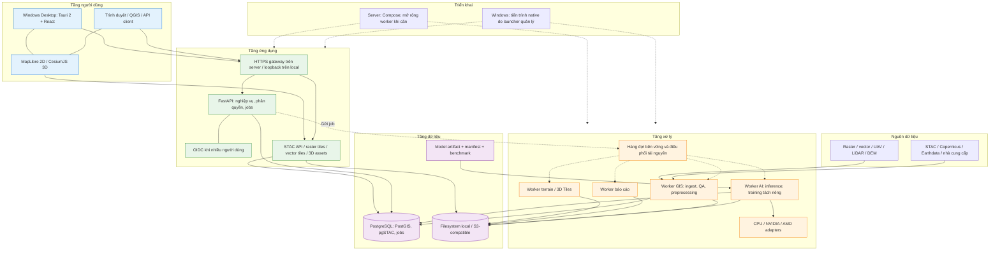

# Đề xuất kiến trúc hệ thống GeoAI — Copilot

Ngày lập: **08/11/2026**. Đơn vị soạn: **AI assistant sử dụng Copilot SDK trong VS Code**.

**Phạm vi:** tổng hợp đề xuất của Copilot trong cuộc trao đổi, bổ sung phương án đóng gói bộ cài Windows. Đây là tài liệu riêng, không thay thế hoặc chỉnh sửa bản đề xuất của tác giả khác. Chưa triển khai code, build bộ cài hoặc benchmark phần cứng.

**Định hướng:** bản đề xuất ban đầu là **Web-first**, có thể chạy local trên Windows hoặc trên máy chủ. **Windows Desktop là lựa chọn đóng gói bổ sung**, sử dụng lại giao diện và lõi xử lý; không đồng nghĩa ứng dụng đã được xây thành desktop-native hoặc đã xác nhận chuyển toàn bộ sang Desktop-first.

Cơ sở nghiệp vụ và dữ liệu:

- [Cẩm nang kiến trúc GeoAI](cam_nang_kien_truc_ung_dung_geoai_vien_tham.md), đặc biệt nhóm năng lực, kiến trúc năm tầng và kiểm định dữ liệu không gian.
- [Hướng dẫn xây dựng ứng dụng GeoAI cho viễn thám](<Hướng dẫn xây dựng ứng dụng GeoAI cho viễn thám.md>), đặc biệt dữ liệu, mô hình, đánh giá, đầu ra và vận hành.

## 1. Tổng quan và quyết định kiến trúc

Khuyến nghị **Modular Monolith + Processing Workers + Hardware-aware Runtime**:

- Một backend nghiệp vụ được chia module rõ ràng, không bắt đầu bằng microservices.
- Tác vụ GIS/AI, tạo báo cáo và chuyển đổi 3D chạy trong worker riêng, không chặn API hoặc UI.
- Lựa chọn CPU/NVIDIA/AMD theo phần cứng, driver, model và kết quả kiểm chứng.
- Chuẩn mở tại các ranh giới dữ liệu: STAC, COG, Zarr, GeoParquet và 3D Tiles.
- Domain Pack đóng gói quy trình phân tích, chỉ tiêu và báo cáo cho từng ngành.
- Một codebase phục vụ web, local workstation và desktop đóng gói; chỉ khác adapter và cấu hình triển khai.

| Yêu cầu | Quyết định |
| --- | --- |
| Code gọn | Tái sử dụng thư viện GIS/AI, không tự viết lại reader, tile server hoặc hàng đợi |
| Module rõ ràng | Tách nguồn dữ liệu, xử lý, model, runtime, thống kê, báo cáo và hiển thị |
| Hiệu năng cao | Đọc cửa sổ/chunk, xử lý bất đồng bộ, tối ưu I/O, cache và GPU theo workload |
| GPU NVIDIA/AMD | Chung hợp đồng thực thi; backend và runtime pack riêng |
| Nhiều vệ tinh/định dạng | Adapter nhà cung cấp kết hợp hồ sơ sản phẩm cảm biến |
| Báo cáo theo tính năng | Snapshot thống kê bất biến, mẫu báo cáo có phiên bản |
| Engine 3D | CesiumJS kết hợp pipeline tạo terrain/3D Tiles |
| Bộ cài Windows | Tauri 2 bọc UI, quản lý backend/worker cục bộ khi chọn chế độ local |

“Công nghệ mới nhất” là bản ổn định còn được duy trì **trong bộ tương thích đã kiểm thử**. Không có model, precision hay runtime nào nhanh nhất cho mọi bài toán; quyết định mặc định phải dựa trên benchmark đầu cuối và chất lượng nghiệp vụ.

## 2. Ba chế độ vận hành

| Chế độ | UI | Nơi xử lý AI | Điều kiện |
| --- | --- | --- | --- |
| Web tập trung | Trình duyệt | Máy chủ/worker từ xa | Mạng nội bộ hoặc Internet theo triển khai |
| Web local | Trình duyệt truy cập loopback | Máy Windows của người dùng | Backend, storage và worker chạy local |
| Windows Desktop | Tauri + UI React | Local, hoặc máy chủ nếu cấu hình kết nối | Có bộ cài và quản lý vòng đời tiến trình |

**GPU trình duyệt phục vụ hiển thị không tự trở thành GPU tính toán cho backend trên server.** Muốn dùng GPU máy người dùng cho xử lý local phải có worker chạy trên máy đó. Không bổ sung agent điều khiển từ xa trong phiên bản đầu nếu chưa có yêu cầu.

Offline chỉ khả thi khi đã có runtime, model, dữ liệu, font và tài nguyên bản đồ cần thiết. Tìm/tải ảnh mới từ nguồn trực tuyến vẫn cần kết nối.

## 3. Sơ đồ kiến trúc



Các ô thể hiện trách nhiệm logic, không yêu cầu mỗi ô là một microservice. Bản local không bắt buộc OIDC, reverse proxy hoặc Docker. Backend/worker dùng chung nghiệp vụ; launcher desktop chỉ điều khiển khởi động, health check, cấu hình và kết thúc tiến trình.

## 4. Cấu trúc code và ranh giới module

Cấu trúc dự kiến; chỉ tạo module khi có chức năng thực tế:

```text
GeoAI\
├── frontend\
│   └── src\
│       ├── app\
│       ├── features\          # projects, catalog, analysis, map, reports
│       └── shared\
├── desktop\                   # shell Tauri; không chứa thuật toán GIS/AI
├── backend\
│   └── src\geoai\
│       ├── api\
│       ├── catalog\
│       ├── ingestion\
│       ├── processing\
│       ├── models\
│       ├── runtime\
│       ├── analytics\
│       ├── reporting\
│       ├── visualization\
│       ├── jobs\
│       ├── domains\
│       └── platform\
├── tests\                     # unit, integration, acceptance, benchmarks
├── packaging\                 # cấu hình installer, runtime/model manifest
└── deploy\                    # triển khai server
```

| Module | Trách nhiệm |
| --- | --- |
| `catalog` | Danh mục nguồn/sản phẩm, tìm kiếm không gian–thời gian, provenance |
| `ingestion` | Adapter nguồn, giải quyết quyền truy cập, đọc định dạng và metadata |
| `processing` | Hiệu chỉnh, mask, đồng đăng ký, resample, compositing, chia/ghép cửa sổ |
| `models` | Model adapter, inference, artifact; giao diện cho môi trường huấn luyện |
| `runtime` | Capability probe, backend, thiết bị, precision và ngân sách RAM/VRAM |
| `analytics` | Thống kê vùng, diện tích, chuỗi thời gian, đánh giá và độ bất định |
| `reporting` | Snapshot báo cáo, biểu đồ, bản đồ và renderer tài liệu |
| `visualization` | Layer, tile, terrain và sản phẩm streaming 3D |
| `jobs` | Lịch, trạng thái, claim, retry, hủy và checkpoint |
| `domains` | Gói ngành: feature, tham số, workflow, chỉ tiêu, mẫu báo cáo |
| `platform` | Cấu hình, database/storage adapter, xác thực và telemetry |

API chỉ kiểm tra request và gọi use case. Worker không chứa một bản sao thuật toán khác API. Tách schema dữ liệu dùng chung khỏi framework; sinh client TypeScript từ OpenAPI. Chỉ tạo abstraction ở nơi có nhiều triển khai thực tế; tránh `BaseService`/`utils` tổng hợp và plugin nạp mã tùy ý.

## 5. Stack mặc định

| Thành phần | Lựa chọn |
| --- | --- |
| UI | React + TypeScript + Vite; MapLibre cho 2D, CesiumJS cho 3D |
| Desktop tùy chọn | Tauri 2 + WebView2; shell mỏng, backend Python đóng gói riêng |
| Backend/API | Python, FastAPI, Pydantic, OpenAPI; SSE cho tiến độ |
| Metadata và không gian | PostgreSQL + PostGIS + pgSTAC |
| Hàng đợi | Procrastinate trên PostgreSQL, tránh thêm broker ngay từ đầu |
| Raster/vector | GDAL/PROJ, Rasterio, Pyogrio, Shapely; GeoPandas khi phù hợp |
| Cube | Xarray; Dask chỉ khi cần chia chunk/xử lý vượt RAM |
| Point cloud | PDAL; bộ chuyển 3D Tiles được chọn sau kiểm chứng |
| AI | PyTorch; TorchGeo/TerraTorch trong môi trường training khi cần |
| Inference | ONNX Runtime/Windows ML hoặc PyTorch native theo model |
| Tile | TiTiler; STAC API; PMTiles cho vector đã đóng gói |
| Báo cáo | Jinja2 + HTML/PDF; XLSX/CSV; DOCX nếu nghiệp vụ yêu cầu |
| Dependency/build | `uv` cho Python, `pnpm` cho frontend, lockfile theo nền tảng |
| Server | Docker Compose trước; container CUDA và ROCm tách biệt |

Chưa mặc định dùng Kubernetes, Kafka, Redis, Qdrant, Ray hoặc nhiều workflow engine. Embedding search có thể bắt đầu bằng pgvector nếu cần. Không đóng gói môi trường notebook/training hoặc tất cả model vào máy người dùng.

**Đánh đổi của lựa chọn PostgreSQL:** thuận lợi dùng chung catalog, jobs và server, nhưng làm bộ cài local lớn và khó vận hành hơn. Bản local đầy đủ phải phân phối hoặc yêu cầu một instance PostgreSQL/PostGIS tương thích; Procrastinate cần PostgreSQL. Không tuyên bố bản local là ứng dụng chỉ có một EXE và không có dịch vụ phụ. Đổi sang database nhúng là quyết định kiến trúc riêng, chưa thực hiện trong đề xuất này.

## 6. Dữ liệu đa định dạng và đa vệ tinh

Tách **adapter nhà cung cấp → hồ sơ sản phẩm cảm biến → biểu diễn xử lý**. Hai nhà cung cấp cùng Sentinel-2 có thể khác asset, xác thực, scale/offset và metadata; không gắn các khác biệt này vào toàn bộ nghiệp vụ.

| Nhóm | Đầu vào tiêu biểu | Biểu diễn ưu tiên |
| --- | --- | --- |
| Raster | GeoTIFF, JP2, NetCDF, HDF, ENVI, SAFE | COG hoặc Zarr theo cấu trúc dữ liệu |
| Vector | GeoPackage, Shapefile, GeoJSON, KML | GeoParquet, PostGIS; giữ định dạng trao đổi khi cần |
| Point cloud | LAS, LAZ, COPC | COPC cho phân tích; 3D Tiles cho trình diễn |
| 3D | glTF/GLB, OBJ/IFC qua converter phù hợp | glTF/GLB, 3D Tiles |
| Bảng | CSV, Parquet | Bảng có schema hoặc Parquet |

Khả năng hỗ trợ phải công bố theo driver/codec được đóng gói và pipeline đã kiểm thử. Đọc được file không có nghĩa đã hỗ trợ mọi mức sản phẩm của cảm biến đó. SAR SLC cần giữ pha và metadata chuyên biệt, không ép thành raster amplitude cho mọi tác vụ.

Nguồn ưu tiên ban đầu: Sentinel-1 RTC, Sentinel-2 L2A, Landsat/HLS và DEM. Mở rộng NASA Earthdata/ASF, NISAR, GEDI, MODIS/VIIRS, siêu phổ, UAV/LiDAR, nguồn thương mại và trong nước bằng adapter theo quyền truy cập thực tế.

Metadata asset bắt buộc: CRS/transform, GSD, footprint, thời gian, processing level, band/wavelength hoặc phân cực, đơn vị, scale/offset, NoData, QA, nguồn gốc, checksum khi có và giấy phép. Model manifest xác định cảm biến, thứ tự kênh, normalization, GSD và chiều thời gian tương thích.

- Đọc cửa sổ/chunk, dùng overviews/HTTP range khi nguồn hỗ trợ; không tải cả kho hoặc chuyển đổi lại COG phù hợp.
- Chọn lưới xử lý theo AOI/model; không gán một UTM hoặc GSD cho mọi dự án.
- Không áp dụng percentile clipping/normalization đại trà cho dữ liệu định lượng.
- Phân biệt thiếu dữ liệu với không phát hiện đối tượng; resample không tạo thông tin quan sát mới.
- Mosaic ghi mọi scene/ngày thành phần; URL tạm và credential không trở thành provenance cố định.

## 7. GPU và hiệu năng đầu cuối

GPU render và GPU compute có thể khác thiết bị. GDAL/I/O và nhiều phép GIS vẫn dùng CPU; không có tùy chọn bật GPU làm mọi bước nhanh như nhau.

| Môi trường | Hướng tăng tốc |
| --- | --- |
| Windows + NVIDIA tương thích | Windows ML + TensorRT RTX EP, hoặc worker CUDA/TensorRT |
| Windows + AMD tương thích | Windows ML + AMD GPU EP; DirectML là đường tương thích khi phù hợp |
| Linux + NVIDIA | PyTorch CUDA cho train; TensorRT/ONNX Runtime CUDA cho inference |
| Linux + AMD được hỗ trợ | PyTorch ROCm; ONNX Runtime MIGraphX theo bộ tương thích |
| WSL2 | Chỉ dùng tổ hợp GPU/driver/runtime có hỗ trợ chính thức |
| Không có backend phù hợp | CPU, hoặc worker từ xa nếu người dùng cho phép |

Theo tài liệu đối chiếu trong cuộc trao đổi: Windows ML là đường ONNX được khuyến nghị trên Windows; EP tối ưu tải động cần Windows/driver phù hợp. AMD GPU EP là hướng chuyển tiếp được khuyến nghị cho AMD Windows. ROCm EP cũ của ONNX Runtime đã bị loại từ 1.23, nhưng điều đó không có nghĩa PyTorch ROCm bị loại. DirectML ở trạng thái duy trì. Không suy ra mọi Radeon/NVIDIA đều được hỗ trợ.

Luồng lựa chọn: **phát hiện thiết bị → đối chiếu support matrix → probe model/operator → kiểm tra kết quả → benchmark → lưu cấu hình theo máy/model**.

Tối ưu theo thứ tự: giảm I/O thừa; prefetch có giới hạn; batch phù hợp; giữ model resident; buffer/I/O binding khi có lợi; mixed precision; compile hoặc lượng tử hóa sau kiểm định. Phát hiện phần graph fallback CPU và chi phí copy trước khi kết luận backend GPU nhanh hơn.

- FP16/BF16/INT8 chỉ bật khi phần cứng hỗ trợ và chất lượng đạt ngưỡng.
- Hết VRAM thì giảm batch, retry có giới hạn; không tự đổi cửa sổ trái model contract.
- Chừa VRAM cho viewer nếu AI và 3D dùng chung card.
- Nhiều GPU chia job độc lập; không gộp VRAM NVIDIA và AMD thành một pool.
- Yêu cầu GPU bắt buộc không âm thầm fallback CPU; ghi backend/precision thực dùng vào manifest.
- Môi trường NVIDIA, AMD và Windows ML tách riêng để tránh xung đột DLL/package. Windows ML là inference path, không thay thế training runtime.

## 8. Pipeline và chiến lược model

Pipeline chuẩn: **tìm/resolve dữ liệu → QA → tiền xử lý → căn chỉnh → suy luận/phân tích → ghép → hậu xử lý → thống kê → công bố → báo cáo**. Tác vụ chỉ số hoặc thống kê có thể bỏ bước AI.

| Năng lực | Baseline | Ứng viên nâng cấp cần benchmark |
| --- | --- | --- |
| Phân loại/lớp phủ | Chỉ số phổ + RF/LightGBM | SegFormer hoặc encoder EO + decoder |
| Phân đoạn thực thể | Mô hình nhỏ, boundary-aware | Instance/panoptic khi đủ nhãn |
| Phát hiện | Detector theo kích thước mục tiêu | OBB khi góc xoay có ý nghĩa |
| Biến động | Đồng đăng ký + sai khác/chỉ số | Siamese, temporal Transformer, fusion SAR–quang học |
| Hồi quy | Mô hình vật lý + hồi quy | Foundation features hoặc mô hình lai |
| Chuỗi thời gian | Thống kê, làm mượt, điểm đổi | Temporal encoder có xử lý dữ liệu thiếu |
| Siêu phân giải/khôi phục | Pipeline riêng | Chỉ phát hành khi kiểm định và gắn nhãn dữ liệu tái tạo |

Prithvi, TerraMind, Clay và các model trong hai cẩm nang là ứng viên, không phải dependency bắt buộc. Chọn theo sensor, GSD, thời gian, nhãn, giấy phép và chi phí. Encoder lớn không mặc nhiên tốt hơn baseline nhỏ.

Kiểm định spatial/time holdout để tránh rò rỉ. Suy luận segmentation dùng cửa sổ chồng lấp và hòa trộn Hann/Gaussian; detection quy đổi tọa độ và ghép dự đoán trùng theo loại hộp. Không vuông hóa mọi polygon. Lưu xác suất/độ bất định cần thiết, không coi confidence của model là khoảng tin cậy thống kê.

## 9. Báo cáo theo tính năng và lĩnh vực

Một **Domain Pack** gồm feature/version, schema tham số, yêu cầu dữ liệu, workflow, công thức chỉ tiêu, style bản đồ, mẫu báo cáo và tiêu chí chất lượng. Các ngành dùng lại engine tính toán và renderer, không sao chép pipeline/GPU logic.

| Lĩnh vực | Ví dụ báo cáo |
| --- | --- |
| Nông nghiệp | Diện tích theo vụ/thửa, sinh trưởng, hạn và biến động |
| Lâm nghiệp | Biến động rừng, sinh khối/carbon kèm phương pháp và sai số |
| Đô thị | Diện tích xây dựng, công trình mới, mật độ và đảo nhiệt |
| Thiên tai | Phạm vi ngập/sạt lở, tài sản ảnh hưởng, thời điểm và coverage |
| Biển/môi trường | Biến động bờ biển, vùng nước và chỉ tiêu chất lượng nước |
| Hạ tầng | Kiểm kê, diện tích/chiều dài và hành lang tuyến |

Luồng: **kết quả công bố → snapshot metrics → biểu đồ/bản đồ → template → PDF/XLSX/DOCX theo nhu cầu**.

Báo cáo ghi AOI, thời gian nguồn, thời gian phân tích/lập báo cáo, source/model/pipeline/template version, đơn vị, threshold, coverage, phương pháp và giới hạn. Diện tích dùng CRS hoặc phép đo ellipsoid phù hợp. Khoảng tin cậy chỉ tính khi có thiết kế kiểm định phù hợp.

Renderer bản đồ báo cáo không phụ thuộc cửa sổ Cesium đang mở. Font tiếng Việt và tài nguyên cần thiết được chuẩn bị cho offline. Đổi nguồn, ngưỡng hoặc kết quả tạo phiên bản snapshot mới. Nếu bổ sung LLM thì chỉ diễn giải dữ liệu đã chốt, không dùng để tự tính số liệu.

## 10. Engine 3D

CesiumJS là lựa chọn 3D địa lý, không bắt buộc Cesium ion. MapLibre phục vụ UI bản đồ 2D; chia sẻ layer specification, selection và timeline thay vì nhân đôi nghiệp vụ. Chỉ khởi tạo engine cần dùng để hạn chế GPU context và bộ nhớ.

| Dữ liệu | Pipeline trình diễn |
| --- | --- |
| DEM/DTM | Kiểm tra CRS/datum đứng → terrain tiles → terrain provider |
| LAS/LAZ/COPC | PDAL chuẩn hóa/lọc → tiler 3D Tiles → streaming theo LOD |
| Mesh/UAV | Georeference → tối ưu mesh/texture → chia LOD → 3D Tiles |
| Footprint + chiều cao | Kiểm tra nguồn/đơn vị chiều cao → extrusion hoặc mesh |
| Kết quả GeoAI | Overlay raster/vector; liên kết feature ID và metrics |

Chuẩn đích: 3D Tiles 1.1/glTF khi chuỗi converter–renderer đã được kiểm chứng; không chỉ dựa trên tên chuẩn để cam kết tương thích. COG không tự trở thành terrain và COPC không mặc định được Cesium đọc trực tiếp.

Thiết kế LOD, culling, screen-space error, giới hạn request/cache và ngân sách texture/point/triangle. Phân biệt cao độ ellipsoid và thủy chuẩn, DTM và DSM; viewer không nâng độ chính xác dữ liệu nguồn. Dựng cảnh ngập 3D không phải mô phỏng thủy động lực học; mô phỏng cần engine chuyên ngành riêng.

## 11. Lựa chọn build bộ cài Windows

### 11.1. Định dạng và profile

| Lựa chọn | Mục đích |
| --- | --- |
| **NSIS EXE Standard** | Cài core; bổ sung WebView2/runtime/model đã chọn qua mạng khi cần |
| **NSIS EXE Offline** | Bộ phân phối gồm core, WebView2 offline và pack đủ cho tính năng đã công bố |
| **WiX MSI Enterprise** | Cài im lặng, nâng cấp/gỡ cài và quản lý phiên bản theo chính sách cơ quan |

EXE/MSI là định dạng; Standard/Offline là profile độc lập. Có thể tạo MSI Offline theo nhu cầu. Ưu tiên Windows x64; không build mọi tổ hợp hoặc ARM64 trước khi có bộ dependency được kiểm chứng.

Hai cấu hình nội dung bộ cài phải được phân biệt:

- **Client:** UI desktop kết nối server; không có xử lý local hoặc cam kết dùng GPU local.
- **Local Workstation:** UI, API, worker, runtime, dữ liệu quản trị local và dependency cần thiết; tận dụng GPU máy người dùng khi tương thích.

Cấu hình Local Workstation giữ PostgreSQL theo stack đề xuất. Phải chọn một instance đã cài hoặc cấp phát instance riêng có PostGIS/pgSTAC, cổng và thư mục dữ liệu riêng; không sửa/xóa dịch vụ PostgreSQL của ứng dụng khác. Launcher quản lý tiến trình và kiểm tra health; không giả định chỉ đóng gói Python là đã có đủ backend. Không yêu cầu Docker cho người dùng cuối.

### 11.2. Thành phần bộ phân phối

- **Core:** Tauri/React, tài nguyên MapLibre/Cesium, API, GIS/CPU, thư viện native, báo cáo và dependency local theo cấu hình.
- **Compute pack:** backend NVIDIA/AMD/Windows ML đã duyệt, manifest tương thích, không chứa toàn bộ toolchain training.
- **Model pack:** trọng số, checksum, schema lớp/đầu vào, license và thông tin kiểm định.
- **Data pack tùy chọn:** dữ liệu mẫu/terrain/bản đồ nền có quyền phân phối.

Python được đóng gói cùng ứng dụng; PyInstaller dạng onedir là ứng viên cần smoke test, không mặc định gộp mọi thư viện GIS/AI thành một EXE tự giải nén. Thu đủ GDAL/PROJ data, codec/plugin, DLL và renderer PDF; kiểm tra điều kiện phân phối lại.

Offline phải có mọi prerequisite hoặc có bước cấp phát được xác minh từ trước. Nhúng WebView2 bootstrapper vẫn có thể cần Internet; dùng offline installer hoặc fixed runtime có kế hoạch vá lỗi riêng. Windows ML EP cần cách cấp phát chính thức và giấy phép phù hợp; không giả định tự tải EP được khi mất mạng. Driver GPU được kiểm tra, không tự thay/nâng mà không có chấp thuận.

### 11.3. Build, ký và cập nhật

**Khóa dependency → build UI → đóng gói backend/runtime → stage pack → build Tauri → ký số → kiểm thử gói cuối trên Windows sạch → phát hành.**

- MSI build trên Windows; ưu tiên Windows x64 build runner hoặc máy nội bộ cho cả EXE/MSI.
- Máy build cần Rust/MSVC, Node/pnpm và môi trường Python tương thích; máy người dùng không cần toolchain này.
- Artifact có version, OS/architecture, app/backend protocol, checksum, license và danh sách pack tương thích.
- Authenticode cho ứng dụng/bộ cài và chữ ký updater Tauri là hai cơ chế riêng; không bảo đảm ký số là không còn cảnh báo SmartScreen.
- Chứng thư/khóa ký nằm trong kho bí mật hoặc hệ thống ký nội bộ; không nằm trong source hoặc bộ cài.
- Online updater chỉ nhận artifact có chữ ký. Offline có thể nhập pack hoặc cài phiên bản đã xác minh. MSI do quản trị tập trung có thể tắt updater trong app.

### 11.4. An toàn vòng đời

Chạy API local trên loopback với token phiên và kiểm tra origin; hạn chế quyền shell/sidecar. Runtime/cache/metadata đặt tại vị trí có quyền ghi; project nằm tại thư mục người dùng chọn, không nằm trong thư mục cài chương trình.

Trước nâng cấp, chờ/hủy job theo chính sách, dừng worker và sao lưu metadata. Stage và kiểm tra pack trước kích hoạt. Rollback app chỉ an toàn khi schema còn tương thích; trường hợp khác cần quy trình restore backup đã thử nghiệm. Gỡ app mặc định giữ project/kết quả; không gỡ driver, WebView2 dùng chung hoặc database của chương trình khác.

## 12. Job, provenance và vận hành

Job có trạng thái queued/running/succeeded/failed/cancelled, heartbeat, attempt, checkpoint và lỗi có cấu trúc. Claim, timeout và khôi phục phải tránh tạo hai kết quả được công bố cho cùng khóa idempotency. Dùng job theo lô đủ lớn, không enqueue một transaction database cho từng pixel/cửa sổ nhỏ.

Run manifest lưu input snapshot, AOI/lưới, pipeline/model/config hash, runtime/driver/precision, coverage và asset kết quả. Không gửi tensor lớn qua JSON; chuyển manifest/URI hoặc shared memory có vòng đời được quản lý. Scheduler giới hạn tổng CPU thread, RAM, VRAM, I/O và đĩa tạm để tránh oversubscription.

Output được ghi staging, kiểm tra rồi mới công bố. Filesystem dùng thao tác cùng volume phù hợp; object storage dùng object bất biến và manifest, không giả định có rename transaction. Retry/crash recovery không coi output dở dang là thành công. Backup metadata và kiểm tra restore là yêu cầu vận hành.

Server bổ sung HTTPS, OIDC, phân quyền project/AOI và quota. Kiểm soát cả API, tile, asset và báo cáo; không chỉ màn hình UI. Credential tách khỏi manifest/log; dữ liệu thương mại tuân theo quyền truy cập và phân phối sản phẩm phái sinh.

## 13. Lộ trình và tiêu chí nghiệm thu

1. **Kiểm chứng nền tảng:** đọc COG lớn; model nhỏ trên NVIDIA/AMD mục tiêu; Cesium/WebView2; bộ cài local đầy đủ; PDF tiếng Việt offline.
2. **Một lát cắt nghiệp vụ:** một nguồn → một feature → thống kê → bản đồ → báo cáo → provenance, có hủy/khôi phục job.
3. **Mở rộng có chọn lọc:** Domain Pack, cảm biến, model và 3D pipeline thêm theo fixture/tiêu chí riêng.
4. **Vận hành nhiều người dùng:** worker pool, quota, giám sát, backup và chỉ bổ sung hạ tầng phân tán khi cần.

Nghiệm thu phải đo/kiểm tra:

- CRS, scale/offset, band order, NoData, đồng đăng ký, diện tích và datum đứng.
- Spatial/time holdout, lớp hiếm, baseline và sai khác cho từng precision/backend.
- Tổng thời gian pipeline, thời gian compile/warm-up, peak RAM/VRAM, I/O và responsiveness UI/3D.
- Máy thiếu GPU/runtime, custom op không hỗ trợ, hết VRAM, cạnh tranh viewer và compute.
- Worker crash, retry, API restart, báo cáo đúng snapshot và không công bố kết quả dở dang.
- Cài mới/nâng cấp/gỡ trên Windows sạch, tài khoản thường, đường dẫn tiếng Việt, thiếu WebView2, thiếu dung lượng và ngắt mạng.
- Local Workstation có database/extensions đúng phiên bản, không xung đột instance khác; offline không phụ thuộc PATH/cache của máy build.

Không cam kết trước FPS, thời gian/km², kích thước bộ cài hay mọi model chạy mọi card. Cần chốt AOI, volume, scene/model mẫu, số người dùng, hệ điều hành, GPU/VRAM và tiêu chí nghiệp vụ.

## 14. Giá trị và quy mô

**Giá trị kỹ thuật: cao.** Kiến trúc tái sử dụng được lõi giữa web/local/desktop, mở rộng cảm biến và ngành bằng hợp đồng, giữ provenance và tránh khóa vào một hãng GPU.

**Quy mô toàn bộ: XL.** Phần rủi ro lớn là đóng gói dependency native/GPU/database, chất lượng dữ liệu địa lý và đa dạng nghiệp vụ, không chỉ model AI. Phải phát triển theo lát cắt có bằng chứng kiểm chứng; đây chưa phải ước lượng lịch hoặc chi phí.

## 15. Tài liệu kỹ thuật tham chiếu

Các nguồn sau đã được tham khảo trong cuộc trao đổi ngày 08/11/2026. Mức hỗ trợ thay đổi theo phiên bản; cần đối chiếu lại và khóa tại thời điểm build. Đây không phải bằng chứng đã chạy thử GeoAI trên phần cứng thực.

- [Windows ML overview](https://learn.microsoft.com/en-us/windows/ai/new-windows-ml/overview) và [execution providers](https://learn.microsoft.com/en-us/windows/ai/new-windows-ml/supported-execution-providers).
- [ROCm compatibility matrix](https://rocm.docs.amd.com/en/latest/compatibility/compatibility-matrix.html).
- [ONNX Runtime ROCm EP](https://onnxruntime.ai/docs/execution-providers/ROCm-ExecutionProvider.html), [MIGraphX EP](https://onnxruntime.ai/docs/execution-providers/MIGraphX-ExecutionProvider.html) và [DirectML EP](https://onnxruntime.ai/docs/execution-providers/DirectML-ExecutionProvider.html).
- [TensorRT support matrix](https://docs.nvidia.com/deeplearning/tensorrt/latest/getting-started/support-matrix.html).
- [CesiumJS](https://cesium.com/platform/cesiumjs/), [OGC 3D Tiles](https://www.ogc.org/standards/3dtiles/) và [PDAL COPC reader](https://pdal.io/en/stable/stages/readers.copc.html).
- [Procrastinate](https://procrastinate.readthedocs.io/en/stable/).
- [Tauri Windows installer](https://v2.tauri.app/distribute/windows-installer/), [sidecar](https://v2.tauri.app/develop/sidecar/), [updater](https://v2.tauri.app/plugin/updater/) và [Windows signing](https://v2.tauri.app/distribute/sign/windows/).
