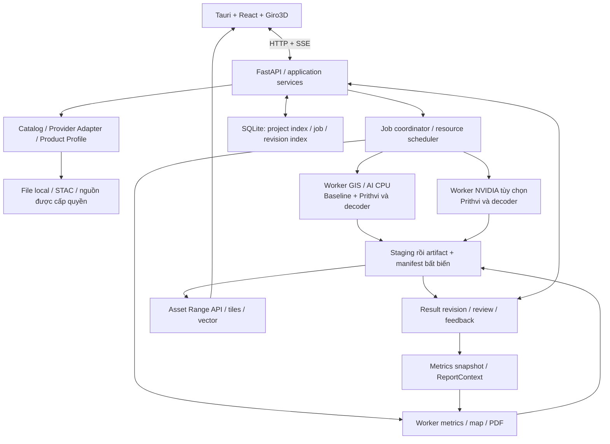

# Đề xuất kiến trúc hệ thống GeoAI — Bản tổng hợp và đối chiếu sản phẩm thị trường

Ngày lập/cập nhật và tra cứu nguồn: **08/11/2026**. Phiên bản tài liệu: **1.4**.

**Addendum Ubuntu 10/11/2026, thiết kế đề xuất:** người dùng bổ sung mục tiêu Ubuntu 22.04 LTS và Ubuntu 24.04 LTS bên cạnh Windows. [ADR-012](../docs/adr/ADR-012-ubuntu-desktop.md), [kiến trúc Ubuntu](../docs/platforms/ubuntu/ubuntu-desktop-architecture.md), [môi trường/đóng gói](../docs/platforms/ubuntu/ubuntu-development-and-packaging.md) và [ma trận UB-01–20](../docs/platforms/ubuntu/ubuntu-validation-matrix.md) cụ thể hóa hướng Tauri/WebKitGTK + Python dùng chung, supervisor/user service/cgroup, owner theo UID, FD/I/O và `.deb` build từ 22.04 để kiểm cả hai LTS. Các lựa chọn kỹ thuật chưa Accepted, chưa có implementation/test Linux. Các primitive Windows/NSIS trong baseline dưới đây tiếp tục thuộc profile Windows; server vẫn mở riêng G4. Giữ Prithvi + decoder từ bản đầu, schema và các gate; không coi yêu cầu OS là nghiệm thu runtime hoặc cam kết lịch phát hành.

**Đặc tả Ubuntu foundation, 10/11/2026:** [SPEC-010](../docs/specs/010-ubuntu-foundation.md), [native profile v1](../docs/platforms/ubuntu/ubuntu-native-profile.md) và [interface adapter](../docs/platforms/ubuntu/ubuntu-adapter-interfaces.md) cụ thể hóa composition, namespace/owner FD, creator-bound Unix socket, dừng theo pidfd, generation journal bền vững và Linux stop-then-copy publish. Đây là input gen code đề xuất, chưa triển khai; private ledger/schema additions phải đi cùng source Pydantic/fixture/exporter trong task code. Review quyết định thiết kế khác nghiệm thu UB/G1–G3; không đợi mọi UB mới viết phần nền đủ dependency.

Bản tổng hợp là nguồn nội dung chuẩn; [bộ 17 tài liệu chuyên biệt](../plans/README.md) trình bày cùng thiết kế theo từng chủ đề và giữ số mục gốc. Khi thay đổi thiết kế, cập nhật bản tổng hợp trước rồi đồng bộ các tài liệu đã tách trong cùng phiên bản. Các quyết định còn mở được quản lý tại mục 17; quyết định có đánh đổi đáng kể khi được chốt cần hồ sơ ADR nêu phương án, bằng chứng, người chốt và tác động, liên kết từ cả hai bản.

Bổ sung đặc tả triển khai sau review ngày 08/11/2026 trong baseline v1.4: task tạo model nghiệp vụ SPEC-008, importer/worker resolver SPEC-009 và ADR-011 về execution owner local. Các phần bổ sung cụ thể hóa trách nhiệm/interface/acceptance, chưa được triển khai hoặc nghiệm thu và không thay yêu cầu sản phẩm/gate đã xác nhận.

Trạng thái: **đề xuất thiết kế để xem xét; chưa triển khai, build bộ cài hoặc benchmark GeoAI**. Những mục được gọi là “quyết định” là lựa chọn của bản đề xuất này, không phải tính năng đã có. Các ngưỡng chất lượng, phần cứng và lịch phát hành cần được xác nhận bằng dữ liệu nghiệp vụ và thử nghiệm.

Cơ sở nội bộ: [bản chính v1.2][A], [bản Copilot][B], [Cẩm nang kiến trúc][C1] và [Hướng dẫn xây dựng ứng dụng][C2]. Phạm vi kế thừa từ bản chính: **ưu tiên Windows desktop, xử lý cục bộ, Giro3D, AI CPU/NVIDIA; giữ khả năng đưa cùng lõi nghiệp vụ lên Linux/server**.

Yêu cầu sản phẩm đã được người dùng xác nhận: **Prithvi-EO-2.0 phải được tích hợp và sử dụng cho phân tích ngay trong bản phát hành đầu**. Biến thể, decoder và profile dữ liệu bên dưới là lựa chọn thiết kế khởi đầu cần kiểm chứng; việc tích hợp Prithvi không còn là hạng mục nghiên cứu tùy chọn.

## 1. Định hướng sản phẩm và quyết định tổng thể

Xây dựng **ứng dụng GeoAI cho chuyên gia GIS và người phân tích nghiệp vụ**, giúp đi từ dữ liệu địa lý đến kết quả có thể kiểm tra, thống kê và lập báo cáo. Giá trị của sản phẩm nằm ở tính đúng địa lý, quy trình sử dụng rõ ràng, kết quả truy nguyên được và vận hành ổn định trên máy người dùng.

Kiến trúc chọn **modular monolith Python + worker tách tiến trình**, giao diện **Tauri 2 + React + TypeScript + Giro3D**. Bản desktop dùng **SQLite WAL + filesystem local**. CPU là cấu hình sử dụng chính thức; NVIDIA tăng tốc theo model đã kiểm chứng. Bản đầu có **Prithvi-EO-2.0 + decoder nghiệp vụ**, cùng baseline RF/boosting để đối chứng. Ưu tiên ONNX Runtime cho suy luận; PyTorch là đường tham chiếu và ngoại lệ phân phối khi có lý do. Bản server bổ sung PostgreSQL/PostGIS, object storage, hàng đợi và xác thực nhiều người dùng khi có nhu cầu thực tế.

Các nguyên tắc xuyên suốt:

1. Prithvi-EO-2.0 có mặt từ bản đầu; bài toán và dữ liệu quyết định cách tinh chỉnh, decoder và phạm vi sử dụng. Baseline đơn giản được giữ để kiểm tra, không thay thế yêu cầu tích hợp Prithvi.
2. Một lõi nghiệp vụ dùng lại giữa local/server; adapter thay đổi nhưng hợp đồng và bộ dữ liệu kiểm chứng phải giữ tương đương.
3. Tách dữ liệu nguồn, kết quả tính toán, chỉnh sửa của chuyên gia và báo cáo thành các phiên bản liên kết được.
4. UI phản hồi nhanh; suy luận, chuyển đổi dữ liệu và xuất báo cáo là job chạy nền.
5. Công bố năng lực theo tổ hợp dữ liệu, model, runtime và phần cứng đã kiểm chứng.
6. Chuẩn mở ở ranh giới trao đổi; không bắt buộc cài một hệ thống thương mại được dùng làm tham chiếu.

### 1.1. Người dùng và sản phẩm bàn giao

| Nhóm | Công việc chính | Thông tin cần nhìn thấy |
| --- | --- | --- |
| Chuyên gia GIS | Chọn dữ liệu, kiểm tra CRS/QA, cấu hình và chạy phân tích | Nguồn, ngày ảnh, vùng quan sát hợp lệ, tham số, trạng thái job |
| Chuyên gia nghiệp vụ | Đối chiếu thực tế, duyệt/sửa kết quả, xác nhận chỉ tiêu | Định nghĩa lớp, sai số, vùng cần kiểm tra, nguồn gốc chỉnh sửa |
| Người dùng báo cáo | Đọc bản đồ, số liệu và giới hạn áp dụng | Thời điểm dữ liệu, phạm vi, chất lượng, trạng thái duyệt |
| Quản trị viên ở bản server | Quản lý truy cập, tài nguyên, sao lưu và phát hành model | Quyền project/asset, quota, nhật ký, phiên bản và tình trạng phục hồi |

Một người có thể kiêm nhiều vai trò ở bản desktop. Bản đầu không cần hệ thống tài khoản nhiều người dùng cục bộ chỉ để mô phỏng các vai trò này.

### 1.2. Cấu hình triển khai

| Cấu hình | Nơi xử lý | Database/storage | Thứ tự ưu tiên |
| --- | --- | --- | --- |
| **Local Workstation** | API và worker trên Windows người dùng | SQLite và filesystem local | Phát hành đầu tiên |
| **Server + Web Client** | Worker trên máy chủ | PostgreSQL/PostGIS và filesystem hoặc object storage | Sau khi hoàn thiện một nghiệp vụ local |
| **Desktop Client** | Kết nối tới server; không kèm worker local | Dữ liệu nghiệp vụ trên server | Đóng gói bổ sung khi có người dùng cần |

Mở UI bằng trình duyệt trên loopback có thể phục vụ phát triển/chẩn đoán, chưa phải một cấu hình phát hành riêng. GPU trình duyệt dùng để render; GPU tính toán thuộc máy chạy worker. Offline chỉ áp dụng cho chức năng có đủ dữ liệu, runtime, model và tài nguyên local.

## 2. Chắt lọc từ bốn tài liệu nội bộ

| Nguồn | Nội dung giữ lại | Điều chỉnh trong bản tổng hợp |
| --- | --- | --- |
| Bản chính [A], mục 1–4, 6, 9–12 | Desktop trước; module và hợp đồng; SQLite; Giro3D; CPU/NVIDIA; bộ cài và offline | Làm rõ vòng đời job, phiên bản kết quả, quyền ghi project, backup và điều kiện lên server |
| Bản Copilot [B], mục 2, 6, 11–12 | Phân biệt Client/Local Workstation; adapter nhà cung cấp → hồ sơ sản phẩm; hàng đợi server; quyền trên API/tile/asset/report | Đưa PostgreSQL/Procrastinate vào cấu hình server; hoãn AMD và hai engine bản đồ song song |
| Cẩm nang [C1], mục 2–7 | Năng lực phân tích; vai trò baseline vật lý/ML; xử lý ảnh lớn; chống rò rỉ không gian; vòng phản hồi | Danh mục thuật toán là hướng mở rộng, không phải danh sách dependency bắt buộc |
| Hướng dẫn [C2], mục 3, 10–12, 15 | Đặc tả bài toán; dữ liệu và nhãn địa phương; kiểm định độc lập; model/data version; drift | Chuyển thành hợp đồng dữ liệu, quy trình kiểm duyệt và tiêu chí nghiệm thu có thể kiểm tra |

Không kế thừa các khuyến nghị tuyệt đối hóa: mọi raster đều phải thành COG; mọi bài toán phát hiện đều phải dùng OBB; mọi pipeline đều clipping theo phân vị; một lưới UTM/GSD dùng cho mọi dự án; mọi polygon phải vuông hóa; mọi model nền tảng nhận được mọi cảm biến. Các lựa chọn này phụ thuộc dữ liệu và mục tiêu cụ thể.

Không dùng thông số minh họa trong cẩm nang làm cam kết sản phẩm: độ trễ vài giờ, tốc độ vài mili giây, độ chính xác, tỷ lệ tiết kiệm VRAM, hoặc siêu phân giải 10 m thành quan sát thật 2,5 m. Không sao chép số liệu dataset, lịch vệ tinh hay diễn giải giấy phép chưa được đối chiếu riêng.

## 3. Tham chiếu sản phẩm thị trường và bài học áp dụng

### 3.1. Cách sử dụng nguồn

Đã đọc trực tiếp tài liệu công khai trên website chính thức của các sản phẩm dưới đây. “Tham chiếu thị trường” có nghĩa là tham khảo quy trình và năng lực được mô tả; **không phải chứng nhận chất lượng, benchmark độc lập hay yêu cầu phải mua sản phẩm đó**. Chuẩn định dạng được đối chiếu riêng với STAC và OGC [T1], [T2].

Phân biệt ba loại nguồn: tài liệu sử dụng/API; trang giới thiệu sản phẩm; đặc tả chuẩn. Chỉ suy ra tính năng mà trang đã đọc thực sự mô tả. Không suy đoán database, framework nội bộ, độ chính xác hoặc kiến trúc triển khai của nhà cung cấp.

### 3.2. Sản phẩm đối chiếu

| Sản phẩm/nền tảng | Điều đã xác nhận từ tài liệu | Điều GeoAI nên học | Giới hạn khi tham khảo |
| --- | --- | --- | --- |
| **Esri ArcGIS Pro / Image Analyst** | Quy trình chuẩn bị nhãn, train, inference, review; package `.dlpk` chứa model và `.emd`; công cụ đo precision/recall/F1/AP và xuất báo cáo độ chính xác [M1], [M2], [M3], [M4] | Model phải có hợp đồng đầu vào; đánh giá là sản phẩm riêng; có bước chuyên gia rà soát | Không mặc định tương thích `.dlpk`, không sao chép runtime/plugin hoặc yêu cầu license Esri |
| **ENVI Deep Learning** | Module cài/license riêng; hướng dẫn grid/object/pixel; cấu hình ONNX gồm metadata, số kênh, kích thước, tiền/hậu xử lý; xem metrics và ma trận nhầm lẫn [M5], [M6], [M7], [M8] | Tách task và input contract; model package có version/license; kết quả đánh giá gắn đúng lần train | ONNX đơn lẻ chưa đủ để chạy đúng; không suy ra tất cả model ONNX đều hỗ trợ |
| **Picterra Forge** | Training areas, accuracy areas; cảnh báo vùng train/test chồng nhau; quản lý kết quả và thuộc tính; báo cáo kết quả/monitoring có thống kê theo thời gian [M9], [M10], [M11], [M12] | Quy trình có hướng dẫn, cảnh báo tại vị trí lỗi, xem/sửa kết quả, thống kê và báo cáo dùng cùng dữ liệu | Detection area của Picterra có thể được đơn giản hóa; GeoAI cần giữ AOI đo đạc chính xác. Không dùng điểm accuracy trong sản phẩm thay cho kiểm định độc lập |
| **UP42** | Tìm và preview scene, chọn sản phẩm, quyền truy cập/EULA, xác nhận order và ngân sách, theo dõi dữ liệu giao; storage truy xuất bằng STAC [M13], [M14] | Tách catalog, quyền truy cập, mua dữ liệu và tải dữ liệu; mỗi trạng thái phải rõ | Đây là tham chiếu thu nhận/quản lý dữ liệu, không phải bằng chứng về pipeline AI của GeoAI |
| **Google Earth Engine** | Môi trường interactive và batch khác nhau; task có ID, trạng thái, hủy và retry; quota cho request, batch, bộ nhớ và storage [M15], [M16] | Preview nhẹ tách khỏi batch; job có vòng đời, giới hạn tài nguyên và lỗi có cấu trúc | Là xử lý từ xa; thuật ngữ batch “offline” của EE không có nghĩa chạy được khi mất Internet |
| **Trimble eCognition — tham chiếu lịch sử** | Trang sản phẩm mô tả OBIA + AI, ruleset, phối hợp raster/point cloud/GIS và batch; đồng thời ghi **“no longer actively sold”** [M17] | Gói nghiệp vụ nên kết hợp thuật toán, quy tắc hình học và chỉ tiêu thay vì chỉ gọi model | Không dùng làm lựa chọn mua mới đang được bán tích cực; không suy ra đã chấm dứt mọi hỗ trợ khách hàng cũ |

Ba dòng đầu là sản phẩm phân tích GeoAI gần nhất với trải nghiệm cần xây. UP42 và Earth Engine bổ sung tham chiếu về dữ liệu và vận hành. Những trang quảng bá về tốc độ/độ chính xác không được dùng làm ngưỡng nghiệm thu.

### 3.3. Chuyển tham chiếu thành yêu cầu

| Mã | Yêu cầu cần làm rõ | Quyết định đề xuất | Căn cứ | Bằng chứng nghiệm thu |
| --- | --- | --- | --- | --- |
| R01 | Một model “được hỗ trợ” nghĩa là gì? | Có manifest, input contract, runtime profile và evaluation record | ArcGIS, ENVI | Chặn sai kênh/đơn vị/shape; chạy fixture CPU/GPU đúng ngưỡng |
| R02 | Độ chính xác áp dụng ở đâu? | Ghi vùng, thời gian, tập nhãn, phương pháp chia mẫu và metrics theo lớp | ArcGIS, ENVI, Picterra, [C2] | Truy được evaluation dataset; không dùng tập test để chỉnh threshold |
| R03 | Kết quả sai được xử lý thế nào? | Bản dự đoán bất biến + bản sửa của chuyên gia + trạng thái duyệt | ArcGIS review, Picterra | Đổi nhãn/geometry không ghi đè kết quả gốc; báo cáo trỏ đúng revision |
| R04 | Tìm thấy scene có nghĩa đã tải được chưa? | Capability và trạng thái truy cập/tải riêng | UP42 | Phân biệt preview-only, cần quyền, sẵn sàng đọc, đang tải và lỗi |
| R05 | Job thành công/hủy nghĩa là gì? | Hoàn tất khi artifact đã kiểm tra và công bố; hủy cần được xác nhận | Earth Engine | Crash/retry không tạo kết quả giả; worker cũ không công bố đè |
| R06 | Báo cáo dùng phiên bản nào? | ReportContext đóng băng result revision, metrics và template | Picterra + [A], [B] | Bản đồ/bảng/PDF khớp; báo cáo cũ không đổi khi rerun |
| R07 | Có cần mọi công nghệ ngay? | Một cấu hình local, một nghiệp vụ; mở rộng theo cổng nghiệm thu | [A], [B], [C2] | Danh sách hỗ trợ và bộ cài khớp năng lực đã kiểm tra |
| R08 | Có xử lý từ xa hoặc phát sinh chi phí không? | Hiển thị nơi chạy, quyền dữ liệu và dự toán khi có; thao tác mua riêng | UP42, Earth Engine | Search không tự đặt mua; không âm thầm gửi dữ liệu local lên cloud |
| R09 | Workflow ngành gồm những gì? | Domain Pack có dữ liệu, thuật toán, quy tắc, chỉ tiêu, quality gate và báo cáo | eCognition, [A], [B] | Một engine chạy được feature có phiên bản, không sao chép GPU logic |

Các chính sách bất biến, revision, quyền công bố và fencing ở dưới là **thiết kế đề xuất của GeoAI**; không tuyên bố các sản phẩm tham chiếu đều triển khai giống vậy.

## 4. Phạm vi bản đầu và luồng sử dụng

### 4.1. Lát cắt nghiệp vụ và đánh đổi tại G0

Phạm vi khởi đầu đã được người dùng xác nhận: **bản đồ lớp phủ trên HLS S30 v2 ở 30 m, dùng Prithvi-EO-2.0 đã gắn decoder và tinh chỉnh cho bộ 7 lớp, kèm chỉ số NDVI/EVI/NDMI/MNDWI, thống kê theo vùng và PDF tiếng Việt**. HLS phù hợp với miền dữ liệu tiền huấn luyện của Prithvi hơn việc mặc định dùng trực tiếp Sentinel-2 L2A 10 m [P1]. AOI có thể vẽ trên bản đồ, lấy từ footprint/ảnh import hoặc import Shapefile; geometry/CRS/hash phải được giữ trong snapshot. Crosswalk WorldCover/JAXA và profile thời gian T=3 cần QC/kiểm định; T=1 chỉ giữ cho spike kỹ thuật. Các gate vẫn phải chốt tại G0; yêu cầu có Prithvi từ bản đầu giữ nguyên.

**Ghi nhận G0 từng phần, 08/11/2026:** người dùng chốt chia đợt; đợt đầu như trên, sau đó bổ sung giám sát rừng/mất rừng, đất ngập nước/ngập lụt và profile 10/5/1 m. Chỉ tiêu định lượng chuyên sâu về đất/cây trồng bổ sung sau. Ưu tiên nguồn mở/miễn phí, ảnh thương mại khi có quyền và ngân sách; mục tiêu nguồn ảnh toàn cầu được thực hiện qua adapter và product profile có kiểm chứng, không là cam kết truy cập mọi nguồn. HLS chỉ ở 30 m; mức 10/5/1 m cần nguồn/profile/model và kiểm định riêng, resample không tạo chi tiết quan trắc mới. Mục tiêu máy ít nhất 20 GB RAM/8 GB VRAM chưa phải cấu hình đã benchmark. [Decision record G0](../docs/evidence/g0/decision-record.md) lưu phát biểu và phần còn thiếu; G0 chưa đạt.

| Phương án | Lợi thế | Chi phí/rủi ro | Quan hệ với Prithvi và quyết định G0 |
| --- | --- | --- | --- |
| Lớp phủ HLS 30 m | Khớp sáu kênh và nguồn tiền huấn luyện; kiểm chứng được pipeline và thống kê | Mây, pixel hỗn hợp, cần nhãn đúng lớp và thời điểm; không phù hợp đối tượng nhỏ | Khuyến nghị nếu có AOI/nhãn phù hợp; bắt đầu HLS S30, L30 thêm sau khi xác minh profile |
| Lớp phủ Sentinel-2 L2A | Có thể phù hợp hơn khi cần độ phân giải cao hơn | Band/GSD/normalization khác HLS; resample không tự tạo tính tương đương | Chỉ thay profile HLS khi đã fine-tune và kiểm định riêng; không đưa ảnh 10 m vào checkpoint HLS rồi mặc định chất lượng giữ nguyên |
| Nước/ngập từ quang học HLS | Có thể dùng Prithvi cho phân đoạn nhị phân và thống kê | Vẫn chịu mây; cần phân biệt nước thường xuyên với ngập mới và có nhãn sự kiện | Phương án Prithvi khác nếu nghiệp vụ/nhãn thuận lợi hơn lớp phủ; vẫn chỉ chọn một feature đầu |
| Ngập Sentinel-1 RTC | Không phụ thuộc mây quang học; baseline ngưỡng hữu ích cho mặt nước | Bóng địa hình, ngập đô thị/dưới tán, nước thường xuyên và khác biệt tiền xử lý; dataset công khai không thay kiểm định địa phương | Không đưa trực tiếp VV/VH vào Prithvi quang học. Feature S1 đơn lẻ không đáp ứng yêu cầu Prithvi từ bản đầu; chọn sau hoặc lập phạm vi riêng nếu cần |

G0 so sánh nhu cầu, khả năng quan sát theo mùa, nguồn ảnh, nhãn địa phương, độ phân giải, chất lượng và ngân sách CPU. Có dataset công khai hoặc ít lớp hơn chưa đủ để kết luận bài toán ngập luôn dễ hơn. Cấu hình flood mẫu của dự án Prithvi dùng sáu kênh quang học; tên dataset Sen1Floods11 không có nghĩa model đó nhận trực tiếp SAR [P3].

Đầu ra G0 phải có khảo sát coverage HLS theo mục 7.5, đường truy cập đã thử và kế hoạch nhãn bắt đầu ngay trong G0. Chốt ngưỡng chất lượng tuyệt đối, ngân sách thử nghiệm và quy tắc dừng tại mục 8.5; không yêu cầu Prithvi phải thắng baseline mới được nghiệm thu. Spike kỹ thuật G1 có thể chạy song song với gán nhãn theo mục 13.2, nhưng kết quả với decoder ngẫu nhiên không thay nghiệm thu model nghiệp vụ.

Điều kiện nghiệm thu feature: có AOI, nguồn, bộ lớp, dữ liệu huấn luyện/kiểm định phù hợp và model nghiệp vụ đạt quality gate. Nếu chưa đủ nhãn, có thể làm prototype để kiểm chứng kỹ thuật, nhưng chưa hoàn thành điều kiện phát hành phân tích nghiệp vụ. Không thay yêu cầu Prithvi bằng một demo tái tạo ảnh hoặc chỉ có mục chọn model trên giao diện.

Năng lực bản đầu:

- Project, import raster/vector, AOI, chọn scene và xem metadata/QA.
- Một adapter STAC được khóa collection/product profile HLS đã chọn; không cam kết tích hợp mọi provider ngay. Import COG local của cùng profile phục vụ offline.
- Một feature dùng **Prithvi-EO-2.0 + decoder có trọng số nghiệp vụ**, chạy từ dữ liệu đến bản đồ/báo cáo; baseline RF/boosting dùng cùng tập kiểm tra để đối chứng.
- Công thức đo diện tích/coverage và tập chỉ số phổ được chọn cho baseline theo mục 8.7.1. Danh mục mô hình toán–vật lý ở mục 8.6 được tích hợp theo Domain Pack và dữ liệu kiểm định; các feature LAI, ET, dòng chảy, thủy lực, xói mòn, sinh khối/carbon là mở rộng G4, không đồng loạt trở thành điều kiện phát hành feature lớp phủ đầu.
- CPU chạy được feature Prithvi trên workload tối thiểu đã chốt; NVIDIA kiểm chứng trên cùng model nghiệp vụ. Model nhỏ giả lập không thay thế bài nghiệm thu Prithvi.
- Bản đồ nguồn/kết quả, bảng thuộc tính, vùng thiếu dữ liệu, thống kê; hai trạng thái chưa duyệt/đã duyệt. Sửa thuộc tính trong app, sửa hình học qua QGIS/GeoPackage.
- DEM COG và COPC ở mức đọc/hiển thị để kiểm chứng viewer; phân tích AI LiDAR là giai đoạn sau.
- Job nền, hủy, khôi phục sau lỗi, export COG/vector phù hợp và PDF có provenance.
- Bộ cài Windows x64 Standard; profile Offline chỉ công bố sau khi vượt bài kiểm tra ngắt mạng.

Hoãn: huấn luyện sâu ngay trong desktop, AMD AI runtime, InSAR/SLC, marketplace plugin, chat agent tự thực thi, cloud mua ảnh tự động, nhiều ngành cùng lúc, microservices, Kubernetes và đồng bộ project nhiều người dùng theo thời gian thực.

### 4.2. Luồng giao diện

**Mở project → nhập/tìm dữ liệu → chọn AOI/scene → kiểm tra dữ liệu → chọn feature/model → xem cấu hình chạy → chạy nền → kiểm tra/sửa/duyệt → thống kê → xuất báo cáo.**

Trước khi chạy, hiển thị nguồn/ngày ảnh, vùng quan sát hợp lệ, model và lớp đầu ra, nơi xử lý, backend, dung lượng đĩa ước tính nếu có. ETA chỉ hiển thị khi có số liệu đo; ghi rõ là ước tính. Các điều kiện không tương thích phải chỉ ra nguyên nhân và cách sửa.

Workspace lấy bản đồ làm trung tâm; các panel Dữ liệu, Phân tích, Kết quả, Báo cáo và Tài nguyên dùng cùng project state. Đổi panel giữ camera, AOI, layer, selection, filter, timeline và job. Trình tự có hướng dẫn phục vụ người mới; người có kinh nghiệm có thể mở lại từng bước.

## 5. Kiến trúc thực thi và ranh giới module



Các ô là trách nhiệm logic. Bản đầu gồm shell, một API/coordinator và worker theo tài nguyên; không phải mỗi ô là một dịch vụ. Training dùng môi trường phát triển riêng, xuất model package sang ứng dụng.

| Module | Trách nhiệm | Giới hạn |
| --- | --- | --- |
| `contracts` | Schema và quy tắc tương thích | Không import module nghiệp vụ |
| `api` | Request, DTO, lỗi, SSE, quyền truy cập | Không chạy model hoặc GDAL nặng trong request |
| `catalog` | Provider adapter, tìm kiếm, resolve, quyền truy cập | Không chứa thuật toán ngành |
| `products` | Hồ sơ sản phẩm cảm biến và chuẩn hóa metadata | Có thể là package con của catalog ban đầu |
| `geoprocessing` | QA, reprojection, cửa sổ, mask, vector, chuẩn hóa dữ liệu | Không phụ thuộc UI |
| `models` / `compute` | Model package, inference adapter, capability, thiết bị và tài nguyên | Tách hợp đồng model khỏi cơ chế CPU/CUDA |
| `workflows` / `jobs` | Ghép bước, checkpoint, hàng đợi, attempt, cancellation | Chỉ workflow đã đăng ký; chưa cần trình thiết kế DAG tổng quát |
| `analytics` / `domains` | Thuật toán dùng lại; feature ngành, chỉ tiêu và quality gate | Domain không sao chép I/O hay runtime |
| `review` | Revision, quyết định duyệt, annotation/feedback | Không sửa artifact dự đoán gốc |
| `reports` | Metrics snapshot, bản đồ/biểu đồ, template, export | Chỉ nhận revision được chỉ định |
| `viewer` / `storage` | Layer/asset serving; metadata, artifact, cache | State nghiệp vụ không nằm trong object của renderer |

Không bắt buộc tạo một thư mục cho mỗi tên ngay lập tức. Dùng registry tĩnh và schema có kiểu; chỉ thêm interface khi có triển khai thay thế thực tế. Sinh client TypeScript từ OpenAPI; một nguồn định nghĩa schema.

### 5.1. Hướng phụ thuộc và kiểm tra ranh giới

Bảng dưới là hướng import nội bộ đề xuất khi tách module; mọi module được dùng `contracts`. Thư viện bên ngoài thuộc adapter có trách nhiệm tương ứng, không làm cầu nối để gọi ngược module cấp trên. Các tên đang ghép trong bảng trách nhiệm có thể cùng package lúc đầu; kiểm tra ranh giới theo package thực có, không tạo module rỗng chỉ để đủ sơ đồ.

| Module | Phụ thuộc nội bộ được phép ngoài `contracts` |
| --- | --- |
| `contracts` | Không có |
| `storage`, `products` | Không có; adapter file/database nằm trong `storage` |
| `catalog` | `products`, `storage` |
| `geoprocessing` | `products`, `storage` |
| `models` | `products`, `storage`; quản lý ModelSpec/pack, không điều khiển scheduler |
| `compute` | `models`; runtime adapter nhận model/input đã xác thực, không gọi workflow |
| `analytics` | `geoprocessing`, `models`, `compute` |
| `review` | `storage` |
| `reports` | `geoprocessing`, `storage`; nhận ReportContext đã chốt, không tự chọn revision |
| `viewer` | `geoprocessing`, `storage` |
| `jobs` | `compute`, `storage`; gọi handler đã đăng ký qua hợp đồng, không import `workflows` |
| `workflows` | `jobs`, `catalog`, `analytics`, `geoprocessing`, `review`, `reports`, `storage` |
| `domains` | `workflows`, `analytics`, `reports`; khai báo feature theo registry |
| `api` | `workflows`, `jobs`, `catalog`, `review`, `viewer`, `storage` |

`bootstrap` là điểm ghép adapter, đăng ký domain/handler và khởi tạo ứng dụng; được tham chiếu các module trên, nhưng các module không import ngược `bootstrap`. `products` có thể nằm trong `catalog.products`; khi kiểm tra import phải cho phép đúng subpackage này, không mở quyền import toàn bộ `catalog` cho module nền.

CI kiểm tra import cấm và phụ thuộc vòng, có thể dùng import-linter hoặc công cụ tương đương. Bổ sung kiểm tra khi package thật được tạo; nếu cần đổi hướng phụ thuộc thì sửa bảng và giải thích trong review. Quy tắc import không chứng minh I/O hay tính toán nặng đã chạy ngoài request: G1/G2 vẫn phải kiểm tra API/UI phản hồi khi worker đang xử lý.

### 5.2. Repository metadata và migration

Đề xuất **SQLAlchemy** cho repository metadata và **Alembic** cho migration [T13], [T14]. SQLite WAL và một coordinator ghi vẫn là cấu hình local. Module nghiệp vụ nhận DTO/hợp đồng; session/transaction và SQL nằm trong adapter repository, không truyền ORM object qua IPC hoặc lưu vào snapshot. Core hay ORM được chọn theo truy vấn thực, không bắt buộc một `BaseRepository` chung cho mọi bảng.

Migration chỉ chạy sau khi có khóa writer độc quyền và backup hợp lệ theo mục 10.3, trước khi nhận job ghi dữ liệu. Review migration sinh tự động; với SQLite, kiểm tra cả batch/table rebuild, constraint/index, dữ liệu cũ và dung lượng tạm. Ghi nhận thành công chỉ sau kiểm tra schema/data; lỗi hoặc gián đoạn phải có đường restore đã thử, không mặc định rollback app sẽ đảo được migration dữ liệu. Version Alembic của database khác `schema_version` của manifest/API.

CI bản đầu tập trung SQLite, repository contract, upgrade từ phiên bản được hỗ trợ và restore. Khi bắt đầu adapter PostgreSQL ở G4, dùng cùng bộ repository contract và bổ sung kiểm tra khác biệt transaction/claim/migration trước nghiệm thu server. CI hai database từ G0 hoặc runner GPU hàng đêm là lựa chọn theo nhu cầu/ngân sách, không phải điều kiện mặc định của desktop.

## 6. Các hợp đồng dữ liệu cần chốt trước khi viết chức năng

Mọi hợp đồng lưu lâu dài có `schema_version`, ID ổn định và thời gian UTC; UI hiển thị theo múi giờ người dùng. ID nhà cung cấp luôn có namespace để không nhầm hai scene cùng tên. Không đưa credential, signed URL hay SDK object vào snapshot.

| Hợp đồng | Nội dung tối thiểu | Quy tắc chính |
| --- | --- | --- |
| `AssetRef` | Provider, collection, product profile/version, scene/asset ID, acquisition time/range, processing level, CRS, footprint, bands/units, QA, license reference, content identity | `asset_id` resolve ra địa chỉ tại thời điểm đọc; vị trí file không thay thế danh tính nội dung |
| `GridSpec` | CRS, affine transform, width/height, pixel interpretation, resampling rule, output dtype/NoData, vertical datum khi có | Extent/pixel size suy ra từ grid; trường lặp phải được kiểm tra nhất quán |
| `TransformSpec` | CRS nguồn/đích có version, trục/đơn vị, operation/pipeline, grid chuyển datum/hash, area of use, tolerance, PROJ database version | Backend quản lý; frontend chỉ dùng phép đã kiểm chứng tương đương, theo mục 7.4 |
| `InputSnapshot` | AOI chuẩn, danh sách asset/version, band mapping, QA policy, temporal selection, mosaic recipe, retention profile và dependency inventory | Chạy lại không tìm lại catalog; phân biệt cố định danh tính với giữ dữ liệu offline |
| `ModelSpec` | ID/version/hash của backbone và decoder, upstream revision, task, sensor/product, band order, units/normalization, shape/GSD/time constraints, metadata policy, classes, runtime/precision, weight format/conversion provenance, license, evaluation IDs | Chặn input sai; pre/postprocess trỏ tới thành phần đã đăng ký và có version; phân biệt backbone, model kỹ thuật với decoder ngẫu nhiên và model nghiệp vụ đã kiểm định; hash đối chiếu manifest tin cậy |
| `PhysicalModelSpec` | Model/method ID và version, loại vật lý/bán thực nghiệm, nguồn phương trình, implementation/solver version/hash, biến/đơn vị, tham số và nguồn/miền hiệu lực, grid/time step/datum, điều kiện đầu/biên khi có, calibration/evaluation IDs, uncertainty policy | Tham chiếu phương pháp đã đăng ký; không chạy biểu thức/script tùy ý. Thiếu biến bắt buộc hoặc sai đơn vị thì chặn; không giả tạo backbone/decoder cho mô hình vật lý |
| `DatasetVersion` | Nguồn nhãn, geometry/CRS, ngày ảnh, class schema, người duyệt, split, license, hash | Tách train/validation/test trước chipping; lưu kiểm tra giao/chồng lấn |
| `JobSpec` | Project, workflow/version, snapshot, tham số, compute policy, resource budget, idempotency key | Dữ liệu gửi qua IPC là manifest/URI; không đẩy tensor lớn qua JSON |
| `RunManifest` | Input/model/pipeline/config hash, grid, attempt, backend/driver/precision thực dùng, coverage, output IDs/checksums, quality flags; với mô hình vật lý thêm PhysicalModelSpec, parameter/calibration snapshot, forcing/biên/solver hash, sai số cân bằng và uncertainty refs | Bất biến sau công bố; ghi cả quyết định fallback nếu có; thiếu đầu vào vật lý không tự điền bằng đầu ra AI chưa được kiểm định |
| `ResultRevision` | Base run, parent revision, edit artifact, class schema, tác giả, lý do, review state | Bản đầu dùng `unreviewed/reviewed`; revision mới khi sửa nhãn/hình học/ngưỡng và phải duyệt lại |
| `EvaluationRecord` | Dataset/split, model/run, loại kiểm chứng kỹ thuật/nghiệp vụ, matching/threshold policy, metrics theo lớp, vùng/thời gian, baseline đối chứng, quality gate/version và kết luận, hạn chế | Không gắn metrics của một khu vực như cam kết cho mọi khu vực; fixture decoder ngẫu nhiên không có giá trị nghiệm thu chất lượng nghiệp vụ |
| `ReportContext` | Result revision, AOI, metrics snapshot, coverage, evaluation refs, template/style/font version, thời gian lập | Chỉ render từ snapshot; đổi kết quả tạo báo cáo mới |

`PhysicalModelSpec` dùng chung `DatasetVersion`, `EvaluationRecord` và cơ chế artifact/job với model học máy. Domain Pack chỉ tham chiếu spec phù hợp từng bước; workflow lai lưu cả hai loại spec. `InputSnapshot` của job vật lý bao gồm forcing khí tượng/thủy văn, DEM/đất, bảng hệ số, điều kiện biên và thời gian tương ứng. Tham số sau hiệu chuẩn là snapshot bất biến có hash và liên kết dataset/split; cấu trúc chi tiết của từng profile được chốt khi thực hiện feature theo mục 8.8.

Access context cấp cho worker là trạng thái runtime tạm, tách khỏi snapshot bền vững: coordinator khóa project/worker/attempt/ref hashes và quyền đọc/ghi theo [worker resolver](../docs/worker-resolver.md). `start` draft yêu cầu context ID/hash; SPEC-001/009 phải thêm kiểu Pydantic, fixture/test và artifact sinh cùng lúc khi triển khai. Không persist credential/provider URL trong context hoặc snapshot; location local private không là field API cho UI tự nhập.

**Versioning:** thay đổi không tương thích tăng major schema version; importer từ chối phiên bản không hiểu bằng lỗi rõ ràng. Trường mở rộng chỉ được bỏ qua nếu schema cho phép. Migration có backup, fixture dữ liệu cũ và kiểm tra restore. Phiên bản app, schema, feature, model và template là các giá trị khác nhau.

**Danh tính nội dung:** asset do hệ thống tạo có checksum. Nguồn remote ưu tiên checksum/version ID của provider; ETag chỉ là dấu hiệu thay đổi nếu provider không cam kết là content hash. File tham chiếu ngoài dự án được kiểm tra lại trước chạy; nếu nội dung đổi phải tạo asset version mới. Báo cáo vẫn xuất lại được từ snapshot/artifact đã lưu, còn chạy lại toàn bộ cần nguồn và runtime tương thích còn truy cập được.

## 7. Dữ liệu đa nguồn và chuẩn hóa địa lý

### 7.1. Ba lớp thu nhận

Chính sách nguồn ảnh đã xác nhận tại G0: nguồn mở/miễn phí trước; ảnh thương mại chỉ tích hợp khi có quyền và ngân sách. Mục tiêu đa nguồn toàn cầu không thay kiểm license/quota/quyền đọc từng asset và gate từng product profile; danh sách provider thực tế vẫn chờ chọn và thử truy cập. Ảnh 10/5/1 m là các profile mở rộng sau nhánh HLS 30 m, không đổi pixel size HLS để tuyên bố nguồn quan trắc mới.

**Provider Adapter → Product Profile → biểu diễn phân tích.**

- Provider adapter phụ trách search, phân trang, rate limit, xác thực, resolve URL, preview và download/remote compute theo capability.
- Product profile mô tả cảm biến, processing baseline, band mapping, scale/offset, đơn vị, QA, grid và yêu cầu tiền xử lý.
- Pipeline nhận AssetRef/GridSpec đã chuẩn hóa và kiểm tra; không rải điều kiện theo tên provider trong thuật toán ngành.

Ví dụ cùng Sentinel-2 L2A từ hai provider phải kiểm tra metadata để biết dữ liệu đã áp offset hay chưa; không trừ offset lần nữa chỉ dựa vào tên cảm biến. SAR RTC cần phân biệt gamma0/sigma0, linear/dB và phân cực. Không trộn giá trị dB và tỷ số tuyến tính theo một công thức không được định nghĩa.

Search, order, download và analysis là các thao tác khác nhau. Bản đầu ưu tiên nguồn mở/import local. Khi thêm ảnh thương mại, xác nhận đúng sản phẩm, quyền sử dụng, điều kiện cung cấp và chi phí trước order; retry của download không tự tạo đơn mua mới. Tham chiếu quy trình UP42 [M13].

**Đường truy cập HLS:** G0 chốt một provider/collection cụ thể và thử từ tìm kiếm đến đọc band/QA trên AOI thật. Đường NASA Earthdata yêu cầu tài khoản/xác thực theo dịch vụ; provider thay thế có cơ chế truy cập và điều kiện riêng. Không suy quyền tải asset từ việc tìm được metadata công khai. Credential/token lưu trong kho hệ điều hành theo mục 15.1, không trong snapshot, project export hoặc log; kiểm tra hết hạn/làm mới và lỗi thiếu quyền. Offline dùng các asset đã được giữ local hợp lệ.

### 7.2. Biểu diễn và lưu trữ

| Loại dữ liệu | Dạng ưu tiên | Điều kiện |
| --- | --- | --- |
| Ảnh quang học, DEM và kết quả raster | COG có overviews khi cần đọc theo vùng | Giữ dữ liệu gốc; không convert lại COG đã phù hợp |
| Cube nhiều thời điểm/siêu phổ | Xarray; Zarr khi có lợi | Chọn chunk theo kiểu truy vấn và ngân sách RAM/I/O |
| Vector | GeoPackage để trao đổi/chỉnh sửa; GeoParquet cho bảng lớn | GeoJSON chỉ cho tập nhỏ/giao tiếp; kiểm tra geometry/CRS/schema |
| LiDAR | COPC khi cần streaming; LAS/LAZ gốc được giữ hoặc tham chiếu | GDAL không thay thế PDAL; công bố driver thực được đóng gói |
| Mesh/photogrammetry | GLB nhỏ; 3D Tiles khi cần phân cấp | Kiểm tra georeference, LOD và extension renderer hỗ trợ |
| SAR SLC/InSAR | Định dạng chuyên biệt giữ pha và metadata | Ngoài phạm vi đầu; không ép thành amplitude COG cho mọi tác vụ |

STAC mô tả nguồn và artifact ở ranh giới trao đổi [T1]. Không mặc định mọi job phải là một STAC Item: job quản lý thực thi, còn sản phẩm địa lý được công bố theo độ hạt phù hợp. Một job có thể sinh nhiều item/asset.

Phân biệt hai **profile sử dụng COG**, không bắt buộc tạo hai file cho mỗi raster:

| Profile | Yêu cầu |
| --- | --- |
| Phân tích | Giữ dtype, giá trị, band/scale, CRS/grid và NoData theo contract; chọn nén lossless và block size theo workload đọc cửa sổ. Block 512 là ứng viên thử nghiệm, chưa là mặc định bắt buộc cho mọi nguồn |
| Hiển thị trực tiếp | Codec/predictor, overviews, mask/NoData và số band phải đọc được bằng decoder JavaScript của phiên bản viewer đã khóa; DEFLATE là ứng viên cần thử. Overview của nhãn phải giữ ý nghĩa lớp, không dùng quy tắc của reflectance tùy tiện |

Nếu COG phân tích đáp ứng viewer thì dùng chung asset. Nếu không, tạo biểu diễn hiển thị dẫn xuất hoặc render tile phía backend (có thể dùng rio-tiler sau kiểm chứng); ghi source asset/version và recipe/style. Tile/display stretch không thay dữ liệu dùng cho suy luận hoặc đo đạc. Bản hiển thị tái tạo được chịu quota/cache theo mục 10.4; chỉ giữ lâu dài nếu được package/report/run yêu cầu.

### 7.3. Quy tắc địa lý bắt buộc

- Giữ AOI gốc kèm CRS; tạo hình học WGS84 chuẩn cho tìm kiếm. Khi chuyển footprint cần xử lý độ cong cạnh, trục tọa độ và antimeridian theo phạm vi hỗ trợ; không chỉ biến đổi hai góc bbox.
- Lưới xử lý được chọn theo AOI/model. Nếu người dùng yêu cầu bám raster tham chiếu thì giữ chính xác CRS, transform, width/height của reference grid; pixel size giống nhau chưa đủ để gọi là cùng lưới.
- Phân biệt footprint giao AOI, vùng có dữ liệu và vùng hợp lệ sau QA. Coverage sau mosaic/suy luận phải tính từ mask thực, không chỉ từ giao bbox.
- Mọi tính toán diện tích công bố phương pháp: ellipsoid hoặc CRS phù hợp. Không tính diện tích bằng số pixel Web Mercator mà bỏ qua biến dạng.
- Đồng đăng ký trước biến động; resample nhãn bằng phương pháp giữ lớp. Scale/offset và normalization theo product/model contract; display stretch không làm đổi raster phân tích.
- Mosaic ghi mọi scene/ngày, phương pháp và mask; xuất thêm source/date raster nếu cần truy nguồn theo pixel. Không gán một ngày chụp duy nhất gây hiểu nhầm cho composite nhiều ngày.
- NoData, mây, ngoài AOI và “không phát hiện” là các trạng thái khác nhau. QA raster dùng schema/version rõ ràng.
- Height có đơn vị và datum đứng; DEM/DSM/DTM không hoán đổi ngầm. Đo từ dữ liệu nguồn, không lấy bề mặt LOD làm số liệu chính thức.

HLS S30/L30 dùng lưới tile MGRS trên UTM ở 30 m [P9]. AOI trên phần đất liền Việt Nam có thể cắt ranh UTM 48N/49N tại 108°E. Mỗi tile giữ CRS nguồn; chọn một `GridSpec` đích phù hợp AOI/model, warp từng nguồn về grid đó trước khi ghép. Không nối trực tiếp chỉ số pixel giữa hai múi. G1 có fixture cắt ranh 108°E để kiểm tra đồng đăng ký, đường nối, vùng chồng lấn, NoData/QA và diện tích không đếm trùng; QA/nhãn dùng resampling giữ lớp, reflectance theo product profile.

### 7.4. CRS frontend–backend và VN-2000

Backend là nguồn quản lý **CRS và phép chuyển đổi có phiên bản**. Hệ thống không duy trì hai bộ tham số do frontend/backend nhập tay độc lập. `TransformSpec` ghi định nghĩa WKT2/PROJJSON hoặc mã authority đã kiểm tra, trục/đơn vị, phép chuyển datum, grid cần thiết và checksum, phạm vi sử dụng, phiên bản PROJ/database và sai số chấp nhận được. Chỉ thống nhất mã CRS chưa đủ: PROJ có thể chọn phép chuyển khác nhau tùy vùng, độ chính xác và grid hiện có [T7].

VN-2000 phải được mô tả theo cấu hình thực của dữ liệu: datum, phép chiếu, múi/kinh tuyến trục, hệ số tỷ lệ, false easting/northing, đơn vị và thứ tự trục. Không có một chuỗi “VN-2000 chung” dùng đúng cho mọi bản đồ cấp tỉnh hoặc mọi nguồn. Thiếu thông tin thì yêu cầu xác định CRS khi import, không tự gán WGS84 hoặc một múi UTM. Các tham số chuyển đổi phải có nguồn và phạm vi sử dụng được đơn vị dữ liệu xác nhận; không sao chép một bộ tham số trên Internet cho mọi dự án.

Quy tắc tại ranh giới ứng dụng:

1. Backend tính AOI tìm kiếm, phép đo, raster phân tích và geometry kết quả. GeoJSON trao đổi theo quy ước longitude/latitude WGS84; tọa độ ở CRS khác dùng DTO có CRS và trục rõ ràng, không gắn nhãn GeoJSON WGS84 sai.
2. Frontend đăng ký cấu hình proj4 từ registry do backend cung cấp, chỉ với phép chuyển đã qua fixture tương đương. Nếu loader không áp dụng được cùng operation/grid/datum thì backend tạo asset/tile đã chuyển sang CRS hiển thị được hỗ trợ; không fallback datum âm thầm.
3. Geometry người dùng vẽ/sửa gửi kèm CRS và phiên bản cấu hình view. Backend xác thực/chuyển đổi và trả geometry chuẩn; tọa độ dùng để hiển thị không tự trở thành tọa độ đo đạc chính thức.
4. Giữ riêng dữ liệu phân tích và dữ liệu hiển thị. Reprojection để render không được ghi đè grid phân tích hoặc nâng giả độ chính xác. Datum đứng có hợp đồng riêng, không mặc định proj4 đã giải quyết chuyển cao độ.
5. Khi thiếu grid hoặc chỉ còn phép chuyển gần đúng không đạt yêu cầu, báo lỗi có cấu trúc; không âm thầm chấp nhận ballpark transformation cho phân tích/đo đạc.

G0 chốt danh sách CRS/VN-2000 mục tiêu và tolerance theo nghiệp vụ. G1 kiểm tra điểm khống chế độc lập trên nhiều vị trí, trục và đơn vị; so backend với frontend và giá trị chuẩn, kiểm tra cả raster overlay. Kiểm tra round-trip là bổ sung, không đủ để phát hiện hai phía cùng dùng một phép chuyển sai. Bộ fixture và tài nguyên grid phải chạy được offline; không tự tuyên bố độ chính xác địa chính từ một phép đổi tọa độ chưa kiểm chứng.

### 7.5. Khảo sát khả năng quan sát HLS tại G0

Trên AOI đại diện, thống kê 2–3 năm dữ liệu theo tháng và mùa, bắt đầu bằng HLS S30 v2 đúng provider/profile dự kiến phát hành. Nếu thử thêm L30, công bố riêng S30, L30 và tổ hợp; không dùng độ phủ tổ hợp để hứa khả năng của S30 đơn lẻ. Nếu lịch sử không đủ thì ghi khoảng thiếu và giới hạn kết luận.

- Khóa AOI, grid đo, khoảng thời gian, asset/version và chính sách Fmask/NoData; giải mã đúng bit QA, không dùng phần trăm mây toàn scene thay coverage AOI. Pixel hợp lệ phải có đủ sáu band và đạt QA đã chọn; phân biệt không có quan sát với có quan sát nhưng bị loại.
- Đo coverage từng ngày, ngày tốt nhất trong tháng, số ngày đạt coverage nghiệp vụ, số quan sát hợp lệ theo pixel và khoảng trống quan sát. Các tile cùng ngày có thể mosaic theo grid chuẩn, nhưng không gộp nhiều ngày rồi gọi là một lần chụp.
- Đo riêng coverage hợp của các quan sát hợp lệ trong tháng hoặc cửa sổ composite; ghi độ trải ngày, scene nguồn và quy tắc chọn pixel. Coverage hợp chỉ là khả năng phủ tiềm năng; recipe composite thực tế còn phải kiểm tra mask đầu ra và profile model.
- Lưu bảng theo tháng và bản đồ coverage/thiếu dữ liệu với provenance; G0 dùng kết quả để chốt feature, mùa, AOI, coverage tối thiểu và chiến lược ảnh một ngày/composite. Bắt đầu bằng đọc QA và kiểm tra validity các band theo cửa sổ, chưa cần suy luận; chi phí vẫn phụ thuộc provider, số scene và diện tích.

Tỷ lệ trung bình tháng không chứng minh tồn tại ảnh một ngày đủ phủ AOI. Composite và metadata TL tuân theo mục 8.2; đổi chiến lược ảnh phải cập nhật profile huấn luyện/kiểm định.

## 8. Chiến lược model, dữ liệu nhãn và kiểm định

### 8.1. Chọn phương pháp theo bài toán

| Bài toán | Baseline | Model tích hợp hoặc hướng mở rộng |
| --- | --- | --- |
| Lớp phủ/diện tích | Chỉ số phổ + RF hoặc boosting | **Prithvi-EO-2.0 + decoder phân đoạn từ bản đầu**; cùng fixture và bộ lớp để đối chứng |
| Phát hiện công trình/vật thể | Detector nhỏ phù hợp GSD | OBB khi hướng/góc xoay là cần thiết; instance khi cần tách đối tượng |
| Biến động | Đồng đăng ký + sai khác/chỉ số | Siamese/temporal model khi giảm báo động giả |
| Chuỗi thời gian | Thống kê mùa vụ, smoothing, change point | Encoder thời gian xử lý được dữ liệu thiếu |
| Sinh khối/nước/tham số vật lý | PROSAIL, FAO-56, SCS-CN/HAND, RUSLE hoặc allometry theo đúng đại lượng và dữ liệu tại mục 8.6 | SEBAL, thủy lực 2D hoặc model lai với ML khi có đủ dữ liệu hiệu chuẩn/kiểm định; triển khai từng feature G4 |
| Phân tích đối tượng GIS | Segmentation/OBIA + quy tắc hình học, kết cấu và quan hệ | Kết hợp AI khi cải thiện chỉ tiêu nghiệp vụ |

**Prithvi-EO-2.0 là thành phần bắt buộc của bản đầu.** TerraMind và các model khác trong cẩm nang tiếp tục là ứng viên mở rộng. Tích hợp Prithvi không đồng nghĩa nó đã tốt hơn baseline trên dữ liệu địa phương; phải công bố kết quả so sánh và giới hạn áp dụng. Nghiệm thu dựa trên ngưỡng tuyệt đối của feature; baseline là đối chứng, không bắt buộc Prithvi thắng. Nếu chưa đạt quality gate thì xử lý theo quy tắc dừng ở mục 8.5, không âm thầm thay bằng RF rồi ghi đã nghiệm thu Prithvi.

### 8.2. Hồ sơ Prithvi-EO-2.0 trong bản đầu

| Nội dung | Lựa chọn thiết kế và điều kiện |
| --- | --- |
| Backbone tham chiếu | **Prithvi-EO-2.0-300M-TL**, bản có encoding thời gian và vị trí. Model card công bố Apache-2.0 [P1]. Đây là lựa chọn khởi đầu, chưa phải cam kết đạt tốc độ CPU; biến thể nhỏ hơn trong cùng họ chỉ thay sau kiểm chứng và ghi quyết định tại G1 |
| Ứng viên CPU | **Prithvi-EO-2.0-100M-TL** và **Prithvi-EO-2.0-tiny-TL (5M)** có repository chính thức [P6], [P7]. G0 lập danh sách, G1 sàng lọc kỹ thuật cùng decoder phù hợp từng backbone; model phát hành phải qua kiểm định nghiệp vụ. Số tham số không thay benchmark toàn pipeline; không suy tốc độ hoặc chất lượng GeoAI từ tỷ lệ 600M/5M |
| Ứng viên không TL | **Prithvi-EO-2.0-300M** có config không encoding tọa độ/thời gian [P8]. Chỉ bỏ yêu cầu metadata làm đầu vào encoding của model; vẫn giữ ngày/scene, CRS, QA và recipe composite trong provenance. Lợi ích TL/non-TL với bộ lớp địa phương phải đo, chưa thay mặc định 300M-TL |
| Nguồn đã đối chiếu | `ibm-nasa-geospatial/Prithvi-EO-2.0-300M-TL`, revision `63adbd39c271da4c42f447e69b1a7c91a338cdc9`. Đã đọc model card/config; chưa tải trọng số hoặc chạy benchmark [P1], [P2] |
| Mô hình nghiệp vụ | Encoder Prithvi + **UPerNet decoder/head phân đoạn** theo hướng tích hợp TerraTorch [P3]. Huấn luyện/tinh chỉnh bên ngoài desktop; có thể bắt đầu đóng băng encoder, chỉ mở thêm tham số nếu validation chứng minh cần |
| Đầu ra | Raster nhãn theo class schema, xác suất khi cần, QA/coverage; vector/thống kê là bước hậu xử lý. Trọng số MAE nền và demo reconstruction không thay thế decoder/head đã huấn luyện |
| Profile dữ liệu đầu | HLS S30 v2, surface reflectance ở 30 m, sáu kênh đúng nghĩa phổ; HLS L30 chỉ thêm khi mapping và QA đã kiểm tra [P4], [P5] |
| Band order | **Blue, Green, Red, Narrow NIR, SWIR1, SWIR2**. Tên chuẩn hóa HLS S30: `B02, B03, B04, B8A, B11, B12`; HLS L30: `B02, B03, B04, B05, B06, B07`. Adapter ánh xạ alias của provider, ví dụ `B2` tương ứng `B02` trong catalog Earth Engine. Không dùng tên `B05` như một ý nghĩa phổ chung cho cả hai sản phẩm |
| Tensor/không gian | Spike kỹ thuật `B × 6 × 1 × 224 × 224`; nghiệp vụ bảy lớp `B × 6 × 3 × 224 × 224`; patch không gian 16 × 16 theo config nền [P2]. Các chiều kênh/thời gian/không gian cố định khi export ONNX; batch 1 là điểm khởi đầu, chỉ dùng batch động hoặc batch khác sau kiểm chứng runtime/RAM. Padding, overlap, decoder upsampling và phép đưa về GridSpec phải có fixture; không resize toàn bộ AOI về 224 × 224 |
| Chiều thời gian | Spike kỹ thuật T=1; model nghiệp vụ bảy lớp dùng **T=3** với ba quan sát thật, cần fine-tune/kiểm định/export riêng. Config nền dùng 4 frame; không lặp một ảnh thành bốn quan sát giả |
| Metadata TL | Lấy acquisition date và tâm cửa sổ theo WGS84 từ metadata đã xác thực; chuyển thành encoding đúng phiên bản model. Không suy ngày/CRS chỉ từ tên file; thiếu metadata thì chặn profile TL này hoặc dùng profile thiếu metadata đã được huấn luyện/kiểm định riêng. Upstream có cơ chế bỏ metadata khi pretrain [P1], nhưng không tự chứng minh profile downstream thiếu metadata hoặc composite đạt chất lượng |
| Normalization | Chuẩn hóa scale/offset về đơn vị thống nhất với mean/std của checkpoint và quá trình fine-tune. Config nền ghi thống kê cỡ DN; nếu dùng reflectance đã scale 0,0001 phải đổi mean/std tương ứng. Ghi các hằng số thực dùng trong ModelSpec; không áp scale hai lần hoặc dùng display stretch để suy luận |
| QA và composite | Loại NoData, mây/bóng mây theo profile; quy định giá trị điền và valid mask giống khi train, loại pixel không hợp lệ khỏi loss/metrics/output. Bản đầu ưu tiên ảnh/ngày xác định; composite nhiều ngày chỉ được dùng nếu profile model quy định ngữ nghĩa thời gian, không gán một ngày giả cho TL |
| Runtime và license | PyTorch/TerraTorch làm đường tham chiếu; thử export toàn bộ encoder + decoder sang ONNX. Model pack chỉ chứa thành phần inference cần thiết, kèm license/notice của backbone, decoder, trọng số và dữ liệu huấn luyện theo điều kiện tương ứng |

Sáu kênh quang học không được thay bằng SAR VV/VH, DEM hoặc RGB lặp kênh. Sentinel-2 L2A, ảnh độ phân giải khác hoặc kênh thiếu phải qua một profile adaptation có dữ liệu huấn luyện/kiểm định riêng. Đổi tên band hoặc resample 10 m thành 30 m không tự tạo sản phẩm HLS tương đương.

Điều kiện hoàn tất tích hợp: UI chọn được feature Prithvi đã sẵn sàng; worker thực thi đúng checkpoint/decoder; xuất raster địa lý và báo cáo truy nguyên được; chạy trên CPU reference và NVIDIA reference; có evaluation độc lập. Model pack chỉ có backbone hoặc một demo tái tạo ảnh chưa đáp ứng điều kiện này.

### 8.3. Vòng đời model và nhãn

**DatasetVersion → split không gian/thời gian → train bên ngoài desktop → validation/chọn threshold → test độc lập → EvaluationRecord → duyệt ModelSpec → phân phối model package.**

Quy tắc giao nhận nguồn ảnh/nhãn được cụ thể hóa ở [nhóm 3/4 SPEC-002](../docs/specs/002-g0-evidence.md#nhóm-3--nguồn-ảnh-và-đóng-gói-input-x): chuỗi X có ba frame thật, nhãn Y có ngày/kỳ mục tiêu, cùng GridSpec/masks và provenance; kiểm scale/QA/TL, ignore và split trước chipping. Weak labels chỉ dùng warm-up train hoặc gợi ý sửa; nhãn giải đoán/thực địa dùng cho validation/test cần QC độc lập. Không lấy số chip hoặc tỷ lệ chính xác minh họa làm gate; provider/quyền, nhãn/split và người duyệt thực vẫn chờ G0.

G0 bắt đầu chuẩn bị/gán nhãn: chốt class schema, người duyệt, nguồn/quyền sử dụng, AOI/mùa đại diện và kế hoạch split. Việc gán nhãn chạy song song spike kỹ thuật G1; trước G2 phải có checkpoint nghiệp vụ và bộ đánh giá độc lập. Fixture kỹ thuật dùng decoder ngẫu nhiên có ID/seed/hash và trạng thái riêng, không được đưa vào danh sách model nghiệp vụ sẵn sàng.

Bổ sung đặc tả triển khai sau review ngày 08/11/2026: [SPEC-008](../docs/specs/008-training-evaluation-model-pack.md) chịu trách nhiệm tạo dataset/split có duyệt, recipe huấn luyện có version, checkpoint Prithvi + decoder, evaluation và model pack đầu vào của SPEC-006. Training nằm ngoài desktop; ML phụ trách recipe/checkpoint, GIS/data phụ trách nhãn/split và reviewer độc lập kiểm test/gate. Tên người, dữ liệu, hyperparameter và ngân sách thực phải được xác nhận trước thực thi; không coi spec được viết là đã có checkpoint hoặc chất lượng đạt. Giữ baseline thiết kế v1.4 và các gate hiện có.

Model package cần trọng số/hash, manifest, class schema, pre/postprocess version, runtime/precision đã kiểm chứng, evaluation summary và điều kiện sử dụng. Học cách mô tả package từ ArcGIS/ENVI [M2], [M7]; không cam kết import trực tiếp package của hai sản phẩm.

Desktop bản đầu nhập nhãn từ GeoPackage hoặc công cụ hiện có như QGIS/CVAT và hỗ trợ review tối thiểu. Chưa xây một hệ thống annotation đầy đủ. Nhãn phản hồi cần người duyệt; không tự chuyển mọi kết quả AI hoặc mọi sửa chữa thành ground truth.

Chia mẫu theo vùng/thời gian trước khi cắt mảnh, kiểm tra chồng lấn và quan hệ gần nhau; buffer chọn theo độ phân giải, kích thước cửa sổ và tương quan không gian. Không cố định một buffer 1–5 km cho mọi bài toán. Tham khảo cảnh báo train/accuracy overlap của Picterra [M10].

### 8.4. Thước đo và điều kiện phát hành

| Loại kết quả | Thước đo cần lưu | Kiểm tra bổ sung |
| --- | --- | --- |
| Phân loại/phân đoạn | Confusion matrix, precision/recall/F1/IoU theo lớp | Lớp hiếm, vùng thiếu dữ liệu, mùa/vùng chưa thấy |
| Detection/instance | AP với IoU policy, precision/recall, count error, geometry quality | Kích thước mục tiêu, đối tượng sát nhau và đường nối giữa các cửa sổ |
| Biến động | F1/IoU lớp biến động, false alarms theo diện tích | Sai đồng đăng ký, mùa vụ, thời điểm nhãn |
| Hồi quy | MAE/RMSE/bias, sai số theo khoảng giá trị | Kiểm chứng thực địa, khoảng dự báo nếu được hiệu chuẩn |
| Diện tích | Diện tích bản đồ; ước tính điều chỉnh sai số nếu đủ thiết kế lấy mẫu | Coverage, đơn vị và khoảng tin cậy đúng phương pháp |

Định nghĩa metrics trong mã và tài liệu phải thống nhất: precision = TP/(TP+FP), recall = TP/(TP+FN), F1 là trung bình điều hòa. Không thay kiểm định độc lập bằng training loss hay overall accuracy. Không coi confidence của model là xác suất đã hiệu chuẩn hoặc khoảng tin cậy thống kê.

Mỗi feature có ngưỡng chất lượng riêng do chủ nghiệp vụ chốt trước nghiệm thu; chưa có căn cứ đặt một F1 chung cho mọi ngành. Khi thay runtime/FP16/INT8 phải đo sai khác chất lượng so với bản tham chiếu. Drift về phổ, sensor/baseline, coverage hay phân bố lớp chỉ là tín hiệu kiểm tra, chưa tự chứng minh model đã sai hoặc đủ điều kiện tự retrain.

### 8.5. Quy tắc nghiệm thu và điểm dừng thử nghiệm

Bộ giá trị người dùng cung cấp ngày 08/11/2026 được ghi tại [tiêu chí nghiệm thu](../docs/domain/acceptance-criteria.md): bảy lớp/global, coverage, diện tích/CI/CRS, tài nguyên và điểm dừng. Máy GPU mới đã xác nhận dùng riêng training/benchmark, giữ mục tiêu desktop trước đó; protocol/sampling, máy thực, CPU SLO và các khoảng lựa chọn còn cần khóa tại SPEC-002. Ghi ngưỡng chưa là gate đạt. Giữ S30/T=3/224 cho nghiệp vụ và T=1 spike; recipe S30+L30/median, cửa sổ 512, DEM hoặc đổi model phải kiểm riêng, không dùng để bỏ qua quality gate.

G0 phải chốt trước khi tinh chỉnh: ngưỡng tuyệt đối theo lớp/vùng của feature, coverage tối thiểu, ngân sách CPU, số vòng thử tối đa và trần thời gian/chi phí, người chịu trách nhiệm và mốc quyết định. Giá trị cụ thể do chủ nghiệp vụ/chủ dự án phê duyệt trong hồ sơ G0; chưa có các giá trị này thì chưa hoàn tất G0. Không đặt một số vòng hoặc ngưỡng F1 tùy ý cho mọi dự án.

| Kết quả | Quyết định |
| --- | --- |
| Prithvi đạt ngưỡng tuyệt đối, coverage và ngân sách; RF tốt hơn trên một số chỉ tiêu | Có thể nghiệm thu nếu các gate khác đạt; công bố kết quả cả hai trên cùng test split và giới hạn áp dụng, không tuyên bố Prithvi vượt baseline |
| Prithvi chưa đạt và còn ngân sách thử | Điều chỉnh nhãn/model/profile dựa trên validation, ghi từng vòng và chi phí; không dùng test độc lập để lặp chọn cấu hình |
| Hết số vòng, thời gian hoặc chi phí mà vẫn chưa đạt | Dừng mở rộng thử nghiệm theo kế hoạch hiện tại. Chủ dự án quyết định hoãn, thu hẹp feature/AOI/mùa/bộ lớp để kiểm định lại, hoặc phê duyệt thay đổi yêu cầu/phạm vi bằng hồ sơ quyết định |

Phát hành thử nghiệm có công bố giới hạn không đồng nghĩa nghiệm thu feature nghiệp vụ. Đặt RF làm mặc định hoặc cho phép chọn một Prithvi chưa đạt chỉ được xét trong phạm vi thay đổi đã được phê duyệt và gắn trạng thái rõ; không tự thỏa yêu cầu Prithvi dùng cho phân tích ngay bản đầu. Không hạ gate hồi tố để hợp thức hóa kết quả: mọi thay đổi gate có version, lý do, người chốt và kế hoạch đánh giá độc lập mới trước nghiệm thu.

### 8.6. Danh mục mô hình toán–vật lý và mức ưu tiên

Mô hình vật lý mô tả quan hệ truyền bức xạ, trao đổi năng lượng hoặc bảo toàn khối lượng/động lượng. Chỉ số phổ, SCS-CN, RUSLE và allometry là phương pháp chỉ số/bán thực nghiệm; HAND là mô tả địa hình theo mạng thoát nước. Phân biệt các loại này trong metadata và báo cáo để không gắn mức giải thích vật lý vượt quá phương pháp thực dùng.

| ID / phương pháp | Đại lượng và dữ liệu bắt buộc | Vị trí trong lộ trình |
| --- | --- | --- |
| GEO-01 — chỉ số phổ, diện tích và coverage | Reflectance HLS đã QA; grid/AOI và raster nhãn; NDVI/EVI/NDMI/MNDWI đã được người dùng chọn cho đợt đầu | G0 còn chốt policy/QA/tolerance và cách thống kê; G1 kiểm tra công thức/đơn vị; G2 dùng đo/thống kê cho feature đầu |
| PHY-01 — PROSAIL (PROSPECT + SAIL) | Phản xạ lá/tán và nghịch đảo LAI/chlorophyll; phổ, đáp ứng phổ cảm biến, góc chiếu/nhìn, tham số tán/đất, số đo thực địa | Ứng viên G4 cho nông nghiệp/thảm thực vật [F1] |
| PHY-02 — FAO-56 Penman–Monteith | ET0 và ETc tham chiếu cây trồng; khí tượng, bức xạ, áp suất/độ cao, Kc và giai đoạn sinh trưởng khi tính ETc | Ưu tiên khảo sát G4 khi có nguồn khí tượng/hiệu chuẩn [F2] |
| PHY-03 — cân bằng năng lượng bề mặt theo SEBAL | ET thực từ bức xạ thuần, nhiệt đất, nhiệt hiện và nhiệt ẩn; cần dữ liệu nhiệt/LST, khí tượng, albedo, emissivity và độ nhám | G4 có điều kiện dữ liệu nhiệt và kiểm định năng lượng/ET; chọn thuật toán/solver cụ thể trước triển khai [F3] |
| PHY-04 — SCS Curve Number (SCS-CN) | Độ sâu dòng chảy trực tiếp của trận mưa; mưa tích lũy, nhóm đất thủy văn, sử dụng đất, điều kiện ẩm và CN đã hiệu chuẩn | Ưu tiên khảo sát G4 cho mưa–dòng chảy theo lưu vực [F4] |
| PHY-05 — HAND | Cao độ so với điểm thoát nước nhận dòng; DEM đã xử lý thủy văn, hướng dòng, mạng sông; mực nước tương ứng nếu lập kịch bản | G4 để sàng lọc nhạy cảm ngập, chưa phải mô phỏng diễn biến lũ [F5] |
| PHY-06 — hệ phương trình nước nông 2D | Độ sâu, vận tốc, thời gian ngập; DEM/bathymetry, lưới, điều kiện đầu/biên, nhám và công trình | G4 theo dự án thủy lực riêng; adapter solver đã kiểm chứng và giấy phép phù hợp [F6] |
| PHY-07 — RUSLE | Mất đất trung bình dài hạn do xói mòn tấm/rãnh nhỏ; R, K, LS, C, P và nguồn kiểm định | G4 cho quản lý đất/lưu vực; không đồng nhất mất đất sườn dốc với bùn cát tại cửa ra [F7] |
| PHY-08 — allometry Chave 2014 và quy đổi carbon | Sinh khối trên mặt đất của cây/ô mẫu; đường kính, chiều cao, khối lượng riêng gỗ, diện tích ô và hệ số carbon có nguồn | G4 cho rừng phù hợp miền hiệu lực, cần kiểm kê thực địa; bản đồ diện rộng qua mô hình được kiểm định riêng [F8] |

Danh mục trên là các phương pháp dự kiến có hồ sơ kỹ thuật, không phải cam kết đã đóng gói hoặc chạy đủ tám model. G4 chọn từng feature theo dữ liệu/nhu cầu; mỗi lựa chọn phải đạt ngưỡng tuyệt đối, ngân sách thử và quy tắc dừng tương tự mục 8.5. Nhu cầu triển khai sớm hơn phải cập nhật phạm vi/gate, không mặc định thêm toàn bộ dependency chuyên ngành vào core.

### 8.7. Phương trình, đơn vị và giới hạn áp dụng

#### 8.7.1. GEO-01 — chỉ số phổ và phép đo diện tích

Với `rho` là surface reflectance đã scale/offset đúng, cùng grid/ngày và mask hợp lệ:

```text
NDVI  = (rho_NIR - rho_Red)   / (rho_NIR + rho_Red)
EVI   = 2.5 * (rho_NIR - rho_Red) / (rho_NIR + 6*rho_Red - 7.5*rho_Blue + 1)
NDMI  = (rho_NIR - rho_SWIR1) / (rho_NIR + rho_SWIR1)
MNDWI = (rho_Green - rho_SWIR1) / (rho_Green + rho_SWIR1)
```

Mapping HLS theo mục 8.2; các chỉ số không có đơn vị. Mẫu số gần 0 theo tolerance của profile, mây/NoData hoặc band không hợp lệ tạo invalid mask, không tự trả 0. Không mặc định một ngưỡng chỉ số đúng cho mọi mùa/vùng; chỉ số là đặc trưng/chẩn đoán hoặc baseline đã kiểm định, không tự là LAI, độ sâu nước hay độ ẩm đất tuyệt đối. Công thức có thể dùng trực tiếp reflectance, không dùng display stretch.

EVI ở đây là bản ba band, hệ số G=2,5, C1=6, C2=7,5, L=1; hằng số L yêu cầu reflectance đã scale/offset về đơn vị không thứ nguyên, không dùng DN chưa scale. HLS S30 dùng NIR B8A, Red B04, Blue B02; L30 khi được hỗ trợ dùng B05/B04/B02 tương ứng. Giữ công thức và mask/tolerance trong profile có version, không tự chuyển EVI sang EVI2 hoặc clip mọi chỉ số về [-1,1] để che giá trị bất thường. Cần fixture số học, scale/mask và band mapping trước nghiệm thu; chưa có số đo kiểm định GeoAI.

Diện tích lớp `k` trên vùng quan sát hợp lệ: `A_k = sum_i(a_i × v_i × I(label_i = k))`, với `a_i` là diện tích phần ô nằm trong AOI tính bằng m² theo ellipsoid hoặc CRS phù hợp, `v_i` là valid mask. Coverage bằng diện tích có quan sát hợp lệ chia diện tích AOI; báo riêng diện tích không quan sát. Nếu dùng raster hóa biên theo tâm pixel thay diện tích giao chính xác thì phải ghi phương pháp và kiểm tra sai số biên. Đổi m² sang ha bằng chia 10.000. Đây là diện tích bản đồ; ước lượng điều chỉnh sai số và khoảng tin cậy cần thiết kế lấy mẫu kiểm định riêng.

#### 8.7.2. PHY-01 — truyền bức xạ lá/tán PROSAIL

PROSPECT mô tả quang học lá; SAIL mô tả truyền bức xạ trong tán. Dạng forward: `rho(lambda) = F_PROSAIL(theta, geometry, soil)`, với `theta` gồm LAI, cấu trúc lá, chlorophyll, nước/chất khô lá, phân bố góc lá và tham số hotspot theo đúng biến thể. Bộ mặc định để khảo sát là PROSPECT-D + 4SAIL; implementation và giấy phép được khóa khi làm feature [F1].

So sánh với band cảm biến phải tích phân phổ qua spectral response function: `rho_b = integral(rho(lambda) × SRF_b(lambda)) / integral(SRF_b(lambda))`. Nghịch đảo bằng LUT hoặc tối ưu có ràng buộc: tối thiểu hóa sai khác phổ có trọng số sai số cộng prior/regularization; lưu miền tham số, cách tìm nghiệm và tiêu chí hội tụ. LAI có đơn vị m² lá/m² đất; chlorophyll thường là microgram/cm² lá theo profile, không tự đổi đơn vị.

Sáu band HLS không đủ để tự do suy đồng thời mọi tham số của PROSAIL. Phải cố định/đặt prior cho tham số không nhận dạng được, đánh giá độ nhạy và kiểm định LAI/chlorophyll bằng đo thực địa độc lập. Tán thưa, cấu trúc rừng phức tạp, nền đất và góc quan sát có thể làm giả định tán đồng nhất không phù hợp. HLS đã xử lý khí quyển/chuẩn hóa góc theo sản phẩm; adapter phải xác định hình học phản xạ phù hợp sản phẩm, không áp lại hiệu chỉnh hoặc dùng góc ảnh gốc một cách máy móc.

#### 8.7.3. PHY-02 — FAO-56 Penman–Monteith

Profile bước thời gian ngày, bề mặt cỏ tham chiếu:

```text
ET0 = [0.408 × Delta × (Rn - G)
       + gamma × 900/(T + 273) × u2 × (es - ea)]
      / [Delta + gamma × (1 + 0.34 × u2)]
ETc = Kc × ET0
```

`ET0` tính bằng mm/ngày; `Rn`, `G` là MJ/m²/ngày; `T` là °C ở 2 m; `u2` là m/s ở 2 m; `es`, `ea` là kPa; `Delta` và `gamma` là kPa/°C. Phương trình và hằng số ở đây dành cho bước ngày; profile giờ có hệ số/quy tắc riêng. Nếu adapter gọi PyETo thì chuyển °C sang K theo chữ ký API, không cộng 273 hai lần [F2].

`ETc` với `Kc` đúng loại cây/giai đoạn và điều kiện chuẩn mô tả nhu cầu thoát hơi cây trồng; không tự bằng ET thực khi thiếu nước. Muốn mô tả stress cần mô hình nước đất/hệ số stress đã chọn và hiệu chuẩn riêng. Ghi nguồn nhiệt độ/ẩm/gió/bức xạ, độ cao/áp suất, quy tắc tổng hợp ngày và nội suy. HLS hỗ trợ loại cây/diễn biến tán khi đã kiểm định, không thay các biến khí tượng còn thiếu. So ET0 với phép tính chuẩn; kiểm định ETc bằng lysimeter hoặc quan trắc phù hợp, đồng bộ diện tích và thời gian.

#### 8.7.4. PHY-03 — cân bằng năng lượng và SEBAL

Quan hệ đóng năng lượng bề mặt: `Rn - G = H + LE`, các thông lượng cùng đơn vị W/m² tại thời điểm tính. `LE` là nhiệt ẩn phục vụ bốc thoát hơi; `H` là nhiệt hiện. Trong SEBAL, ước tính `H` liên quan đến nhiệt độ bề mặt, vận chuyển khí động, độ nhám và lựa chọn điểm neo nóng/lạnh; cần khóa quy tắc neo, hiệu chỉnh ổn định khí quyển và kiểm tra hội tụ [F3].

ET trong khoảng thời gian được suy từ tích phân `LE` chia nhiệt hóa hơi: với năng lượng MJ/m² và nhiệt hóa hơi MJ/kg, kết quả kg/m² tương đương mm nước. Không lấy một ảnh nhiệt tức thời rồi nhân thẳng thành ET ngày; cách ngoại suy theo ngày phải có giả định và kiểm định riêng.

HLS S30 sáu band không cung cấp kênh nhiệt. Feature này cần nguồn nhiệt/LST phù hợp như sản phẩm Landsat thermal đã QA, khí tượng và các tham số bề mặt; ghi GSD gốc và thời điểm của từng nguồn. Resample LST thô về 30 m không tạo phép đo nhiệt thật ở 30 m. Kiểm định ET với eddy covariance/lysimeter hoặc cân bằng nước độc lập có xử lý sai số và chênh lệch footprint; phần dư cân bằng bằng 0 do tính LE từ phương trình không tự chứng minh ET đúng.

#### 8.7.5. PHY-04 — mưa–dòng chảy SCS-CN

Profile trận mưa, đơn vị mm:

```text
S  = 25400/CN - 254
Ia = lambda × S
Q  = 0                                  khi P <= Ia
Q  = (P - Ia)^2 / (P - Ia + S)           khi P > Ia
```

`P` là mưa tích lũy, `Q` là độ sâu dòng chảy trực tiếp, `S` là khả năng giữ nước, `Ia` là tổn thất ban đầu; `CN` trong khoảng `(0, 100]`. Giá trị `lambda = 0.2` là quan hệ khởi đầu truyền thống, không phải hằng số đúng cho mọi lưu vực; thay lambda phải hiệu chuẩn lại CN tương ứng [F4]. CN cần loại sử dụng đất, nhóm đất thủy văn, điều kiện ẩm và tỷ lệ không thấm theo bảng có nguồn. Lớp phủ Prithvi chỉ cung cấp một phần đầu vào, không xác định CN duy nhất.

Với nhiều tiểu vùng, tính thể tích `sum(Q_i × area_i / 1000)` theo m³ rồi tổng hợp; phải khai báo nếu dùng CN tổng hợp vì quan hệ phi tuyến cho kết quả khác. SCS-CN dự báo lượng dòng chảy dư của sự kiện, chưa tạo hydrograph, đỉnh lưu lượng hay mực ngập; muốn có các đại lượng đó cần mô hình chuyển mưa–dòng chảy theo thời gian/routing và dữ liệu kiểm định bổ sung. Kiểm tra `0 <= Q <= P`, ca mưa dưới tổn thất ban đầu và CN=100, đối chiếu thể tích dòng chảy sự kiện từ trạm đo sau xử lý baseflow phù hợp.

#### 8.7.6. PHY-05/06 — HAND và thủy lực nước nông 2D

HAND tại ô `i`: `HAND_i = z_i - z_d(i)`, trong đó `d(i)` là ô mạng thoát nước nhận dòng từ `i` theo routing địa hình, không phải sông gần nhất theo khoảng cách Euclid [F5]. Khóa phương pháp xử lý depression, hướng dòng D8 hoặc phương pháp tương đương, ngưỡng tạo mạng sông, DEM và datum đứng. DEM làm phẳng/sửa dòng phải giữ riêng cùng recipe và vùng sửa; cầu/đê/cống và đô thị có thể làm routing DEM sai thực tế.

Nếu có chiều cao nước `h_r` so với cùng đáy tham chiếu của reach nhận dòng, `max(0, h_r - HAND_i)` chỉ là độ sâu kịch bản gần đúng sau kiểm tra kết nối thủy lực và datum. Không dùng một mực nước chung cho toàn tỉnh hoặc gọi kết quả này là mô phỏng vận tốc/thời gian lũ. HAND tự nó mô tả địa hình; kiểm định kịch bản bằng dấu vết/mực nước hoặc bản đồ ngập quan trắc đồng thời.

Khi nghiệp vụ cần diễn biến độ sâu/vận tốc, chọn solver nước nông 2D giải hệ bảo toàn khối lượng và động lượng. Dạng minh họa trên đáy cố định, bỏ qua các hạng bổ sung như Coriolis/khuếch tán rối:

```text
dh/dt + div(h × u) = r - f + q
d(h × u)/dt + div(h × u ⊗ u + 0.5 × g × h^2 × I)
  = -g × h × grad(zb) - tau_b/rho_w + s_m
```

`h` là độ sâu m; `u` là vector vận tốc m/s; `zb` là cao độ đáy m; `r`, `f`, `q` là nguồn/hao nước theo độ sâu m/s; `tau_b` là ứng suất đáy, `rho_w` là khối lượng riêng nước; `s_m` là nguồn động lượng nhất quán với dòng vào/ra. Đặc tả solver phải ghi đầy đủ các hạng thực dùng, đóng ma sát (ví dụ Manning với nhám có đơn vị), sơ đồ số, bước thời gian/CFL, wetting–drying, lưới và điều kiện biên [F6].

Tích hợp qua adapter một solver đã kiểm chứng; không tự viết solver thủy lực tổng quát trong bản đầu. Cần terrain/bathymetry, mưa hoặc hydrograph/mực nước biên, điều kiện đầu, công trình và nhám đã hiệu chuẩn. Kiểm tra lake-at-rest, khối lượng, độ sâu không âm, độ nhạy lưới/bước thời gian; kiểm định độc lập mực nước, hydrograph và footprint ngập. Budget CPU cho solver được đo riêng; không suy từ benchmark Prithvi.

#### 8.7.7. PHY-07 — xói mòn đất RUSLE

`A = R × K × LS × C × P`, với `A` là mất đất trung bình dài hạn, chọn hệ SI để báo bằng tấn/ha/năm. `R` là độ gây xói mòn mưa, `K` là tính dễ xói của đất, `LS` là chiều dài/độ dốc sườn, `C` là che phủ/quản lý, `P` là biện pháp bảo tồn [F7]. `LS/C/P` không có đơn vị; đơn vị R và K phải là bộ tương thích để tích cho đúng đơn vị A, không trộn hệ US customary với SI.

R cần dữ liệu cường độ/năng lượng mưa hoặc quan hệ địa phương đã kiểm định; tổng mưa năm đơn thuần không tự là R. K cần thuộc tính đất, LS cần DEM và phương pháp chiều dài dòng chảy/ngưỡng giới hạn, C/P cần sử dụng đất và thực hành quản lý có nguồn. Chỉ số NDVI hoặc lớp phủ có thể hỗ trợ C sau hiệu chuẩn, không suy P chỉ từ ảnh.

RUSLE mô tả xói mòn tấm và rãnh nhỏ do mưa/dòng chảy mặt; không tự dự báo trượt lở, xói lòng/bờ sông hoặc bùn cát cửa ra. Muốn chuyển mất đất sườn dốc thành sediment yield cần mô hình phân phối/vận chuyển và dữ liệu mới. Kiểm định với ô đo xói mòn hoặc quan trắc phù hợp cùng khoảng thời gian; báo độ nhạy R/K/LS/C/P và độ bất định, không gọi mọi raster RUSLE là đo đạc mất đất thực tế.

#### 8.7.8. PHY-08 — sinh khối và carbon rừng

Ứng viên allometry cho cây nhiệt đới trong miền hiệu lực của Chave 2014, có chiều cao [F8]:

```text
AGB_tree_kg = 0.0673 × (rho_wood × D^2 × H)^0.976
AGB_plot_Mg_ha = sum(AGB_tree_kg) / (1000 × plot_area_ha)
C_aboveground_Mg_ha = f_C × AGB_plot_Mg_ha
```

`D` là đường kính thân theo quy trình kiểm kê, đơn vị cm; `H` là chiều cao cây m; `rho_wood` là g/cm³; AGB là khối lượng khô trên mặt đất. Nếu adapter dùng package trả Mg/cây thì không chia 1.000 lần nữa. Phải kiểm tra loài/kiểu rừng và khoảng kích thước áp dụng; rừng trồng đặc thù, cây bụi hoặc cây ngoài miền hiệu lực có thể cần phương trình địa phương. `f_C` có nguồn, phiên bản và độ bất định phù hợp, không gán một tỷ lệ carbon cho mọi sinh cảnh.

HLS không đo trực tiếp D, H hay khối lượng riêng gỗ từng cây. Dữ liệu kiểm kê tạo nhãn ô mẫu; sau đó mới dùng hồi quy/ML hoặc đặc trưng Prithvi kết hợp dữ liệu phù hợp để lập bản đồ diện rộng, với split độc lập theo ô/vùng và khớp diện tích/thời điểm. DEM mặt đất không phải chiều cao cây; cần đo H, mô hình D–H đã kiểm định hoặc dữ liệu canopy thích hợp.

Trữ lượng carbon trên mặt đất không đại diện tất cả bể carbon và không tự là lượng hấp thụ/phát thải. So sánh hai thời điểm phải cùng phạm vi/bể/phương pháp và truyền sai số; hệ số 44/12 chỉ đổi khối lượng C thành CO2 tương đương về hóa học, không tự tạo tín chỉ hay mức giảm phát thải đã xác minh.

### 8.8. Tích hợp mô hình vật lý, hiệu chuẩn và độ bất định

Workflow dùng chung: **snapshot nguồn → kiểm tra biến/đơn vị/grid/thời gian → chuẩn hóa → chạy phương pháp đã đăng ký → kiểm tra miền hiệu lực/cân bằng/hội tụ → artifact và uncertainty → review → báo cáo**. `geoprocessing` chuẩn bị dữ liệu; `analytics` chứa phép tính/adapter; `domains` chọn phương pháp/tham số; `jobs/compute` cấp ngân sách. NumPy/SciPy có thể phục vụ đại số, LUT, tối ưu và lấy mẫu; dependency chuyên ngành/solver chỉ đóng gói cùng feature đã kiểm chứng.

`PhysicalModelSpec` và parameter snapshot phải ghi nguồn phương trình, đơn vị, giá trị/range, cách hiệu chuẩn, hash code/solver, dữ liệu calibration/validation/test, support domain và cách xử lý ngoài miền. Phân biệt tham số đo, tham số lấy từ tài liệu và tham số đã fit. Không tự mặc định số 0 cho forcing thiếu, không clip kết quả vật lý vô lý rồi bỏ dấu vết; trả quality flag hoặc chặn tùy profile. Profile đơn giản như chỉ số phổ không cần solver/điều kiện biên, các trường không áp dụng phải thể hiện rõ.

Khi ghép AI với vật lý, lưu cả model AI và mô hình vật lý: ví dụ lớp phủ → bảng CN/C/P đã hiệu chuẩn; ô kiểm kê → allometry → hồi quy bản đồ AGB. Sai số lớp phủ và bảng hệ số phải truyền xuống kết quả. Đầu ra mô hình vật lý chưa kiểm định không tự trở thành ground truth; dùng dữ liệu tổng hợp từ PROSAIL để huấn luyện phải công bố simulation-to-real gap và kiểm định bằng quan trắc thật. Physics-informed loss/PINN là hướng nghiên cứu riêng, chưa là dependency bắt buộc.

Ước lượng độ bất định bằng phân tích độ nhạy và Monte Carlo có seed, số mẫu, phân phối/range cùng tương quan đầu vào được ghi rõ. Với gần tuyến tính, có thể dùng `Var(y) ≈ J × Sigma × J^T`; không giả định mọi input/pixel độc lập. Sai số cấu trúc model, tham số và quan trắc được báo riêng khi có thể. Chỉ công bố khoảng bất định khi có giả định thống kê đủ cơ sở và kiểm tra độ phủ trên dữ liệu độc lập; dải min–max của kịch bản không được gọi là khoảng tin cậy.

### 8.9. Kiểm chứng và cổng phát hành cho mô hình toán–vật lý

| Nhóm kiểm chứng | Bằng chứng bắt buộc trước phát hành feature tương ứng |
| --- | --- |
| Công thức/đơn vị | Ví dụ chuẩn độc lập cho diện tích/chỉ số, ET0, SCS-CN và allometry; kiểm chuyển °C/K, mm/m, kg/Mg và diện tích ô; tolerance theo độ chính xác đầu vào |
| Địa lý/thời gian | DEM/datum đứng, lưới, footprint và múi giờ/kỳ tích lũy khí tượng khớp; không tạo chi tiết giả bằng resampling hoặc ghép dữ liệu lệch thời điểm |
| Forward/inverse | PROSAIL so phổ với reference và kiểm nhận dạng tham số; solver kiểm hội tụ/lưới, bảo toàn và ca chuẩn; benchmark số học không thay validation thực địa |
| Hiệu chuẩn/kiểm định | Tách calibration/validation/test theo vùng, mùa hoặc sự kiện; không dùng test để chọn tham số; lưu baseline đơn giản, MAE/RMSE/bias và chỉ tiêu chuyên ngành phù hợp |
| Ngập/dòng chảy | SCS-CN kiểm thể tích, HAND kiểm topology/mực nước/kết nối, solver 2D kiểm khối lượng/độ sâu/vận tốc; quan trắc và dự báo phải cùng đại lượng |
| Uncertainty/miền hiệu lực | Đánh giá độ nhạy, sai số đầu vào/tham số, xử lý ngoài miền và mức tin cậy của khoảng báo cáo; dữ liệu thiếu vẫn thể hiện coverage/quality flags |
| Vận hành | Fixture CPU/offline, version solver và giấy phép, ngân sách RAM/đĩa/thời gian, cancel/resume theo capability; không mặc định mọi solver hỗ trợ checkpoint theo mảnh |

G0–G2 của bản đầu áp dụng GEO-01 cùng Prithvi và RF/boosting. Khi mở feature PHY ở G4, lập hồ sơ dữ liệu/đại lượng, ngưỡng nghiệm thu và ngân sách thử trước; kiểm chứng kỹ thuật, hiệu chuẩn rồi test độc lập trước phát hành. Trạng thái reviewed của chuyên gia không thay việc feature/model đạt quality gate.

## 9. Job, tài nguyên và phục hồi

### 9.1. Vòng đời

Trạng thái job: `queued → running → succeeded / failed`; hủy dùng `cancel_requested → cancelled` khi việc dừng đã được xác nhận. Retry tạo attempt mới trong cùng job, có backoff và giới hạn. Một job đã công bố thành công không bị đổi thành cancelled do yêu cầu đến muộn.

`phase` mô tả bước `resolve/validate/preprocess/infer/postprocess/measure/publish`, tách khỏi trạng thái job. Tiến độ đo bằng đơn vị công việc khi biết tổng; không hiển thị phần trăm giả cho bước chưa ước lượng được. SSE hỗ trợ reconnect; UI đọc lại trạng thái chuẩn từ API nếu bỏ lỡ sự kiện.

### 9.2. Trách nhiệm và chống công bố trùng

- Một coordinator ghi trạng thái SQLite ở bản desktop; worker gửi event và artifact candidate. Hàng đợi không tạo một transaction cho từng pixel hoặc từng cửa sổ nhỏ.
- Mỗi attempt có ID, heartbeat và token thế hệ. Khi timeout/retry, token cũ hết hiệu lực; coordinator từ chối mọi yêu cầu công bố của worker cũ, kể cả worker đó vẫn chạy.
- Khóa idempotency chống lặp yêu cầu của client. Nó khác content cache key: người dùng vẫn có thể chủ động tạo một run mới với cùng input để đối chứng.
- Giới hạn retry cho lỗi tạm thời; sai CRS/band/operator, thiếu quyền hoặc model không tương thích không được lặp vô hạn.
- Checkpoint chứa cấu hình/input/model hash và danh sách chunk hoàn tất. Chỉ resume khi hợp đồng còn khớp; nếu không, khởi chạy lại có giải thích.
- Với model vật lý, khóa thêm PhysicalModelSpec/parameter/forcing/biên và solver version. Phép tính điểm/ô có thể checkpoint theo mảnh; solver thủy lực có trạng thái liên kết không gian/thời gian chỉ resume bằng checkpoint native đã kiểm chứng. Không chia solver liên kết thành các tile độc lập như suy luận Prithvi; nếu không có checkpoint an toàn thì ghi capability không hỗ trợ resume và chạy lại có giải thích.
- Sau crash, xác định attempt mất heartbeat, thu hồi tài nguyên, kiểm tra staging và đối chiếu artifact. Không coi file tồn tại là bằng chứng job thành công.

### 9.3. Chính sách đóng ứng dụng

Mặc định đóng cửa sổ là yêu cầu thoát ứng dụng. Nếu có job đang chạy, người dùng chọn quay lại hoặc dừng có kiểm soát rồi thoát; không âm thầm tiếp tục xử lý nền. Worker dừng ở checkpoint; quá thời hạn dừng cho phép kết thúc nhóm tiến trình và đánh dấu attempt bị gián đoạn. “Chạy tiếp ở khay hệ thống” chỉ thêm sau khi có yêu cầu và kiểm chứng vòng đời riêng.

Trên Windows, shell quản lý sidecar và worker trong **Job Object**, cân nhắc `JOB_OBJECT_LIMIT_KILL_ON_JOB_CLOSE` để thu hồi tiến trình khi shell chết [T15]. Launcher phải xác nhận các tiến trình con thực sự thuộc nhóm, không vô tình kế thừa handle giữ nhóm sống hoặc cho phép breakaway ngoài chính sách. Job Object là cơ chế thu hồi, không tự tạo checkpoint: thoát bình thường vẫn gửi yêu cầu dừng, chờ xác nhận có giới hạn rồi mới kết thúc nhóm. Crash/force-kill chỉ resume từ chunk đã ghi hoàn tất, checksum và input/model/config còn khớp; G1 kiểm tra cả shell crash và worker native treo.

### 9.4. Resource scheduler

Ngân sách gồm CPU thread, RAM, VRAM, I/O, đĩa tạm và số request nguồn. Số job khác số thread GDAL/BLAS/PyTorch. Một worker chính trên mỗi GPU ở bản đầu; giữ phần tài nguyên cho viewer và hệ điều hành. Queue library không thay thế bộ điều phối GPU này.

Phạm vi điều phối bản đầu được cụ thể hóa ở [ADR-011](../docs/adr/ADR-011-local-execution-owner.md), trạng thái đề xuất có điều kiện G1: một phiên GeoAI giữ quyền thực thi tác vụ nặng cho một tài khoản Windows trên máy, kể cả nhiều project hoặc session đăng nhập của cùng tài khoản. Phiên sở hữu chỉ chạy một job nặng tại một thời điểm; instance khác không tự khởi động worker/model resident. Khóa quyền thực thi liên process khác khóa writer từng project và khác attempt fencing; timeout/heartbeat hết hạn chưa đủ để cấp lại tài nguyên khi worker cũ chưa được xác nhận dừng. Chưa cam kết điều phối nhiều tài khoản/ứng dụng ngoài GeoAI hoặc xây dịch vụ Windows toàn máy.

Khi hết VRAM, giảm batch và retry có giới hạn; không tự đổi kích thước cửa sổ trái ModelSpec. Mặc định worker tự đọc asset/checkpoint đã được cấp quyền bằng cửa sổ và ghi output vào staging của attempt. Giữa các tiến trình chỉ truyền tham chiếu và điều khiển theo mục 9.5. Ưu tiên giảm I/O thừa, prefetch có giới hạn và giữ model resident trước khi tối ưu kernel.

### 9.5. Giao thức điều khiển worker và đường dữ liệu

Chọn **JSON-RPC 2.0 qua stdin/stdout riêng của từng worker** cho coordinator local; UI–API giữ HTTP/SSE. Đây là lựa chọn triển khai local của GeoAI: đặc tả JSON-RPC không quy định transport [T9]. Worker giữ model resident qua nhiều task nếu ngân sách cho phép.

- Framing local: UTF-8, mỗi thông điệp JSON trên một dòng, newline trong chuỗi được escape; giới hạn ban đầu 1 MiB/thông điệp. Schema/protocol version được thương lượng lúc khởi động; thông điệp sai/thiếu dòng hoặc vượt giới hạn gây lỗi có thể chẩn đoán.
- Các lệnh tối thiểu: `capabilities`, `start`, `cancel`, `shutdown`; event gồm heartbeat, phase/progress, artifact candidate và structured error. Mọi thông điệp của attempt có `job_id`, `attempt_id`, generation token; `start` trả xác nhận nhận việc, kết quả hoàn tất gửi sau.
- `stdout` chỉ dành cho protocol; log đi `stderr` hoặc file theo job. Bắt/định tuyến output của thư viện native; dữ liệu lạc vào stdout được coi là lỗi protocol, không bỏ qua rồi tiếp tục đoán trạng thái.
- Bootstrap worker trước khi import GDAL/ONNX Runtime/CUDA: flush các buffer, giữ bản sao stdout gốc cho writer protocol nhị phân, rồi chuyển fd 1 sang stderr bằng cơ chế tương đương `os.dup(1)` và `os.dup2(2, 1)`. Writer duy nhất tuần tự hóa UTF-8 với byte LF, khóa ghi giữa các thread và flush sau thông điệp; không để thư viện dùng descriptor protocol.
- Trên Windows, kiểm tra cả CRT file descriptor và Win32 standard handle; cập nhật `SetStdHandle` khi cần để native code lấy handle mới ghi đúng đích. Handle đã cache có thể không theo thay đổi [T12], nên không coi hai lệnh `dup` là bảo đảm cho mọi DLL. Launcher cấp đủ stdin/stdout/stderr pipe và dùng `CREATE_NO_WINDOW` khi tạo worker console; `PYTHONUTF8=1` chỉ hỗ trợ encoding Python, không thay chế độ binary hoặc định tuyến native. G1 kiểm tra sidecar đóng gói với log Python, CRT và Win32 đồng thời, kể cả giai đoạn import; bộ nhận vẫn fail rõ khi protocol nhiễm dữ liệu.
- Bộ nhận lệnh và heartbeat vẫn hoạt động khi suy luận. Coordinator đọc liên tục cả stdout/stderr, giới hạn buffer và giảm tần suất progress khi cần; không để log đầy pipe làm worker treo. Timeout nhận lệnh khác timeout chạy job; quá hạn request không tự chứng minh job đã dừng.
- Lệnh truyền `asset_id`, manifest, window/grid và resource budget. Worker resolve tham chiếu qua hợp đồng storage được cấp bởi coordinator; đường dẫn tùy ý từ UI không được chuyển thẳng vào worker. Kết quả là manifest/URI nội bộ của artifact đã ghi, không phải tensor nhúng JSON.
- [Worker resolver](../docs/worker-resolver.md) cụ thể hóa bootstrap tin cậy và access context tạm theo project/attempt; `start` của wire draft bổ sung context ID/hash. Coordinator materialize input remote trước start; worker bản đầu chỉ đọc manifest/input/model đã đăng ký và được cấp, không đọc SQLite/credential hay tự tìm lại catalog. File local ngoài project vẫn được phép nếu được đăng ký và xác minh; staging/output chỉ trong vùng ghi được cấp cho attempt. Mã/schema chưa được thay theo draft này; SPEC-001/009 phải đồng bộ trước triển khai runtime.
- Memmap/shared memory là tối ưu tùy chọn khi đo thấy việc chia sẻ tensor đã tiền xử lý có lợi. Khi dùng phải có owner/lease theo attempt, shape/dtype, quyền đọc/ghi, thời hạn sử dụng, close/cleanup khi crash. Chỉ truyền descriptor; không đưa cơ chế này thành dependency của luồng bản đầu.

Worker server về sau dùng queue/lease và storage adapter phù hợp; giao thức stdin/stdout không được coi là transport qua nhiều máy.

## 10. Lưu trữ, công bố artifact và project di động

### 10.1. Phân loại dữ liệu

| Loại | Nơi lưu/nguồn sự thật | Quy tắc |
| --- | --- | --- |
| Project registry, hàng đợi, attempt, audit trạng thái | SQLite trong thư mục ứng dụng local | Một coordinator; không đặt DB đang mở trên network share/thư mục đồng bộ |
| Input gốc | Tham chiếu có kiểm tra hoặc bản copy do người dùng chọn | Không âm thầm nhân đôi kho ảnh; ghi rõ chế độ import |
| Input snapshot, run/revision manifest và artifact đã công bố | Thư mục project local có cấu trúc | Bất biến; database lưu chỉ mục và quan hệ để truy vấn |
| Cache tile/raster/model engine | Cache local có quota, cache key và pin/lease | Chỉ LRU trên dữ liệu đủ điều kiện xóa; artifact kết quả không thuộc cache |
| Staging/checkpoint | Theo job/attempt | Có owner, hạn mức và quy tắc dọn; không public trực tiếp |

SQLite WAL yêu cầu các tiến trình truy cập ở cùng máy; tài liệu SQLite không hỗ trợ WAL qua network filesystem [T5]. Bản đầu dùng một project writer; mở project để sửa từ instance thứ hai phải bị chặn bằng khóa do hệ điều hành quản lý, không dựa vào PID cũ đơn thuần.

Bản đầu hỗ trợ **project đang xử lý, staging, cache và database trên ổ local**; không ghi project đang hoạt động trực tiếp trên SMB/network share hoặc thư mục đồng bộ. Ổ mạng có thể là nguồn chỉ đọc hoặc đích lưu trữ/export. Với nguồn mạng, benchmark đọc theo cửa sổ và chọn staging local khi cần; không kết luận mọi SMB đều chậm. HTTP Range thuộc chặng viewer–asset API; backend mở file SMB là chặng filesystem khác. Thiết kế phải xử lý mất kết nối và kiểm tra input identity trước khi tiếp tục.

### 10.2. Công bố kết quả

1. Worker ghi vào staging theo attempt; kiểm tra metadata, khả năng mở, coverage và checksum.
2. Coordinator xác nhận attempt còn hiệu lực, chưa bị hủy và đủ artifact cần thiết.
3. Chuyển output hoàn chỉnh trong cùng volume sang vị trí bất biến; đăng ký manifest và metadata trong transaction. Transaction kiểm tra lại token/trạng thái attempt và ràng buộc duy nhất của lần công bố để xử lý cạnh tranh với cancel/retry.
4. API chỉ phục vụ kết quả có bản ghi công bố hợp lệ. Startup reconcile output chưa đăng ký và metadata thiếu file; kết quả thiếu file bị báo lỗi khả dụng, không hiển thị như dữ liệu đầy đủ.

Filesystem và SQLite không tạo thành một transaction chung. Quy trình dựa trên bước có thể lặp an toàn và reconcile, không hứa thực thi đúng một lần. Server dùng object bất biến + con trỏ manifest; không mô phỏng rename filesystem trên S3.

### 10.3. Export project và backup

Project export có manifest liệt kê file/hash, version, kết quả/revision/báo cáo, dữ liệu nguồn được kèm và dữ liệu còn tham chiếu ngoài. Export metadata-only phải được gắn rõ; không quảng bá là bản sao tự chạy offline. Gói chia sẻ không chứa credential hoặc đường dẫn bí mật của máy gốc.

Backup metadata dùng cơ chế backup SQLite phù hợp hoặc dừng ghi/checkpoint theo quy trình; không copy riêng `.db` đang mở rồi bỏ qua WAL. Backup project bao gồm artifact và nguồn cần thiết, có retention và thử restore trên thư mục/máy khác. Có thể tái dựng chỉ mục artifact từ manifest; không giả định manifest có đủ lịch sử job/audit để thay thế backup database.

### 10.4. Pin, retention và khả năng tái lập

Snapshot cố định danh tính và cách chọn dữ liệu; việc giữ byte nguồn là một chính sách riêng. Người dùng thấy trạng thái: **đủ dữ liệu để tái lập offline**, **cần lấy lại nguồn**, hoặc **thiếu nguồn/phiên bản**. Xuất lại báo cáo từ artifact/snapshot đã lưu không đồng nghĩa chạy lại được toàn bộ phân tích.

| Nhóm | Chính sách giữ dữ liệu | Điều kiện giải phóng |
| --- | --- | --- |
| Job đang chạy hoặc checkpoint còn hiệu lực | Pin/lease các input local, intermediate/checkpoint và model/runtime version cần dùng; thông tin lease được lưu bền vững | Job kết thúc và hết nhu cầu resume theo retention; crash phải reconcile lease trước GC |
| Run được chọn “giữ để tái lập offline” | Pin dependency closure có kiểm kê: input/window đủ cho pipeline, mask/grid, model + decoder hoặc PhysicalModelSpec/parameter/forcing/biên, cấu hình và runtime/solver cần thiết | Chỉ bỏ pin theo lựa chọn rõ ràng hoặc chính sách lưu trữ đã chấp thuận; kiểm tra những run khác còn dùng |
| Snapshot lịch sử chỉ giữ tham chiếu | Giữ manifest/version/hash và artifact kết quả; không mặc định pin toàn bộ scene mãi mãi | Cache nguồn có thể bị dọn; chạy lại phải resolve đúng phiên bản và xác minh nội dung |
| Cache có thể tái tạo | LRU/quota chỉ áp dụng khi không có pin/lease hoặc dependency được bảo vệ | Không được xóa artifact kết quả, báo cáo, nguồn do người dùng quản lý hoặc model đang dùng |

Pin chỉ có hiệu lực với dữ liệu GeoAI quản lý. File ngoài project/ổ mạng có thể bị chủ sở hữu thay/xóa; chế độ offline phải copy phần cần thiết vào kho quản lý, xác minh hash và kiểm tra quyền sao chép. Không gọi một URL hoặc tên scene là bản backup.

Coordinator quản lý pin theo ID nội dung và danh sách chủ sở hữu để các run dùng chung dữ liệu. GC phải phối hợp với việc tạo lease để không xóa file vừa được job nhận dùng. Có quota cho dữ liệu được giữ; khi thiếu đĩa thì dừng nhận job/copy và cho người dùng quản lý retention, không tự gỡ pin để chạy tiếp. Chỉ giữ các cửa sổ cần thiết nếu chúng đủ để tái lập preprocessing/context; không tự cho rằng một crop nhỏ luôn thay được toàn scene.

## 11. Viewer GIS/3D và kiểm tra kết quả

**Giro3D là lựa chọn ban đầu**, vì phù hợp hướng GIS 2D/2.5D/3D và nguồn dữ liệu địa lý. Tài liệu và ví dụ chính thức có COG/GeoTIFF elevation và COPC [T3], [T6]. Điều này xác nhận hướng tích hợp; chưa chứng minh tốc độ, độ chính xác đo đạc hay kích thước bộ cài của GeoAI.

- DEM dùng COG độ cao nếu reader đáp ứng; point cloud ưu tiên COPC. 3D Tiles dùng khi loại sản phẩm và quy mô cần; không bắt buộc chuyển mọi point cloud thành 3D Tiles.
- Local asset API dùng `asset_id`, HTTP Range/206, ETag và chính sách cache. Xác thực cả request từ loader, worker và decoder; không đưa nguyên file lớn qua Tauri IPC.
- Với phiên bản Giro3D đã khóa, kiểm chứng fetch hook/adapter gắn token phiên trong header cho request asset/tile và Range, kể cả request phát từ web worker. Không đưa token vào URL, log hoặc cache key công khai; nếu loader không hỗ trợ đường xác thực đã chọn thì dùng adapter/proxy local được kiểm chứng, không bỏ xác thực.
- Đóng gói decoder/WASM, font, shader/tài nguyên và bản đồ nền offline cần thiết. Với phiên bản Giro3D được khóa, kiểm tra đường tải laz-perf và cấu hình local trước khi khởi tạo nguồn COPC/LAS/LAZ.
- Backend xử lý khi JavaScript không đọc được codec/CRS hoặc khi style cần biểu thức phức tạp. GDAL hỗ trợ một định dạng không tự bảo đảm frontend đọc trực tiếp được.
- State layer, camera, selection, AOI, style và timeline nằm ở ứng dụng. Mỗi result/revision được định danh riêng; đổi threshold không chỉ thay màu rồi ghi đè kết quả cũ.
- Review bản đầu gồm xem nguồn/kết quả, lọc theo lớp/confidence, định vị vùng lỗi, nhận xét và sửa thuộc tính. Sửa hình học qua QGIS rồi nhập GeoPackage thành revision mới, kiểm tra CRS/feature ID/class schema/geometry; chưa xây editor hình học tổng quát trong Giro3D.

Fixture viewer phải có raster lớn, DEM có NoData/datum rõ, COPC, vector nhiều đỉnh, nhãn và picking. Đo byte tải, cold/warm load, RAM/VRAM, phân vị frame time, giải phóng bộ nhớ khi đóng lớp và cạnh tranh với AI. **p95 frame time ≤ 33 ms** trên scene và chuỗi thao tác cố định là mục tiêu thử nghiệm đề xuất ban đầu; chưa là cam kết cho mọi dữ liệu. G0/G1 phải ghi viewport, độ phân giải màn hình, layer/style, số đối tượng/đỉnh hiển thị, cấu hình máy và trạng thái AI; số lượng polygon tổng trong dataset không tự xác định tải render.

Adapter viewer chỉ bao phủ thao tác ứng dụng đang dùng: thêm/xóa lớp, camera, chọn đối tượng, cập nhật style/time và lấy ảnh xem trước khi cần. Báo cáo chính thức vẫn dùng renderer backend theo mục 12.3. Giữ state ngoài engine và giới hạn nơi gọi API Giro3D để giảm chi phí đổi phiên bản; không coi interface là bảo đảm thay engine không tốn công về CRS, picking, style hoặc hiệu năng. Mỗi lần nâng phiên bản chạy lại fixture codec/COG, COPC/WASM, xác thực và offline; kiểm tra không phát request CDN khi ngắt mạng.

Chỉ thêm OpenLayers/MapLibre hoặc đổi engine khi fixture nghiệp vụ chứng minh Giro3D không đáp ứng. Không đóng gói nhiều engine để dự phòng ngay từ đầu.

## 12. Revision, gói nghiệp vụ và báo cáo

### 12.1. Phân biệt hoàn tất kỹ thuật và duyệt nghiệp vụ

Job `succeeded` có nghĩa quá trình tính toán và công bố artifact thành công. Nó không tự có nghĩa kết quả đủ chất lượng hoặc đã được chuyên gia duyệt. **Bản đầu chỉ có hai review state: `unreviewed` (chưa duyệt), `reviewed` (đã duyệt)**, kèm người/thời điểm, phạm vi kiểm tra và nhận xét. Người dùng có thể đưa về chưa duyệt kèm lý do; chưa xây quy trình nhiều cấp phê duyệt hoặc trạng thái approved/rejected riêng.

Chỉnh sửa tạo revision có `parent_revision_id`, giữ lớp dự đoán gốc và edit artifact. Sửa sau duyệt tạo revision chưa duyệt; metrics được tính lại từ revision mới. Thay model, nguồn, lưới hoặc tiền xử lý tạo run mới. Thay threshold từ probability artifact có thể chỉ chạy hậu xử lý nhưng vẫn tạo revision và ghi recipe.

Đầu ra được phân loại rõ: raster dự đoán và vector dẫn xuất; chỉnh sửa vector trong QGIS không tự làm đổi raster gốc. Metrics/report phải chỉ định representation và revision có thẩm quyền; nếu muốn raster sửa theo vector thì tạo artifact dẫn xuất mới có recipe và kiểm tra NoData/grid. Nhập lại GeoPackage giữ liên kết với run/revision gốc, không coi file ngoài là ground truth tự động.

### 12.2. Domain Pack

Mỗi `domain_id + feature_id + feature_version` xác định: bài toán, schema tham số, product/model requirements, workflow, quy tắc hậu xử lý, công thức chỉ tiêu, đơn vị, tiêu chí chất lượng, style và template. Dùng lại engine xử lý và thống kê.

Ví dụ: gói lớp phủ tính diện tích theo vùng; gói rừng thêm định nghĩa biến động và phương pháp kiểm chứng; gói ngập thêm thời điểm trước/sau và coverage. Ước tính carbon cần phương pháp và dữ liệu kiểm định phù hợp; lớp hiển thị ngập 3D không thay engine mô phỏng thủy động lực.

Domain Pack vật lý tham chiếu danh mục mục 8.6 và `PhysicalModelSpec`: gói thực vật chọn PROSAIL; gói nước cây trồng chọn FAO-56 hoặc SEBAL theo dữ liệu; gói lưu vực chọn SCS-CN, HAND hay solver 2D theo đại lượng cần dự báo; gói đất dùng RUSLE; gói rừng dùng allometry và hồi quy diện rộng đã kiểm định. Chỉ kích hoạt feature khi có input profile, nguồn hệ số, calibration/evaluation và runtime/solver đã duyệt. Một lớp phủ AI có thể là đầu vào của nhiều gói, nhưng bảng ánh xạ lớp sang CN/C/P và sai số của nó phải được version hóa riêng.

### 12.3. Báo cáo

**ResultRevision được chọn → MetricsSnapshot → ReportContext → bản đồ/biểu đồ → Typst PDF và bảng phụ lục khi cần.**

PDF bản đầu dùng Typst CLI, font tiếng Việt và template local. Matplotlib/renderer 2D trong worker dựng bản đồ báo cáo; không phụ thuộc cửa sổ viewer đang mở. XLSX khi cần bảng; DOCX khi có yêu cầu mẫu có thể chỉnh sửa. HTML report tương tác là mở rộng, không triển khai song song hai renderer PDF ngay từ đầu.

Báo cáo bắt buộc ghi AOI, acquisition range, ngày phân tích/lập báo cáo, coverage và diện tích chưa quan sát, class/threshold, đơn vị/phương pháp, backbone/decoder/feature/template version, result revision và representation, trạng thái duyệt, evaluation reference và giới hạn. Kết quả chưa duyệt có thể xuất bản nháp với nhãn rõ; bản báo cáo chính thức của feature đầu yêu cầu revision `reviewed`. Trạng thái này ghi nhận việc kiểm tra của người dùng, không tự chứng nhận chất lượng pháp lý hoặc đo đạc.

Với kết quả vật lý, báo cáo ghi đại lượng/phương trình và PhysicalModelSpec, bộ tham số/nguồn hệ số, kỳ tính, forcing/điều kiện biên, solver và kết quả kiểm định/bất định thay cho các trường backbone/decoder không áp dụng. Phân biệt ET0/ETc/ET thực, Q theo mm/thể tích/lưu lượng, HAND/độ sâu mô phỏng, mất đất sườn dốc/bùn cát cửa ra và AGB/carbon tồn trữ/biến động carbon. Kịch bản giả định phải được gắn nhãn và nêu giả định; vùng không có dữ liệu hoặc ngoài miền hiệu lực không ghi thành giá trị 0.

Một report record lưu file/hash và tất cả snapshot liên quan. Xuất lại nội dung dùng snapshot cũ; không yêu cầu PDF tái render phải có hash giống hệt nếu metadata render thay đổi, nhưng số liệu/nội dung phải tương đương. Bản PDF gốc được lưu để truy nguyên chính xác. Nếu sau này dùng LLM, LLM chỉ viết diễn giải dựa trên số liệu đã chốt, không tự tính số liệu hay thay artifact.

## 13. CPU/NVIDIA và môi trường chạy

Người dùng nêu mục tiêu máy dự kiến ít nhất 20 GB RAM và 8 GB VRAM; chưa có CPU/GPU/hãng/OS/driver/SSD, dung lượng khả dụng, workload và SLO cụ thể. Đây chưa là support matrix hoặc bằng chứng inference/fine-tune đủ tài nguyên. Benchmark inference theo cửa sổ/tổng job và ngân sách training ở môi trường ngoài desktop phải được xác định riêng; không suy GPU NVIDIA chỉ từ dung lượng VRAM.

| Thành phần | Lựa chọn đầu | Điều kiện mở rộng |
| --- | --- | --- |
| CPU | NumPy/scikit-learn cho baseline; **ưu tiên ONNX Runtime CPU cho Prithvi + decoder**; PyTorch CPU nếu export chưa đạt | Cấu hình chính thức, có workload/thời gian/RAM riêng; không chỉ là fallback khi thiếu NVIDIA |
| NVIDIA | **Ưu tiên ONNX Runtime CUDA**; PyTorch CUDA là ngoại lệ có hồ sơ lý do | TensorRT/compile/INT8 khi có lợi đầu cuối và đạt quality gate |
| AMD/Intel | Render qua GPU đồ họa khi tương thích; AI dùng CPU | Runtime AI khác cần máy, model và support matrix riêng |
| Training | PyTorch/TerraTorch trong môi trường phát triển/server riêng để huấn luyện decoder/tinh chỉnh Prithvi | Không kèm notebook, optimizer hoặc môi trường training đầy đủ vào desktop |
| Toán–vật lý | CPU NumPy/SciPy cho đại số, chỉ số, tối ưu/LUT và uncertainty; solver chuyên ngành qua adapter khi mở feature | Kiểm đơn vị, cân bằng/hội tụ và ngân sách riêng; không mặc định mọi solver xuất ONNX, chạy GPU hoặc checkpoint theo tile |

Luồng chọn thiết bị: phát hiện → kiểm tra compatibility matrix → probe operator/model → so sánh kết quả → benchmark → lưu cấu hình theo máy/model. `auto`, `cpu`, `gpu:<id>` có fallback policy rõ. Yêu cầu GPU bắt buộc không âm thầm chạy CPU; không tự chuyển sang cloud.

Core CPU và compute pack CUDA có môi trường riêng để tránh xung đột DLL/package. Các model tương thích dùng chung runtime pack theo version; không tạo một môi trường PyTorch đầy đủ cho mỗi model. ONNX Runtime CUDA vẫn có dependency CUDA/cuDNN và phải đo tổng dung lượng bộ phân phối [T10]. Cache engine khóa theo model + decoder hash, input profile, precision, GPU và runtime cần thiết. Tách GPU render và compute trong trang tài nguyên khi có thể truy vấn.

G1 xây đường tham chiếu PyTorch cho **toàn bộ Prithvi + decoder + metadata theo profile TL/non-TL**, rồi thử ONNX với T=1, H=W=224 và các chiều còn lại theo mục 8.2. Lựa chọn runtime ở G1 là kết luận kỹ thuật sơ bộ khi decoder chưa được huấn luyện; chỉ phân phối ONNX mặc định khi checkpoint nghiệp vụ vượt kiểm tra operator, output, quality gate và hiệu năng ở G2. Nếu chưa export đúng hoặc không có lợi, giữ PyTorch inference pack tối thiểu với hồ sơ gồm nguyên nhân, phiên bản, dung lượng và benchmark; đây là ngoại lệ được thiết kế sẵn, không bỏ Prithvi khỏi bản đầu để tránh đóng gói. Không mặc định hỗ trợ mọi dynamic shape hoặc mọi số frame.

Giảm tải trước hết bằng đọc ít hơn, prefetch có hạn, cửa sổ/batch đúng contract, giới hạn thread và giữ model resident. **Thử INT8 sớm ở G1 nếu profiling cho thấy inference CPU là nút thắt**: bắt đầu bằng dynamic quantization cho các toán tử tuyến tính/MatMul được runtime hỗ trợ trong transformer, giữ các phần khác FP32. Dynamic không cần calibration offline nhưng có overhead tính tham số activation lúc chạy. Chỉ thử static quantization cho Conv/decoder sau khi profiling cho thấy có lợi và có tập calibration đại diện, tách khỏi test độc lập. Cả hai chỉ được phân phối sau đánh giá checkpoint nghiệp vụ theo lớp/vùng, tolerance và hiệu năng toàn pipeline. ONNX Runtime khuyến nghị dynamic cho transformer, static cho CNN và lưu ý quantization có thể giảm độ chính xác hoặc chậm hơn [T8]. Không coi INT8 là tối ưu bắt buộc cho RF/boosting; FP32 là đường tham chiếu.

### 13.1. Workload và ngân sách CPU bắt buộc

[Tiêu chí nghiệm thu](../docs/domain/acceptance-criteria.md) ghi yêu cầu mới GPU 16–24 GB/RAM 32 GB/SSD 500 GB, VRAM ≤85%, SLA GPU ≤15 phút/tile T=3, cap training 4 GPU-giờ và early stopping. Người dùng xác nhận máy này dùng riêng training/benchmark; giữ mục tiêu desktop ít nhất 20 GB RAM/8 GB VRAM. Máy thực/ranh giới đo, CPU SLO và campaign/chi phí còn chờ khóa; không coi đây là benchmark hoặc support matrix đã đạt. Các ví dụ GPU/chip/epoch không thay đo thực; shape/precision/profile đổi phải đánh giá lại.

G0 chốt trước khi đo nghiệm thu: model CPU cụ thể, số core/thread dùng, RAM khả dụng, loại đĩa, dữ liệu/hash, AOI/số pixel hợp lệ, T, window/overlap, chất lượng tối thiểu, **thời gian job tối đa**, peak RAM và đĩa tạm. Có hai mức: fixture nhỏ kiểm tra tính đúng và workload nghiệp vụ đại diện để quyết định khả năng sử dụng. G1 đo cold/warm time, thời gian riêng I/O/preprocess/inference/postprocess/report và phản hồi UI; không chỉ ghi tốc độ một patch rồi suy ra tốc độ toàn AOI.

Prithvi-300M-TL có thể nặng trên CPU; tài liệu chưa có số đo để cam kết phút/km². Nếu không đạt ngân sách, đánh giá ONNX/INT8, giới hạn workload được hỗ trợ hoặc biến thể nhỏ hơn **thuộc Prithvi-EO-2.0** với decoder đã kiểm định; ghi rõ quyết định và giữ cùng quality gate. Không âm thầm chuyển sang baseline hoặc server, và không gọi CPU “được hỗ trợ” nếu chỉ load được model nhưng không hoàn thành workload tối thiểu. Mixed precision/compile/TensorRT tiếp tục được kiểm tra theo backend; không gộp VRAM của các card thành một pool.

Ước lượng quy mô, không phải benchmark: AOI 10.000 km² ở 30 m có khoảng 11,1 triệu pixel, tương đương khoảng 221 cửa sổ 224 × 224 không overlap hoặc khoảng 886 cửa sổ theo stride 112 (overlap 50% mỗi chiều). Số cửa sổ thực còn phụ thuộc hình AOI, biên/padding, mask và cách ghép tile. Với cùng diện tích, 30 m có khoảng một phần chín số pixel của 10 m, nhưng RAM, cache và thời gian toàn pipeline không nhất thiết giảm chín lần. Chưa đo encoder + decoder và I/O trên CPU reference thì chưa kết luận hàng chục phút hay hàng giờ. 100M-TL/tiny-TL ở mục 8.2 là ứng viên cần đo, không phải cam kết tăng tốc hoặc giữ chất lượng.

### 13.2. Spike kỹ thuật và kiểm chứng model nghiệp vụ

| Bước | Dữ liệu/model | Kết quả và giới hạn |
| --- | --- | --- |
| G1 — khả thi kỹ thuật, song song gán nhãn | Backbone Prithvi thật đã khóa revision; UPerNet đúng kiến trúc/profile dự kiến nhưng có thể khởi tạo ngẫu nhiên với seed/hash cố định; fixture HLS thật, metadata/QA hợp lệ | Kiểm tra tensor/grid, export/load ONNX, operator, output FP32 giữa runtime, cold/warm time và peak RAM; thử dynamic INT8 nếu cần. Ghi rõ decoder chưa huấn luyện; sai khác INT8 chỉ là chẩn đoán kỹ thuật, chưa phải bằng chứng chất lượng |
| G2 — model nghiệp vụ trước nghiệm thu | Checkpoint encoder + decoder đã huấn luyện, profile đầu vào thực, bộ nhãn/test độc lập và workload đại diện | Chạy lại export, tolerance, benchmark CPU/NVIDIA và mọi precision định phân phối; đánh giá theo lớp/vùng, coverage và baseline. Thay checkpoint/decoder/profile làm mất hiệu lực những số đo cũ bị ảnh hưởng |

G1 khóa fixture/tolerance kỹ thuật trước tối ưu và chỉ chọn sơ bộ runtime/biến thể khi chưa có checkpoint nghiệp vụ. Fixture decoder ngẫu nhiên giữ namespace/version riêng; golden output nghiệp vụ được tạo và duyệt từ checkpoint thật trước nghiệm thu G2. Không dùng output ngẫu nhiên để tính F1/IoU nghiệp vụ hoặc bật model cho người dùng. Khả năng export và mức chi phí sơ bộ có thể khảo sát trước nhãn; ổn định số, quantization và chất lượng cuối vẫn phụ thuộc trọng số, input và runtime thực.

### 13.3. Cấu hình khởi điểm để chốt workload

Các con số dưới là **ứng viên thảo luận tại G0**, không phải cấu hình tối thiểu đã xác nhận hoặc support matrix phát hành. Chỉ chốt workload khi có model CPU cụ thể, OS/build được hỗ trợ, RAM khả dụng, đĩa, ngân sách thời gian và profile dữ liệu theo mục 13.1.

| Mức | Ứng viên đề xuất | Điều cần kiểm chứng |
| --- | --- | --- |
| Máy văn phòng | Windows x64; CPU 8 nhân, RAM 16 GB, SSD, không GPU rời | Ghi model CPU/core/thread thực và RAM còn cho worker; đo Prithvi + decoder, peak RAM và phản hồi UI. Không suy mọi CPU 8 nhân có cùng throughput |
| Máy trạm | Windows x64; RAM 32 GB, NVIDIA khoảng 8 GB VRAM trở lên | Chốt model GPU/driver/runtime và VRAM dành cho viewer/OS; dung lượng VRAM đơn thuần không chứng minh tương thích hoặc đủ batch |
| AOI đại diện | HLS S30 30 m, T=3 nghiệp vụ/T=1 spike; thử một tỉnh khoảng 5.000–15.000 km² bên cạnh fixture nhỏ | Chốt footprint, mùa/coverage, số pixel thực xử lý, padding/overlap và I/O; giới hạn AOI hỗ trợ dựa trên đo G1 và xác nhận checkpoint nghiệp vụ G2 |

Ngân sách thời gian job chưa có giá trị mặc định; chủ nghiệp vụ chốt tại G0. Mục tiêu viewer theo mục 11 là phép đo riêng trên scene cố định, kể cả khi AI đang chạy. Không dùng cấu hình ứng viên hoặc ước lượng số pixel để tuyên bố tốc độ hàng chục phút hay khả năng chạy trên mọi máy văn phòng.

## 14. Stack và bộ cài Windows

### 14.1. Stack mặc định

| Nhóm | Lựa chọn |
| --- | --- |
| Desktop/frontend | Tauri 2, React, TypeScript, Vite, Giro3D, pnpm |
| API/schema | FastAPI, Pydantic, OpenAPI, SSE |
| GIS | GDAL/PROJ, Rasterio, Shapely, Pyogrio; PDAL cho pipeline điểm đã chọn |
| Catalog/cube | pystac-client; Xarray/odc-stac khi cần; Dask chỉ khi có lợi đo được |
| AI bản đầu | Prithvi-EO-2.0 + decoder phân đoạn đã kiểm định; RF/boosting đối chứng; ONNX Runtime ưu tiên và PyTorch inference pack theo điều kiện mục 13 |
| Toán–vật lý | NumPy/SciPy theo phương pháp đã chọn; PROSAIL/solver thủy lực và dependency chuyên ngành chỉ thêm cùng Domain Pack G4 sau kiểm định/giấy phép |
| Data/job local | SQLite WAL, repository SQLAlchemy, migration Alembic, filesystem, coordinator có phạm vi hẹp; điều kiện kiểm chứng tại mục 5.2 |
| Report | Matplotlib, Typst; XlsxWriter khi có yêu cầu |
| Môi trường native/Python | Pixi và lockfile theo OS/architecture; cơ chế khóa dependency pip bên trong phải được xác định, không quản lý cùng package bằng hai nguồn cạnh tranh |
| Sidecar | Python/runtime được đóng gói; thử PyInstaller onedir hoặc environment đóng gói có thể di chuyển trước khi chốt |

Ưu tiên phiên bản tương thích với toàn bộ stack thay vì phiên bản mới nhất của từng thành phần. Công cụ quản lý dependency không tự bảo đảm thu đủ GDAL/PROJ data, codec, DLL, PDF renderer và tài nguyên tải động.

### 14.2. Thành phần phân phối

- **Core:** UI, API/coordinator, GIS/CPU, SQLite, report engine và viewer assets.
- **Compute pack:** runtime NVIDIA đã kiểm chứng; runtime PyTorch CPU/CUDA bổ sung chỉ khi cần theo hồ sơ ngoại lệ, không kèm full training toolchain.
- **Model pack bắt buộc của bản đầu:** Prithvi-EO-2.0 và decoder/head nghiệp vụ có trọng số, ModelSpec, upstream revision/hash, định dạng và provenance chuyển đổi, preprocessing config, evaluation summary và license/notice. Phân phối ONNX hoặc safetensors theo mục 14.3; ngoại lệ `.pt` cần hồ sơ riêng. Runtime tương thích phải có trong cấu hình phân phối; backbone đơn lẻ hoặc decoder ngẫu nhiên chưa đủ.
- **Data pack:** dữ liệu mẫu/bản đồ nền được phép phân phối, phục vụ offline hoặc kiểm chứng.

NSIS EXE Standard là profile mặc định; Offline bổ sung đủ prerequisite và pack đã chọn. MSI/WiX dành cho triển khai tập trung. Định dạng EXE/MSI độc lập với Standard/Offline. Tauri có các cơ chế này [T4]; mỗi profile chỉ được công bố sau khi kiểm tra gói cuối.

Standard có thể tải model pack Prithvi trong bước thiết lập tính năng để giữ installer core nhỏ; trạng thái tải/chưa sẵn sàng phải rõ và có xác minh hash/chữ ký. Điều này không biến Prithvi thành phần mở rộng tùy chọn của lộ trình: bản phát hành đầu phải có đầy đủ pack, runtime và workflow thực thi. Profile Offline kèm sẵn model + decoder, runtime, metadata và dữ liệu kiểm chứng cần thiết; không tải trọng số ngầm khi mở model lần đầu.

Offline phải cài/chạy được khi ngắt mạng, không dựa vào CDN, cache máy build hoặc WebView2 bootstrapper cần Internet. Dùng offline installer/fixed runtime theo chính sách cập nhật đã chọn. Các chức năng tìm ảnh mới trên Internet vẫn cần mạng.

### 14.3. Build và vòng đời

**Khóa dependency → build UI → đóng gói sidecar/pack → stage tài nguyên → build installer → ký → kiểm tra trên Windows sạch → phát hành.**

Ký Authenticode và chữ ký updater là hai cơ chế riêng. App, runtime và model pack có manifest tương thích và được xác minh trước kích hoạt. Chỉ pack từ nguồn được tin cậy mới được nạp; không chạy Python script tùy ý lấy từ một model tải ngoài. Process riêng không được xem là sandbox bảo mật đầy đủ.

**Chuỗi cung ứng trọng số:** các repository Prithvi đã đối chiếu có checkpoint `.pt` dùng cơ chế serialization của PyTorch [P6], [P7], [P8]. Khóa revision và tải trên môi trường build cô lập, không có credential sản xuất; kiểm hash từ nguồn/manifest tin cậy trước nạp. Dùng PyTorch đã vá với `weights_only=True` được đặt tường minh; không tự chuyển sang `weights_only=False` hoặc allowlist class lạ khi nạp lỗi. Chuyển checkpoint đã xác minh sang safetensors cho đường PyTorch hoặc ONNX cho ONNX Runtime, kiểm tra tương đương trước phân phối; code kiến trúc/preprocessing được khóa và review riêng.

Manifest phát hành ghi hash nguồn/đích, phiên bản công cụ chuyển đổi, cấu hình, kết quả kiểm chứng và chữ ký; kiểm manifest tin cậy và hash trước kích hoạt pack. Ngoại lệ giữ `.pt` phải ghi lý do và dùng `weights_only=True` trên runtime đã vá; không nhận pickle tùy ý từ người dùng. `weights_only=True` giảm bề mặt thực thi mã nhưng không chống mọi dạng DoS/lỗi bộ nhớ [T11]. Safetensors/ONNX không tự làm code/runtime an toàn, nên vẫn giới hạn kích thước/tài nguyên và chỉ nạp pack được tin cậy.

Trước update: xử lý job đang chạy, kiểm tra dung lượng, backup metadata, stage phiên bản mới và migration. Rollback app chỉ khi schema tương thích; còn lại dùng restore đã thử nghiệm. Gỡ ứng dụng mặc định giữ project/kết quả; không gỡ driver hoặc WebView2 dùng chung. Máy người dùng không cần Python/Node/Docker/toolchain phát triển.

## 15. Bảo mật và hướng lên server

### 15.1. Bảo mật local

Desktop API bind loopback, token phiên và kiểm tra origin; shell giới hạn lệnh/sidecar được phép. Asset API resolve ID đã đăng ký, không nhận path/URL tùy ý. Credential lưu trong kho hệ điều hành (Windows Credential Manager hoặc cơ chế tương đương đã kiểm chứng); log và manifest loại bỏ secret. Import archive/pack kiểm tra đường dẫn, kích thước và nội dung trước giải nén/kích hoạt.

[SPEC-009](../docs/specs/009-importer-worker-resolver.md) và [ma trận importer/resolver](../docs/importer-resolver-security.md) bổ sung ca kiểm archive traversal/ADS/reparse point, giới hạn giải nén, VRT tham chiếu phụ, URL/redirect/DNS theo provider policy và candidate khác project/attempt. Kiểm canonical path phải phối hợp handle/file identity để tránh đổi đích sau kiểm; input ngoài project đã được cấp quyền không bị cấm chỉ vì vị trí. Đây là tiêu chí phải thực hiện, chưa có importer hoặc test bảo mật đã pass.

Shell trao cổng loopback và token ngẫu nhiên đủ mạnh của phiên cho UI qua IPC Tauri được giới hạn quyền, không qua URL. Cổng ngẫu nhiên chỉ tránh xung đột/giảm khả năng đoán, không thay xác thực. Bind `127.0.0.1` và kiểm tra `Host` đúng địa chỉ/cổng đã cấp; nếu hỗ trợ IPv6 phải cấu hình bind và allowlist rõ. Không tin `X-Forwarded-Host` từ request local.

Kiểm tra `Origin` theo allowlist đúng phiên bản Tauri/WebView2, tách cấu hình phát triển khỏi bản phát hành; không dùng CORS wildcard như biện pháp bảo vệ. Request có Origin không hợp lệ bị từ chối. Với loader/native client có thể không gửi Origin, quy định rõ đường được phép và vẫn bắt buộc token/Host; không cho phép thiếu Origin để bỏ xác thực. Áp dụng nhất quán cho API điều khiển, SSE, tile, Range asset, export và report; transport progress phải gửi được token mà không đưa vào query string.

G1/G3 thử request sai Host/Origin, thiếu/sai token, token của phiên cũ sau khởi động lại và các đường loader/web worker theo mục 11. Token phiên không lưu trong project, gói chẩn đoán hoặc manifest; log phải lọc cả header. Cơ chế loopback bảo vệ ranh giới truy cập ứng dụng, không được mô tả là chống mọi tiến trình độc hại chạy cùng tài khoản hệ điều hành.

### 15.2. Hướng lên server

| Thành phần | Local Workstation | Server |
| --- | --- | --- |
| Job store | SQLite/coordinator | PostgreSQL; đánh giá Procrastinate làm queue adapter |
| Metadata và truy vấn không gian | SQLite index + dịch vụ GIS | PostgreSQL/PostGIS; pgSTAC nếu cần catalog service |
| Artifact | Filesystem | Filesystem hoặc S3-compatible theo quy mô |
| Runtime | Worker local CPU/CUDA | Worker CPU/CUDA kiểm chứng riêng trên Linux |
| Identity | Phiên local, quyền hệ điều hành | HTTPS, OIDC, project roles, audit và quota |
| UI | Tauri | Browser hoặc Desktop Client |

Server vẫn có scheduler RAM/VRAM/I/O; không coi Procrastinate là bộ lập lịch GPU. SQLite và PostgreSQL không thay thế trong suốt: kiểm tra semantics của claim, migration và truy vấn; dùng cùng fixture để so sánh kết quả nghiệp vụ, không bắt buộc bit-identical giữa mọi backend số học.

Quyền phải được kiểm tra trên job, tile, Range asset, export và report. Nếu triển khai quyền theo AOI, không chỉ lọc danh sách item: phải bảo đảm tile/crop/download không trả dữ liệu ngoài phạm vi được phép. Bản server đầu có thể dùng project/asset authorization; quyền theo AOI chỉ phát hành sau khi có đường phục vụ dữ liệu đáp ứng được.

Không tự gửi ảnh/nhãn ra ngoài máy. Chức năng remote compute cần nơi chạy, dữ liệu gửi, quyền truy cập và chi phí khi có được hiển thị rõ. Chính sách license lưu theo nguồn/model và điều kiện export; các kết luận pháp lý cụ thể cần xác minh theo hợp đồng và bối cảnh triển khai, không suy ra chỉ từ tên nguồn “mở”.

### 15.3. Vận hành, chẩn đoán và kiểm tra phát hành

Log có cấu trúc, thời gian UTC, level/event/error code, `project_id`, `job_id`, `attempt_id`, phase và correlation ID. Lỗi model ghi version/backend/precision, lỗi địa lý ghi `TransformSpec` ID; không ghi credential, signed URL hoặc dump toàn bộ input. Rotation/retention và quota log được cấu hình; thiếu đĩa phải được phát hiện trước job và không làm log vô hạn chiếm chỗ artifact.

Gói chẩn đoán do người dùng xuất gồm phiên bản app/OS/runtime/driver, capability report, health, mã lỗi, log đã lọc và manifest rút gọn cần tái hiện. Mặc định loại ảnh, nhãn, geometry nhạy cảm và đường dẫn cá nhân; cho xem nội dung trước khi chia sẻ. Crash report local lưu exit code/signal hoặc lỗi native thu được, last heartbeat/phase và correlation ID. Không tự upload gói chẩn đoán hoặc crash dump; dump bộ nhớ chỉ thu theo chế độ hỗ trợ riêng vì có thể chứa dữ liệu.

Mỗi lỗi hiển thị được nguyên nhân có thể xử lý, trạng thái dữ liệu/job và bước khắc phục: thiếu runtime, sai band/CRS, thiếu grid, hết RAM/VRAM/đĩa, mất nguồn, protocol lỗi. Hướng dẫn hỗ trợ dùng job/attempt ID và gói chẩn đoán, không yêu cầu người dùng suy đoán model hoặc chạy lại nhiều lần.

Kiểm tra tự động gồm:

- CI CPU cho schema, CRS/normalization, job/IPC, report, packaging và fixture suy luận nhỏ trên các thay đổi liên quan. Benchmark workload lớn chạy định kỳ hoặc trước release, không bắt mọi sửa tài liệu chạy model lớn.
- Khi tạo/tách package backend, kiểm tra hướng import tại mục 5.1; với repository/migration, chạy SQLite contract và upgrade/restore tại mục 5.2. PostgreSQL bổ sung khi làm adapter server; lịch GPU hàng đêm chỉ thêm nếu tần suất thay model và ngân sách cần đến.
- Trước phát hành compute pack/model mới: chạy bài kiểm tra tự động trên NVIDIA reference bằng GPU runner **hoặc máy kiểm thử chuyên dụng**. Kiểm tra gói cuối trên Windows sạch; không xem việc pass trong môi trường phát triển là bằng chứng installer đủ dependency.
- Bộ **golden fixture/output có phiên bản** gồm input hash, ModelSpec, preprocessing tensor tham chiếu, logits/probability phù hợp, nhãn, grid/coverage và metrics. Tách fixture kỹ thuật G1 với decoder ngẫu nhiên khỏi golden output nghiệp vụ của checkpoint thật theo mục 13.2. So CPU/ONNX/CUDA/PyTorch với tolerance tuyệt đối/tương đối và ngưỡng chất lượng theo lớp khi có model nghiệp vụ; không yêu cầu bit-identical giữa mọi backend.
- G1 chốt tolerance trước tối ưu. Cập nhật golden output phải có lý do, review và version mới; không tự ghi đè output chuẩn để làm test pass. Thay runtime, band mapping, quantization hoặc decoder phải chạy lại các kiểm tra bị ảnh hưởng.

## 16. Lộ trình và cổng nghiệm thu

Đã ghi bộ số ngưỡng do người dùng cung cấp tại [tiêu chí nghiệm thu](../docs/domain/acceptance-criteria.md); SPEC-002 còn khóa protocol/máy/CI/budget và thu đầu vào thực. G0 chưa hoàn tất; training/benchmark chỉ chạy khi đủ dependency tương ứng, không tự coi “vòng thử ở G0” là cho phép fine-tune trước gate. G2 cần số đo thật theo version đã khóa, gồm CPU SLO riêng và các tiêu chí chất lượng/coverage/diện tích/CRS phù hợp.

Thứ tự đã xác nhận: HLS 30 m với lớp phủ, NDVI/EVI/NDMI/MNDWI, thống kê và PDF trước; rừng/mất rừng, đất ngập nước/ngập lụt và profile 10/5/1 m sau. Đây là phạm vi chia đợt, chưa có lịch/ngân sách đợt sau; G0 vẫn chờ AOI/thời gian, bộ lớp/nhãn, nguồn truy cập thực, CRS/gate/workload và người chịu trách nhiệm. Chọn chỉ số không tự nghiệm thu công thức/profile hoặc số đo nghiệp vụ.

| Giai đoạn | Đầu ra | Điều kiện chuyển tiếp |
| --- | --- | --- |
| **G0 — Đặc tả một nghiệp vụ** | So sánh phương án mục 4.1; khảo sát HLS 2–3 năm theo mục 7.5, thử truy cập/credential; bắt đầu nhãn/split; ứng viên Prithvi/decoder; CRS/VN-2000; CPU workload và quality gate | Chốt một feature, nguồn/profile/mùa/coverage tối thiểu, kế hoạch nhãn và fixture; có giá trị cụ thể cho ngưỡng chất lượng, thời gian/RAM và ngân sách/số vòng/quy tắc dừng theo mục 8.5. Không yêu cầu đã hoàn tất gán nhãn để bắt đầu spike G1 |
| **G1 — Kiểm chứng rủi ro nền tảng** | Spike Prithvi + decoder đúng kiến trúc, có thể ngẫu nhiên, theo mục 13.2; ONNX/dynamic INT8 có điều kiện; Windows bundle/model conversion; CRS và AOI cắt 108°E; JSON-RPC/native logging; COG/DEM/COPC; PDF/offline | Có đường tham chiếu và fixture kỹ thuật có version; sàng lọc runtime/biến thể, tolerance và packaging từ số đo; ghi lý do nếu dùng PyTorch. Lựa chọn model/runtime còn sơ bộ khi thiếu checkpoint nghiệp vụ; gán nhãn tiếp tục song song |
| **G2 — Một luồng hoàn chỉnh** | Import/STAC → snapshot → Prithvi nghiệp vụ → review hai trạng thái → metrics → PDF; đối chứng baseline, hủy/khôi phục job; chạy lại export/precision/benchmark với checkpoint thật | Có nhãn/test độc lập và golden output nghiệp vụ; đạt ngưỡng tuyệt đối, coverage và ngân sách CPU đã chốt, không bắt buộc thắng RF; NVIDIA đạt tương đương nếu chọn phân phối pack NVIDIA. Provenance gồm backbone/decoder, conversion và phép chuyển CRS; không đạt thì áp dụng điểm dừng mục 8.5 |
| **G3 — Hoàn thiện phát hành local** | Model/compute pack; log/chẩn đoán, retention/pin; backup/restore; upgrade/uninstall; profile Offline; support matrix | Vượt kiểm tra trên máy sạch, có Prithvi + decoder thực chạy offline, không mất nguồn đang bảo vệ hoặc artifact |
| **G4 — Mở rộng chọn lọc** | Feature/domain/nguồn/model mới theo nhu cầu; chọn từng model toán–vật lý mục 8.6 với PhysicalModelSpec, dữ liệu hiệu chuẩn và uncertainty; hoặc server nếu nhu cầu chia sẻ ưu tiên hơn | Mỗi mở rộng có fixture, chất lượng, miền hiệu lực và ngân sách riêng; model vật lý qua mục 8.9 trước phát hành, không nhân rộng giả định chưa kiểm chứng |

Khả năng import và chạy thư viện lõi trên Linux có thể được kiểm tra sớm để phát hiện phụ thuộc Windows. Nghiệm thu sản phẩm server/Linux là phạm vi riêng ở G4, không phải điều kiện bắt buộc hoàn thiện mọi chức năng server trước khi phát hành desktop.

Bổ sung ánh xạ task sau review: G1 cần bằng chứng execution owner theo ADR-011 và importer/resolver SPEC-009, bên cạnh shell/job/Prithvi/GIS/viewer/PDF/bundle. SPEC-008 chuẩn bị nhãn/recipe/training song song G1 khi đủ input/budget, cung cấp checkpoint/evaluation/model pack cho SPEC-006 kiểm workflow G2. CPU là cấu hình chính thức; kiểm NVIDIA để phân phối pack NVIDIA, không tự biến pack tùy chọn thành điều kiện bắt buộc của bản CPU. Các task contracts/shell/job/resolver dùng fixture được chỉ rõ có thể làm trước G0; chưa tự cho toàn nghiệp vụ được nghiệm thu.

### 16.1. Ma trận kiểm chứng bắt buộc

| Nhóm | Bài kiểm tra | Kết quả cần chứng minh |
| --- | --- | --- |
| Execution owner local | Hai project/instance/session cùng tài khoản, namespace/ACL, owner crash nhưng worker còn sống, chuyển project/model resident | Một phiên sở hữu và một job nặng trong phạm vi hỗ trợ; thu hồi token không thay xác nhận giải phóng compute; chưa điều phối nhiều tài khoản |
| Importer/resolver | Ma trận IMP/NET/RES của SPEC-009: archive/reparse/limits/VRT, network/redirect, bootstrap/context và candidate khác project/attempt | Chặn truy cập vượt policy, input ngoài project đã đăng ký vẫn hợp lệ, không lộ secret hoặc publish file chưa kiểm; context và lease được kiểm trước dùng |
| Training/model nghiệp vụ | SPEC-008: dataset/split/recipe/checkpoint selection, test độc lập, RF đối chứng, conversion/runtime/license/promotion | Có đầu ra thực cho SPEC-006, không dùng test để tinh chỉnh hoặc business readiness tự khai; đạt gate tuyệt đối và ngân sách đã chốt |
| Địa lý | CRS/axis/transform, VN-2000 mục tiêu, grid thiếu, frontend/backend và điểm khống chế độc lập; fixture HLS cắt UTM 48N/49N tại 108°E; band/scale, NoData/QA, reference grid, diện tích, datum đứng | Đạt tolerance đã chốt; mosaic về GridSpec đích không lệch đường nối hoặc đếm trùng; không fallback datum âm thầm; round-trip không thay điểm chuẩn |
| Module/repository | Hướng import theo package thực, phụ thuộc vòng; SQLite repository contract, Alembic migration trên dữ liệu cũ và restore khi gián đoạn | Không import ngược bootstrap hoặc rò session/ORM qua IPC; migration giữ constraint/index và dữ liệu, chỉ một writer; PostgreSQL kiểm chứng riêng khi làm server |
| HLS/access/coverage | Provider/collection đã chọn, đọc sáu band/QA, xác thực/hết hạn/làm mới; khảo sát theo ngày/tháng trong 2–3 năm và recipe composite | Phân biệt metadata công khai với quyền đọc asset, ngày tốt nhất với coverage hợp; không lộ credential; coverage thực đáp ứng chiến lược ảnh, lưu đủ scene/ngày |
| AI/Prithvi | HLS S30/L30 theo profile phát hành, sáu band/scale/QA, metadata TL/non-TL, shape/T, backbone + decoder; baseline và split độc lập | Model nghiệp vụ thực chạy và đạt quality gate tuyệt đối; phát hiện sai band/GSD/thời gian; không dùng reconstruction hoặc decoder ngẫu nhiên thay segmentation đã kiểm định |
| Toán–vật lý theo feature | GEO-01 ở G1/G2; các PHY ở G4: ví dụ công thức/đơn vị độc lập, calibration/test, mask/miền hiệu lực, cân bằng/hội tụ và độ bất định theo mục 8.9 | Không nhầm đại lượng/đơn vị hay dùng input thiếu; PhysicalModelSpec/parameter/forcing/solver truy nguyên được; kiểm chứng số học không thay validation thực địa |
| CPU/NVIDIA | Cùng fixture nghiệp vụ; golden tensors/output; ONNX/PyTorch và precision được phân phối | CPU đạt ngân sách thời gian/RAM của workload; GPU đạt tolerance và quality gate; công bố cold/warm và giới hạn |
| Dữ liệu lớn | COG/COPC Range, chunk, overviews, mạng chậm/URL hết hạn | Đọc có giới hạn; RAM/đĩa tạm nằm trong ngân sách; không đổi input snapshot |
| Job | Crash ở từng giai đoạn, mất heartbeat, cancel, retry, coordinator restart; đóng bình thường, shell crash và force-kill nhóm Windows Job Object | Attempt cũ không publish; output thiếu không succeeded; không còn worker mồ côi; chỉ resume checkpoint hợp lệ, không coi kill là dừng đúng checkpoint |
| IPC | Worker đang infer vẫn nhận cancel; log Python/CRT/Win32 khi bootstrap/import và inference trong sidecar Windows; UTF-8/LF, stdout lạc dữ liệu, partial/oversized message, stderr đầy, timeout và pipe đóng | Protocol không nhiễm log native hoặc đổi framing; phát hiện vi phạm rõ; không treo vì log/progress; không truyền tensor JSON hoặc nhận kết quả từ attempt cũ |
| Revision/report | Hai trạng thái duyệt; sửa thuộc tính, nhập geometry từ QGIS, đổi threshold, rerun, report lại | Sửa tạo revision chưa duyệt; bản gốc giữ nguyên; metrics/bản đồ/PDF chọn đúng representation/revision |
| Viewer | DEM/COPC/vector lớn, COG phân tích/hiển thị và codec/overviews/QA, WASM local; đóng/mở layer, AI đồng thời | Ghi p95 frame time theo scene/viewport/máy đã chốt; không rò tài nguyên; dùng chung COG khi tương thích, display artifact không thay dữ liệu đo/phân tích |
| Bảo mật desktop | Host/Origin sai, token thiếu/sai/hết phiên; API, SSE, tile và Range qua loader/web worker; khởi động lại ứng dụng | Từ chối truy cập trái policy, không lộ token qua URL/log; đường loader hợp lệ vẫn chạy có xác thực trên bản đóng gói |
| Offline | Ngắt mạng, máy sạch, font/decoder viewer, Prithvi + decoder nghiệp vụ, runtime và input đầy đủ | Cài và chạy feature Prithvi đến PDF không yêu cầu CDN/PATH/cache bên ngoài |
| Installer | Tài khoản thường, đường dẫn tiếng Việt/khoảng trắng, thiếu đĩa, upgrade bị gián đoạn | Phục hồi được; không mất project; chỉ phát hành tổ hợp đã kiểm tra |
| Model pack | Revision/hash/chữ ký, checkpoint nguồn và artifact đã chuyển, `weights_only=True` với ngoại lệ `.pt`, giới hạn kích thước và runtime đã vá | Từ chối pack/manifest không tin cậy hoặc sai hash; không tự fallback pickle không hạn chế; output sau chuyển đổi đạt tolerance, chỉ phân phối model nghiệp vụ đạt gate |
| Backup | Restore metadata và project trên thư mục/máy khác | Mở được artifact/report; chỉ rõ nguồn ngoài chưa được kèm |
| Retention/storage | GC đồng thời nhận job, lease sau crash, hết quota, nguồn mạng mất/đổi; export/restore run được giữ offline | Không xóa dữ liệu đang pin; tái lập không cần nguồn ngoài khi đã công bố đủ offline; project ghi ở local |
| Hỗ trợ | Crash native, lỗi runtime/CRS, xuất gói chẩn đoán và log rotation | Tìm được lỗi theo job/attempt; không lộ secret/dữ liệu mặc định; không tự gửi ra ngoài |
| Server khi có | Quyền API/tile/asset/export, quota, concurrent claim, object storage | Không vượt quyền; không công bố trùng; kết quả tương đương trong tolerance |

Benchmark lưu cấu hình máy/driver, app/backbone/decoder/runtime version, dataset hash, cold/warm time, compile time, tổng thời gian job, peak RAM/VRAM, byte đọc, đĩa tạm và ảnh hưởng UI. G0 đặt ngân sách theo nhu cầu sử dụng; G1 xác nhận khả thi hoặc điều chỉnh có lý do trước G2. Không chỉ đo rồi ghi nhận mà thiếu điều kiện đạt/không đạt. Chưa cam kết FPS, phút/km² hoặc dung lượng bộ cài trước khi có dữ liệu và phép đo.

## 17. Các quyết định cần chủ dự án chốt và đề xuất mặc định

Những điểm dưới đây là đầu vào phải chốt trước khi triển khai hoặc nghiệm thu phần phụ thuộc. **Yêu cầu có Prithvi-EO-2.0 từ bản đầu đã được người dùng xác nhận**; biến thể, feature, dữ liệu, quality gate và ngân sách vẫn cần chốt theo bằng chứng. Các mặc định khác là lựa chọn của bản đề xuất, không phải thông số đã được đo.

| Quyết định | Mặc định đề xuất | Ai chốt / thời điểm | Tác động nếu đổi |
| --- | --- | --- | --- |
| Nghiệp vụ đầu tiên | So sánh bảng mục 4.1; ưu tiên lớp phủ HLS S30 30 m dùng Prithvi | Chủ nghiệp vụ, trước G0 kết thúc | S1-only không thay yêu cầu Prithvi; chọn một feature có nhãn/QA phù hợp |
| Model bắt buộc / cấu hình | Prithvi-EO-2.0; khởi đầu 300M-TL + UPerNet, T=1 và 224 cố định; ứng viên CPU 100M-TL/tiny-TL, non-TL 300M theo mục 8.2 | Nhóm ML lập danh sách G0, sàng lọc G1, xác nhận checkpoint nghiệp vụ G2 | Giữ model/decoder version riêng; runtime/biến thể chưa được nghiệm thu chỉ từ decoder ngẫu nhiên |
| Nguồn HLS và chiến lược ảnh | Một provider S30 v2, xác thực qua kho hệ điều hành; khảo sát 2–3 năm và coverage/ngày/composite theo mục 7.5 | GIS/data + chủ nghiệp vụ, G0 | Chốt mùa/AOI/coverage tối thiểu; L30 hoặc composite đổi profile phải kiểm định lại |
| Ngân sách thử và điểm dừng | Ngưỡng tuyệt đối, số vòng tối đa, trần thời gian/chi phí và người quyết định theo mục 8.5; RF là đối chứng | Chủ dự án + chủ nghiệp vụ + ML, G0 | Hết ngân sách chưa đạt thì hoãn/thu hẹp hoặc phê duyệt thay đổi; không hạ gate hồi tố hay tự bỏ yêu cầu Prithvi |
| AOI, volume và lịch sử | Một vùng đại diện có cả ca khó; một tập nhỏ và một tập stress | GIS/data + kỹ thuật, G0 | Quyết định chunk, cache, dung lượng và benchmark |
| Class schema và chất lượng | Bộ 7 lớp IDs 0–6; `-1` ignore/mask; crosswalk WorldCover/JAXA là nhãn tham khảo; T=3 nghiệp vụ, T=1 spike | Chủ nghiệp vụ + chuyên gia, G0 | Model/review/report phải có version tương ứng; cần QC và nhãn độc lập |
| Phương pháp toán–vật lý | GEO-01 cho đo/thống kê bản đầu; chọn từng PHY theo mục 8.6 khi mở domain | GIS/ML + chuyên gia ngành + chủ nghiệp vụ; GEO-01 tại G0, PHY trước feature G4 | Chốt đại lượng, dữ liệu/đơn vị, solver/hệ số, calibration/test, uncertainty và ngân sách; không coi ảnh HLS là đủ cho mọi tham số vật lý |
| Phần cứng và CPU SLO | Windows x64; CPU reference/RAM/đĩa, thời gian job tối đa cho workload; một NVIDIA reference | Kỹ thuật + chủ dự án, G0; kiểm chứng G1 | Quyết định profile Prithvi, batch, runtime và phạm vi AOI hỗ trợ |
| Repository và migration | SQLAlchemy/Alembic theo mục 5.2; SQLite trước, PostgreSQL khi làm server | Kỹ thuật, G1 | Version/constraint/upgrade/restore phải có fixture; không mở rộng CI hai database chỉ để giữ chỗ |
| Ngân sách viewer | Đề xuất p95 ≤ 33 ms trên scene/viewport cố định theo mục 11, đối chiếu cấu hình ứng viên mục 13.3 | GIS/UI + chủ dự án, G0/G1 | Chốt tải hiển thị và AI đồng thời; không suy hiệu năng từ tổng polygon hoặc dung lượng VRAM |
| CRS/VN-2000 | Registry backend, TransformSpec, danh sách CRS và điểm khống chế/tolerance | GIS + đơn vị dữ liệu, G0/G1 | Tài nguyên chuyển datum offline và đường reprojection viewer |
| Định dạng đầu vào bản đầu | COG/GeoTIFF, GeoPackage/GeoJSON, DEM và COPC fixture | GIS + kỹ thuật, G0–G1 | Kích thước core và dependency native |
| Mức chỉnh sửa kết quả | Sửa thuộc tính/feedback; hình học qua QGIS rồi nhập GeoPackage | Nhóm người dùng, G0 | Không xây editor tổng quát; phải kiểm tra revision/representation khi nhập |
| Quy trình báo cáo chính thức | Hai trạng thái unreviewed/reviewed; PDF chính thức yêu cầu reviewed | Chủ nghiệp vụ, trước G2 | Chưa có nhiều cấp phê duyệt; sửa thì duyệt lại |
| Lưu trữ và retention | Project/cache/staging local; pin theo job hoặc run giữ offline, quota và thời hạn resume | Chủ dự án + kỹ thuật, G0/G3 | Dung lượng, tái lập, GC và quy trình chuyển dữ liệu mạng vào local |
| Offline và phân phối | NSIS Standard trước, Offline sau khi có đủ pack; MSI khi có nhu cầu | Đơn vị triển khai, G1–G3 | WebView2, font, dữ liệu nền, ký và cập nhật |
| Định dạng trọng số và nguồn tin cậy | Chuyển `.pt` trên build cô lập sang ONNX/safetensors; manifest ký và provenance chuyển đổi theo mục 14.3 | Kỹ thuật/ML, G1; kiểm chứng lại checkpoint G2/G3 | Ngoại lệ `.pt` phải có lý do, `weights_only=True` và runtime đã vá; không nạp code/pickle tùy ý |
| Nhu cầu server | Kích hoạt khi có chia sẻ tài nguyên/dữ liệu hoặc nhiều người dùng | Chủ dự án, sau G2 hoặc khi yêu cầu đổi | Auth, queue, storage, vận hành và chi phí |
| Nhân sự/ngân sách/thời hạn | Ước lượng sau G0/G1 theo work package | Chủ dự án + nhóm triển khai | Quy mô đầy đủ còn lớn; chưa có cơ sở cam kết lịch |
| Chủ sở hữu model nghiệp vụ | SPEC-008 tạo dataset/split/recipe/checkpoint/evaluation/pack; SPEC-006 tiêu thụ và kiểm tích hợp | GIS/data + ML + reviewer độc lập + chủ nghiệp vụ; ghi tên/phân công khi nhận task | Không coi checkpoint tự xuất hiện; recipe/budget/gate phải được chốt trước thực thi phần phụ thuộc |
| Đồng thời nhiều project/instance | ADR-011 đề xuất một execution owner/tài khoản Windows trên máy và một job nặng; instance khác chỉ đọc/báo bận | Kỹ thuật kiểm khóa/recovery xuyên session G1; chủ dự án chốt phạm vi hỗ trợ | Khóa project không đủ; nhiều tài khoản hoặc broker toàn máy cần yêu cầu/ADR riêng |

### 17.1. Sổ quyết định kiến trúc (ADR)

Sổ dưới định danh các quyết định cần quản lý, không tự nâng các đề xuất thành thiết kế đã đo hoặc đã nghiệm thu. Yêu cầu Prithvi từ bản đầu đã được xác nhận; các lựa chọn kỹ thuật vẫn phải qua cổng tương ứng. Mỗi hồ sơ ghi bối cảnh, lựa chọn, phương án đã cân nhắc, hệ quả, chủ trì/người chốt, ngày, bằng chứng và điều kiện xem lại. Theo yêu cầu tổ chức tài liệu cho AI/dev, hồ sơ chính thức đặt tại [Artchitect/docs/adr](../docs/adr/README.md), thay đường `Artchitect/plans/adr/` từng được đề xuất. ADR-001–008 giữ mã cũ; ADR-009/010 cụ thể hóa IPC/attempt và mô hình toán–vật lý đã có trong v1.4, không tự nâng trạng thái thành đã nghiệm thu.

| Mã | Chủ đề | Trạng thái hiện tại | Điều kiện chốt/xem lại |
| --- | --- | --- | --- |
| ADR-001 | Windows desktop trước; server khi có nhu cầu | Định hướng kế thừa; động lực/ràng buộc triển khai cụ thể cần chốt G0 | Xác định offline, dữ liệu ở local, số máy và nhu cầu chia sẻ theo mục 1.2; mở server theo nhu cầu G4 |
| ADR-002 | SQLite WAL, SQLAlchemy và Alembic | Lựa chọn thiết kế đề xuất | Một writer, migration/restore G1; khi có server kiểm chứng PostgreSQL, không đổi ngầm semantics |
| ADR-003 | Giro3D và adapter viewer phạm vi hẹp | Lựa chọn thiết kế có điều kiện | Fixture CRS, codec/COG/COPC, xác thực, offline và hiệu năng G1; chỉ đổi/thêm engine khi có bằng chứng |
| ADR-004 | CPU chính thức, NVIDIA tùy chọn, ưu tiên ONNX | Lựa chọn thiết kế có điều kiện | Workload G0, spike G1 và checkpoint nghiệp vụ G2; giữ ngoại lệ PyTorch cả CPU/CUDA theo mục 13 |
| ADR-005 | Backend quản lý CRS và TransformSpec | Lựa chọn thiết kế đề xuất | Điểm khống chế, phép chuyển/grid offline và frontend tương đương theo mục 7.4; backend reprojection khi cần |
| ADR-006 | Pixi và cách đóng gói sidecar/pack | Lựa chọn thiết kế đề xuất | Khóa dependency, so phương án đóng gói bằng fixture máy sạch G1/G3; không suy đủ DLL/data từ công cụ quản lý gói |
| ADR-007 | PDF Typst từ revision/metrics snapshot | Lựa chọn thiết kế đề xuất | PDF tiếng Việt offline, provenance và representation đúng, revision đã duyệt theo mục 12 |
| ADR-008 | Prithvi-EO-2.0 dùng cho phân tích từ bản đầu | Yêu cầu đã xác nhận; biến thể/decoder còn cần kiểm định | Chốt profile/nhãn/gate và điểm dừng G0; xác nhận checkpoint thật G2; không chuyển yêu cầu thành model tùy chọn |
| ADR-009 | JSON-RPC local và fencing theo attempt | Lựa chọn thiết kế đề xuất; wire draft 0.1.0 chưa có transport | Kiểm framing/native log, cancel/retry/crash và stale attempt ở G1; idempotency không thay fencing |
| ADR-010 | Mô hình toán–vật lý theo Domain Pack | Lựa chọn thiết kế đề xuất; GEO-01 bản đầu, PHY chọn từng feature G4 | Dữ liệu/đơn vị/hiệu chuẩn, solver/uncertainty và gate riêng trước phát hành feature |
| ADR-011 | Quyền thực thi local dùng chung giữa project/instance | Đề xuất có điều kiện; một phiên sở hữu cho mỗi tài khoản Windows trên máy | G1 kiểm khóa liên session/process, hai project tranh tài nguyên, crash/worker còn sống và recovery; chưa hỗ trợ nhiều tài khoản cùng compute |
| [ADR-012](../docs/adr/ADR-012-ubuntu-desktop.md) | Mở rộng desktop Ubuntu 22.04/24.04 LTS | Mục tiêu OS đã xác nhận; adapter/packaging còn đề xuất | UB-01–20, review kỹ thuật và bằng chứng hai LTS; không thay acceptance Windows hoặc server G4 |

ADR dự thảo được sửa có lịch sử. Khi quyết định đã được chấp thuận thay đổi, tạo ADR mới liên kết hồ sơ cũ và đánh dấu trạng thái bị thay thế; giữ nguyên nội dung quyết định/bằng chứng lịch sử. Cập nhật bản tổng hợp và toàn bộ tài liệu chuyên biệt chịu ảnh hưởng trong cùng phiên bản. Chưa tạo các file ADR chỉ có tiêu đề hoặc ghi quyết định chưa được chốt là đã chấp thuận.

## 18. Những đánh đổi được chấp nhận

- SQLite giảm công việc cài đặt nhưng cần coordinator local được thiết kế và kiểm tra kỹ; giới hạn một máy/một writer là chủ ý.
- Giro3D có hướng đọc dữ liệu phù hợp nhưng bộ công cụ biên tập/nhãn phải qua fixture; việc đổi engine có chi phí và không được che bằng lớp abstraction quá lớn từ đầu.
- CPU/NVIDIA thu hẹp số tổ hợp phải kiểm chứng; máy AMD/Intel vẫn dùng CPU và GPU đồ họa, nhưng chưa có tăng tốc AI tương đương.
- Prithvi-EO-2.0 là yêu cầu từ bản đầu, làm tăng công việc dữ liệu, decoder, CPU benchmark và đóng gói. Giữ một feature và một profile model được kiểm chứng để kiểm soát phạm vi; không hứa model nền giải quyết mọi bài toán.
- ONNX Runtime là ưu tiên phân phối, nhưng PyTorch được giữ khi cần bảo toàn tính đúng. INT8 là thử nghiệm có điều kiện; dung lượng và tốc độ phải đo trên pack/model cụ thể.
- Model package và revision tăng lượng metadata, đổi lại giúp kiểm tra, phục hồi và lập báo cáo đúng nguồn. Chỉ lưu probability/checkpoint cần thiết theo retention và nhu cầu nghiệp vụ.
- Một feature hoàn chỉnh tạo nền dùng lại tốt hơn triển khai nông nhiều ngành; các domain mở rộng phải có người phụ trách dữ liệu và kiểm định.
- Tham khảo sản phẩm thị trường giúp làm rõ trải nghiệm và hợp đồng, không thay thế thử nghiệm trên dữ liệu Việt Nam hoặc dữ liệu của người dùng.

## 19. Danh mục nguồn và phạm vi sử dụng

### 19.1. Tài liệu nội bộ

| Mã | Tài liệu | Phần được sử dụng |
| --- | --- | --- |
| [A] | Đề xuất kiến trúc hệ thống GeoAI v1.2 | Quyết định desktop/Giro3D/CPU-NVIDIA, module, dữ liệu, report, packaging và hướng server |
| [B] | Đề xuất kiến trúc GeoAI — Copilot | Cấu hình triển khai, product profile, queue server, quyền truy cập và vận hành |
| [C1] | Cẩm nang kiến trúc và phát triển ứng dụng GeoAI | Năng lực, phương pháp, pipeline ảnh lớn, baseline, kiểm định không gian |
| [C2] | Hướng dẫn xây dựng ứng dụng GeoAI cho viễn thám | Đặc tả bài toán, dataset/nhãn, đánh giá, workflow, feedback và drift |

Bản 1.3 tiếp thu có chọn lọc tài liệu người dùng cung cấp **“Đề xuất kiến trúc hợp nhất hệ thống GeoAI (desktop-first)”**, tự ghi phiên bản 2.1, ngày 08/11/2026, tên file `Đề xuất kiến trúc hợp nhất hệ thống GeoAI (desktop-first) (1).md`: hướng phụ thuộc module, repository/migration, COG theo mục đích, bảo mật desktop, quản lý tiến trình Windows, cấu hình thảo luận và ADR. Đây là nguồn góp ý thiết kế, không phải bằng chứng triển khai. Không kế thừa các đoạn mâu thuẫn về Prithvi tùy chọn, bắt buộc thắng RF, lộ trình A–D, sửa snapshot khi bỏ pin hoặc báo cáo bỏ qua revision; bản tổng hợp và bộ plans tiếp tục dùng G0–G4 và các điều kiện của v1.2.

### 19.2. Nguồn sản phẩm đã đọc trực tiếp ngày 08/11/2026

| Mã | Tài liệu chính thức | Nội dung làm bằng chứng |
| --- | --- | --- |
| [M1] | ArcGIS Pro — Deep learning in ArcGIS Pro | Preparing training data, model training, inference và review |
| [M2] | ArcGIS Pro — Deep learning models in ArcGIS | EMD/DLPK, sensor/band/model definitions và package contents |
| [M3] | ArcGIS Pro — Compute Accuracy For Object Detection | Metrics theo lớp, ground truth, IoU matching và PDF accuracy report |
| [M4] | ArcGIS Pro — Review results from deep learning | Rà soát đối tượng và sửa thuộc tính lớp |
| [M5] | ENVI — Introduction to ENVI Deep Learning | Module cài đặt/license riêng, mục đích phân tích đặc trưng không gian/phổ |
| [M6] | ENVI — Overview of the ENVI Deep Learning Process | Grid, object detection, pixel segmentation và chia sẻ model |
| [M7] | ENVI — Configure ONNX Model | Input/output, pre/postprocess, bands, shape, version, license và wavelength |
| [M8] | ENVI — View Training Metrics | Training/validation metrics, confusion matrices và metadata đánh giá |
| [M9] | Picterra — Annotations | Training areas, accuracy areas và annotation |
| [M10] | Picterra — Detector Insights | Cảnh báo dữ liệu nhãn và training/accuracy area overlap |
| [M11] | Picterra — Results | Detection area, thuộc tính, lớp và export; lưu ý simplification của detection area |
| [M12] | Picterra — Reports | Result/monitoring reports, timeline, count/area statistics và CSV |
| [M13] | UP42 — Create catalog orders | Access/EULA, search/preview, order/budget và delivery status |
| [M14] | UP42 — Access to data | STAC-retrievable storage, asset, metadata và download |
| [M15] | Earth Engine — Processing Environments | Interactive/batch, task lifecycle, retry và cancellation |
| [M16] | Earth Engine — Earth Engine quotas | Giới hạn request, batch, memory và storage |
| [M17] | Trimble — eCognition Remote Sensing Office Software | OBIA/AI/rulesets; thông báo không còn bán tích cực |

Đây là tài liệu sử dụng hoặc trang sản phẩm công khai, không phải thử nghiệm có tài khoản trả phí. ArcGIS `pro.arcgis.com` chuyển hướng sang `doc.esri.com` trong lần tra cứu; liên kết dưới dùng đích đã đọc. Picterra dùng miền `picterra.ai`/`docs.picterra.ai`. Những URL trả trang rỗng hoặc lỗi không được dùng làm bằng chứng.

### 19.3. Chuẩn và nền tảng kỹ thuật đã đối chiếu

| Mã | Nguồn | Phạm vi xác nhận |
| --- | --- | --- |
| [T1] | STAC — SpatioTemporal Asset Catalogs | Mô tả, lập chỉ mục và khám phá asset địa lý |
| [T2] | OGC Cloud Optimized GeoTIFF Standard 1.0, 21-026 | COG, tile/overview và HTTP range; đây là đặc tả chuẩn |
| [T3] | Giro3D — API documentation | Khái niệm và API công khai; không phải benchmark GeoAI |
| [T4] | Tauri 2 — Windows Installer | NSIS/WiX, điều kiện build và phân phối WebView2 |
| [T5] | SQLite — Write-Ahead Logging | WAL, concurrency/checkpoint và giới hạn cùng host/network filesystem |
| [T6] | Giro3D — Examples | Ví dụ COPC và GeoTIFF elevation/color trong danh mục ví dụ chính thức |
| [T7] | PROJ — Computation of coordinate operations between two CRS | Lựa chọn operation theo vùng, độ chính xác và grid; CRS giống nhau chưa đủ bảo đảm cùng phép chuyển |
| [T8] | ONNX Runtime — Quantize ONNX models | Dynamic cho transformer, static cho CNN, calibration, overhead và trường hợp quantization không tăng tốc; không phải benchmark Prithvi |
| [T9] | JSON-RPC 2.0 Specification | Request/response/notification; transport/framing là quyết định bổ sung của GeoAI |
| [T10] | ONNX Runtime — CUDA Execution Provider | Dependency CUDA/cuDNN và tương thích runtime; không suy dung lượng pack chỉ từ tên framework |
| [T11] | PyTorch — Serialization semantics, tài liệu nguồn chính thức | `weights_only=True` hạn chế unpickling nhưng không chống mọi DoS/lỗi bộ nhớ; không coi là sandbox |
| [T12] | Microsoft — GetStdHandle và SetStdHandle | Win32 standard handle, thay hướng output và giới hạn khi code đã cache handle; cần kiểm chứng với sidecar/native DLL thực |
| [T13] | SQLAlchemy — Overview | Core/ORM và lớp tích hợp database; không chứng minh SQLite/PostgreSQL có semantics giống nhau |
| [T14] | Alembic — Running Batch Migrations for SQLite and Other Databases | Migration batch/table rebuild và constraint của SQLite; script sinh tự động vẫn phải review và kiểm tra restore |
| [T15] | Microsoft — Job Objects | Nhóm tiến trình, kế thừa/breakaway và kill-on-close; không bảo đảm flush/checkpoint nghiệp vụ |

Phiên bản dependency phải được khóa ở G1. Các trang `latest` có thể thay đổi; release manifest và hồ sơ benchmark cần ghi phiên bản thực tế, không chỉ lưu link `latest`.

### 19.4. Nguồn Prithvi và profile HLS đã đối chiếu

| Mã | Nguồn chính thức | Phạm vi xác nhận |
| --- | --- | --- |
| [P1] | IBM/NASA — Prithvi-EO-2.0-300M-TL model card, revision đã ghi ở mục 8.2 | Backbone MAE/ViT, metadata TL, HLS v2 30 m, sáu band, Apache-2.0; demo là image reconstruction và task khác cần fine-tune |
| [P2] | Cùng model repository — config.json tại cùng revision | Sáu input channel, img_size 224, patch 1×16×16, num_frames 4, time/location và thống kê normalization |
| [P3] | NASA-IMPACT/Prithvi-EO-2.0 — cấu hình fine-tuning sen1floods11.yaml | EncoderDecoderFactory/UperNetDecoder và sáu band quang học; là cấu hình mẫu, không phải checkpoint downstream đã kiểm chứng cho GeoAI |
| [P4] | Earth Engine Data Catalog — NASA HLS HLSS30 v002 | Mô tả sản phẩm NASA và band mapping của HLS Sentinel-2; không bắt buộc dùng Earth Engine làm nguồn thực thi |
| [P5] | Earth Engine Data Catalog — NASA HLS HLSL30 v002 | Mô tả sản phẩm NASA và band mapping của HLS Landsat |
| [P6] | IBM/NASA — Prithvi-EO-2.0-tiny-TL, revision `335eadc2c45ad5abe7bd307223e1c48c5b60c41b` | Model card công bố 5M và họ model tiền huấn luyện HLS; danh sách file có `.pt`; chưa đo chất lượng/tốc độ GeoAI |
| [P7] | IBM/NASA — Prithvi-EO-2.0-100M-TL, revision `2c84e383194986040f883cc43d7869002c425e1b` | Repository chính thức của ứng viên 100M-TL, có checkpoint `.pt`; config/decoder/runtime phải kiểm chứng trước chọn |
| [P8] | IBM/NASA — Prithvi-EO-2.0-300M, revision `9eb1b1102806593963daa333bcc491b1c6f8562f` | Model card/config xác nhận bản không TL, `coords_encoding` rỗng; không chứng minh non-TL tốt hơn TL trên GeoAI |
| [P9] | NASA Earthdata — Harmonized Landsat and Sentinel-2 (HLS) | HLS S30/L30 ở 30 m, lưới UTM/MGRS; đường truy cập cụ thể còn phải chốt/thử tại G0 |

Đã đọc model card/config và tài liệu sản phẩm ngày 08/11/2026. Chưa tải/chạy trọng số; không có bằng chứng ONNX export, INT8, tốc độ CPU hoặc chất lượng nghiệp vụ của GeoAI. Bản thân link/checkpoint nền không phải bộ model pack phân tích hoàn chỉnh: decoder, dữ liệu tinh chỉnh, code, môi trường và giấy phép liên quan phải được khóa và kiểm chứng trước phát hành.

Bản 1.2 bổ sung đối chiếu nguồn chính thức về biến thể Prithvi, quantization, serialization và Windows handles trong cùng ngày. Đây là xác minh tài liệu, chưa phải chạy các fixture đề xuất. Thống kê coverage HLS, giới hạn thử nghiệm G0 và các số đo G1/G2 vẫn là công việc cần thực hiện; không ghi ước lượng pixel hoặc thông số upstream thành kết quả nghiệm thu.

Bản 1.3 bổ sung đối chiếu tài liệu SQLAlchemy, Alembic và Windows Job Objects trong ngày 08/11/2026. Cấu hình phần cứng, p95 viewer, codec COG và adapter xác thực là đề xuất/điều kiện thử nghiệm; chưa chạy benchmark, kiểm thử bảo mật hay migration của GeoAI.

### 19.5. Nguồn mô hình toán–vật lý đã đối chiếu

| Mã | Nguồn | Phạm vi xác nhận |
| --- | --- | --- |
| [F1] | PROSAIL Python bindings; mô tả PROSPECT và 4SAIL | Forward leaf/canopy reflectance và tham số cần khóa; repository này không tự xác nhận độ phù hợp từng cảm biến hay giấy phép phân phối toàn app |
| [F2] | FAO-56 Penman–Monteith; công thức triển khai tham chiếu PyETo | ET0 theo khí tượng ngày, đơn vị/hằng số; ETc và stress cần Kc/dữ liệu kiểm định riêng |
| [F3] | Bastiaanssen et al., SEBAL, DOI 10.1016/S0022-1694(98)00253-4 | Tham chiếu phương pháp cân bằng năng lượng và suy ET; đã đối chiếu metadata bài báo, chưa đọc toàn văn trong lần cập nhật này |
| [F4] | USACE HEC-HMS — SCS Curve Number loss model | Phương trình Pe, Ia, S và CN; tài liệu yêu cầu calibration/validation thay vì dùng CN bảng như kết quả cuối |
| [F5] | Nobre et al., HAND, DOI 10.1016/j.jhydrol.2011.03.051 | Tham chiếu mô hình địa hình HAND; đã đối chiếu metadata bài báo, chưa đọc toàn văn trong lần cập nhật này |
| [F6] | USACE HEC-RAS technical reference — 2D shallow-water/diffusion-wave basis | Bảo toàn khối lượng/động lượng, giả định và lựa chọn solver; feature cần adapter/giấy phép/kiểm chứng riêng |
| [F7] | USDA-ARS — RUSLE1.06c description | Các hệ số R, K, LS, C, P và phạm vi xói mòn tấm/rãnh nhỏ; không phải sediment yield tổng quát |
| [F8] | Chave et al. 2014, DOI 10.1111/gcb.12629; package BIOMASS implementation | Đã đọc abstract qua Crossref và code computeAGB: phương trình có D/H/wood density, đổi kg sang Mg; miền hiệu lực rừng nhiệt đới cần kiểm định địa phương |

Bản 1.4 bổ sung danh mục mô hình toán–vật lý và phương trình profile cho chỉ số/diện tích, PROSAIL, FAO-56, SEBAL, SCS-CN, HAND, nước nông 2D, RUSLE và allometry carbon. Phạm vi đọc nguồn ghi riêng trong bảng: trang FAO-56 trả HTTP 403 nên đối chiếu công thức/đơn vị ET0 qua PyETo; F3/F5 mới xác nhận thư mục bài báo. Đây là đặc tả dự kiến; chưa triển khai solver, hiệu chuẩn hay kiểm định thực địa. Chỉ GEO-01 thuộc G0–G2, các feature PHY là mở rộng G4.

## 20. Lịch sử tài liệu

| Phiên bản | Ngày | Thay đổi |
| --- | --- | --- |
| 1.0 | 08/11/2026 | Tổng hợp ưu điểm của hai đề xuất và hai cẩm nang; bổ sung đối chiếu sản phẩm chính thức, hợp đồng dữ liệu, review/revision, vòng đời job, backup, phạm vi MVP và cổng nghiệm thu |
| 1.1 | 08/11/2026 | Đưa Prithvi-EO-2.0 vào phạm vi bắt buộc từ bản đầu; bổ sung backbone/decoder, profile HLS và band/time/normalization contract. Cập nhật bảng chọn nghiệp vụ G0, CRS/VN-2000, IPC, CPU SLO, ưu tiên ONNX có ngoại lệ PyTorch, log/chẩn đoán/golden fixture, pin/retention, project local và review hai trạng thái; đồng bộ bộ cài và nghiệm thu. Đây là sửa thiết kế, chưa triển khai/benchmark |
| 1.2 | 08/11/2026 | Bổ sung ngưỡng tuyệt đối/quy tắc dừng, chuẩn bị nhãn từ G0 và tách spike G1 khỏi nghiệm thu checkpoint G2; khảo sát HLS/credential/UTM; ứng viên 100M-TL/tiny-TL/non-TL, profile ONNX cố định và dynamic INT8 có điều kiện; an toàn chuyển đổi trọng số và stdout Windows. Đồng bộ README và 17 tài liệu trong plans, giữ số mục/liên kết và trạng thái đề xuất; chưa chạy benchmark hoặc nghiệm thu nghiệp vụ |
| 1.3 | 08/11/2026 | Tiếp thu chọn lọc bản hợp nhất chuyên gia: hướng phụ thuộc module/CI, SQLAlchemy/Alembic và upgrade/restore, hai profile COG dùng chung khi phù hợp, token loader/Host/Origin, Windows Job Object với dừng có kiểm soát, cấu hình nghiệm thu mẫu và sổ ADR. Giữ các điều kiện v1.2 và đồng bộ README cùng 17 tài liệu; chỉ cập nhật thiết kế, chưa triển khai/benchmark |
| 1.4 | 08/11/2026 | Bổ sung PhysicalModelSpec, danh mục mô hình toán–vật lý và phương trình/đơn vị/giới hạn cho chỉ số phổ, PROSAIL, FAO-56, SEBAL, SCS-CN, HAND, nước nông 2D, RUSLE và allometry sinh khối/carbon; thêm hiệu chuẩn, độ bất định và cổng kiểm chứng. Các feature vật lý mở rộng ở G4; bản đầu vẫn GEO-01 + Prithvi và baseline, chưa triển khai/benchmark |
| Addendum Ubuntu trên baseline 1.4 | 10/11/2026 | Ghi mục tiêu hai LTS và ADR-012; đồng bộ adapter, guide build/ABI/offline và ma trận UB-01–20 sang kiến trúc/plans/docs/specs. Chỉ phát triển tài liệu; kỹ thuật chưa Accepted, chưa code/test Linux và không đóng gate |
| Addendum SPEC-010 trên baseline 1.4 | 10/11/2026 | Cụ thể hóa Ubuntu foundation bằng spec, native profile và interface adapter: creator-bound socket/FD, pidfd stop, generation journal/recovery, Linux I/O/publish và suite 010-T01–09. Rà thiết kế và kiểm tài liệu theo SPEC-000/000.7; các mốc code 010.1–010.3 chưa bắt đầu, ADR kỹ thuật vẫn đề xuất |

**Bổ sung đặc tả cho baseline v1.4, 08/11/2026:** liên kết SPEC-008 tạo model nghiệp vụ, SPEC-009/worker access context và security acceptance, ADR-011 giới hạn đồng thời liên project/instance; đồng bộ docs/kiến trúc/plans chịu ảnh hưởng. Đây là tài liệu dự thảo để triển khai, chưa làm code, chưa chốt dữ liệu/ngưỡng/nhân sự hoặc tạo bằng chứng runtime.

**Bổ sung yêu cầu G0 cho baseline v1.4, 08/11/2026:** người dùng xác nhận chia đợt, HLS 30 m + lớp phủ/NDVI/EVI/NDMI/MNDWI/thống kê/PDF trước, các nghiệp vụ rừng/ngập và profile 10/5/1 m sau; nguồn mở/miễn phí trước, thương mại khi có quyền/ngân sách, mục tiêu máy 20 GB RAM/8 GB VRAM còn chờ kiểm chứng. Bổ sung công thức EVI vào GEO-01 và đồng bộ tài liệu chịu ảnh hưởng; [hồ sơ quyết định từng phần](../docs/evidence/g0/decision-record.md), G0 chưa đạt, chưa code hoặc benchmark.

[A]: de_xuat_kien_truc_he_thong_geoai.md
[B]: de_xuat_kien_truc_he_thong_geoai_copilot.md
[C1]: cam_nang_kien_truc_ung_dung_geoai_vien_tham.md
[C2]: <Hướng dẫn xây dựng ứng dụng GeoAI cho viễn thám.md>
[M1]: https://doc.esri.com/en/arcgis-pro/latest/help/analysis/deep-learning/deep-learning-in-arcgis-pro.html
[M2]: https://doc.esri.com/en/arcgis-pro/latest/help/analysis/image-analyst/deep-learning-models-in-arcgis.html
[M3]: https://doc.esri.com/en/arcgis-pro/latest/tool-reference/image-analyst/compute-accuracy-for-object-detection.html
[M4]: https://doc.esri.com/en/arcgis-pro/latest/help/analysis/image-analyst/review-results-from-deep-learning.html
[M5]: https://www.nv5geospatialsoftware.com/docs/Introduction.html
[M6]: https://www.nv5geospatialsoftware.com/docs/OverviewENVIDeepLearning.html
[M7]: https://www.nv5geospatialsoftware.com/docs/ConfigureONNXModel.html
[M8]: https://www.nv5geospatialsoftware.com/docs/ViewTrainingMetrics.html
[M9]: https://docs.picterra.ai/detectors/annotations/
[M10]: https://docs.picterra.ai/detectors/detector-insights/
[M11]: https://docs.picterra.ai/detection_results/
[M12]: https://docs.picterra.ai/reports/
[M13]: https://docs.up42.com/data/catalog-process
[M14]: https://docs.up42.com/data-management/assets
[M15]: https://developers.google.com/earth-engine/guides/processing_environments
[M16]: https://developers.google.com/earth-engine/guides/usage
[M17]: https://geospatial.trimble.com/en/products/software/trimble-ecognition
[T1]: https://stacspec.org/en
[T2]: https://docs.ogc.org/is/21-026/21-026.html
[T3]: https://giro3d.org/latest/apidoc/index.html
[T4]: https://v2.tauri.app/distribute/windows-installer/
[T5]: https://sqlite.org/wal.html
[T6]: https://giro3d.org/latest/examples/index.html
[T7]: https://proj.org/en/stable/operations/operations_computation.html
[T8]: https://onnxruntime.ai/docs/performance/model-optimizations/quantization.html
[T9]: https://www.jsonrpc.org/specification
[T10]: https://onnxruntime.ai/docs/execution-providers/CUDA-ExecutionProvider.html
[T11]: https://github.com/pytorch/pytorch/blob/main/docs/source/notes/serialization.md
[T12]: https://learn.microsoft.com/en-us/windows/console/getstdhandle
[T13]: https://docs.sqlalchemy.org/en/20/intro.html
[T14]: https://alembic.sqlalchemy.org/en/latest/batch.html
[T15]: https://learn.microsoft.com/en-us/windows/win32/procthread/job-objects
[P1]: https://huggingface.co/ibm-nasa-geospatial/Prithvi-EO-2.0-300M-TL/raw/63adbd39c271da4c42f447e69b1a7c91a338cdc9/README.md
[P2]: https://huggingface.co/ibm-nasa-geospatial/Prithvi-EO-2.0-300M-TL/raw/63adbd39c271da4c42f447e69b1a7c91a338cdc9/config.json
[P3]: https://raw.githubusercontent.com/NASA-IMPACT/Prithvi-EO-2.0/main/configs/sen1floods11.yaml
[P4]: https://developers.google.com/earth-engine/datasets/catalog/NASA_HLS_HLSS30_v002
[P5]: https://developers.google.com/earth-engine/datasets/catalog/NASA_HLS_HLSL30_v002
[P6]: https://huggingface.co/ibm-nasa-geospatial/Prithvi-EO-2.0-tiny-TL/tree/335eadc2c45ad5abe7bd307223e1c48c5b60c41b
[P7]: https://huggingface.co/ibm-nasa-geospatial/Prithvi-EO-2.0-100M-TL/tree/2c84e383194986040f883cc43d7869002c425e1b
[P8]: https://huggingface.co/ibm-nasa-geospatial/Prithvi-EO-2.0-300M/tree/9eb1b1102806593963daa333bcc491b1c6f8562f
[P9]: https://www.earthdata.nasa.gov/data/projects/hls
[F1]: https://github.com/jgomezdans/prosail
[F2]: https://github.com/woodcrafty/PyETo/blob/master/pyeto/fao.py
[F3]: https://doi.org/10.1016/S0022-1694(98)00253-4
[F4]: https://www.hec.usace.army.mil/confluence/hmsdocs/hmstrm/canopy-surface-infiltration-and-runoff-volume/infiltration/scs-curve-number-loss-model
[F5]: https://doi.org/10.1016/j.jhydrol.2011.03.051
[F6]: https://www.hec.usace.army.mil/confluence/rasdocs/ras1dtechref/6.6/theoretical-basis-for-one-dimensional-and-two-dimensional-hydrodynamic-calculations/2d-unsteady-flow-hydrodynamics
[F7]: https://www.ars.usda.gov/southeast-area/oxford-ms/national-sedimentation-laboratory/watershed-physical-processes-research/docs/revised-universal-soil-loss-equation-106-description-of-rusle106c/
[F8]: https://github.com/cran/BIOMASS/blob/master/R/computeAGB.R
