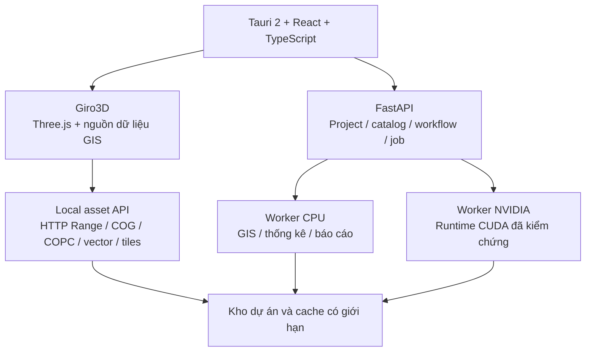

# Thay Cesium và thu hẹp hỗ trợ GPU cho GeoAI Desktop

Ngày đánh giá: **08/11/2026**. Trạng thái: **đề xuất lựa chọn công nghệ; chưa benchmark hoặc build thử sản phẩm**.

Tài liệu liên quan: [Kiến trúc GeoAI hiện tại](de_xuat_kien_truc_he_thong_geoai.md).

Yêu cầu mới: có thể giảm hỗ trợ GPU AMD; ưu tiên **GIS 2D/3D, terrain, LiDAR và bộ cài gọn**. Windows desktop và worker xử lý cục bộ vẫn là hướng chính.

## 1. Khuyến nghị

**Ưu tiên đánh giá Giro3D để thay CesiumJS, giữ Tauri + React + TypeScript và backend Python. Thu hẹp tăng tốc AI về CPU và NVIDIA.**

Giro3D phù hợp vì có sẵn cơ chế hiển thị raster độ cao, COG, point cloud COPC/LAS/LAZ, vector và 3D Tiles. Nó dùng Three.js và tích hợp nguồn dữ liệu OpenLayers; không cần tự ghép một engine GIS từ Three.js thuần. Tài liệu chính thức cung cấp ví dụ DEM, COPC, vector tương tác, đường đồng mức, clipping và đo/vẽ hình học. [S1–S3]

Đây là lựa chọn theo độ phù hợp với bài toán, không phải kết luận Giro3D có FPS cao hơn hoặc bộ cài nhỏ hơn Cesium. Các số liệu đó phải đo trên cùng fixture và bản build Windows.

**Phương án thứ hai là iTowns.** Nếu Giro3D không đạt tiêu chí hiển thị/tương tác, so sánh iTowns trên cùng dữ liệu trước khi chuyển sang một stack native khác. **osgEarth** là phương án native đáng cân nhắc khi mức kiểm soát renderer quan trọng hơn việc giữ UI và đơn giản hóa đóng gói.

## 2. Phạm vi GPU đề xuất

| Phần cứng | Hiển thị GIS/3D | AI trong phạm vi đầu tiên |
| --- | --- | --- |
| NVIDIA tương thích | GPU đồ họa qua WebView2/WebGL2 | CPU và một runtime CUDA đã kiểm chứng |
| AMD tương thích đồ họa | Vẫn dùng GPU để render khi driver/WebView2 hỗ trợ | CPU; hoãn runtime AI riêng cho AMD |
| Intel/iGPU tương thích | Render với ngân sách điểm, texture và LOD phù hợp | CPU |

**Giảm hỗ trợ AMD ở tầng AI không đồng nghĩa cấm máy AMD hoặc tắt tăng tốc đồ họa AMD.** Renderer và AI sử dụng hai cơ chế tăng tốc khác nhau.

Phân phối ban đầu có core CPU và compute pack NVIDIA tùy chọn. Với model xuất ONNX hợp lệ, đánh giá ONNX Runtime CPU/CUDA; model cần PyTorch giữ một đường PyTorch CUDA riêng đã kiểm chứng. Chốt một đường chính theo model được chọn, không đưa tất cả runtime vào bộ cài.

TensorRT là tối ưu tiếp theo khi benchmark chứng minh lợi ích sau khi tính cả compile/warm-up, bộ nhớ và chất lượng. Huấn luyện dùng môi trường phát triển riêng; không cài toàn bộ TorchGeo/TerraTorch vào máy người dùng chỉ để suy luận.

Hoãn AMD ROCm, MIGraphX, Windows ML/DirectML cho AI khỏi điều kiện phát hành đầu tiên. Giao diện `compute` vẫn cho phép bổ sung backend sau, nhưng chưa tạo pack, dependency và pipeline CI cho những nhánh chưa dùng.

## 3. So sánh các nền tảng thay thế

| Nền tảng | Điểm phù hợp với GeoAI | Đánh đổi trong ứng dụng desktop | Đề xuất |
| --- | --- | --- | --- |
| **Giro3D + Tauri** | GIS 2D/2.5D/3D; COG độ cao; COPC/LAS/LAZ; vector, clipping, point-cloud styling; dùng lại React | Vẫn chạy qua WebView; cần đo vector dày/nhãn và VRAM; kiểm chứng bản đóng gói offline | **Ứng viên ưu tiên** |
| **iTowns + Tauri** | Globe và planar view; GIS raster/vector, MVT, 3D Tiles, point cloud; xây trên Three.js | Cần kiểm tra tính năng trong bản phát hành được khóa và hành vi của từng nguồn dữ liệu; vẫn qua WebView | **Ứng viên đối chứng trực tiếp** |
| **osgEarth + Qt/C++** | SDK bản đồ native; raster/vector/độ cao; nguồn local và online; dùng GDAL và OpenSceneGraph | Thay lớp giao diện hoặc thêm host native; C++/Qt/OSG và plugin native tăng việc build, tích hợp, phân phối | Chọn khi có nhu cầu native được chứng minh |
| **VTK/PyVista + Qt/PySide** | DEM/mesh, lát cắt, point cloud và visualization khoa học; thuận lợi khi hệ thống thiên về Python | Phải bổ sung nhiều chức năng GIS như catalog lớp, tile streaming, nhãn/cartography và CRS theo nghiệp vụ | Phù hợp một công cụ phân tích 3D chuyên dụng hơn là thay toàn bộ WebGIS |
| **ArcGIS Maps SDK for .NET** | GIS native Windows; bản đồ 2D, scene 3D và dữ liệu offline | Chuyển UI sang .NET; điều kiện license/deployment và hệ sinh thái dữ liệu cần đánh giá | Lựa chọn thương mại khi tổ chức đã dùng Esri |

Giro3D được công bố theo MIT; metadata npm tại thời điểm tra cứu là **2.0.6**. iTowns công bố lựa chọn CeCILL-B hoặc MIT; metadata npm là **2.46.0**. Tài liệu osgEarth **3.8.0** hiện công bố MIT; không nên áp dụng kết luận về license của phiên bản osgEarth cũ cho bản đang chọn. Dependency như Qt/OpenSceneGraph vẫn có license riêng. VTK dùng BSD-style license. [S2, S4–S8]

Đã kiểm tra nội dung tarball npm của hai phiên bản: Giro3D 2.0.6 có `GeoTIFFSource` và `COPCSource`; iTowns 2.46.0 có `CopcSource` nhưng không thấy `CogSource` trong gói phát hành này, dù `CogSource` xuất hiện trên nhánh phát triển. Vì vậy chưa coi API COG đó của iTowns là tính năng sẵn có trong bản 2.46.0. Đây là một lý do thực tế để thử Giro3D trước, không phải khẳng định iTowns không thể đọc COG bằng một đường tích hợp khác. [S2, S4, S5]

osgEarth có module tích hợp Cesium Native trong repository. Nếu mục tiêu là loại mọi dependency Cesium, phải kiểm tra tập module được bật, đặc biệt đường hiển thị 3D Tiles; không mặc định mọi cấu hình osgEarth đều độc lập hoàn toàn với Cesium. [S7]

Unreal/Unity không được ưu tiên cho yêu cầu bộ cài gọn và GIS phân tích. Chúng đáng xem xét khi mô phỏng, VR hoặc chất lượng hình ảnh kiểu game trở thành yêu cầu chính. Three.js/Babylon.js thuần cũng không phải thay thế đầy đủ cho một engine GIS có sẵn quản lý nguồn dữ liệu, tọa độ và LOD.

## 4. Giro3D có thể giảm phần việc nào?

| Dữ liệu | Luồng ưu tiên với Giro3D | Công việc vẫn phải thực hiện |
| --- | --- | --- |
| DEM/DSM/DTM dạng COG | Đọc qua nguồn GeoTIFF, gắn vào lớp elevation để tạo bề mặt địa hình | CRS, datum đứng, NoData, overview, resampling và giới hạn mesh/texture |
| Ảnh đa phổ/kết quả raster | COG trực tiếp cho trường hợp đã kiểm chứng; tile API cho style/biểu thức phức tạp | Chọn band, scale/offset, contrast, màu và mask theo sản phẩm |
| LiDAR COPC | Đọc các phần dữ liệu cần thiết, dùng LOD/ngân sách điểm | Kiểm tra CRS, phân loại, thuộc tính, giải nén và cache |
| LAS/LAZ rất lớn | Chuyển sang COPC ở worker để thuận lợi cho truy cập theo vùng | Giữ file nguồn, ghi provenance, quản lý dung lượng chuyển đổi |
| Vector | Nguồn vector, feature collection hoặc vector tiles theo quy mô | Style, nhãn, picking, cập nhật/chỉnh sửa và kiểm chứng hiệu năng |
| Mesh/công trình | glTF hoặc 3D Tiles khi cần phân cấp | Định vị, chiều cao, LOD và kiểm tra các extension thực sự hỗ trợ |

**DEM COG không bắt buộc đi qua bước sinh Quantized Mesh như luồng CesiumTerrainProvider đã đề xuất. COPC cũng không bắt buộc chuyển thành 3D Tiles chỉ để hiển thị point cloud.** Đây là hai cơ hội giảm code chuyển đổi và dữ liệu phái sinh cho GeoAI.

Tuy vậy, hỗ trợ đọc trực tiếp không có nghĩa mọi file đều hiển thị ngay với hiệu năng tốt. GeoTIFF chưa tối ưu có thể cần COG/overviews; LAS/LAZ thông thường có thể cần chuyển sang COPC. Bộ đọc JavaScript có giới hạn codec và định dạng khác GDAL. Các trường hợp không hỗ trợ sẽ được chuẩn hóa ở backend hoặc phục vụ qua tile API.

Không bắt buộc tải toàn bộ DEM hoặc đám mây điểm vào RAM/GPU. Đường đọc phải thực sự dùng HTTP Range, chọn overview/LOD và có cache giới hạn. Đo byte đọc, RAM, VRAM và thời gian tạo frame trên bản build để xác nhận hành vi này.

Giro3D có tích hợp nguồn OpenLayers nhưng điều đó không tự bảo đảm mọi công cụ biên tập, nhãn và cartography của OpenLayers đều có sẵn trong scene 3D. Chỉ bổ sung một view OpenLayers hoặc MapLibre khi fixture nghiệp vụ chứng minh cần; tránh chạy hai engine liên tục ngay từ đầu.

## 5. Kiến trúc ứng viên sau điều chỉnh

Thay engine không làm thay đổi `AssetRef`, `GridSpec`, `RunManifest`, feature workflow hay cơ chế báo cáo. Module viewer chịu trách nhiệm chuyển metadata/asset thành lớp hiển thị của engine mới. Dữ liệu state nghiệp vụ như AOI, layer ID, style, selection và kết quả đo phải tách khỏi instance Three.js/Giro3D.

Local asset API phục vụ file bằng asset ID đã đăng ký, hỗ trợ Range/206, Content-Length, ETag và cache policy phù hợp. Không truyền nguyên file lớn qua Tauri IPC hoặc JSON. Xác thực request theo cơ chế header/fetch hook mà phiên bản engine hỗ trợ; không đưa token vào URL theo mặc định.

Backend vẫn là nơi xử lý khoa học và tính toán số liệu báo cáo. Không dùng độ phân giải của mesh/texture đang hiển thị làm đầu vào mặc định để tính diện tích, độ cao hay thể tích chính thức.

## 6. Làm bộ cài gọn theo cách thực tế

Tauri giúp tận dụng WebView2 có sẵn trên máy. Giro3D/iTowns là thư viện JavaScript, không đòi hỏi chuyển sang một bộ runtime game engine. Tuy nhiên, đây vẫn là ứng dụng desktop có renderer web; không phải ứng dụng native toàn bộ.

Dung lượng tổng phải đo gồm **UI + Python/GDAL + công cụ báo cáo + WebView2 nếu phải kèm + CUDA runtime + model**. Chỉ so kích thước npm package hoặc file EXE của shell sẽ không phản ánh bộ cài thực tế.

Các quyết định giúp giảm dung lượng:

1. Core CPU hoạt động được trước khi tải pack AI; compute pack NVIDIA và trọng số được phân phối riêng.
2. Dùng một engine viewer mặc định; không kèm Cesium, Giro3D, iTowns và MapLibre cùng lúc chỉ để dự phòng.
3. Gói toàn bộ worker, WASM, decoder, font và shader cần thiết tại local để chạy offline; kiểm tra không còn URL CDN ngầm.
4. Chỉ đóng gói driver/codec và model nằm trong danh sách hỗ trợ; giữ cả thư mục native runtime cần thiết, không cắt DLL theo phỏng đoán.
5. Dùng profile Standard và Offline đã đề xuất; công bố dung lượng từng profile sau khi build, không hứa một con số MB khi chưa đo.

Trong gói Giro3D 2.0.6 đã kiểm tra, `sources/las/config.js` đặt đường mặc định của laz-perf tới CDN jsDelivr. Bộ cài offline phải kèm WASM tương ứng và cấu hình `setLazPerfPath` về tài nguyên local trước khi tạo source LAS/LAZ/COPC. Đây là yêu cầu đóng gói cụ thể, cần xác minh bằng phép thử ngắt mạng. [S11]

## 7. Thử nghiệm để chốt engine

Giai đoạn đầu chỉ cần một ứng dụng thử nghiệm nhỏ trên Windows WebView2, chạy lần lượt cùng fixture trên Giro3D và iTowns; dùng Cesium hiện tại làm đối chứng nếu đã có bản thử nghiệm. Không xây toàn bộ UI trước khi thử dữ liệu lớn.

| Fixture | Điều cần đo/kiểm tra |
| --- | --- |
| DEM COG có nhiều mức overview, NoData và CRS dự án | Cold/warm load, byte đọc, hình học mép, độ cao, FPS, RAM/VRAM |
| COPC từ LiDAR thật, lớn hơn ngân sách RAM cho phép tải toàn bộ | LOD, giải nén, màu/classification, clipping, picking, bộ nhớ sau khi đóng lớp |
| Vector thửa đất đại diện | Số feature/đỉnh trong viewport, style, nhãn, chọn đối tượng, lọc thuộc tính và thời gian tương tác |
| Các lớp kết hợp | DEM + imagery + vector + point cloud; mức dùng VRAM và khả năng giữ UI khi AI chạy |
| Máy sạch và mạng bị ngắt | WebView2, Python/runtime, decoder/WASM, đường dẫn tiếng Việt và dữ liệu local |

Mục tiêu tương tác ban đầu là frame time khoảng **33 ms hoặc thấp hơn cho scene nghiệm thu** (tương ứng 30 FPS), cùng ngân sách bộ nhớ và thời gian mở lớp được chốt theo máy/dữ liệu thực tế. Ghi phân vị frame time, không chỉ FPS trung bình. Kết quả cần kèm phiên bản WebView2, driver, số điểm/tam giác nhìn thấy và mức chi tiết.

Kiểm tra riêng độ chính xác: hiển thị đúng CRS, axis order, đơn vị và datum đứng; picking trên mesh LOD không thay thế lấy mẫu từ DEM nguồn. Kiểm tra giới hạn extent và sai số tọa độ khi dự án mở rộng từ một khu vực nhỏ sang cấp tỉnh hoặc nhiều vùng chiếu.

Chốt Giro3D nếu đạt các fixture này với ít mã tùy biến hơn và tổng chi phí phù hợp. Chọn iTowns nếu có lợi thế được đo rõ ràng trên workload thực tế. Chỉ chuyển sang osgEarth/native khi đường WebView không đáp ứng được yêu cầu đã định hoặc chi phí khắc phục lớn hơn chi phí đổi UI/build stack.

## 8. Nội dung cần cập nhật khi hợp nhất vào kiến trúc chính

Các thay đổi liên quan trực tiếp: mô tả UI/viewer và sơ đồ thực thi; bảng runtime; pipeline COG/COPC; thành phần bộ cài; fixture và điều kiện chuyển giai đoạn A; đường hỗ trợ CPU trên máy AMD. Giữ rõ trạng thái **engine được đề xuất** và **engine đã benchmark**, tránh biến kết quả tra cứu tài liệu thành cam kết hiệu năng.

Tài liệu này là phương án điều chỉnh để chọn công nghệ. Bản kiến trúc chính vẫn là bản đã review; việc đổi engine trong toàn bộ đặc tả cần áp dụng nhất quán sau khi chọn hướng triển khai.

## 9. Nguồn đã đối chiếu

- **[S1]** [Giro3D — tính năng và định dạng](https://giro3d.org/giro3d.html), [ví dụ chính thức](https://giro3d.org/latest/examples/), [API](https://giro3d.org/latest/apidoc/modules.html).
- **[S2]** [Metadata package Giro3D 2.0.6](https://registry.npmjs.org/@giro3d/giro3d/2.0.6): version, license, Three.js/OpenLayers và dependency đọc dữ liệu; đã kiểm tra tarball được chỉ định trong metadata.
- **[S3]** [Giro3D COPC example](https://giro3d.org/latest/examples/copc.html), [feature reprojection example](https://giro3d.org/latest/examples/feature-collection-reprojection.html).
- **[S4]** [iTowns repository và README](https://github.com/iTowns/itowns), [license](https://github.com/iTowns/itowns/blob/master/LICENSE.md), [metadata package 2.46.0](https://registry.npmjs.org/itowns/2.46.0); đã kiểm tra tarball được chỉ định trong metadata.
- **[S5]** [iTowns CogSource trong nhánh phát triển](https://github.com/iTowns/itowns/blob/master/packages/Main/src/Source/CogSource.ts), [CopcSource](https://github.com/iTowns/itowns/blob/master/packages/Main/src/Source/CopcSource.ts). Tính năng ở nhánh phát triển phải được đối chiếu với bản phát hành chọn cho sản phẩm.
- **[S6]** [osgEarth — tài liệu](https://docs.osgearth.org/en/latest/), [tích hợp Qt](https://docs.osgearth.org/en/latest/faq.html), [license hiện tại](https://docs.osgearth.org/en/latest/license.html).
- **[S7]** [osgEarth — module osgEarthCesium](https://github.com/gwaldron/osgearth/tree/master/src/osgEarthCesium).
- **[S8]** [VTK — chức năng và license](https://vtk.org/about/).
- **[S9]** [ArcGIS Maps SDK for .NET — tài liệu chính thức](https://developers.arcgis.com/net/).
- **[S10]** [Tauri — Windows installer và WebView2](https://v2.tauri.app/distribute/windows-installer/).
- **[S11]** [Mã cấu hình LAZ trong gói Giro3D 2.0.6](https://unpkg.com/@giro3d/giro3d@2.0.6/sources/las/config.js); nội dung được đối chiếu từ tarball npm.
